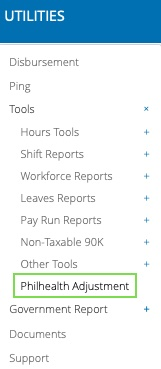

# how to handle retroactive PHIC adjustments?

for retroactive adjustments required under PhilHealth Circular No. 2020-0005 you may use the PhilHealth adjustment facility in ashima allowing you to handle the amortization of the 1% differential payments from your employees until these are fully paid under the timeframe prescribed.&#x20;

depending on your agreement with your employees you may do a lump sum deduction or offer a staggered deduction of the 1% differential payments or remittances for the remaining period of the calendar year, which is August to December 2022.

the Philhealth adjustment function allows you to enter the employee ID, the amount and a specific payroll target date of deduction on a template that you can then upload to ashima for payroll inclusion.

#### step 1: login to your admin account and on the navigation bar go to UTILITIES > PhilHealth Adjustment

#### step 2: download and complete the PHIC amortization template&#x20;

download the amortization template.\
\
to complete the template make sure to provide the following:

1. employee ID
2. target payroll date  - since the payrolls for the affected periods (January to May 2022) had already been disbursed to the employees, the 1% differential payments or remittances can only be deducted prospectively in the coming payroll periods.
3. amount to be deducted  - if you choose to deduct the retroactive remittances lump sum (one time) you enter the employee, the target payroll date and the amount to be deducted once on the template upload file. \
   \
   however if you want to stagger the PHIC adjustment deduction enter the amortized schedule of the employee item by item assigning the correct amount to a specific date.


Note: There is no delete option for the PHIC adjustment upload so make sure to review the template for accuracy and correctness before uploading.\
\
However,  if you need to correct/change what has been uploaded (i.e change the amount to be deducted)  you can re-upload the template with the corrections and it will overwrite the previous data entered. 


#### step 3: upload the completed template.

to confirm the upload you should see a list of the PHIC adjustment  on this page

#### step 4: check the pay run details

on the pay run details the adjustment will be displayed under DEDUCTIONS / LOANS / Philhealth Adjustment

## What are the tax implications of the additional remittances deducted from the salary?

to correctly calculate the employees' total tax due for the year and the amount of the tax to be withheld from the payroll at year end, the additional remittances deducted from the salary (uploaded as adjustments under PHIC amortization template) will reduce the employees taxable income and the withholding tax on compensation in the current payroll process.


Generating the Statement of Premium Account (SPA) for the paid periods, adding the PHIC remittances/adjustments that need to be deducted and ensuring that the correct tax due at year-end is reported is the responsibility of the employer. employers are obliged to conduct such additional administrative activities for payroll tax compliance purposes.


\
 
