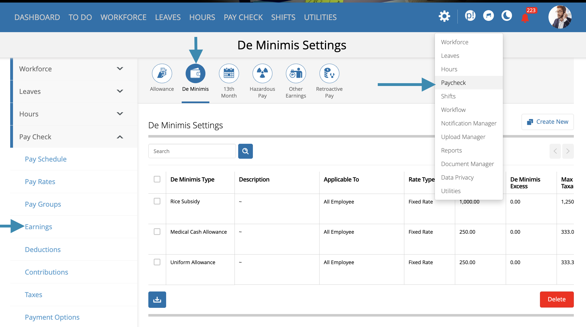
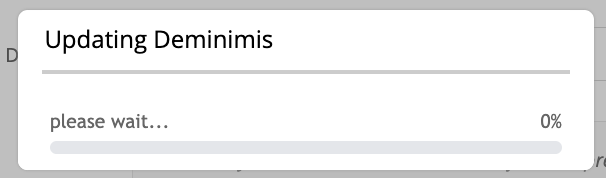
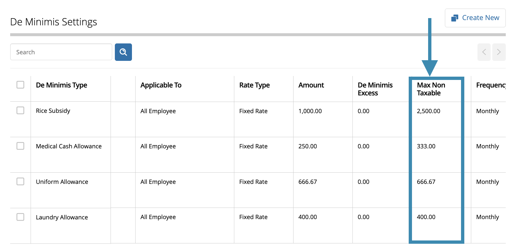
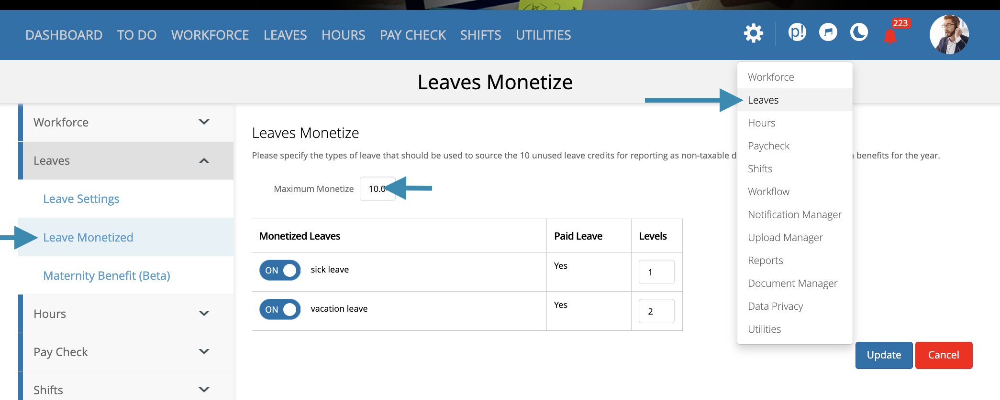
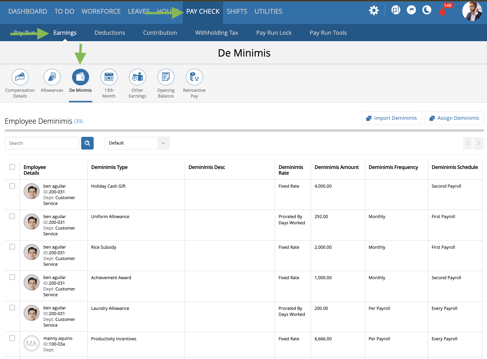
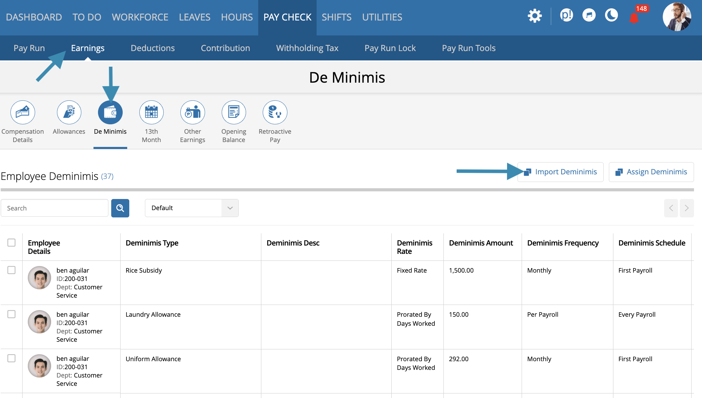
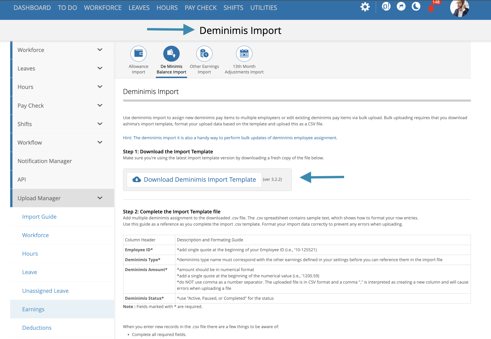

# De minimis

#### deminimis non taxable thresholds: what's changing?

ashima now supports **higher maximum non taxable threshold** for deminimis benefits. to take full advantage of these new thresholds, you **must update your deminimis configurations in ashima**.

with this change, you can now assign deminimis benefit types with **higher non taxable thresholds or caps**, allowing your existing benefits to fall within the new, higher tax exempt limits.

**important:** even if you **do not plan to increase the deminimis amounts assigned to employees**, you still need to edit your settings so the higher cap is applied for future use.\
\
If you **wish to increase the allowance amounts for employees**, you must also update the employee assignments.

Use **De Minimis** to review company de minimis items and maintain employee assignments.

**Navigation:** Go to **Paycheck → De Minimis**. Company item definitions are maintained under **Settings → Paycheck**.

### what is the difference between an item and an employee assignment?

* A **company item** defines the name, applicable classification, limits, and available behavior.
* An **employee assignment** selects that item for an employee. It records the supported employee amount, dates, or schedule.

Creating a company item does not automatically assign it to every employee.

### before you begin

Confirm the following before creating, updating, or removing an assignment:

* The correct company item and its current tax and payroll meaning.
* Whether the employee already has the same or a related assignment.
* The supported amount, effective date, and schedule.
* Whether an open payroll already uses the assignment.


Do not repurpose an item used in historical payroll when its business or tax meaning changes. Create a new item and stop new use of the old item when the page supports that approach.



**important:**\
the higher non taxable thresholds for deminimis will **not be applied automatically**. you must **update your deminimis settings** for the new caps to take effect.

if you also wish to **change the amounts assigned to employees**, you will need to **update the deminimis assignments**. this step though is only required if you are increasing or adjusting employee deminis amounts.


#### summary of updated deminimis non taxable thresholds

the amounts below reflect the new maximum non taxable thresholds now available in ashima. **if any of these changes apply to your company and you wish to use the higher limits, you must update your settings and reassign the corresponding deminimis types for them to take effect.** 

* **rice subsidy**\
  from 2,000 to **2,500 per month**
* **laundry allowance**\
  from 300 to **400 per month**
* **medical cash allowance**\
  from 250 to **333 per month**
* **uniform allowance**\
  from 7,000 to **8,000 per year**
* **medical assistance**\
  from 10,000 to **12,000 per year**
* **achievement award**\
  from 10,000 to **12,000 per year**
* **gifts**\
  from 5,000 to **6,000 per year**
* **monetized unused vacation leave credits**\
  from 10 days to **12 days**

### how to apply higher deminimis threshold

#### <mark style="color:$primary;">step 1: update the deminimis type settings</mark>

\
in ashima, most deminimis types, such as **rice subsidy, uniform allowance, holiday cash gift**, and others, can be managed under **deminimis settings**.\
\
to apply the higher non taxable caps, you need to update each of your existing deminimis type settings.

<figure><figcaption></figcaption></figure>

1. go to **settings > paycheck > earnings > deminimis**.
2. open a deminimis type.
3. click **edit and save**

<figure><figcaption></figcaption></figure>

after clicking **edit**, the system will display a notice that it is checking for updates to the selected deminimis type. Allow the check to complete, then click **save** to apply the updated deminimis max cap.\
\
once saved, the system will automatically update the **max non taxable cap** based on the new thresholds.\
\
you do **not** need to manually enter or change the cap amount.


**important**\
this is the **only required action**, even if the deminimis amounts assigned to employees remain unchanged


**example**\
\
if you want to apply the higher threshold for a **Rice Subsidy**, increasing the cap from **2,000 to 2,500**:

* open your existing **Rice Subsidy** deminimis type
* click **Edit** and review the notice that the deminimis is being updated
* click **Save** to finalize the update

saving the record will automatically update the max non taxable cap for that deminimis type. 

<figure><figcaption></figcaption></figure>


you must complete the same steps for **all your active deminimis types** to ensure that the updated max non taxable caps are applied to each one.


#### **how to verify the update:**

to confirm that your deminimis maximum non taxable limits have been updated to the higher threshold, check the **“Max Non-Taxable”** column for all deminimis types in your settings.\
\
if this column reflects the higher cap, then your deminimis settings have been updated correctly.

<figure><figcaption></figcaption></figure>


**important:**\
please **DO NOT create a new deminimis type**. update the existing deminimis type entry on your settings so that all your previous rules and configurations remain unchanged—only the threshold will be updated.


#### <mark style="color:blue;">**step 2: update monetized unused leaves**</mark>

in ashima most deminimis types, i.e rice subsidy, uniform allowance, etc. are managed under deminimis settings.\
\
however, the **monetized unused leave conversion** deminimis type is configured differently. Its settings are located under l**eave settings**, so any updates to the monetized leave deminimis must be done there.\
\
if you use **monetization of unused leaves as deminimis and you wish to update and move up the threshold**, go to:

**settings > leaves > leaves monetized**, and update the maximum monetized leave credits to match the new threshold.

<figure><figcaption></figcaption></figure>

save updates to monetized leave settings, if any.\
\
for the **Leave Conversion Monetization** deminimis type, this is also an opportune time to **review your leave conversion configuration** — not just the number of unused leave days that will be converted as non taxable deminimis, but also **which leave types are included** and the **priority levels** (for example, converting Vacation Leave first before Sick Leave).

###

### how do i assign a de minimis item?

1. Open the De Minimis list or the employee's de minimis details.
2. Search for and select the employee.
3. Select the correct de minimis item.
4. Enter the supported amount, dates, or schedule.
5. Review the item and employee values.
6. Save the assignment.
7. Review the next affected payroll. Recalculate an open payroll when required.

### how do i update or remove an assignment?

Open the employee's de minimis details. Select the supported **Edit** or **Remove** action.

Before saving, check whether an open payroll already includes the item. Removing an assignment stops the employee's applicable use according to its dates and payroll state. It does not rewrite completed historical payroll.

### what should i review after saving?

Review the following:

* The employee and selected item.
* The amount and effective dates.
* Payroll and tax treatment.
* Open-payroll recalculation.
* The resulting payslip and payroll report, where applicable.

### optional: update employee deminis amounts

if you wish to **increase the deminimis amounts assigned to employees**, you can update the employee assignments using the **deminimis bulk upload file**.\
\
this step is **only necessary** if you plan to change employee deminimis amounts.


**important:**\
you should **first complete the updates to your deminimis settings** as described in the previous section.\
\
the higher caps must be applied before updating employee assignments.


#### steps to update employee amounts

you can update employee deminimis amounts **individually** or **in bulk**. 

**Step 1: access the deminimis module assignment table**

<figure><figcaption></figcaption></figure>

1. navigate to **paycheck > earnings > deminimis** in the main menu.
2. this page displays the **deminimis assignment table**, showing all deminimis types currently assigned to your employees.

from here, you can choose to update assignments **per employee** or **in bulk**.

#### Step 2a: Update Per Employee

_Use this option if you want to update the deminimis amount for a single employee or a small number of employees._ 

1. Use the **search bar** to locate the employee whose deminimis you want to update.
2. A list of deminimis types assigned to that employee will be displayed.

<figure><figcaption></figcaption></figure>

3. Click anywhere on the row so you can dirll down to the selected employees assigned deminis types. 

<figure><figcaption></figcaption></figure>

3. Click again on the sepcific type of deminis you wish to edit so you can drill down to the **deminimis type details** page. Update the **Amount** field with the new value you wish to assign to the employee. 

<figure><figcaption></figcaption></figure>

3. Click **Save**.
4. Repeat these steps for any other deminimis types or employees you want to update individually.

_Use this option if you want to update the deminimis amount for a single employee or a small number of employees._

#### Step 2b: Update in Bulk

_Use this option if you want to update deminimis amounts for multiple employees at once._

1. From the **Deminimis Assignment Table**, click the **Download** button. You will see two options:

<figure><figcaption></figcaption></figure>

* **Download All** information – For reviewing full details before making changes.
* **Download Import Ready** File – Use this to update multiple employees at once.

2. Open the **Import Ready File**. It contains all employees and their assigned deminimis types in the correct upload format (employee ID, deminimis type, and new amount, and status.).
3. Update the **Amount** column for the employees and deminimis types you wish to change. Do not modify other fields.
4. Save the file.
5. upload the updated file back into ashima using the u**pload** option.

<figure><figcaption></figcaption></figure>

<figure><figcaption></figcaption></figure>

Once uploaded, the updated amounts will be applied to all selected employees.


**important:**\
if you want to **keep your existing deminimis amount assignments** for employees and are not increasing any amounts, there is **no need to perform this step**. 


### downloads and imports

Use the available list download to review assignments. Use an import-ready file only with its matching current import workflow and template.

Confirm row results before relying on a bulk change. Do not modify fields outside the supported import values.

### related articles

* [Earnings and de minimis items](../../settings/payroll-settings/earnings-and-de-minimis-items.md)
* [Compensation details](../../workforce/employee-record/compensation-details.md)
* [Employee pay details](../run-payroll/employee-pay-details.md)
* [Payroll register](../../reports/payroll-and-accounting/payroll-register.md)

 

if you need assistance with the update or would like us to guide you through the process, feel free to reach out to ashima support on teams.
