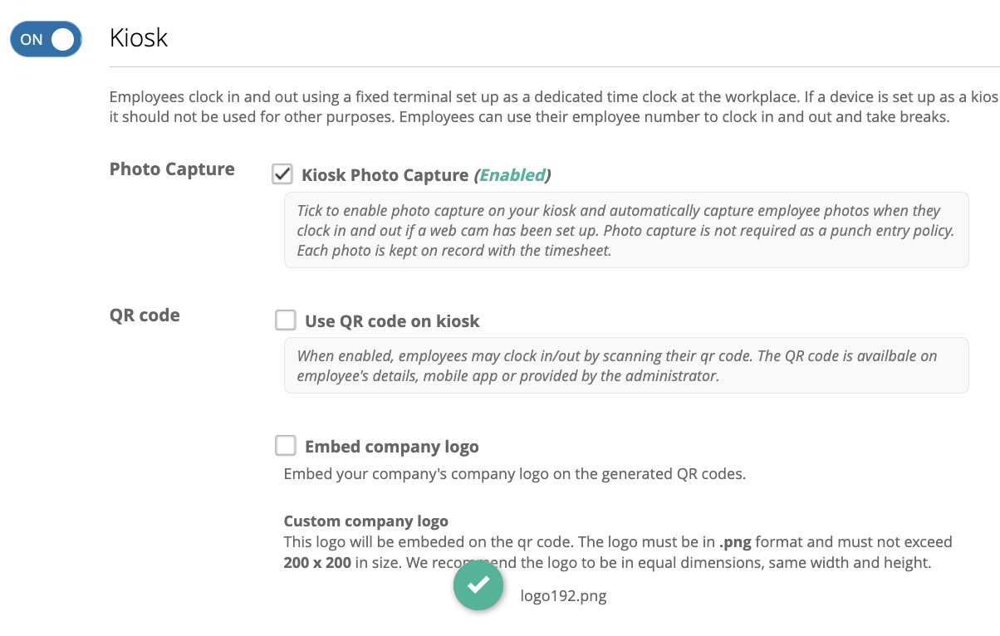

# how do I set up a timekeeping kiosk?

a kiosk is a fixed terminal designated as a dedicated time clock at the workplace. employees use it to clock in, clock out, and log breaks.

to enable kiosk clock in turn ON the settings under **settings > hours > time entry > kiosk**

<figure><figcaption></figcaption></figure>

the kiosk uses employee ID entry as the standard login method. You may choose to enhance security or streamline access by turning on additional features:

* **Photo Capture (optional):** Adds a second verification step after the employee enters their ID.
* **QR Code (optional):** Allows employees to scan their QR code instead of typing their employee ID.

when you set up a device as a kiosk, it should be reserved exclusively for timekeeping and not used for other purposes. 


Important: A kiosk should be reserved exclusively for timekeeping and not used for other purposes. 


### what are the steps to set up a kiosk?

1. **log in to the admin portal**\
   Go to **settings** > **hours** > **timekeeping entry** and enable the Kiosk time entry setting
2. **coordinate with ashima support**&#x20;
   * contact ashima support with the details of the device you want to dedicate as a kiosk.
   * our team will assist in configuring  the device so it functions as a time entry terminal.
3. **configure kiosk features**\
   \
   by default, employees log in to the kiosk using their **employee ID**. You can enhance or simplify this process with additional features: 
   * **Photo Capture (optional):**
     * Tick to enable photo capture.
     * A webcam must be connected to the kiosk device for this feature to work.
     * Photos are automatically captured when employees clock in and out.
     * Each photo is stored with the timesheet entry for up to **3 months**, giving admins enough time to review records against  payroll.
   * **QR Code Login (optional):**
     * Tick to allow employees to clock in/out by scanning their QR code.
     * QR codes are available via the employee profile, the mobile app, or can be distributed by an administrator.
   * **Company Logo (optional):**
     * Upload your company logo to embed it on generated QR codes.
     * Requirements: PNG format, max size 200 x 200 pixels (equal width and height recommended).
4. **Save and Activate**\
   After setup is complete, save your settings to activate the kiosk. Employees will now see the kiosk as an available time entry method.
