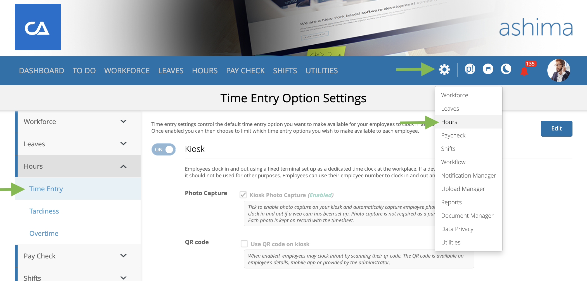

# how do I set up time entry options?

you can manage time entry preferences from the **admin portal** under:\
s**ettings** → **hours** → **time entry**&#x20;

<figure><figcaption></figcaption></figure>

ashima supports three time entry methods:

* **desktop (employee portal)** – employees log in via the web portal to record hours.
* **kiosk** – a shared device or terminal used as a central punch station.
* **mobile** – employees log time directly from the ashima timekeeping mobile app.

### how do I enable or disable options?

* Each time entry method has an ON/OFF toggle.

<figure><figcaption></figcaption></figure>

* Turning a method **ON** makes it available for employees.
* Turning it **OFF** removes it from their options.

**Example:** To limit all employees to kiosk-only, switch OFF both **desktop** and **mobile**.

any methods you enable will immediately be displayed in the employee portal for clocking in and out. disabled methods will no longer appear.

### what’s the best way to decide which options to use?

* **choose kiosk-only** if you want all employees clocking in at a central location.
* **enable mobile** if your workforce is often remote or on the move.
* **allow multiple options** if you want flexibility across different work environments


Enabling a method at the global level makes it visible for all employees. If you don’t want them to use it, keep it switched OFF to avoid confusion.

