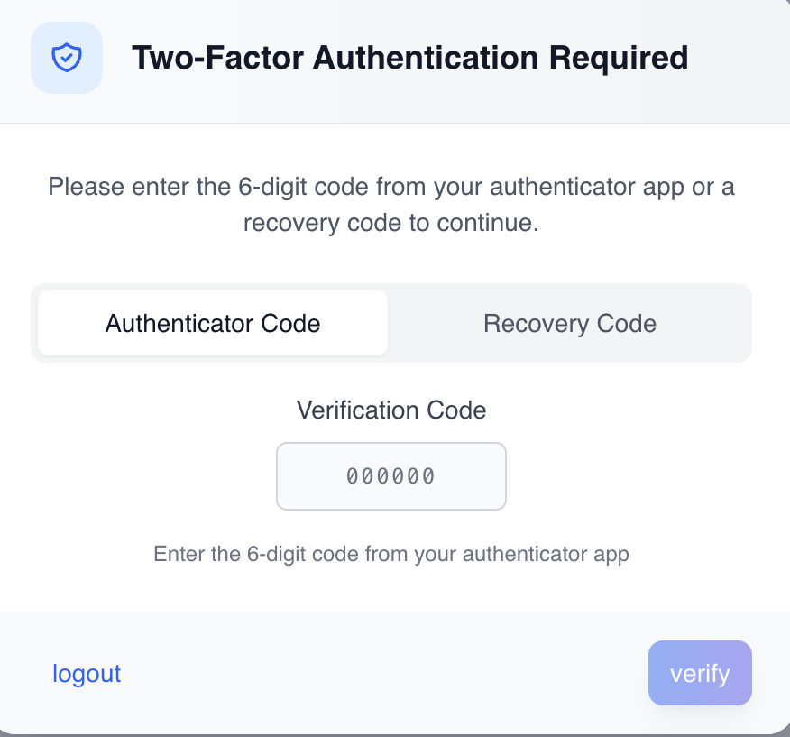

# Two-factor authentication (2FA)

use this guide to manage company-level employee 2fa in ashima. this includes turning the feature on, making it mandatory for selected employees, reviewing who has completed setup, and resetting 2fa for employees who are fully locked out.

the main workflow is:

1. turn on **Two-Factor Authentication Feature** so employees can set up 2fa.
2. review or update **Employee Enforcement** if 2fa should be required.
3. use **Employee 2fa Status** to review setup status and reset 2fa when needed.

### **what is two-factor authentication (2fa)?**

two-factor authentication adds an extra layer of security by requiring two verification steps during login. even if someone knows a user’s password, they cannot access the account without the authentication code from the user’s device.

ashima uses app-based 2fa, which allows employees to use **any trusted authenticator app they already use or prefer**, such as google authenticator, microsoft authenticator, or other compatible authenticator tools.

these apps generate 6-digit rotating codes that refresh every 30–60 seconds.

***

## enable 2fa

### **what does it mean to “enable 2fa” for the company?**

<figure><figcaption></figcaption></figure>

\
enabling 2fa simply **turns on the feature** for your company.\
\
this means employees **can choose** to set up 2fa, but they are **not required** to do so.\
\
employees may set it up voluntarily inside their portal.

key points:

* employees decide on their own if they want to activate 2fa
* 2fa becomes available in each employee’s profile
* employees who enable 2fa can also disable it anytime
* no login restrictions are applied

think of enabling as _allowing_ or _making 2fa available_. 

### what are the main pages to manage your company's 2fa?

* **Security Settings** — use this page to turn employee 2fa on or off for the company and manage **Employee Enforcement**.
* **Employee 2fa Status** — use this page to review which employees have 2fa enabled and reset 2fa for an employee who cannot recover access on their own.

### before you begin: key 2fa terms

* **two-factor authentication feature** — makes 2FA available in the employee portal.
* **employee enforcement** — makes 2FA mandatory for employees in the selected scope.
* **2fa status** — shows whether an employee already has 2FA enabled.
* **recovery codes** — one-time backup codes employees can use if they lose access to their authenticator app.
* **reset 2fa** — clears the employee's current 2FA setup so they must set it up again on their next login.

## security settings

use this page when you want to control whether employees can use 2fa and whether they are required to use it.

**Navigation**\
**Settings** → **Workforce** → **Security**

<figure><figcaption></figcaption></figure>

the page has two main sections:

* **Two-Factor Authentication Feature** — the company-level availability switch
* **Employee Enforcement** — the mandatory-use section

the page also shows these actions:

* **view employee 2fa status**
* **edit**
* **save changes**
* **cancel**

### what does enabling 2FA mean for the company?

turning on **two-factor authentication feature** makes 2fa available to employees in their portal.

when the feature is on:

* employees can choose to set up 2fa
* employees who already use 2fa continue to log in with it
* no one is forced to use 2fa unless **employee enforcement** is also turned on

when the feature is off:

* employees cannot newly set up 2fa
* employee login challenges are bypassed
* employee enforcement is turned off

### how do I enable 2fa for employees?

1. open **security settings**.
2. click **edit**.
3. turn **two-factor authentication feature** on.
4. click **save changes**.

<figure><figcaption></figcaption></figure>

### what happens after I enable the feature?

employees can set up 2fa in their employee portal. Setting up 2fa is still optional unless you also turn on **employee enforcement**.\
\
once 2fa is enabled for your company, employees will have the ability to set up 2FA on their ashima employee portal - [(setting up 2FA on your employee portal)](https://app.gitbook.com/s/X9DtH3OfZcuRNq2dT0xK/employee-portal/overview/setting-up-two-factor-authentication-2fa)

***

## enforcing 2fa

### what does employee enforcement mean?

use **employee enforcement** when 2fa should be required, not just available.

when enforcement is on:

* employees in the selected scope must keep 2fa enabled
* employees who have not set up 2fa are prompted to complete setup during login
* employees already using 2fa continue with normal 2fa login

turning on the feature alone does not force setup. Enforcement is the setting that makes 2FA mandatory.

### how do I enforce 2fa?

<figure><figcaption></figcaption></figure>

<figure><figcaption></figcaption></figure>

1. open **Security Settings**.
2. click **edit**.
3. make sure **two-factor authentication feature** is on.
4. turn **employee enforcement** on.
5. choose the enforcement scope: **all employees**, **selected employees**, **selected departments**, or **selected payroll groups**.

<figure><figcaption></figcaption></figure>

6. if needed, pick the employees, departments, or payroll groups that should be included.
7. click **save changes**.

#### fields

* **two-factor authentication feature** — turns employee 2fa availability on or off for the company.
* **employee enforcement** — makes 2fa mandatory for the selected scope.
* **all employees** — requires every employee in the company to use 2fa.
* **selected employees** — requires only selected employees to use 2fa.
* **selected departments** — requires employees in selected departments to use 2fa.
* **selected payroll groups** — requires employees in selected payroll groups to use 2fa.

### **what does enforcing 2fa mean?**

enforcing 2fa means 2fa becomes **required** for all or selected employees.\
they **cannot access** their ashima account until they complete the 2FA setup.

key points:

* employees are forced to set up 2fa during login
* they cannot turn off 2fa once enforcement is active
* admins can enforce for all employees or select groups
* removing enforcement does not disable 2fa for users who already set it up

think of enforcing as _requiring_ or _making 2fa mandatory_.

### what happens after enforcement is turned on?

* employees who already enabled 2fa continue logging in with their password and 2fa code
* employees who have not enabled 2fa are prompted to complete setup before they can continue

<figure><figcaption></figcaption></figure>

### can I turn off enforcement later?

yes. you can turn off **Employee Enforcement** at any time.

1. Open **Security Settings**.
2. Click **edit**.
3. Turn **Employee Enforcement** off.
4. Click **save changes**.

### what happens after enforcement is turned off?

* employees who already enabled 2fa keep their existing 2FA setup
* employees who never set up 2fa are no longer required to configure it

ashima does not automatically notify employees when enforcement is turned off, so communicate that change separately if needed.

***

## employee 2fa status

use this page to review employee 2fa completion and support employees who can no longer recover access on their own.

**Navigation**\
**Settings** → **Workforce** → **Security** → **view employee 2fa status**

<figure><figcaption></figcaption></figure>

the page shows a table with:

* **Name**
* **Employee ID**
* **Department**
* **Payroll Group**
* **2fa Status**
* **Action**

the **2fa Status** column shows:

* **enabled** — the employee already has 2fa enabled
* **not set** — the employee has not enabled 2fa

<figure><figcaption></figcaption></figure>

### how do I filter or search this page?

you can narrow the list using:

* **search employees**
* **status**
* **department**
* **payroll group**

***

## Reset 2fa

### when should I reset an employee's 2fa?

Use **reset 2fa** only when the employee cannot recover access using normal self-service options.

typical examples:

* the employee no longer has access to their authenticator app
* the employee no longer has their recovery codes
* the employee cannot complete login and cannot recover access on their own


do not use reset as the first step if the employee can still log in with recovery codes or can still manage their own 2FA setup.


### how do I reset an employee's 2fa?

1. open **employee 2fa status**.
2. find the employee.
3. click **reset 2fa**.
4. review the confirmation message.
5. click **confirm reset**.

<figure><figcaption></figcaption></figure>

<figure><figcaption></figcaption></figure>

### what happens after I reset 2fa?

the reset clears the employee's current 2fa secret and recovery codes. the employee is prompted to set up 2fa again on their next login.

#### rules and warnings

* Reset 2fa only affects the selected employee.
* Reset 2fa removes the employee's existing 2fa setup.
* After reset, the employee must complete setup again before 2fa can be used on the account.

### what should administrators know about employee self-service recovery?

employees are expected to manage normal 2FA recovery through their own portal whenever possible.

that includes:

* entering a valid authenticator code
* using a recovery code during login
* regenerating recovery codes while they still have account access

admin reset is the fallback when self-service recovery is no longer possible.

***

## how to set up 2fa as an employee

Click on the link to view how your employees can set up their 2fa on their employee portal.

\- [(setting up 2FA on your employee portal)](https://app.gitbook.com/s/X9DtH3OfZcuRNq2dT0xK/employee-portal/overview/setting-up-two-factor-authentication-2fa)
