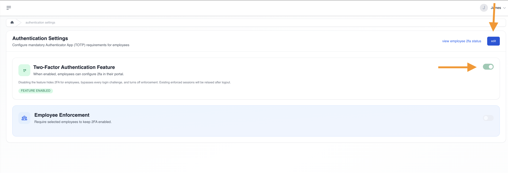
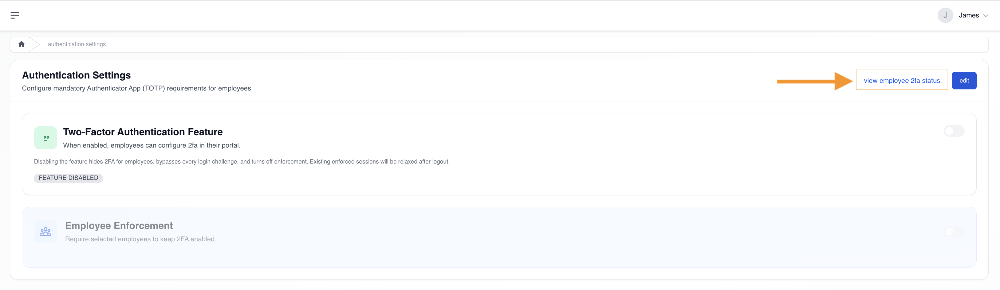

# Two-factor authentication (legacy reference)

### **what is two-factor authentication (2fa)?**

two-factor authentication adds an extra layer of security by requiring two verification steps during login. even if someone knows a user’s password, they cannot access the account without the authentication code from the user’s device.

ashima uses app-based 2fa, which allows employees to use **any trusted authenticator app they already use or prefer**, such as google authenticator, microsoft authenticator, or other compatible authenticator tools.

these apps generate 6-digit rotating codes that refresh every 30–60 seconds.

### **what does it mean to “enable 2fa” for the company?**

<figure><figcaption></figcaption></figure>

\
enabling 2fa simply **turns on the feature** for your company.\
\
this means employees **can choose** to set up 2fa, but they are **not required** to do so.\
\
employees may set it up voluntarily inside their portal.

key points:

* employees decide on their own if they want to activate 2fa
* 2fa becomes available in each employee’s profile
* employees who enable 2fa can also disable it anytime
* no login restrictions are applied

think of enabling as _allowing_ or _making 2fa available_.\
 

### **how does an admin enable 2fa?**

#### **step 1 — go to security settings**

<figure><figcaption></figcaption></figure>

1. log in as admin
2. go to **settings → workforce → security**
3. open the **two-factor authentication** section

#### **step 2 — turn on 2fa**

<figure><figcaption></figcaption></figure>

1. click **edit**
2. switch **two-factor authentication** on
3. save your changes 

once 2fa is enabled for your company, employees will have the ability to set up 2FA on their ashima employee portal - [(setting up 2FA on your employee portal)](https://app.gitbook.com/s/X9DtH3OfZcuRNq2dT0xK/employee-portal/overview/setting-up-two-factor-authentication-2fa)

### **how does admin view employees who enabled 2fa?**

<figure><figcaption></figcaption></figure>

within **security settings**, click **view 2fa status** to see who has 2fa enabled

### **can admin reset an employee’s 2fa?**

employees are generally expected to manage their own 2fa access through the available self-service options — including using recovery codes, switching to recovery mode during login, or regenerating recovery codes inside their portal. these are designed so employees do not easily get locked out of their accounts.

however, if an employee becomes **fully locked out** and no self-service recovery options are available — for example, they lost access to their phone, do not have their recovery codes, and cannot complete authentication — admin has the ability to perform a manual 2fa reset.

a reset clears the employee’s existing 2fa setup so they can reconfigure it from scratch. \
\
search for the employee on the list and click on reset and confirm action.

<figure><figcaption></figcaption></figure>

<figure><figcaption></figcaption></figure>

## **enforce 2fa (mandatory)**

<figure><figcaption></figcaption></figure>

### **what does enforcing 2fa mean?**

enforcing 2fa means 2fa becomes **required** for all or selected employees.\
they **cannot access** their ashima account until they complete the 2FA setup.

key points:

* employees are forced to set up 2fa during login
* they cannot turn off 2fa once enforcement is active
* admins can enforce for all employees or select groups
* removing enforcement does not disable 2fa for users who already set it up

think of enforcing as _requiring_ or _making 2fa mandatory_.

***

### **how does an admin enforce 2fa?**

#### **step 1 — open security settings**

go to security settings and enable "employee enforcement"\
**settings → workforce → security → two-factor authentication → dedit → employee enforcement ON**

<figure><figcaption></figcaption></figure>

#### **step 2 — choose who must use 2fa**

admins may enforce **2fa to ALL employees or only for selected employees?**

* all employees
* selected employees
* specific departments
* specific payroll groups

save changes.

***

### **what happens after enforcement is turned on?**

#### **employees who already set up 2fa on their employee portal:**

continue logging in using their username and password after which they will be asked to provide their 2FA code to continue.\
\

#### **employees who have not set up 2fa on their employee portal:**

they will be prompted to complete setup during login before proceeding. 

***

### **can admin disable mandatory 2fa after enabling it?**

yes.\
\
admin can turn off enforcement at any time. to turn off simply toggle the employee enforcement to "OFF"\
\
this removes the requirement to use 2fa — but it does **not** disable 2fa for users who already enabled it voluntarily.

<figure><figcaption></figcaption></figure>

1. log in as admin
2. go to **settings → workforce → security**
3. open **two-factor authentication**
4. click **edit**
5. turn off  employee enforcement save

***

### **what happens to employees after enforcement is disabled?**

#### **employees who already enabled 2fa:**

their 2fa remains active; they may turn it off manually if desired.

#### **employees who never set up 2fa:**

they are no longer required to configure it and may continue using ashima without 2fa.

***

### **are employees notified automatically when enforcement is disabled?**

no.\
\
ashima does not send an automated notification.

admins may choose to communicate this change internally.

***

### **can admin re-enable enforcement later?**

yes.\
\
when re-enabled:

* employees with existing 2fa continue normally
* employees without 2fa will again be required to set it up 

 
