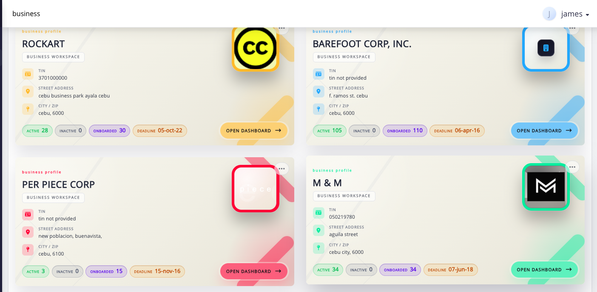

# choose and manage a business

use **Business** to choose the intended company's dashboard or use the available company-management controls.

**navigation:** **Control Center → Business**

## choose the company

review the company cards and open the intended dashboard link. an ordinary administrator's company list follows the companies included in that administrator's access arrangement; it may differ from an owner or designated administrator's list.

<figure><figcaption>
Each company card shows its employee counts and opens that company's dashboard.
</figcaption></figure>

if a company is missing, review the administrator's company selection rather than assuming the company does not exist.

## create a business when available

the create control is shown for owners and designated administrators. enter the required company name, address, city, and postal code, and satisfy the TIN and other form validations. save through the available control and check validation or success feedback.

## check before deleting

the delete control is shown for the owner.

> **warning:** verify the exact business and review any association restriction. do not use deletion as a promise that every historical record will be erased or recoverable.

review all warnings and confirm the exact business before deleting it. after deletion, return to the business list and confirm that the intended company is no longer active.

***
