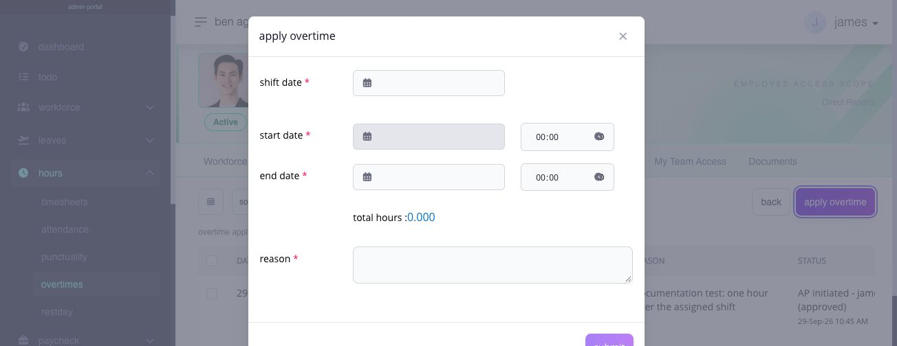

# review and maintain overtime

## review and maintain overtime

use overtime history to review filed overtime records, their work-schedule context, and their current approval status.

**Navigation:**\
go to **Hours → Overtimes**.

### what does this page display?

the page lists overtime records by employee and date submitted. each row includes the overtime period, number of hours, work schedule, reason, status, and remarks. select an employee row to open that employee's overtime applications.

captured hours are not automatically payable overtime. the system also checks the assigned shift, overtime settings, employee entitlement, and approval workflow.

### how do i review overtime history?

1. select the date or date range using the calendar control.
2. search for the employee or apply the work schedule, department, or position filters.
3. review the overtime period and number of hours.
4. compare the overtime period with the linked work schedule.
5. review the reason, status, and remarks.
6. select the employee row when you need the employee-level application history or the **Apply Overtime** action.

on the employee detail page, review each application's approval state and whether its selection box is available before attempting a removal.

### where is overtime submitted and approved?

1. select the employee row from **Overtime History**.
2. select **Apply Overtime**.
3. enter the required **Shift Date**, **Start Date** and time, **End Date** and time, and **Reason**.
4. review the calculated total hours.
5. select **Submit**.

overtime submitted through the admin or manager **Apply Overtime** action is filed and auto-approved through the final configured level. employee-filed overtime follows the configured approval workflow. Paycheck uses approved overtime according to payroll rules. if CTO conversion is enabled and the same source work is converted to CTO, it must not also be paid as overtime.

<figure><figcaption>
Check the shift date and overtime period together. Total hours updates from the dates and times before you submit.
</figcaption></figure>

### when can i remove an overtime application?

open the employee's overtime history and check whether the application has a selectable box. select an eligible application, then choose **Delete** and review the confirmation before committing the removal.

| application state                                                                                           | what to expect                                                                                     |
| ----------------------------------------------------------------------------------------------------------- | -------------------------------------------------------------------------------------------------- |
| active, approved, with a valid shift date and no linked post-payroll adjustment or closed-payroll inclusion | an authorized administrator can select it for deletion                                             |
| pending, rejected, locked, linked to a post-payroll adjustment, or already included in closed payroll       | deletion is unavailable; review its status or payroll link rather than trying to remove the record |

removing an eligible application changes the active overtime record. it does not rewrite a payslip already issued from a closed pay run. If you need to correct issued pay, follow the [post-payroll adjustment guide](../../paycheck/corrections-controls-and-ingestion/use-post-payroll-adjustments.md).

### how do i download overtime records?

apply the needed filters, open the download control, and select **Excel** or **CSV**.

the export is limited to 4,000 rows. narrow the date range when the requested export exceeds that limit.

### related articles

* [timesheet logs](../timesheets-and-attendance/timesheet-logs.md#page-045-pages-admin-hours-timesheet-logs-md)
* [rest day and holiday work](rest-day-and-holiday-work.md#page-051-pages-admin-hours-rest-day-and-holiday-work-md)
* [review overtime, rest day, and holiday requests](../../todo-workflow/request-specific-approvals/review-premium-work-requests.md)
