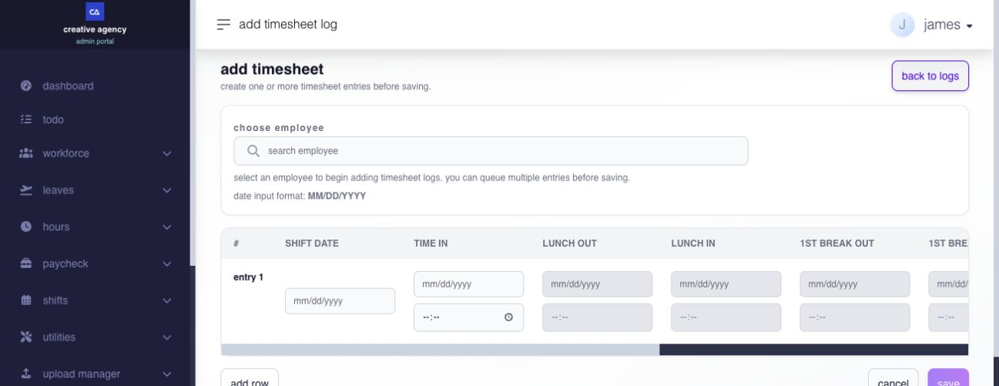

# add a timesheet

## add a timesheet

use Add Timesheet to create one or more missing time records for an employee from the Admin Portal.


**warning:** adding a timesheet changes attendance results and can affect an open payroll. confirm the employee, shift date, and punches before saving.


**Navigation:**\
go to **Hours → Timesheets**, then select **Add Timesheet**.

### what must be set up first?

the employee needs a valid work schedule for the shift date. the schedule determines which lunch and additional-break fields are available.

time-entry settings, access privileges, pending applications, and payroll state can also determine whether the date is open for direct entry or requires another correction process.

The employee must currently be active and within your permitted employee scope to receive a new manual timesheet. An inactive employee or an employee with **End of Employment** status cannot receive new timesheet logs through this action, even when the selected date is earlier. Review the employment record and use the appropriate correction process instead.

### fields

| field                  | use                                              |
| ---------------------- | ------------------------------------------------ |
| choose employee        | selects the employee who owns every queued row   |
| shift date             | identifies the work date and assigned schedule   |
| time in                | records the start of work                        |
| lunch out and lunch in | records lunch when the assigned shift tracks it  |
| 1st break out and in   | records the first additional break when enabled  |
| 2nd break out and in   | records the second additional break when enabled |
| time out               | records the end of work                          |

enter dates in `MM/DD/YYYY` format. only fields supported by the employee's assigned shift are available.

every punch date must fall within the inclusive day before through day after the selected shift date. this supports overnight or cross-date work but rejects dates outside that window.

### how do i add a timesheet?

1. open **Hours → Timesheets**.
2. select **Add Timesheet**.
3. search for and select the employee.
4. enter the **Shift Date**.
5. enter **Time In** and **Time Out**.
6. enter lunch and break punches when the assigned shift requires them.
7. select **Add Row** to queue another timesheet for the same employee.
8. review every row and select **Save**.

<figure><figcaption>
Select the employee and shift date first. The assigned shift determines which lunch and break fields are available; more punch columns extend to the right.
</figcaption></figure>

use **Remove** to discard a queued row before saving, or **Cancel** to return without saving.

### what happens after saving?

the records appear in Timesheet Logs and successful saves automatically invoke timesheet recalculation for the affected employee dates. after recalculation:

* confirm the employee, shift date, and source;
* review scheduled and actual hours;
* review tardiness, undertime, absence, and break results;
* confirm any overtime, rest-day, holiday, or leave relationship; and
* recalculate an affected open pay run when required.

### why is a break field unavailable?

the employee's assigned shift does not use that break field for the selected date. review the shift before changing the timesheet. do not add a punch merely to fill a blank field.

### when should i not add a direct timesheet?

do not create a second direct correction when a related employee adjustment or approval request is pending. a closed-payroll date also cannot be treated like an ordinary open attendance record; use the eligible post-payroll process when applicable.

### related articles

* [timesheet logs](timesheet-logs.md#page-045-pages-admin-hours-timesheet-logs-md)
* [edit or delete timesheets](edit-or-delete-timesheets.md#page-047-pages-admin-hours-edit-or-delete-timesheets-md)
* [time entry settings](../../settings/time-entry-hours-shifts-and-holidays/choose-employee-time-entry-options.md)
* [shift assignments](../../shifts/plan-and-assign-shifts/assign-shifts.md#page-034-pages-admin-shifts-assign-shifts-md)
* [post-payroll adjustments](../../paycheck/corrections-controls-and-ingestion/use-post-payroll-adjustments.md)
