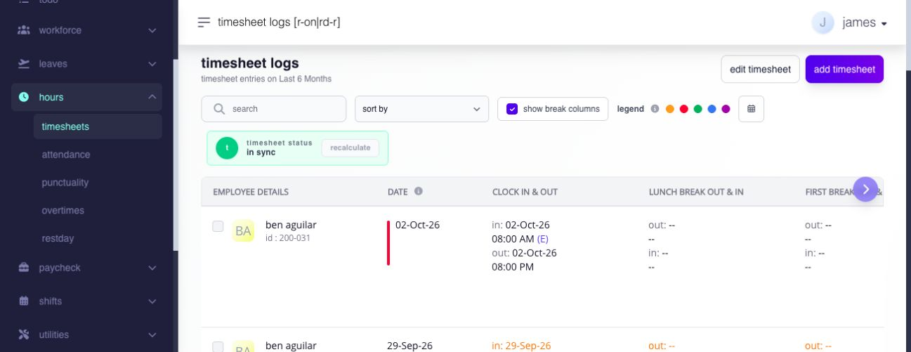
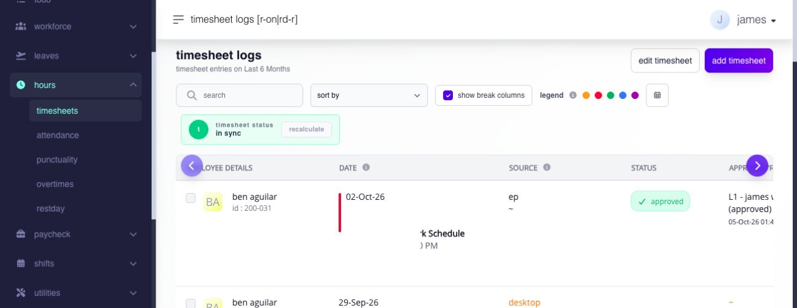

# review and interpret timesheet logs

## review and interpret timesheet logs

use Timesheet Logs to review how employee time entries were interpreted against the assigned shift, identify attendance issues, recalculate changed records, and download the records included in your review.

**Navigation:**\
go to **Hours → Timesheets**.

### how does Ashima create a timesheet?

Ashima captures time logs, but the logs alone do not determine the attendance result. the employee's assigned shift provides the context for each work date.

Ashima compares the captured logs with the shift to determine:

* which work date the logs belong to;
* which punches are expected;
* scheduled and actual hours;
* late, overbreak, and total tardiness;
* undertime and absence;
* whether a required punch is missing;
* whether an additional entry should be treated as an excess log; and
* whether the date is a rest day or holiday.


**note:** when a timesheet looks incorrect, review the assigned shift and the captured logs together. correcting punches alone may not fix a result caused by an incorrect shift assignment.


### what punches does a shift require?

the expected punches depend on the shift settings for that work date.

* a shift without tracked breaks normally expects **Clock In** and **Clock Out**.
* a shift with a tracked lunch normally expects **Clock In**, **Lunch Out**, **Lunch In**, and **Clock Out**.
* a shift with tracked additional breaks also expects the applicable break-out and break-in punches.

if an expected punch is missing, the row can require correction. ideally, the employee submits a timesheet adjustment. an authorized admin can also correct the record when appropriate.

if Ashima cannot match a captured entry to the assigned shift's recognized punch sequence or work period, the entry can appear as an **excess log**. it remains visible for traceability but is excluded from actual, regular, and payable hours. do not edit an excess row in an attempt to make it payable. correct the assigned shift, normal timesheet row, or applicable work application that caused the mismatch, then recalculate the timesheet when required.

### what do the attendance terms mean?

| term            | simple meaning                                                                       | what to review                                                                    |
| --------------- | ------------------------------------------------------------------------------------ | --------------------------------------------------------------------------------- |
| late            | time recognized after the expected shift start                                       | assigned shift, actual clock-in, and attendance rules                             |
| overbreak       | break time beyond the duration allowed by the shift                                  | break-out and break-in punches and configured break duration                      |
| total tardiness | total tardiness recognized for the day, which can include late and overbreak minutes | detailed late and overbreak values                                                |
| undertime       | scheduled work time not completed before the expected shift end                      | actual clock-out, assigned shift, and approved leave                              |
| absent          | scheduled time with no recognized work or applicable leave coverage                  | schedule, timesheet, and approved leave                                           |
| missing punch   | one or more punches required by the shift are incomplete                             | clock-in, clock-out, lunch, and other tracked breaks                              |
| excess log      | a captured entry that is not recognized as an actual log for the matched shift       | assigned shift, normal timesheet row, required application, and unmatched punches |

approved leave can offset tardiness or undertime when it covers the affected part of the shift. review the attendance result together with the employee's leave records.

### anatomy of a timesheet

review the fields together rather than reading a punch, color, or total on its own.

| part                         | what it tells you                                                 | what to watch for                                                |
| ---------------------------- | ----------------------------------------------------------------- | ---------------------------------------------------------------- |
| employee and shift date      | identifies the employee and work date                             | overnight work and the correct employee/date                     |
| clock in and clock out       | shows the main work punches                                       | a missing clock-out can flag a row even when clock-in exists     |
| lunch and additional breaks  | shows break punches required by the shift                         | a blank field matters only when the break is enabled and tracked |
| actual and scheduled hours   | compares recognized work with the schedule                        | missing punches, breaks, leave, or an incorrect shift            |
| tardiness                    | shows late, overbreak, and total tardiness                        | scheduled start and configured break duration                    |
| undertime and absence        | shows time not covered by recognized work or leave                | shift, leave status, and clock-out                               |
| work schedule                | shows the shift used to interpret the logs                        | an incorrect or changed shift can alter the result               |
| source                       | shows where a punch or entry came from                            | investigate an unexpected source before editing or deleting      |
| recalculation state          | shows whether the result needs refreshing                         | do not rely on a pending result for payroll review               |
| status, approver, and reason | provides adjustment or application context                        | resolve pending requests before making a separate correction     |
| location and project         | renders the combined **Location \| Project** value when available | availability depends on company setup and clock-in method        |

<figure><figcaption>
Start with the employee, shift date, and captured punches. Use the horizontal table control to inspect the remaining attendance columns.
</figcaption></figure>

<figure><figcaption>
The same row, scrolled to the right, shows the schedule that interpreted the punches, the displayed source, and approval status.
</figcaption></figure>

### what do the indicators mean?

the current page uses row and date indicators to highlight conditions such as missing logs, attendance exceptions, changed schedules, employee adjustments, admin/import activity, post-payroll adjustments, rest days, and holidays.

use the indicator together with the detailed values. an indicator is a prompt to review the row; it does not determine the final attendance or payroll treatment by itself.

### what does the source tell me?

the **Source** identifies how each punch or entry reached the timesheet. one timesheet can contain punches from different sources, so review the token beside each event rather than assuming the whole row came from one channel.

| displayed source  | meaning                                                        | useful follow-up                                                                          |
| ----------------- | -------------------------------------------------------------- | ----------------------------------------------------------------------------------------- |
| **Desktop**       | employee used the enabled desktop clock-in flow                | check IP, authenticator, photo, or employee restrictions configured for desktop entry     |
| **Kiosk**         | employee used an enabled kiosk                                 | check the kiosk device, location, PIN or QR behavior, and required photo where configured |
| **Mobile**        | employee used mobile clock in                                  | check geolocation, Face ID, required approval, and capture detail where enabled           |
| **EP**            | employee added the log through the supported employee workflow | review the reason, status, and required approval                                          |
| **MP**            | manager added the log through the supported manager workflow   | review the acting manager and the saved time sequence                                     |
| **Dashboard**     | an administrator added the log from the admin workflow         | review the administrator action and timesheet history                                     |
| **Autogenerated** | Ashima generated the entry programmatically                    | trace the related system workflow before replacing it with a manual entry                 |

bulk import is another way supported time data can enter Hours. after an import, use the row-level upload result, the affected timesheet, its displayed source or history, and the audit evidence available for the run. do not assume that a successfully uploaded filename means every row was accepted.

photo, location, and related capture evidence appears only when the method and company settings support it. the source explains provenance; it does not by itself approve the punch or make the resulting time payable.

### why can an employee clock in before the shift starts?

for a uniform shift, Ashima begins matching the next shift up to two hours before its scheduled start. this helps separate the next shift from work that can still belong to the previous shift.

this is not a universal two-hour rule for every shift type. overnight, flexible, open-shift, rest-day, and holiday records use their applicable shift and surrounding logs. review the displayed work date and schedule when a punch appears on a different date than expected.

### why can an employee not punch again immediately?

the minimum interval between captured employee punches is configurable. when no positive configured interval is supplied, the shared behavior defaults to five minutes; this helps prevent accidental repeated punches.

this safeguard applies to captured employee punches. admin add and edit forms use their own validation rules.

### how do timesheets connect to overtime, rest day, and holiday pay?

a captured time log proves that a punch was recorded. it does not always mean that the time is automatically payable.

the usual relationship is:

1. punches are captured;
2. the assigned shift and day type provide context;
3. Ashima identifies the work interval;
4. the employee completes the required overtime, rest-day, or holiday application when approval is enabled;
5. the approver reviews the request; and
6. approved or automatically recognized work becomes eligible for the applicable payroll calculation.

the result depends on employee entitlement, company settings, approval status, and payroll rules.

#### overtime

Ashima compares the requested overtime period with the assigned shift and actual logs. the employee must have a timesheet for the date. the request can also be limited by the overtime grace period, minimum duration, cap, payroll state, and application rules.

captured time remains reference evidence. overtime is not payable until the required workflow is completed and approved, unless the applicable setup explicitly permits automatic treatment.

#### rest day and holiday work

Ashima can capture logs on a rest day or holiday. whether a separate application and approval is required depends on the rest-day, holiday, workflow, entitlement, and payroll settings.

confirm the day type, employee location, assigned shift, entitlement, and approval state before relying on the payroll result.


**important:** **Captured** means the log exists. **Approved** means the required workflow was completed. **Payable** means the approved or automatically recognized work is included under the applicable payroll rules.


### what should i review first?

prioritize records with:

* missing required punches;
* an attendance warning or changed-schedule indicator;
* actual hours that differ from scheduled hours;
* unexpected tardiness, overbreak, undertime, or absence;
* an excess log;
* a pending adjustment or application;
* an unexpected source;
* a rest-day or holiday date requiring approval; or
* an overnight or cross-date punch under an unexpected work date.

### which settings affect timesheet logs?

| setting or control            | effect on timesheet logs                                                     |
| ----------------------------- | ---------------------------------------------------------------------------- |
| time entry                    | available clock-in methods, photo capture, and entry restrictions            |
| assigned shift                | expected schedule, required punches, breaks, and scheduled hours             |
| tardiness and break settings  | interpretation of late, overbreak, and total tardiness                       |
| overtime settings             | grace period, minimum duration, cap, and application rules                   |
| rest day and holiday settings | whether captured work requires an application and approval before payment    |
| workflow settings             | who reviews applications when approval is required                           |
| leave records                 | whether approved leave covers affected scheduled time                        |
| payroll state                 | whether a direct correction is allowed or a post-payroll process is required |
| access privileges             | whether add, edit, delete, download, or recalculate actions are available    |

some settings apply company-wide, while others depend on the module, payroll group, shift, location, or employee assignment. when two employees produce different results, compare their assignments and entitlements before treating the difference as an error.

### how do i review an employee's timesheet?

1. open **Hours → Timesheets**.
2. search for the employee and select the date or date range.
3. check whether recalculation is pending.
4. compare the punches with the displayed work schedule.
5. confirm which lunch and break punches the shift requires.
6. review actual and scheduled hours, tardiness, undertime, and absence.
7. review the indicators, source, status, reason, and approval details.
8. open the detailed history when you need to trace individual punches.
9. correct the shift first if the wrong schedule caused the result. correct the timesheet when the recorded punches are wrong.

### when should i recalculate?

Recalculate when the page shows a pending state after a timesheet, shift, leave, import, or related attendance record was added, edited, deleted, or corrected.

recalculation interprets the affected logs again using the applicable schedule and rules. if an open pay run already includes those dates, review whether that pay run also requires recalculation.

### how do i download timesheet logs?

1. apply the employee and date filters required for the review.
2. select **Download**.
3. select **Excel** or **CSV**.
4. open **Advanced Options** when you need to change the timezone. the current default is **GMT +8**.
5. confirm the download.

the download uses the active filter set and selected format. downloads are limited to 4,000 rows; narrow the date range when the result exceeds that boundary.

### related articles

* [add a timesheet](add-a-timesheet.md#page-046-pages-admin-hours-add-a-timesheet-md)
* [edit or delete timesheets](edit-or-delete-timesheets.md#page-047-pages-admin-hours-edit-or-delete-timesheets-md)
* [attendance pages](attendance-pages.md#page-048-pages-admin-hours-attendance-pages-md)
* [punctuality pages](punctuality-pages.md#page-049-pages-admin-hours-punctuality-pages-md)
* [overtime history](../premium-work/overtime-history.md#page-050-pages-admin-hours-overtime-history-md)
* [rest day and holiday work](../premium-work/rest-day-and-holiday-work.md#page-051-pages-admin-hours-rest-day-and-holiday-work-md)
* [time entry settings](../../settings/time-entry-hours-shifts-and-holidays/choose-employee-time-entry-options.md)
* [shift settings and assignments](../../shifts/plan-and-assign-shifts/assign-shifts.md#page-034-pages-admin-shifts-assign-shifts-md)
* [post-payroll adjustments](../../paycheck/corrections-controls-and-ingestion/use-post-payroll-adjustments.md)
