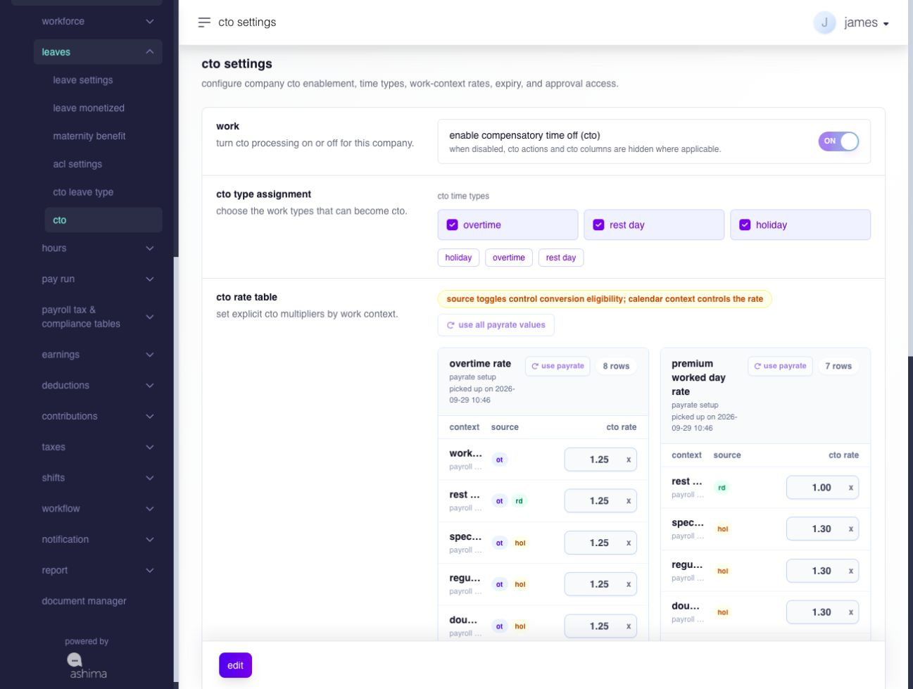

# manage compensatory time off (CTO)

## manage compensatory time off (CTO)

CTO means compensatory time off. it is time-off credit created from approved source work, such as overtime, rest day work, or holiday work.

CTO is not normally earned by schedule or yearly accrual. it is created when eligible approved work is converted into CTO credits.

use **compensatory time off (cto)** to convert approved overtime, rest day work, or holiday work into time-off credits that employees can apply for later.


**important:** changing CTO settings affects which approved work can become CTO, how credits are calculated, when credits expire, and how the same source work is treated in payroll. review the settings before saving.


**navigation:**\
go to **Settings → Leaves → CTO**

### when should you use CTO?

use CTO when the company allows approved work to become time-off credits instead of paying that work only as overtime, rest day pay, or holiday pay.

example:

`approved overtime → converted into cto → cto credits added to the employee balance`\
\
some pages use **conversion**, **converted**, **wrapped**, or **earned**. in this guide, these terms refer to the same user-facing result: approved source work becomes CTO credits.

### where does CTO appear?

CTO is managed through the leave module, but CTO is not the same as ordinary leave.

ordinary leave is usually earned or accrued based on a policy. CTO is a credit bank created from approved source work, such as overtime, rest day work, or holiday work.

because CTO is managed inside the leave module, some screens may still use leave-related labels.

the leave module shows the employee's assigned CTO leave type, available credits, pending credits, used credits, expiry date, and transaction history.

### what do CTO balance terms mean?

| term      | simple meaning                                                                                                |
| --------- | ------------------------------------------------------------------------------------------------------------- |
| available | CTO credits the employee can still use.                                                                       |
| pending   | CTO credits reserved for a leave request that is waiting for approval. some screens may show this as applied. |
| approved  | CTO credits attached to an approved CTO leave request.                                                        |
| used      | CTO credits already used for approved time off. some screens may show this as consumed.                       |
| expired   | CTO credits that can no longer be used because the expiry rule has already applied.                           |

simple balance idea:

> \[!FORMULA] **available CTO = credited CTO − pending CTO − used CTO − expired CTO ± adjustments**

### what is a CTO pool?

a CTO pool is a group of CTO credits that share the same employee, CTO leave type, source type, and expiry date.

example:

`employee: ben aguilar`

`cto leave type: cto - overtime`

`source type: overtime`

`expiry date: 2026-05-31`

if the same employee has multiple overtime conversions that create **cto - overtime** credits with the same expiry date, those credits may be grouped together in one pool.

a pool is not always equal to one overtime, rest day, or holiday record. one pool may include credits from more than one converted source record. use the ledger or more-info view when you need to trace the exact source records that created the credits.

### which CTO page should i use?

| page                    | what you use it for                                                                                                        |
| ----------------------- | -------------------------------------------------------------------------------------------------------------------------- |
| **CTO Settings**        | turn CTO on or off, choose source types, set conversion rates, set expiry rules, and choose who can convert approved work. |
| **cto leave types**     | review CTO leave types generated from CTO settings.                                                                        |
| **Leave Balance**       | review employee CTO balances, assignments, available credits, pending credits, and transaction history.                    |
| **CTO Conversions**     | review approved work records that are ready to convert into CTO.                                                           |
| **CTO Leave Import**    | upload CTO balances into employee leave records.                                                                           |
| **employee leave page** | let employees apply for assigned CTO leave types.                                                                          |

### how do i set up CTO?

1. go to **Settings → Leaves → CTO**.
2. turn **enable compensatory time off (cto)** on.
3. select the CTO source types in **CTO Time Types**.
4. set the **CTO Minting Rate** for each applicable work context of each selected source type.
5. choose the **Should CTO Expire** rule for each selected source type.
6. choose the **CTO Conversion Access** setting.
7. click **Save CTO Settings**.

### fields

* **enable compensatory time off (cto)** — turns CTO on or off for the company.
* **CTO Time Types** — selects which approved work types can become CTO. the supported source types are overtime, rest day, and holiday.
* **CTO Minting Rate** — sets how many CTO minutes are created from source minutes for the applicable work context. the supported source types remain overtime, rest day, and holiday.
* **Should CTO Expire** — sets whether CTO credits expire and how the expiry date is calculated.
* **CTO Conversion Access** — sets who can convert approved work into CTO.

### what happens after i save CTO settings?

the system saves the CTO rules and creates or reactivates generated CTO leave types for the selected source types.

examples:

* **CTO - Overtime**
* **CTO - Rest Day**
* **CTO - Holiday**

if you remove a CTO source type, the system deactivates the generated leave type for new use. existing balances and transaction history remain traceable.

### how do CTO source types work?

CTO supports these source types:

<figure><figcaption>
Select which approved work types can become CTO. The work context and rate table determine the credit multiplier.
</figcaption></figure>

| source type | what it means                       |
| ----------- | ----------------------------------- |
| overtime    | approved overtime work becomes CTO. |
| rest day    | approved rest day work becomes CTO. |
| holiday     | approved holiday work becomes CTO.  |

only approved source work should become CTO. pending, rejected, cancelled, already converted, zero-minute, missing-assignment, or unrelated source work should not be converted.

### how does the CTO minting rate work?

minting is the credit-creation step inside CTO conversion.

plainly, conversion decides that approved source work will become CTO. minting calculates how many CTO minutes are added to the employee's balance.

the applicable saved work-context rate controls how many CTO minutes are created from source minutes.

> \[!FORMULA] **source minutes × applicable work-context rate = CTO minutes**

payrate values can be used as optional first-time seeds for these rates. after a CTO rate is saved, later changes to payroll rates do not overwrite it. selected sources require rates greater than zero, with up to two decimal places. overtime and premium worked days use separate rate groups; the exact work context selects the applicable row. review copied seed rates before saving.

settings control new conversion decisions. when a source, target type, rate, or expiry rule changes, review pending conversions because Ashima can reject an intent whose source or converted minutes no longer match the current configuration.

### can converted CTO be reverted?

converted CTO should not be directly reverted back to ordinary overtime, rest day pay, or holiday pay once credits have been added to the employee balance.

if a correction is needed, use the proper correction process instead. this keeps the CTO balance, payroll treatment, and transaction history clear.

common correction cases include:

* deducting CTO through a manual adjustment when credits were added incorrectly
* reviewing payroll treatment if the original source work should be paid instead
* checking whether the CTO credit was already applied, approved, cancelled, or expired before making a correction

### how are decimal CTO minutes handled?

CTO uses whole minutes. when a conversion creates a decimal minute, Ashima rounds half up for each approved work record.

examples:

`15.49 minutes becomes 15 minutes`

`15.50 minutes becomes 16 minutes`

`15.51 minutes becomes 16 minutes`

Ashima rounds the CTO minutes for each approved work record before adding the results. it does not combine several records first and then round the total.

### how do CTO expiry rules work?

expiry is set per CTO source type.

| expiry rule      | what happens                                                                         |
| ---------------- | ------------------------------------------------------------------------------------ |
| does not expire  | CTO credits stay available until used or adjusted.                                   |
| after x days     | CTO credits expire after the configured number of days from the conversion run date. |
| end of the month | CTO credits expire at the end of the conversion run month.                           |
| end of the year  | CTO credits expire at the end of the conversion run year.                            |

if CTO does not expire, the credits remain available until they are used, adjusted, or otherwise changed by an authorized action.

for **after x days**, **end of the month**, and **end of the year**, the expiry date is based on the CTO conversion date. it is not based on the original overtime, rest day, or holiday work date.\
\
example:\
\
`overtime work date: 2026-04-20`

`conversion run date: 2026-05-07`

`validity: 10 days`

`expiry date: 2026-05-17`


**note:** the expiry date is based on the CTO conversion date. it is not based on the original overtime, rest day, or holiday work date.


### who can convert approved work into CTO?

the **CTO Conversion Access** setting controls who can initiate CTO conversion.

| option                        | what it means                                                               |
| ----------------------------- | --------------------------------------------------------------------------- |
| **admin manual conversion**   | only users with admin access convert eligible work from the admin workflow. |
| **approvers during approval** | assigned approvers choose CTO during approval when the workflow allows it.  |

### how do i review CTO leave types?

open **CTO Leave Settings** to review CTO leave types generated by CTO settings.

the page displays the CTO leave type, CTO source, conversion rate, expiry rule, assigned employee count, leave units, and availability.

if no CTO source types are enabled, the page shows that no CTO leave types were found and instructs you to enable CTO time types from CTO settings.

an inactive CTO type, a CTO source disabled in settings, or an unmapped type can leave existing balances and history visible while restricting new assignment, application, or wrapping use according to the corresponding current state.

### how do i convert approved work into CTO?

You can review conversions across employees on **CTO Conversions**, or open a source-specific conversion view from an employee's CTO type detail. Choose the view that matches the work you are converting; their filters and action labels differ.

On the company-wide **CTO Conversions** page, filter by employee, source, date range, or status. Review the approved work and select only rows marked **Ready**. Complete the conversion action shown for the selected source, then check the employee's CTO balance and the source row's converted status.

#### convert one employee's overtime

1. open the employee's CTO type detail and select the **Overtime** conversion view.
2. set the from and to dates, then select **Apply filter**.
3. review the approved overtime rows and select the eligible work.
4. select **Convert selected to CTO**, then check the result and use **Back** to return.

#### convert one employee's rest-day or holiday work

1. open the employee's CTO type detail and select the **Rest Day** or **Holiday** conversion view.
2. apply the date filter and review the approved rows for that work type.
3. select the eligible rows, then select **Wrap selected and mint CTO**.
4. check the converted status and CTO balance, then use **Back** to return.

The employee views use a date filter for that employee and source. To search across employees or compare sources and statuses, return to the company-wide **CTO Conversions** page. A pending, rejected, cancelled, already converted, zero-minute, or missing-assignment row is not ready to convert.

### what happens after i convert selected rows?

Ashima adds the CTO credit, links it to the approved source record, increases the employee balance, records the transaction, and marks the source as converted and excluded from payroll. a failed or rejected conversion creates no CTO credit, so the source remains available for its ordinary payroll treatment.

the same approved source work should not also be paid again as the same overtime, rest day, or holiday pay.


**important:** **converted into CTO = not paid again as the same source work**


to check: before closing payroll, review open or draft pay runs when CTO conversion affects overtime, rest day work, or holiday work. this helps confirm that the same source work is not counted both as paid work and as CTO.

### what do CTO conversion statuses mean?

| status             | what it means                                                              |
| ------------------ | -------------------------------------------------------------------------- |
| all                | shows all approved work records in the selected filters.                   |
| ready              | the approved work record is eligible for CTO conversion.                   |
| converted          | the approved work record was already converted into CTO.                   |
| missing assignment | the employee does not have the matching generated CTO leave type assigned. |
| zero minutes       | the approved work record has no convertible minutes.                       |

a work record can be selected only when its status is **Ready**.

### can the same source work be converted twice?

no. each approved work record can be converted only once.

the system checks whether the source work was already converted before allowing another conversion.

### how does an employee apply for CTO?

the employee applies through the employee leave page and selects the assigned CTO leave type.

the employee should review the CTO leave type, requested date, requested duration, and available CTO balance before submitting.

### can an employee apply for more CTO than available?

no. generated CTO leave types do not allow negative balance or borrowed CTO.

if the requested CTO is more than the available CTO, the system should block the request with an insufficient balance message.

### what happens while a CTO application is pending?

the requested CTO is reserved while the application waits for approval.

this means the available CTO balance decreases and the pending CTO balance increases. pending CTO should not expire while it is reserved.

### what happens when CTO is approved?

the system releases the pending reservation and records the approved CTO usage.

for forward usage, the system uses earliest-expiry-first allocation. credits that expire sooner are used before credits that expire later.

### what happens when CTO is rejected?

the system returns the reserved CTO using the refund rule.

returned credits go back to an eligible available balance for the same CTO leave type.

### what happens when CTO is cancelled?

the system reverses the pending or approved CTO application, depending on the application status and permissions.

if cancellation returns credits, the system returns them to an eligible available balance for the same CTO leave type. if no eligible balance is available, cancellation should be blocked.

when an application used credits from more than one expiry date, cancellation returns the later-expiring credits first. this keeps earlier-expiring credits used first and helps preserve credits with more time left.

example:

`cto used from credits expiring 2026-05-30`

`cto used from credits expiring 2026-08-30`

`cancelled CTO returns first to the 2026-08-30 credits`

### what happens when CTO expires?

expiry removes unused available CTO that has reached its expiry date.

expiry should not remove pending CTO, approved CTO, consumed CTO, or historical ledger records. a scheduled process expires eligible earned or manual pools; an authorized administrator may also expire an eligible pool from employee details after checking that no pending or approved application depends on it.

if a pending CTO application is later rejected or cancelled, the returned credits follow the refund rule.

### where do i review employee CTO balances?

open **Leave Balance** to review employee CTO balances from the leave module.

the page displays employee details, leave type, leave units, credits added, available balance, pending balance, credit date, and transaction links.

### how do i import CTO balances?

use **CTO Leave Import** to upload CTO balances into the leave module.

the import file must contain:

`Employee Number | Leave Type | Classification | Description | Transaction | Effective Start Date`

**Effective Start Date** accepts:

* 1|month
* 2|year
* mm/dd/yyyy
* yyyy-mm-dd

relative dates require a valid employee hire date.

### how do i trace a CTO movement?

use the ledger to trace CTO transactions.

the ledger should help you review credits created from source work, CTO applications, approvals, rejections, cancellations, expiries, and manual adjustments.

for deeper tracing, open the transaction detail or more-info view.

### which source details explain a CTO movement?

use more info to trace where a CTO movement came from and what it affected.

useful details include source type, source date, source minutes, minting rate, credited CTO minutes, expiry date, application reference, action taken, person who performed the action, and action date.

the more-info view should show only details that help you understand the CTO movement.

use more info when you need to answer questions such as:

* which approved overtime, rest day work, or holiday work created this CTO?
* how many minutes were converted into CTO?
* what expiry date was assigned?
* was the CTO later applied, approved, rejected, cancelled, expired, or adjusted?

### can i add manual CTO adjustments?

use manual CTO adjustments only for corrections.

manual credits and deductions should have a clear reason and should remain separate from source-converted CTO so the audit trail stays clear. a positive adjustment can create a manual pool; a negative adjustment must identify the existing pool from which minutes are removed. after saving, review the summary, pool detail, and event history.

### troubleshooting

| issue                                                        | what to check                                                                                                                                                        |
| ------------------------------------------------------------ | -------------------------------------------------------------------------------------------------------------------------------------------------------------------- |
| approved work does not appear for CTO conversion             | check that CTO is enabled, the source type is selected, and the source work is approved.                                                                             |
| a row shows missing assignment                               | assign the employee to the matching generated CTO leave type.                                                                                                        |
| a row is not selectable                                      | check the status. only a **Ready** work record can be selected; converted, zero-minute, missing-assignment, pending, rejected, or cancelled records are unavailable. |
| CTO leave types are missing                                  | enable at least one CTO time type and save CTO settings.                                                                                                             |
| the converted minutes look different from the decimal result | CTO uses whole minutes and rounds half up for each approved work record.                                                                                             |
| an employee cannot apply for CTO                             | check that the CTO leave type is assigned and that the employee has enough available balance.                                                                        |
