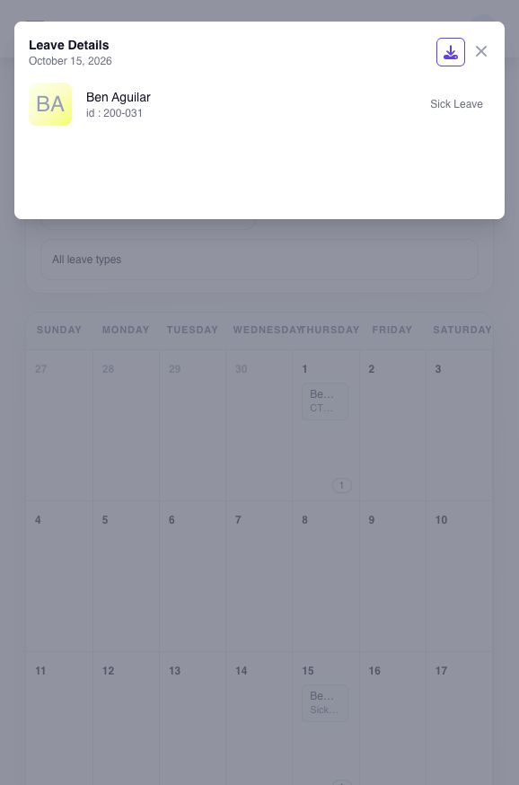

# review employee leave in the calendar

## review employee leave in the calendar

use the leave calendar to see employees with recorded leave on a selected day or within a selected month. administrators can use this view to check who is away today, review upcoming absences, coordinate work, compare leave with shifts or attendance, or complete another date-based review.

**Navigation:**\
go to **Leaves → Leave Calendar**.

### how do i see who has leave on a date?

1. select the month and year that contains the date.
2. select a leave type or keep **All Leave Types**.
3. review the calendar for the selected month and leave type.
4. on a date with recorded leave, select its leave-count button to see the employee and leave type.
5. open **Leave History** when you need the application status, covered period, or supporting files.

### which leave entries should i treat as confirmed?

check the application status before treating a calendar entry as confirmed leave. a pending request may appear in the selected view but is not the same as an approved request. open **Leave History** when you need the governing status, covered dates, duration, or supporting documents.

the visible entries also depend on the selected month, leave-type filter, employee access, and whether a request was cancelled or rejected.

### download the calendar view

1. select the month, year, and leave-type filter.
2. open the download control.
3. select **XLS** or **CSV**.
4. verify that the downloaded period and leave-type filter match the view you intended to retain.

### review or download leave for one day

1. find a date that shows a leave count.
2. select the **leave-count button** to open the day details. selecting the date number or an empty part of the day cell does not open this view.
3. review the employees and leave types. use **Leave History** to confirm each application's status. select the download control in the day-detail window if you need its CSV file.

<figure><figcaption>
Select a populated date's leave count to open its day details. The window lists employees and leave types; confirm approval status in Leave History.
</figcaption></figure>

the day-detail CSV is separate from the calendar's month-level **XLS** and **CSV** downloads. if a day has no leave entries, there is no day-detail list to open.

### compare leave with shifts and attendance

use the calendar to identify dates that may affect staffing, schedules, or attendance review. open the employee's approved leave application, shift calendar, or timesheet for the governing detail. the leave calendar does not replace the application record, assigned shift, or timesheet.

### why might a leave entry be missing?

check the month and year, leave-type filter, application status, employee visibility, and whether the request was cancelled or rejected. confirm the request in **Leave History** before changing the employee balance.

### related articles

* [review leave overview and history](review-leave-overview-and-history.md#page-055-pages-admin-leaves-review-and-maintain-leave-leave-overview-and-history-md)
* [review and correct leave balances](../balances-transfers-and-cto/review-and-correct-leave-balances.md#page-057-pages-admin-leaves-review-and-maintain-leave-leave-balances-md)
* [review and cancel leave](review-and-cancel-leave.md#page-060-pages-admin-leaves-review-and-maintain-leave-review-and-cancel-leave-md)
