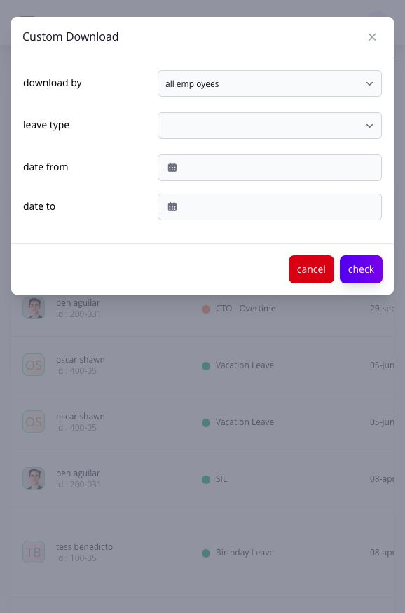

# review leave overview and history

## review leave overview and history

use the leave overview and history pages to review employee leave activity, application status, dates, attachments, and downloadable records.

**Navigation:**\
go to **Leaves → Leave Overview** or **Leaves → Leave History**.

### when should i use the overview or leave history?

use **Leave Overview** for a quick check of approved leave and current leave activity. use **Leave History** when you need to find a specific application, confirm its status and dates, or open its supporting files. use **Leave Balance** and **View Transaction** when the question concerns credits rather than the application itself.

### how do i find a leave record?

1. open **Leave History**.
2. choose **All**, **Approved**, **Pending**, **Cancelled**, or **Rejected**.
3. search for an employee, select a leave type, and set the start and end dates.
4. open the employee or application record for more detail.
5. download the attachment when supporting documents are available.

### how do i download leave history?

1. open the download control and choose **XLS** or **CSV**.
2. in the export dialog, choose one employee or all employees, a leave type, and the required dates.
3. select **Check**. if entries are available, select **Proceed**.
4. complete the additional fields and select **Submit**. select **Cancel** to leave without requesting a file.
5. check the exported employee scope, dates, and leave type before using the file for attendance or payroll review.

<figure><figcaption>
Set the criteria in Custom Download before selecting Check. These fields are separate from the filters on the Leave History list.
</figcaption></figure>

### related articles

* [leave calendar](review-employee-leave-in-the-calendar.md#page-056-pages-admin-leaves-review-and-maintain-leave-leave-calendar-md)
* [leave balances](../balances-transfers-and-cto/review-and-correct-leave-balances.md#page-057-pages-admin-leaves-review-and-maintain-leave-leave-balances-md)
* [file leave for an employee](file-leave-for-an-employee.md#page-059-pages-admin-leaves-review-and-maintain-leave-file-leave-for-an-employee-md)
* [review and cancel leave](review-and-cancel-leave.md#page-060-pages-admin-leaves-review-and-maintain-leave-review-and-cancel-leave-md)
