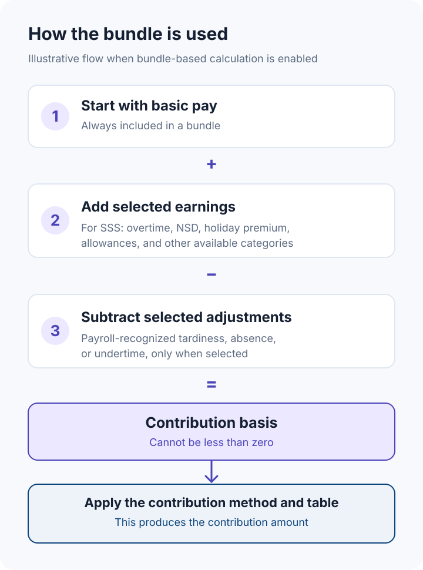
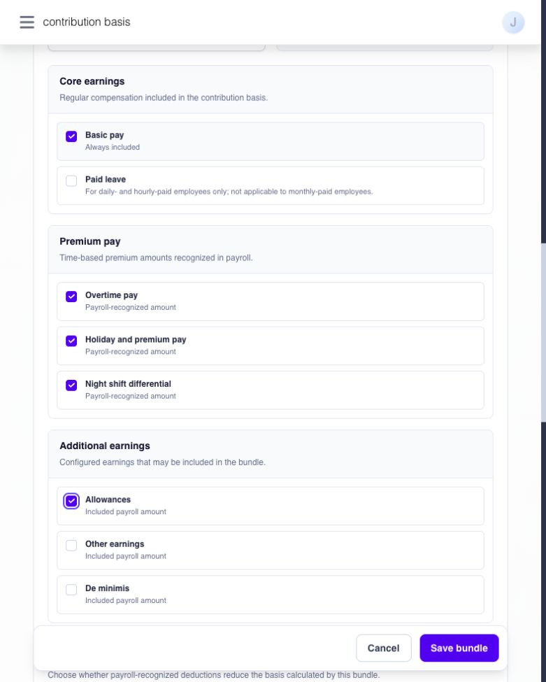
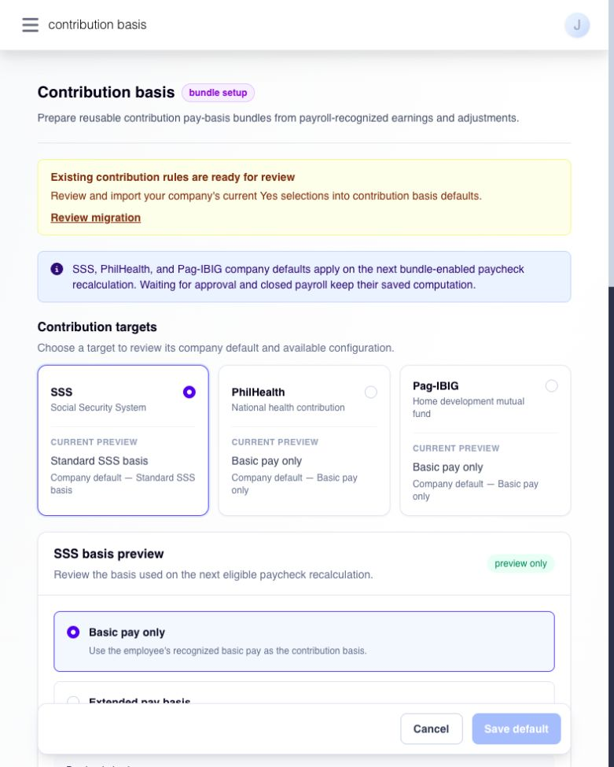
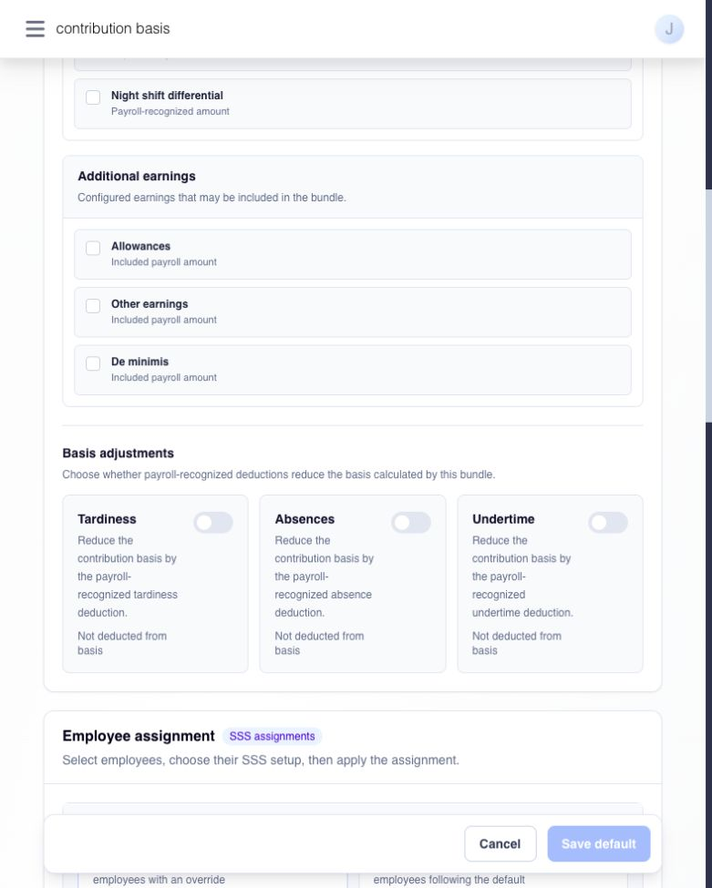
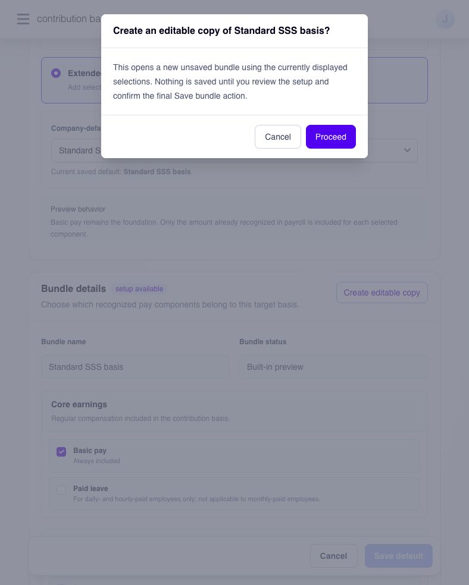
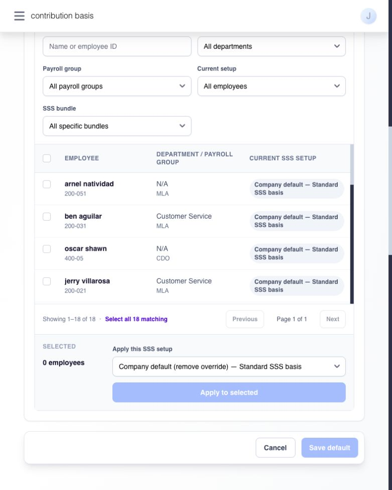

# configure contribution basis bundles


**Availability:** Contribution basis is being prepared for release. Continue using your current **Contribution Rules** for now. The steps below apply after your company is given access and bundle-based payroll calculation is enabled.


If your company already has SSS, PhilHealth, or Pag-IBIG contribution rules, begin with [review and migrate existing contribution rules](migrate-existing-contribution-rules.md). If those rules have already been reviewed, continue with the setup below. [Start here](./) explains the two paths.

A pay bundle tells Ashima which parts of an employee's pay to use as the **basis** for a contribution. For example, an SSS bundle can include basic pay, overtime pay, night shift differential, holiday and premium pay, and allowances. The bundle chooses the pay amounts that enter the basis; the applicable contribution calculation and table determine the contribution amount afterward.

When this feature is enabled, open **Settings → Paycheck → Contribution basis**. You can prepare separate bundles for SSS, PhilHealth, and Pag-IBIG. Each contribution can have its own company default, and you can assign a different bundle to one employee or several employees selected together. Compared with the previous general rule, this lets employees use different contribution bases when the company needs them.

**Create, then assign:** saving a bundle makes it available. It does not apply the bundle to anyone. Save it as the company default for employees without an override, or assign it to selected employees. To give a payroll group the same basis, filter the employee list by **Payroll group**, select the matching employees, and apply the bundle in bulk. This saves assignments for those employees; it is not a standing payroll-group rule that automatically assigns future members.

Here is an example of the selections you could prepare for SSS:

| select in the SSS bundle     | example of what the selection includes                                                         |
| ---------------------------- | ---------------------------------------------------------------------------------------------- |
| **Basic pay**                | payroll-recognized basic pay; always selected                                                  |
| **Overtime pay**             | recognized overtime pay                                                                        |
| **Night shift differential** | recognized night shift differential                                                            |
| **Holiday and premium pay**  | recognized holiday and premium pay                                                             |
| **Allowances**               | all positive allowance amounts recognized in payroll for the employee, not one named allowance |

When bundle-based calculation is enabled, Ashima starts with basic pay, adds the selected earnings recognized in payroll, and subtracts any selected tardiness, absence, or undertime adjustments recognized in payroll. The basis cannot fall below zero. The applicable contribution method and table then determine the contribution amount.

<figure><figcaption>
The bundle defines the basis; the contribution method and table calculate the amount. This diagram shows the intended flow when bundle-based calculation is enabled.
</figcaption></figure>

If payroll records both a mobile allowance and a transport allowance under **Allowances**, selecting that category includes both positive recognized amounts. You cannot select the mobile allowance alone in this bundle. **Other earnings** is also one category rather than a choice of individual earning types. The illustrated basis is an example; your contribution amount still depends on the applicable method and table.

<figure><figcaption>
Example SSS bundle selections in the Ashima form. Allowances is one category; the form does not select individual allowance types.
</figcaption></figure>


**Before changing a basis:** review the company's existing contribution rules and the pay items recognized in payroll. Saving a bundle, default, or employee assignment does not recalculate a pay run. Check the calculated contribution in an eligible open pay run when your company starts using bundle-based calculations.


## choose what belongs in the basis

Open the **Contribution basis** page and select **SSS**, **PhilHealth**, or **Pag-IBIG** under **Contribution targets**. The target card shows a **Current preview** and a separate company-default label. A preview selection is not a saved change; check **Current saved default** before leaving the page.

<figure><figcaption>
Choose the contribution target first, then compare its preview with the saved company default.
</figcaption></figure>

**Basic pay only** uses the employee's payroll-recognized basic pay. **Extended pay basis** lets you add recognized components through a saved bundle. Basic pay is always included and cannot be deselected.

| contribution | additional earnings available in a new bundle                                                                       | basis adjustments available    |
| ------------ | ------------------------------------------------------------------------------------------------------------------- | ------------------------------ |
| SSS          | Paid leave, Overtime pay, Holiday and premium pay, Night shift differential, Allowances, Other earnings, De minimis | Tardiness, Absences, Undertime |
| PhilHealth   | Paid leave                                                                                                          | Tardiness, Absences, Undertime |
| Pag-IBIG     | Paid leave                                                                                                          | Tardiness, Absences, Undertime |

Selecting a component means using its amount already recognized in payroll. It does not create an earning, change the statutory contribution table or rate, or change when a contribution is deducted. **Paid leave** is an available component for daily- and hourly-paid employees; for monthly-paid employees, it is not added again because their salary is already in basic pay.

## create a bundle

1. Select the contribution target and **Extended pay basis**.
2. Select **Create editable copy** of the built-in basis, or **New bundle** when viewing an existing bundle, then select **Proceed**. This opens an unsaved setup.
3. Enter a distinct **Bundle name** for that contribution. Review **Bundle details** and select the earnings to include. Basic pay stays selected.
4. Under **Basis adjustments**, select any payroll-recognized Tardiness, Absences, or Undertime deduction that should reduce the basis.
5. Select **Save bundle**. Review the confirmation and select **Save bundle** again.

<figure><figcaption>
Choose whole earning categories and, if needed, the adjustments that reduce the contribution basis.
</figcaption></figure>

<figure><figcaption>
Create editable copy opens a draft for review. It does not save a bundle by itself.
</figcaption></figure>

The saved bundle becomes an active, published version 1. Creating it does **not** make it the company default or assign it to employees. A name must be unique for that contribution, use no more than 120 characters, and differ from the built-in name.


**Preview versus saved setup:** **Create editable copy** and **New bundle** only open an unsaved form. A bundle exists after you confirm **Save bundle**.


## set the company default

Use a separate default for SSS, PhilHealth, and Pag-IBIG. Employees without a specific bundle assignment follow the default saved for that contribution.

1. Select the contribution target. Choose **Basic pay only** to use its built-in basis, or **Extended pay basis** and an active bundle from **Company-default \[contribution] bundle**.
2. Compare the selection with **Current saved default**. If the page says the selected change is not yet saved, select **Save default**.
3. Review **Current default** and **New default** in the confirmation, then select **Save default**.
4. Check that the target card and **Current saved default** show the intended bundle.

Saving a default does not change an employee's separately assigned bundle. It also does not recalculate payroll by itself.

## assign a bundle to one employee or several employees

Use **Employee assignment** when one employee or a selected group should use a different bundle for a particular contribution. The list shows active employees visible to your account, including those with a specific bundle and those following the company default. You can select one employee directly or filter by **Payroll group** or **Department** and select several employees together.

1. Select **SSS**, **PhilHealth**, or **Pag-IBIG**.
2. Search by name or employee ID, or filter by **Department**, **Payroll group**, **Current setup**, or bundle.
3. Select the employees. The table header selects the current page; **Select all \[number] matching** selects employees across all pages that match the filters. Review the selected count before continuing.
4. Under **Apply this \[contribution] setup**, choose an active bundle. To remove an existing employee override, choose **Company default (remove override)**.
5. Select **Apply to selected**, review the confirmation, and select **Confirm assignments**.
6. Check **Current \[contribution] setup** for the affected employees.

<figure><figcaption>
Filter the employees and review the selected count before applying a bundle or returning them to the company default.
</figcaption></figure>

Assignments are specific to the selected contribution. A later change to the company default affects employees following that default, while an employee with a specific bundle continues to use that bundle. Filtering by payroll group helps you select current employees for a bulk assignment; it does not create a continuing group-level rule. Review new hires or employees who later move into that group and assign them separately if they should use the same bundle.


**Before a bulk assignment:** confirm the filters and selected count. **Select all \[number] matching** can include employees beyond the page currently visible.


## change or retire a bundle

To change its selected components, open the active bundle, select **Edit**, make the changes, and select **Save new version**. Review the current and new version numbers, then select **Publish new version**. The new version becomes current; the earlier version is preserved. If another administrator updated the bundle first, reload the page and review the current version before trying again. A new version requires a real component or adjustment change.

To change only its name, select **Rename** and then **Save new name**. Renaming does not change the published component selections.

To stop offering a bundle for new selections, select **Deactivate**. First save a different company default if this bundle is the current default, and reassign any employees using it or return them to **Company default (remove override)**. Then confirm **Deactivate bundle**. Its saved versions remain available as history.


**Editing an imported PhilHealth or Pag-IBIG bundle:** an older imported bundle may contain earnings that new bundles for those targets no longer offer. If the version confirmation lists excluded earnings, review that list before selecting **Publish new version**. The existing version stays unchanged until you confirm.


## if the expected result does not appear

* **the selected default did not change:** check **Current saved default**. A preview selection needs a separate **Save default** confirmation.
* **an employee still follows a different bundle:** check their **Current \[contribution] setup**. A specific employee assignment takes precedence over the company default. Use **Company default (remove override)** if they should follow the default.
* **the bundle cannot be deactivated:** check whether it is the company default or still assigned to employees. Change those saved selections first.
* **a contribution amount did not change after saving:** saving setup alone does not recalculate payroll. Confirm with your payroll administrator that bundle-based calculation is active, then review an eligible open pay run before attributing an amount to this setting.

## definition of terms

* **contribution basis:** the recognized pay amount used as input to a contribution calculation. The applicable contribution method, table, and schedule are separate settings.
* **bundle:** a named set of included earnings and basis adjustments for one contribution.
* **company default:** the basis selected for employees who do not have a specific bundle for that contribution.
* **employee override:** a saved bundle assignment for a particular employee and contribution instead of the company default.
* **published version:** a saved set of bundle selections. Editing components creates a new current version and preserves the earlier one.
