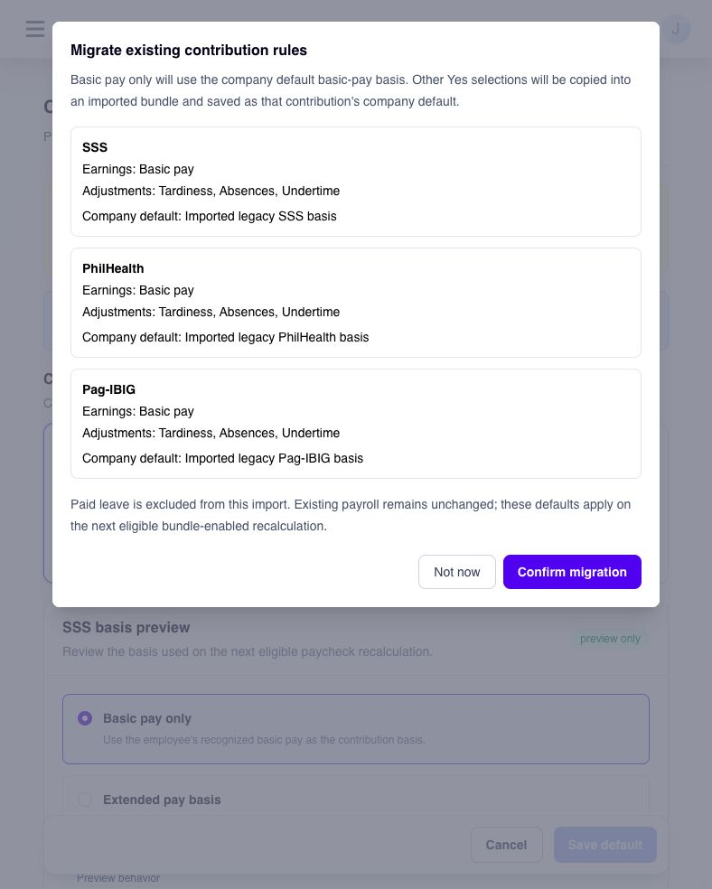

# review and migrate existing contribution rules


**Availability:** Contribution basis is being prepared for release. Continue using your current **Contribution Rules** for now. The steps below apply after your company is given access and bundle-based payroll calculation is enabled.


If your company already uses contribution rules, review them before creating new contribution basis bundles. Migration takes the current **Yes** selections for each contribution and prepares a company default that reflects those choices. SSS is the example below; the same confirmation also checks pending PhilHealth and Pag-IBIG rules.

**Who this is for:** administrators of existing companies with SSS, PhilHealth, or Pag-IBIG rules. If your company has no existing rules to bring forward, use [configure contribution basis bundles](configure-contribution-basis-bundles.md).

## what will happen to our existing SSS rule?

Ashima reads the earnings and basis adjustments marked **Yes** for SSS. **Basic pay** must be **Yes**. If that is the only selected component and no adjustment is selected, the new SSS default is **Basic pay only**. If other recognized earnings or adjustments are also **Yes**, Ashima creates an active bundle called **Imported legacy SSS basis** and saves it as the SSS company default. A name suffix may be added if that name already exists.

For example, if the current SSS rule marks **Basic pay**, **Overtime pay**, and **Night shift differential** as **Yes**, the imported SSS bundle includes those three components. If **Tardiness** is also **Yes**, that adjustment is selected to reduce the basis when payroll recognizes it. These selections define the basis; they do not change the contribution table or rate.

| what the review shows for a contribution                                 | what confirmation does                                                           |
| ------------------------------------------------------------------------ | -------------------------------------------------------------------------------- |
| Basic pay only, with no selected basis adjustments                       | Uses the built-in **Basic pay only** company default; no named bundle is needed. |
| Basic pay plus other selected earnings or basis adjustments              | Creates an imported bundle and saves it as that contribution's company default.  |
| Already configured                                                       | Keeps the existing saved default; it is not replaced by the import.              |
| Basic pay missing or not **Yes** for a contribution still awaiting setup | Blocks confirmation until the existing rule is reviewed and corrected.           |


One **Confirm migration** action handles every pending contribution shown in the dialog. Review SSS, PhilHealth, and Pag-IBIG together. You cannot confirm only SSS from this dialog, and one pending target without **Basic pay = Yes** blocks the whole import. A target already configured keeps its current default.


## before you confirm

1. Review the current contribution rules for SSS, PhilHealth, and Pag-IBIG. Check the **Yes** earnings and adjustments for each one, especially **Basic pay**.
2. Open **Contribution basis** and compare each target's proposed earnings, adjustments, and **Company default** with the rule you intend to preserve.
3. If a target says **Manual review required**, resolve its **Basic pay** selection in the existing contribution rules before returning to the migration review. The **Confirm migration** button remains unavailable while a pending target is blocked.
4. Decide whether each proposed company default is right for employees who do not have a separate bundle assignment. If you need more time, select **Not now**; it does not import the rules.

<figure><figcaption>
Check the proposed basis and company default for all three contributions before confirming migration.
</figcaption></figure>

## confirm and check the result

1. In **Contribution basis**, select **Review migration** from **Existing contribution rules are ready for review**. The migration review can also open when the page loads.
2. Read the SSS, PhilHealth, and Pag-IBIG cards. Check the selected **Earnings**, **Adjustments**, and proposed **Company default** for each pending target.
3. If the proposals are correct, an administrator with contribution-settings edit access selects **Confirm migration**. Ashima reads the latest existing rules again at confirmation, then saves the pending company defaults together. If another administrator changed the rules while you were reviewing, reload and compare the new preview before confirming.
4. Return to each contribution target and check **Current saved default**. For an imported bundle, open its details and check the selected components. Keep the earlier rule record available for your own comparison.
5. Once bundle-based calculation is enabled for your company, check the contribution basis and calculated amount in an eligible open pay run before approval. The saved default by itself is not proof that a payroll calculation changed.

The import leaves existing rule records and already calculated payroll unchanged. It does not automatically select **Paid leave**, even when that component is available in a new bundle. If the intended basis needs paid leave, review the saved setup separately using [configure contribution basis bundles](configure-contribution-basis-bundles.md).

Migration establishes a company default for each pending contribution. If particular employees need a different basis, create another bundle and assign it to them after migration. You can filter by **Payroll group** and assign the bundle to selected employees in bulk; a new employee who later joins that group is not automatically given the same assignment.


Do not use a settings preview as evidence that waiting-for-approval, closed, or historical payroll changed. Importing defaults does not recalculate those payroll records. Confirm the result in an eligible open pay run only after bundle-based calculation is available.


## if the proposed result is not what you expect

* **The SSS card lists the wrong components:** check which entries are **Yes** in the existing SSS rule. The migration copies those selections; it does not infer a different basis from the contribution amount.
* **Confirm migration is disabled:** a pending contribution may lack **Basic pay = Yes**, or your account may lack contribution-settings edit access. Read the message on each card and ask an authorized administrator to correct or confirm the rule.
* **An existing default was not replaced:** a contribution already configured in **Contribution basis** is intentionally kept. Review its saved default and change it through the normal default-setting task if needed.
* **The contribution amount did not change:** first check whether bundle-based calculation is enabled and whether the pay run is eligible and has been recalculated. The import alone does not recalculate payroll.

## next step

Use [configure contribution basis bundles](configure-contribution-basis-bundles.md) to change the imported selections, set a different default, or give particular employees a different bundle.
