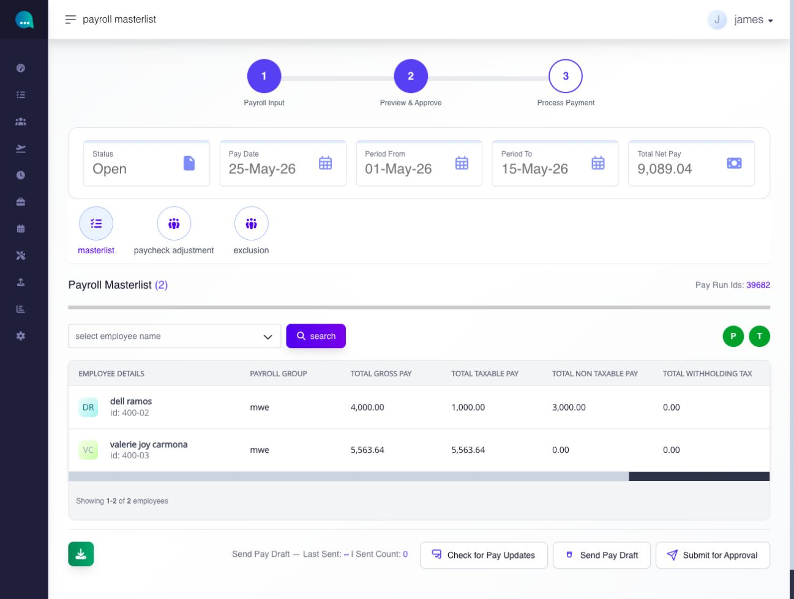
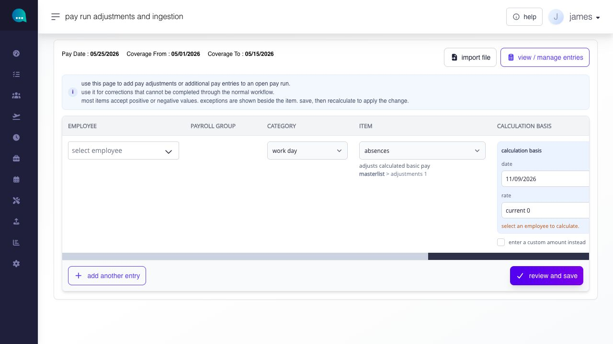
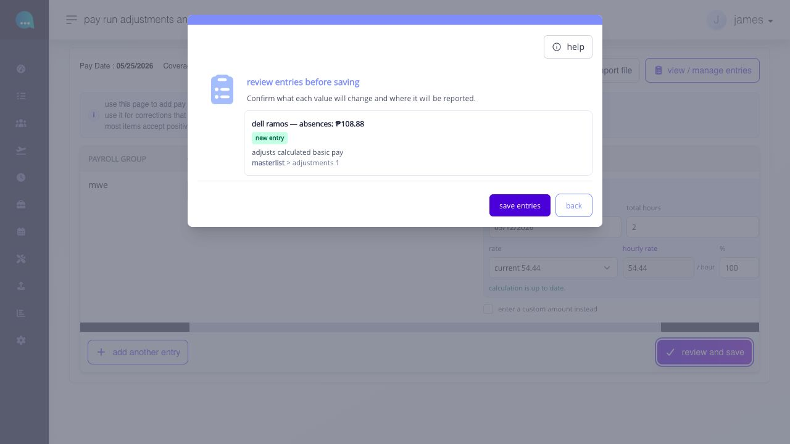
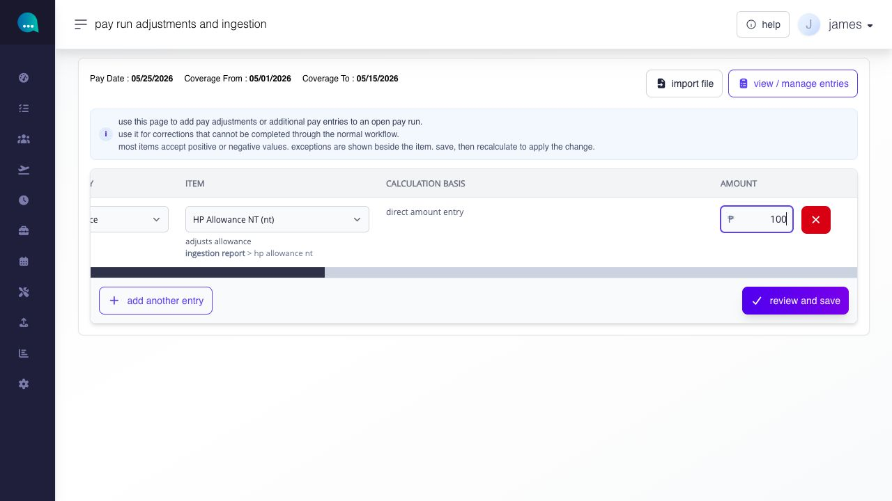
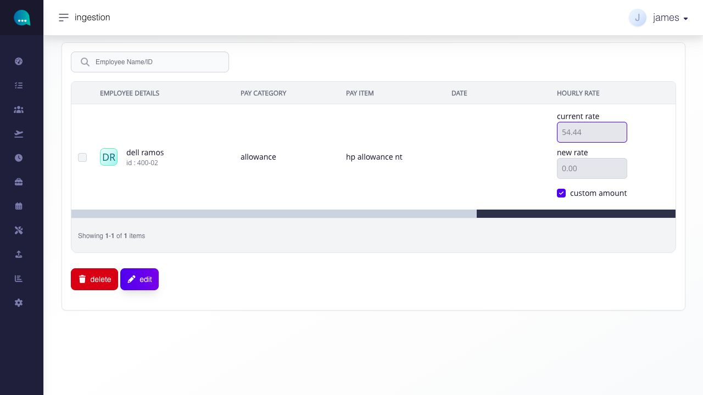
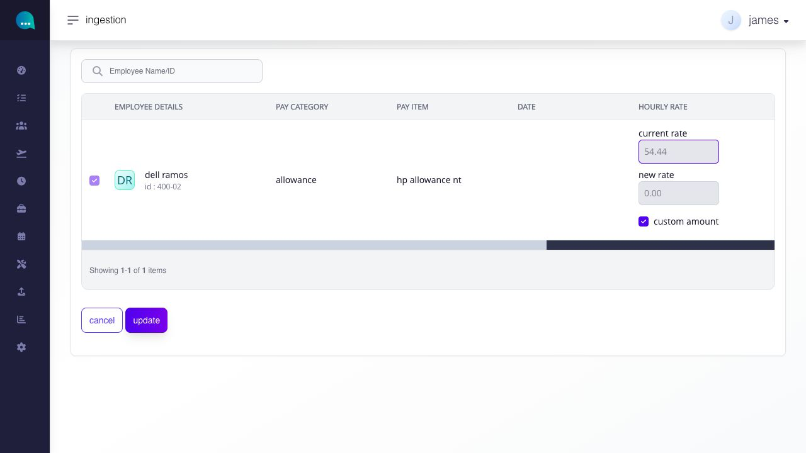
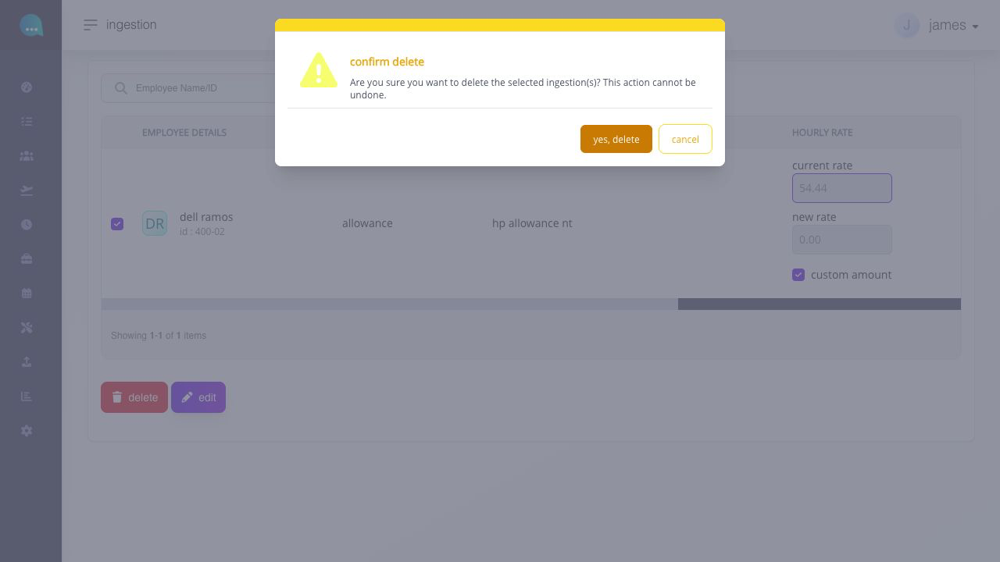

# add adjustments or ingestion

## add adjustments or ingestion

use **paycheck adjustment** to add a correction directly to an open pay run when the change should not be made through the employee's normal setup or the original Hours, Leave, Earnings, Deduction, Loan, Contribution, or Tax workflow.


a paycheck adjustment changes the payroll being reviewed. Confirm the employee, payroll dates, item, sign, and amount before saving, then recalculate and review the employee result.


**Navigation:**\
go to **Paycheck → Pay Run → Payroll**, open the payroll masterlist, then select **paycheck adjustment**. From Employee Pay Details, the page can also be opened for one employee.

### paycheck adjustment

#### how do I use paycheck adjustment?

use **paycheck adjustment** when payroll values need a direct payroll-side correction before approval.

this is the correct page for manual payroll adjustments during the masterlist review stage.

**navigation:**\
go to **Paycheck → pay run → view payroll masterlist → paycheck adjustment**

#### what can I do from this page?

this paycheck adjustment supports two different payroll-side correction methods:

* <mark style="color:violet;">**adjustment**</mark> is used for payroll-side workday or pay corrections such as workday, overtime, holiday, night shift differential, leave, absent, tardiness, and undertime directly into the current open pay run
* <mark style="color:violet;">**ingestion**</mark> is used to add payroll-entry amounts into assigned categories such as allowance, other earnings, other deductions, loans, contributions, and withholding tax. Use it to add or offset earning-side or deduction-side entries.

use the item-specific comparison below to distinguish adjustment and ingestion. the selected item determines its required inputs, sign and placement in payroll output; do not treat the two terms as interchangeable when making an entry.

#### how do I create a paycheck adjustment?

<figure><figcaption>
Check the open pay run and its dates, then select paycheck adjustment.
</figcaption></figure>

1. from the payroll **masterlist**, click on the **paycheck adjustment** tab.
2. a new tab/page will open while keeping the main masterlist accessible.
3. the **ingestion** page opens with a blank entry row for the selected pay run. Check its pay date and coverage before entering a correction.

<figure><figcaption>
check the pay date and coverage above the blank row. scroll the table sideways to reach all calculation and amount fields.
</figcaption></figure>

4. select the employee to whom you want to apply the paycheck adjustment. Selecting an employee name is a required field.


**select employee (\*)** - selects the employee receiving the correction.


5. choose **pay category**. this determines which payroll-item category the entry belongs to. choosing a pay category is a required field. the following pay category options are available:

* **work day**
* **overtime**
* **holiday**
* **nsd**
* **leaves**
* **absent**
* **tardiness**
* **undertime**
* **deminimis**
* **allowance**
* **other earnings**
* **other deductions**
* **insurance**
* **third party loans**
* **loans**
* **contributions**
* **withholding tax**

6. choose a **pay item**. Options are listed based on the pay category selected. Choosing a pay item is a required field.


**pay item (\*)** - lists the specific payroll item available under the selected pay category.


7. complete remaining **entry fields -** the rest of the row changes based on the selected payroll item. Some items ask for a date, hours, rate-based value, or a custom amount. Others use only a smaller set of fields.\
   \
   Common entry field behavior: 

* **date (\*)** - records the effective date of the payroll entry. appears when the selected item is date-based (for example, overtime)
* **current and new rate** - shows the current rate or the updated rate context when applicable. appear when the selected item uses rate-based calculation (for example, workday)
* **rate %** - applies percentage-based logic when supported. appears when the selected item uses percentage-based logic.
* **custom amount** - lets you enter the amount directly when the item supports amount-based entry (for example, allowance or De Minimis)
* **total hours** - used when the entry is hour-based.
* **amount** - records the amount to be saved when the selected item uses direct amount entry or calculated amount output.

8. in employee calculator mode, select the date, hours, day or holiday type, and **Current**, **New** or **Custom** rate source. **Enter a custom amount instead** lets you enter an amount directly. Check missing-input or stale-calculation feedback; changing a calculator input refreshes the result.
9. use **Add another entry** for another unsaved row. Check every amount, sign and destination. **Preview** opens existing Employee Pay Details; it does not calculate or save the unsaved rows.
10. select **Review and save**. In **Review entries**, check whether each row is classified as **New** or **Update**. Select **Back** to correct the rows without saving, or **Save entries** to commit them. Correct a failed check and review again.
11. read the actual added and updated counts, then open **view / manage entries** to verify the saved entries.
12. choose **Yes, recalculate** or **I will do it later** in the separate recalculation confirmation. Review the affected payroll after recalculation.


**Saved entries and recalculation are separate.** If saving succeeds but recalculation fails, the entries can already be saved. Check the saved list and the error or trace code before retrying; do not submit the same entries again merely because payroll did not refresh.


<figure><figcaption>
review the employee, amount, new-entry classification and report destination before saving. choose Back to correct the entry.
</figcaption></figure>

#### will a repeated entry add another amount?

A matching active entry for the same employee, company, category, item, source and pay run can be updated instead of added. The date distinguishes entries only for date-based items; a different tax classification does not make a separate entry. Review the **New/Update** result before saving and the actual counts afterward, because the saved records can change between review and save.

#### which amount and tax rules should i check?

**Absent / Absent Adjustment** requires an amount greater than zero. For **Allowance**, **Other Earnings** and **De Minimis**, **(t)/(nt)** follows the active item settings and cannot be changed in the entry. A CSV Tax value cannot override those settings. Correct a missing tax setting before saving or importing.

<figure><figcaption>
this allowance uses direct amount entry. its (nt) marker comes from the item settings; it is not a separate tax choice here.
</figcaption></figure>

Opening an older entry does not change its saved tax treatment. Saving an edit resolves the current active settings again, so check the displayed classification before selecting **Update**. Verify the saved row, recalculate, and review its payroll effect.

#### when should I use payroll adjustments?

use the normal payroll modules first when the change belongs to the employee's regular payroll setup.

for example:

* if the employee should receive an earning or deduction through normal setup, create or assign it through the proper module
* if the item can be assigned as a valid one-time payroll entry in the normal module, use that standard assignment flow first
* if the issue is with worked time, attendance, or payable hours, correct it through the timesheet or the proper hours workflow

if the correction can be handled through the standard modules in Ashima, use those. these follow the proper rules for taxable and non-taxable reporting and will make it easier for you to manage.

use **payroll adjustment** when a correction needs to be applied directly and urgently (last minute corrections) to the current open pay run.

you can also use this when the amount cannot be added or deducted through the standard earnings or deductions module entries in Ashima.


as a best practice, avoid relying on **Paycheck Adjustment** for corrections that can be handled through the standard earnings and deductions modules.

use it only as a last resort—for urgent, last-minute corrections that cannot be easily processed through the standard modules. 


#### which adjustment entry should I use for basic pay/workday corrections?

here’s a quick guide to help you choose the right adjustment entry for basic pay or workday corrections:

* **Underpaid:** Missed timesheet / unpaid workday → Use **Work Day (positive)** to add pay
* [**Overpaid**](add-adjustments-or-ingestion.md#page-070-pages-admin-paycheck-md--use-case-basic-pay-overpayment)**:** Excess hours or overpaid workday (from previous payroll) → Use **Work Day (negative)** to deduct pay
* **Actual absence (should reduce basic pay)** → Use **Absent (positive)**
* **Actual tardiness (should reduce basic pay)** → Use **Tardiness (positive)**
* **Actual undertime (should reduce basic pay)** → Use **Undertime (positive)**

Use this as a reference when adjusting pay to ensure entries are applied correctly. 


Use these quick rules first:

* **Work Day** — use to add pay back for a day or hours that should have been paid.
* **Negative Work Day** — use to recover a basic-pay overpayment so the correction stays on the earnings side.
* **Absent** — use to add a missing absence deduction.
* **Tardiness** — use to add a missing tardiness deduction.
* **Undertime** — use to add a missing undertime deduction.
* Use the matching positive deduction entry when the employee should lose pay.
* Do not use **Absent**, **Tardiness**, or **Undertime** when the issue is really a basic-pay overpayment.


#### use case: basic-pay overpayment

if the employee was overpaid on **basic pay** from previous payroll, keep the correction on the earnings side.

use **work day** with a negative amount when the goal is to:

* take back overpaid basic pay
* bring taxable pay down with the recovery
* let payroll and tax reporting reflect that the overpayment happened on pay, not on attendance deduction

do not force this through **Absent**, **Tardiness**, or **Undertime** if the employee was not actually absent, late, or undertime.

#### how do different pay adjustment entries behave?

the exact fields shown on the row depend on the selected **pay category** and **pay item**. Use the table below as a working guide for what each pay-entry group normally requires and how it affects payroll.

<table><thead><tr><th width="109.09375">Pay entry</th><th width="110.1796875">Use case</th><th width="105.6796875">Key fields</th><th width="169.15625">Positive / Negative</th><th width="139.0234375">Tax effect</th><th width="158.34765625">Fix if incorrect entry</th></tr></thead><tbody><tr><td><strong>Work Day</strong></td><td>Pay add-back; basic-pay overpayment recovery</td><td>Date + hours / amount / calculator fields</td><td>
<code>+</code> add pay back; net pay up.

<code>-</code> recover basic pay overpayment; taxable pay down; net pay down
</td><td>Earnings-side; affects taxable pay and withholding tax</td><td><strong>Edit</strong> values. <strong>Delete and re-add</strong> if wrong item or date</td></tr><tr><td><strong>Overtime</strong></td><td>Overtime pay correction</td><td>Date + hours / rate fields</td><td>
<code>+</code> add overtime pay.

<code>-</code> reverse overtime pay
</td><td>Earnings-side; affects taxable pay and withholding tax</td><td><strong>Edit</strong> values. <strong>Delete and re-add</strong> if wrong item or date</td></tr><tr><td><strong>Holiday</strong></td><td>Holiday pay correction</td><td>Date + hours / amount / calculator fields</td><td>
<code>+</code> add holiday pay.

<code>-</code> reverse holiday pay
</td><td>Earnings-side; affects taxable pay and withholding tax</td><td><strong>Edit</strong> values. <strong>Delete and re-add</strong> if wrong item or date</td></tr><tr><td><strong>NSD</strong></td><td>Night shift differential correction</td><td>Date + rate fields</td><td>
<code>+</code> add NSD pay.

<code>-</code> reverse NSD pay
</td><td>Earnings-side; affects taxable pay and withholding tax</td><td><strong>Edit</strong> values. <strong>Delete and re-add</strong> if wrong item or date</td></tr><tr><td><strong>Leaves</strong></td><td>Paid leave correction</td><td>Date + hours / amount / calculator fields</td><td>
<code>+</code> add paid leave.

<code>-</code> reverse paid leave
</td><td>Earnings-side; affects taxable pay and withholding tax</td><td><strong>Edit</strong> values. <strong>Delete and re-add</strong> if wrong item or date</td></tr><tr><td><strong>Absent</strong></td><td>Actual absence deduction</td><td>Date +, for some items, <strong>Total Hours</strong> and <strong>Amount</strong></td><td>
<code>+</code> add absence deduction; net pay down.

zero and negative amounts are not accepted; correct the saved entry instead
</td><td>Deduction-side; not taxable earnings</td><td>Use for real absence only. <strong>Edit</strong> or <strong>Delete and re-add</strong> if wrong</td></tr><tr><td><strong>Tardiness</strong></td><td>Actual tardiness deduction</td><td>Date +, for some items, <strong>Total Hours</strong> and <strong>Amount</strong></td><td>
<code>+</code> add tardiness deduction; net pay down.

<code>-</code> reduce prior tardiness adjustment
</td><td>Deduction-side; not taxable earnings</td><td>Use for real tardiness only. <strong>Edit</strong> or <strong>Delete and re-add</strong> if wrong</td></tr><tr><td><strong>Undertime</strong></td><td>Actual undertime deduction</td><td>Date +, for some items, <strong>Total Hours</strong> and <strong>Amount</strong></td><td>
<code>+</code> add undertime deduction; net pay down.

<code>-</code> reduce prior undertime adjustment
</td><td>Deduction-side; not taxable earnings</td><td>Use for real undertime only. <strong>Edit</strong> or <strong>Delete and re-add</strong> if wrong</td></tr><tr><td><strong>Allowance</strong>*</td><td>Allowance correction</td><td><strong>Amount</strong></td><td>
<code>+</code> add amount.

<code>-</code> reverse amount
</td><td>Depends on allowance type</td><td><strong>Edit</strong> amount. <strong>Delete and re-add</strong> if wrong item</td></tr><tr><td><strong>Other Earnings</strong>*</td><td>Other earning correction</td><td><strong>Amount</strong></td><td>
<code>+</code> add amount.

<code>-</code> reverse amount
</td><td>Follows active item tax settings, shown as (t)/(nt)</td><td><strong>Edit</strong> amount. <strong>Delete and re-add</strong> if wrong item</td></tr><tr><td><strong>Other Deductions</strong>*</td><td>Other deduction correction</td><td><strong>Amount</strong></td><td>
<code>+</code> add deduction; net pay down.

<code>-</code> reduce deduction; net pay up
</td><td>Deduction-side</td><td><strong>Edit</strong> amount. <strong>Delete and re-add</strong> if wrong item</td></tr><tr><td><strong>Loans</strong>*</td><td>Loan deduction correction</td><td><strong>Amount</strong></td><td>
<code>+</code> add deduction; net pay down.

<code>-</code> reduce deduction; net pay up
</td><td>Deduction-side</td><td><strong>Edit</strong> amount. <strong>Delete and re-add</strong> if wrong item</td></tr><tr><td><strong>Contributions</strong>*</td><td>Contribution correction</td><td><strong>Amount</strong></td><td>
<code>+</code> add deduction; net pay down.

<code>-</code> reduce deduction; net pay up
</td><td>Deduction-side</td><td><strong>Edit</strong> amount. <strong>Delete and re-add</strong> if wrong item</td></tr><tr><td><strong>Withholding Tax</strong>*</td><td>Direct tax correction</td><td><strong>Amount</strong></td><td>
<code>+</code> add tax deduction; net pay down.

<code>-</code> reduce tax deduction; net pay up
</td><td>Direct tax deduction; not the same as adding taxable pay</td><td><strong>Edit</strong> amount. <strong>Delete and re-add</strong> if wrong item</td></tr></tbody></table>

`*` Ingestion entry. Entries without `*` are adjustment entries.

**important note about date-based adjustment items.**

date-based entries can require supporting values before they can be saved. for some workday-related entries, the page can require both **total amount** and **total hours**.

if you are working on a date-based correction, review **view / manage entries** first before adding another entry for the same employee and date.

#### what happens after I save a payroll adjustment entry?

After **Save entries**, check the actual added and updated counts before leaving the page. Use the review-and-save steps above when you need to correct an unsaved entry.

Open **view / manage entries** to check the saved employee, pay category, pay item, and amount. Select a row there before using **edit** or **delete**.

<figure><figcaption>
The saved entry appears in the list. Select its checkbox to edit or delete it; scroll the table sideways to inspect the amount.
</figcaption></figure>

After saving, complete the separate recalculation step and review the result in the masterlist. Choosing to recalculate later does not make the saved entries disappear.

If you imported entries from a CSV, check the accepted rows in **view / manage entries** alongside entries added manually. A submitted file alone does not confirm that every row was accepted. Recalculate the open pay run and review the affected employees in **Employee Pay Details**. See [import ingestion entries from CSV](import-ingestion-entries-from-csv.md) for the upload and row-error steps.

#### what happens if I make a mistake on the adjustment?

if a saved payroll adjustment entry is wrong, edit or delete the incorrect entry:

1. open **view / manage entries**
2. review whether the payroll item already exists as an active saved line
3. use **Edit** if you want to correct the saved line
4. use **Delete** if you want to remove it completely, then re-add the correct entry

<figure><figcaption>
After selecting a row and choosing edit, change the supported values and select update. Cancel leaves the saved entry unchanged.
</figcaption></figure>

do not assume saving the same item again will create a second separate correction line.\
\
please check the [pay entry guide](../start-here-understand-paycheck.md#page-070-pages-admin-paycheck-md--which-adjustment-entry-should-i-use) to understand the best approach to take when fixing a mistake on the entry.

#### how do I delete a saved payroll adjustment entry?

delete it from **view / manage entries**.

a prompt is displayed for you to confirm if you wish to proceed with the deletion:

`Are you sure you want to delete the selected ingestion(s)? This action cannot be undone.`

<figure><figcaption>
Check that the intended saved row is selected before confirming deletion. Cancel keeps the entry.
</figcaption></figure>

* delete removes the active payroll correction from the current pay run
* the action cannot be undone from the page

#### where do payroll adjustments and ingestions appear in employee pay details?

**employee pay details** shows payroll entries under the section they affect.

common display patterns are:

* **adjustment** - earnings-side corrections such as **work day**, **overtime**, **holiday premium**, **night differential**, and **paid leave**
* **ingestion** on the earnings side - paycheck-entry earnings such as **allowance**, **other earnings**, and some payroll-side de minimis results
* **ingestion** on the deductions side - saved deduction entries such as **other deductions**, **loans**, **contributions**, and **withholding tax**
* **absent**, **tardiness**, and **undertime** - shown inside their own deduction breakdowns

#### how is each adjustment or ingestion item reported?

the page used to enter the correction is not necessarily the label used in payroll output. review the saved item in Employee Pay Details, the payslip, and the appropriate download.

| selected category    | saved as   | Employee Pay Details and payslip                          | masterlist export with **Include Ingestion Breakdown**                  |
| -------------------- | ---------- | --------------------------------------------------------- | ----------------------------------------------------------------------- |
| **Work Day**         | adjustment | earnings-side **Adjustment**                              | **Taxable Basic Pay**                                                   |
| **Overtime**         | adjustment | earnings-side **Adjustment**                              | **Overtime**                                                            |
| **Holiday**          | adjustment | earnings-side **Adjustment**                              | **Holiday** and **Total Holiday & Rest Day**                            |
| **NSD**              | adjustment | earnings-side **Adjustment**                              | **Night Shift Differential**                                            |
| **Leaves**           | adjustment | earnings-side **Adjustment** or the applicable leave line | **Leave**                                                               |
| **Absent**           | adjustment | **Absent** deduction breakdown                            | **Absent**                                                              |
| **Tardiness**        | adjustment | **Tardiness** deduction breakdown                         | **Tardiness**                                                           |
| **Undertime**        | adjustment | **Undertime** deduction breakdown                         | **Undertime**                                                           |
| **Allowance**        | ingestion  | earnings-side **Ingestion**                               | matching named allowance column when included                           |
| **Other Earnings**   | ingestion  | earnings-side **Ingestion**                               | matching named other-earning column when included                       |
| **Other Deductions** | ingestion  | deduction-side **Ingestion**                              | matching named other-deduction column when included                     |
| **Loans**            | ingestion  | deduction-side **Ingestion**                              | matching government-loan or third-party-loan column                     |
| **Contributions**    | ingestion  | applicable contribution deduction line                    | matching **SSS**, **PHIC**, **HDMF**, **HDMF I**, or **HDMF II** column |
| **Withholding Tax**  | ingestion  | withholding-tax or tax-adjustment line                    | **Withholding Tax**                                                     |

on the masterlist page, ingestion is folded into taxable pay, deductions, withholding tax, and net pay rather than displayed as one separate column. when **Include Ingestion Breakdown** is **Yes**, the export adds an employee row with **Source = ingestion** and places each amount in the payroll column it affects.

**Download ingestion** is the item-level audit file. it contains one row per saved item with **Employee Id**, **First Name**, **Last Name**, **Ingestion Category**, **Ingestion Item**, **Tax Rule**, and **Amount**. reconcile this file to **view / manage entries** and the recalculated employee result.

**rules or warnings**

* the available **pay item** values depend on the selected **pay category**
* some items require calculator values, not just a direct amount
* do not assume every repeated save creates a second active row
* after saving, editing, or deleting an entry, recalculate and review the affected payroll

***

### payroll entries

use the payroll-entry pages to review how earnings, deductions, contributions, withholding tax, and disbursement-related values appear in payroll.

#### how does Ashima group pay entries?

Ashima groups pay entries based on how they affect payroll.

* [**earnings**](../start-here-understand-paycheck.md#page-070-pages-admin-paycheck-md--earnings) add to the employee's pay. These include items such as allowances, de minimis, 13th month, other earnings, and retroactive pay.
* [**deductions**](../pay-items-contributions-and-tax/set-up-and-review-deductions.md) reduce the employee's pay. These include items such as government loans, third party loans, insurance, and other deductions.
* [**contributions**](../start-here-understand-paycheck.md#page-070-pages-admin-paycheck-md--contributions) are statutory or company-managed payroll deductions tied to required contribution types such as **SSS**, **PHIC**, and **HDMF**.
* **withholding tax** is the payroll tax deducted from the employee's pay based on the employee's taxable payroll result and tax setup.
* **disbursements** are payment-side payroll items that are tracked separately from normal earnings and deductions but still form part of the employee's overall payroll output.

in simple terms:

* items that increase pay belong under **Earnings**
* items that reduce pay belong under **Deductions**, **Contributions**, or **Withholding Tax**
* items that release or track payment amounts can also appear under **Disbursements**

this structure helps administrators know where to create a pay item, where to assign it, and how it will appear later in payroll review, masterlist totals, and payslips.

#### what payroll entry groups are part of Paycheck?

**earnings**

* allowances
* de minimis
* 13th month
* other earnings
* retroactive pay

**deductions**

* government loans
* third party loans
* insurance
* other deductions

**contributions**

* SSS
* PHIC
* HDMF
* HDMF I
* HDMF II

**other payroll entries**

* withholding tax
* disbursements

***
