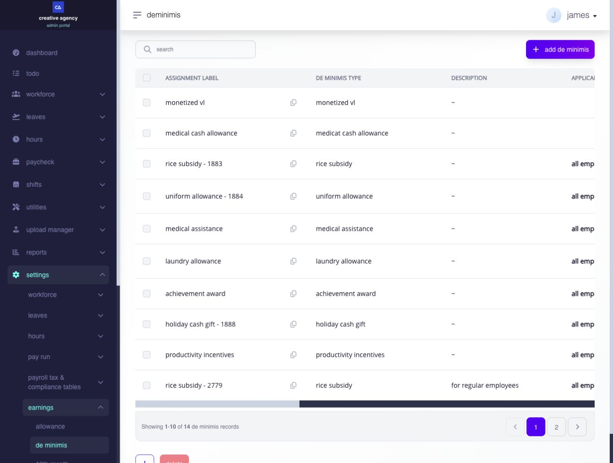
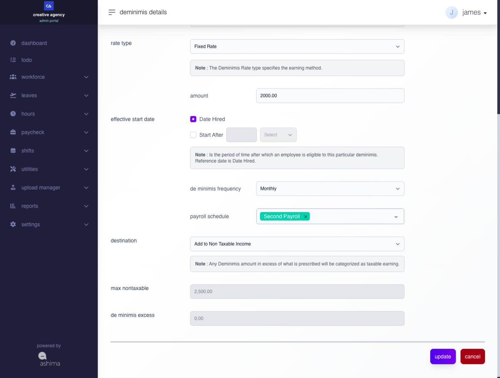
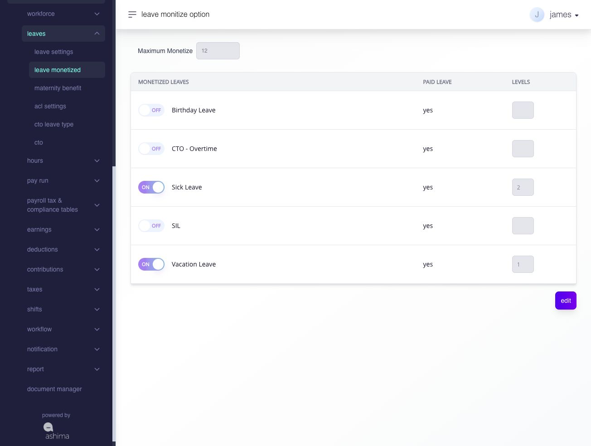
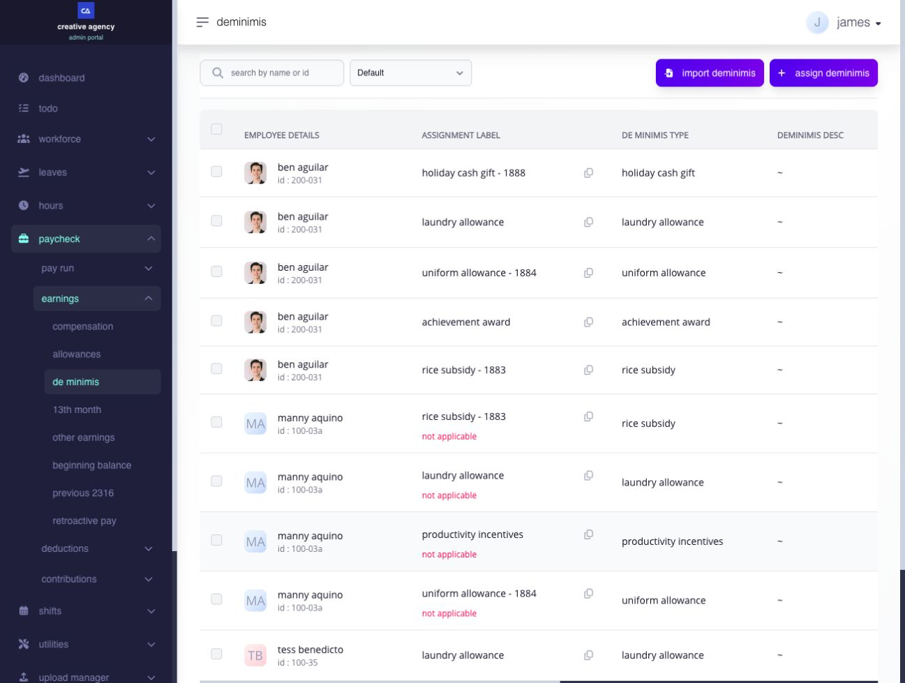
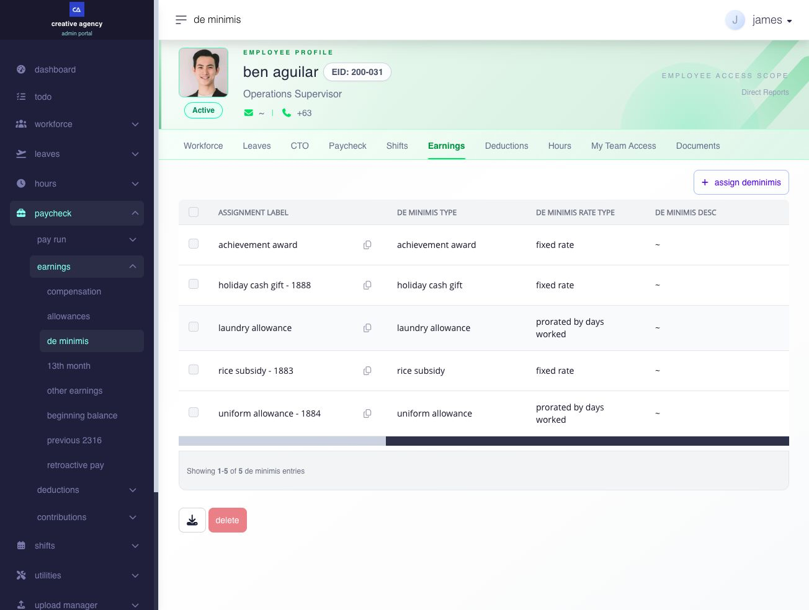
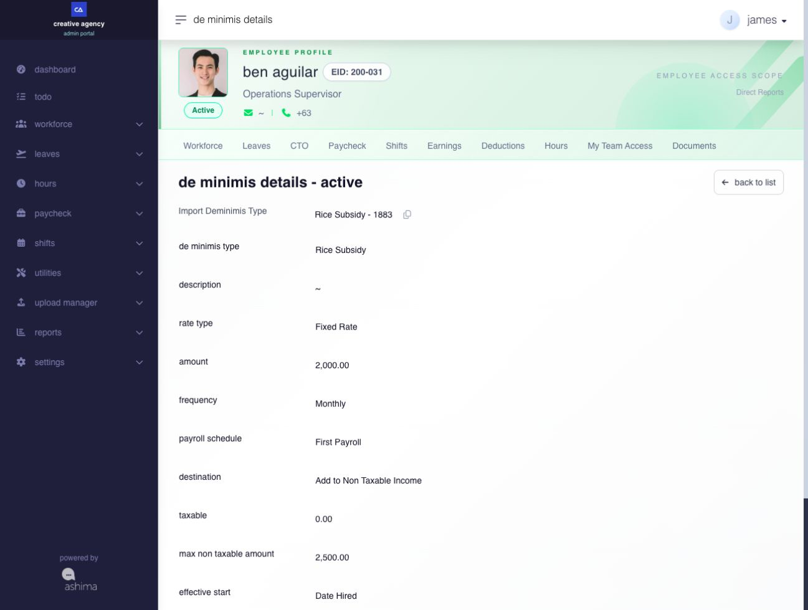
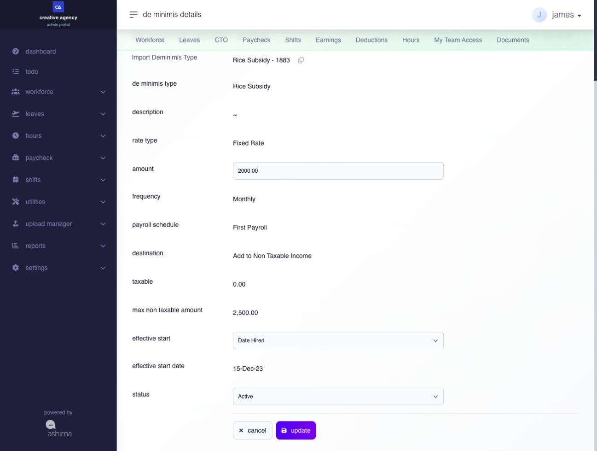
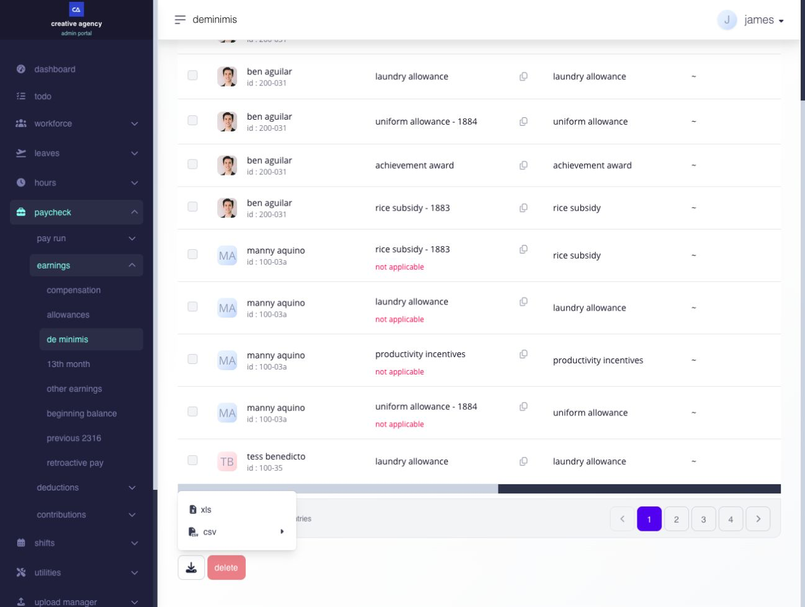
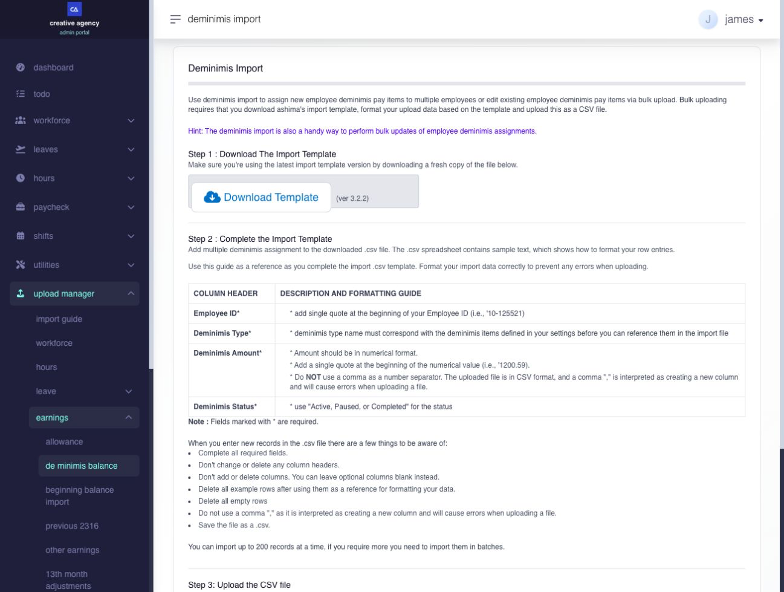
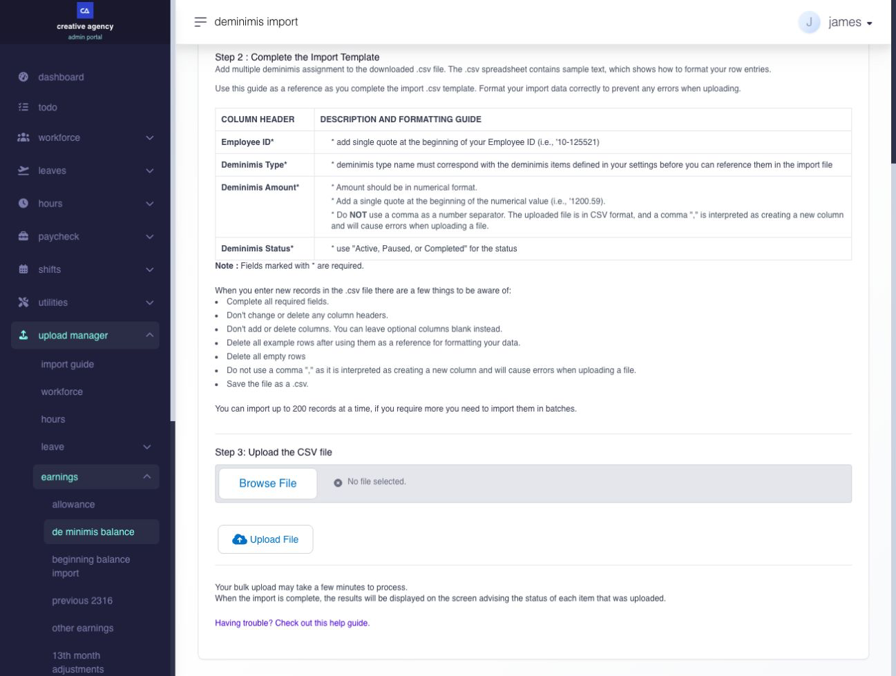

# configure and assign De Minimis benefits

## configure and assign De Minimis benefits

Use **De Minimis** to review company de minimis items and maintain employee assignments.

**Navigation:** Go to **Paycheck → Earnings → De Minimis**. Company item definitions are maintained under **Settings → Earnings → De Minimis**.

The company item controls the applicable maximum non-taxable cap. The employee assignment controls the amount assigned to a particular employee. Updating a company item's cap does not increase the employee's assigned amount.

Under the ceilings in BIR Revenue Regulations No. 29-2025, an administrator must save each active De Minimis company item for Ashima to apply its supported current cap. Update employee assignments separately only when the amount provided to an employee must change.

### what is the difference between an item and an employee assignment?

* A **company item** defines the name, applicable classification, limits, and available behavior.
* An **employee assignment** selects that item for an employee. It records the supported employee amount, dates, or schedule.

Creating a company item does not automatically assign it to every employee.

### before you begin

Confirm the following before creating, updating, or removing an assignment:

* The correct company item and its current tax and payroll meaning.
* Whether the employee already has the same or a related assignment.
* The supported amount, effective date, and schedule.
* Whether an open payroll already uses the assignment.


Do not repurpose an item used in historical payroll when its business or tax meaning changes. Create a new item and stop new use of the old item when the page supports that approach.



Saving the company item applies its supported current maximum non-taxable cap. This does not change the amount assigned to an employee. Update employee assignments only when those amounts must also change.


#### what are the current maximum non-taxable ceilings?

the following ceilings are based on BIR Revenue Regulations No. 29-2025. The company item must be saved for Ashima to apply the supported ceiling.

| benefit                                 | maximum non-taxable ceiling |
| --------------------------------------- | --------------------------: |
| rice subsidy                            |             2,500 per month |
| laundry allowance                       |               400 per month |
| medical cash allowance                  |               333 per month |
| uniform allowance                       |              8,000 per year |
| medical assistance                      |             12,000 per year |
| achievement award                       |             12,000 per year |
| gifts                                   |              6,000 per year |
| monetized unused vacation leave credits |                     12 days |

### how do I apply the current De Minimis threshold?

#### step 1: update the De Minimis type settings

<figure><figcaption>
Find each company item in Settings before reviewing its non-taxable cap.
</figcaption></figure>

\
in Ashima, most deminimis types, such as **rice subsidy, uniform allowance, holiday cash gift**, and others, can be managed under **deminimis settings**.\
\
to apply the supported current non-taxable caps, update each active De Minimis type setting.

1. go to **settings > paycheck > earnings > deminimis**.
2. open a deminimis type.
3. Check the item's **Max Nontaxable** value. If it needs the supported current cap, select **Edit**, review the other fields, then select **Update**.

The current detail page opens directly in edit mode when you select **Edit**; no separate checking notice appeared in the tested account. The maximum is a read-only field on this form. After saving, reopen the item and verify the cap.\
\
you do **not** need to manually enter or change the cap amount.


Saving each active company item is sufficient when employee assignment amounts are not changing.


**example**\
\
to apply the supported current cap for **Rice Subsidy**:

* open the existing **Rice Subsidy** De Minimis type;
* select **Edit** and review the displayed amount, rules, and read-only maximum; and
* select **Update**.

saving the record applies the supported cap for that De Minimis type. Reopen the item to confirm its value. 

<figure><figcaption>
Review the amount and other rules before selecting Update. The maximum is displayed but cannot be typed into here.
</figcaption></figure>


repeat these steps for every active De Minimis type that must use its supported current cap.


#### how do I verify the update?

check the **Max Non-Taxable** column for each active De Minimis type in **Settings**.\
\
the saved item is ready when the column shows the applicable current cap.

<figure><figcaption>
The company amount and its maximum non-taxable cap are separate values.
</figcaption></figure>


For a cap refresh, edit and save the existing De Minimis type so its other rules and configuration remain attached to the same item. Do not create a duplicate type solely to apply the current cap.


#### step 2: update monetized unused leaves

most De Minimis types, including rice subsidy and uniform allowance, are managed under **De Minimis Settings**.\
\
the **monetized unused leave conversion** type is configured under **Leave Settings**.\
\
if the company treats monetized unused leave as de minimis, go to:

**Settings → Leaves → Leaves Monetized**, and review the maximum monetized leave credits against the applicable current ceiling.

save any required change to the monetized leave settings.\
\
for **Leave Conversion Monetization**, also review which leave types are included and their priority order, such as converting **Vacation Leave** before **Sick Leave**. The ceiling, eligible leave types, and conversion priority control different parts of the result.

<figure><figcaption>
Review the maximum and the leave types included in monetization.
</figcaption></figure>

### how do I assign a de minimis item?

1. Open the De Minimis list or the employee's de minimis details.
2. Search for and select the employee.
3. Select the correct de minimis item.
4. Enter the supported amount, dates, or schedule.
5. Review the item and employee values.
6. Save the assignment.
7. Review the next affected payroll. Recalculate an open payroll when required.

### how do I update or remove an assignment?

Open the employee's de minimis details. Select the supported **Edit** or **Remove** action.

Before saving, check whether an open payroll already includes the item. Removing an assignment stops the employee's applicable use according to its dates and payroll state. It does not rewrite completed historical payroll.

### what should I review after saving?

Review the following:

* The employee and selected item.
* The amount and effective dates.
* Payroll and tax treatment.
* Open-payroll recalculation.
* The resulting payslip and payroll report, where applicable.

### when should I update employee De Minimis amounts?

update employee assignments when the amount provided to one or more employees must change. use individual editing for a small number of assignments or the **De Minimis** bulk upload file for multiple assignments.\
\
skip this task when employee assignment amounts remain unchanged.


first save the applicable company De Minimis items as described above.\
\
confirm the company caps before increasing employee assignment amounts.


#### steps to update employee amounts

you can update employee deminimis amounts **individually** or **in bulk**. 

**Step 1: access the deminimis module assignment table**

1. navigate to **paycheck > earnings > deminimis** in the main menu.
2. this page displays the **deminimis assignment table**, showing all deminimis types currently assigned to your employees.

from here, you can choose to update assignments **per employee** or **in bulk**.

<figure><figcaption>
The assignment table lists employee items; scroll across for their amounts and other columns. Import Deminimis opens the separate bulk-update workflow.
</figcaption></figure>

#### step 2a: update an individual employee

_Use this option if you want to update the deminimis amount for a single employee or a small number of employees._ 

1. Use the **search bar** to locate the employee whose deminimis you want to update.
2. A list of deminimis types assigned to that employee will be displayed.

<figure><figcaption>
Open the employee's assigned item before changing its amount.
</figcaption></figure>

3. Click anywhere on the row to open the selected employee's assigned deminimis types. 
4. Click the specific deminimis type you wish to edit to open the **deminimis type details** page. Update the **Amount** field with the new value you wish to assign to the employee. 

<figure><figcaption>
Check the employee amount against the company item's maximum before editing.
</figcaption></figure>

5. Select **Update** and reopen the assignment to confirm the saved amount.

<figure><figcaption>
Change the employee amount only when the benefit actually changes, then select Update.
</figcaption></figure>

6\. Repeat these steps for any other deminimis types or employees you want to update individually.

#### step 2b: update employees in bulk

Use **Import Deminimis** when several employee assignments need new amounts or when adding assignments for several employees. The **Download** button on the assignment table offers **XLS** and **CSV** exports of that list; it does not provide the import-ready template.

<figure><figcaption>
Use this menu to review the assignment list. Start the bulk update with Import Deminimis instead.
</figcaption></figure>

1. On **Paycheck → Earnings → De Minimis**, select **Import Deminimis**. The import page opens in a separate tab.
2. Select **Download Template** on the import page. Use a fresh copy so its columns match the current import format.
3. In the CSV template, enter **Employee ID**, **Deminimis Type**, **Deminimis Amount**, and **Deminimis Status** for each record. Use an existing company item name and the page's formatting guide. Keep the template headers and columns unchanged, remove example and empty rows, and avoid commas in numeric amounts.
4. Save the file as CSV. The page states a limit of **200 records per import**; split larger updates into batches.
5. Select **Browse File**, choose the completed CSV, and select **Upload File**. Review the on-screen result for each row before relying on the new amounts.

<figure><figcaption>
Use the import template and its current column guide for bulk additions or edits.
</figcaption></figure>

<figure><figcaption>
Upload the completed CSV and review the row results on this page.
</figcaption></figure>


If the employee's assigned amount is not changing, no employee-assignment update is needed merely because the company item's maximum cap changed.


### downloads and imports

Use the available list download to review assignments. Use an import-ready file only with its matching current import workflow and template.

Confirm row results before relying on a bulk change. Do not modify fields outside the supported import values.

### related articles

* [Earnings and de minimis items](../../settings/earnings/configure-de-minimis-item-types-and-limits.md)
* [Compensation details](../../workforce/compensation-and-payroll-assignments/set-up-employee-compensation.md)
* [Employee pay details](../run-payroll/review-employee-pay-details.md)
* [Payroll register](../../reports/payroll-and-accounting/generate-and-review-the-payroll-register.md)
