# run and review Year End

## run and review Year End

<figure>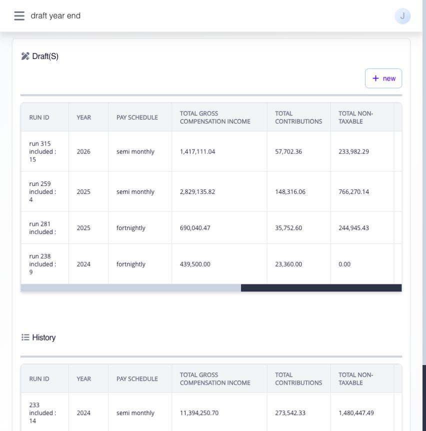<figcaption>
Find the tax year and pay schedule under Draft(s), or open a completed run under History.
</figcaption></figure>

Year End brings an employee's compensation and withholding for one tax year into a single report. Use it to check the annual tax result, resolve missing or duplicate records, review the draft Form 2316 and Alphalist, and prepare the final outputs. Opening a report does not submit a tax filing or settle a refund in payroll.

**Navigation:** Go to **Paycheck → Pay Run → Year-End**.

### start here: what is the sequence?

1. Confirm that all applicable payrolls for the year are closed. Check employee records and any [beginning balances](corrections-controls-and-ingestion/import-and-review-beginning-balances.md) or previous-employer Form 2316 records needed for the year.
2. Open an existing draft or select **New** to create a run for the correct **Year** and **Pay Schedule**.
3. Review employees in **above MWE** and **MWE**. Trace each annual figure from Ashima payroll through the imported sources to **Tax Due** and **Adjustment**.
4. Use **check updates** and **recalculate** when the employee list or source figures change. Resolve identity, inclusion, and tax-review decisions before approval.
5. Open an employee's available draft **2316**, and download the draft **year-end** and **alphalist** files to check their details.
6. Add the signatory information needed for the form, then select **Submit for approval**. After the run closes, generate and download the final Form 2316 archive and prepare the applicable DAT output for your company's filing process.


**Review before submission.** A draft Alphalist or Form 2316 is useful for checking the run. It is not proof that the run has been approved, the form has been issued, or a BIR file has been submitted or accepted.


### what information does Year End use?

Year End uses closed Ashima payroll for the selected tax year and pay schedule. This includes taxable and non-taxable earnings, 13th Month and other benefits, statutory contributions, withholding, and supported adjustments recorded in the source payroll. It also uses these imported sources when they apply:

| Source                 | When to use it                                                                                                                    | What to check                                                                                                                                                                  |
| ---------------------- | --------------------------------------------------------------------------------------------------------------------------------- | ------------------------------------------------------------------------------------------------------------------------------------------------------------------------------ |
| **Beginning Balance**  | Your company processed part of the same tax year before using Ashima, or must carry in approved present-employer opening figures. | Confirm the employee, year, taxable and non-taxable amounts, contributions, and tax withheld against source records. Do not upload the same payroll period twice.              |
| **Previous 2316**      | An employee had a previous employer in the tax year and its Form 2316 information belongs in the annual review.                   | Confirm the employee and TIN, previous-employer compensation, and tax information against that employer's certificate. This is separate from your company's beginning balance. |
| **Year End ingestion** | A supported Year End-specific adjustment is needed.                                                                               | First determine whether the problem actually belongs in payroll, Beginning Balance, or Previous 2316. Correct that source when it is wrong, then recalculate.                  |


**One year, three sources:** Ashima payroll + present-employer beginning balance + previous-employer Form 2316, when applicable, provide the annual source picture. A blank imported-source group can be correct when that source does not apply. It needs attention when the source should exist but was not recorded.


### where does a payroll item appear in Year End?

For an item on a **closed Ashima payroll**, start in the **ASHIMA** columns. Then follow its tax treatment: a non-taxable amount goes to **ASHIMA NON-TAXABLE**; a taxable amount goes to **ASHIMA TAXABLE**. The same benefit can have amounts on both sides. **Beginning Balance** is for your company's earlier payroll outside Ashima, and **Previous Employer 2316** is for another employer's certificate. Those amounts have their own columns; do not look for them under ASHIMA.

| Item from a closed Ashima payroll                                    | Where to look in Year End                                                                                                                                      | What to remember                                                                                                                                                                                                                             |
| -------------------------------------------------------------------- | -------------------------------------------------------------------------------------------------------------------------------------------------------------- | -------------------------------------------------------------------------------------------------------------------------------------------------------------------------------------------------------------------------------------------- |
| Basic pay for an employee above MWE                                  | **ASHIMA TAXABLE → Basic Salary**                                                                                                                              | The Year End figure is not necessarily the payslip's gross basic pay. Tardiness, undertime, absences, employee contributions, and other supported adjustments affect this column. Open its breakdown and compare the closed payroll periods. |
| Basic statutory minimum wage for an MWE                              | **MWE → ASHIMA NON-TAXABLE → Basic SMW**                                                                                                                       | Use the MWE tab. Taxable excess or other taxable compensation, if any, appears in the taxable part of that row.                                                                                                                              |
| Overtime, night differential, and rest-day or holiday premium        | **ASHIMA TAXABLE → Overtime**, **Night Differential**, or **RD/Holiday Premium**                                                                               | Each has its own column. For an MWE, check the separately displayed exempt MWE overtime, night differential, and holiday-pay columns before assuming the amount is taxable.                                                                  |
| De Minimis benefit                                                   | **ASHIMA NON-TAXABLE → De Minimis** for its non-taxable portion                                                                                                | If an amount becomes taxable after the applicable benefit treatment, look under **ASHIMA TAXABLE → 13th Month & Other Benefits**. Do not expect every peso of a De Minimis item to remain in the De Minimis column.                          |
| 13th Month pay                                                       | **ASHIMA NON-TAXABLE → 13th Month & Other Benefits** for its non-taxable portion; **ASHIMA TAXABLE → 13th Month & Other Benefits** for its taxable portion     | The annual treatment can split one benefit across both columns. Review the source 13th Month payroll and any beginning-balance or previous-employer benefit amounts before interpreting an excess.                                           |
| Other earnings, allowances, service charges, or hazard pay           | **ASHIMA NON-TAXABLE → 13th Month & Other Benefits** or **ASHIMA TAXABLE → 13th Month & Other Benefits**, according to the item's recorded tax treatment       | “Other Benefits” is a group, not a separate column for every earning name. Use the amount's breakdown and the source payslip to identify the particular item.                                                                                |
| Employee statutory contributions                                     | **ASHIMA NON-TAXABLE → Contributions** and the Ashima **Total Contributions** summary                                                                          | Contributions also affect the taxable basic-salary calculation. Do not add the contribution column to compensation a second time.                                                                                                            |
| Tax withheld on a closed payroll                                     | Ashima **Total Taxes Withheld**; later combined in **TAX WITHHELD FOR THE YEAR**                                                                               | The later figure can also include withholding from Beginning Balance and Previous Employer 2316, plus supported termination effects.                                                                                                         |
| Payroll adjustment, post-payroll adjustment, or retroactive pay      | **ASHIMA TAXABLE → Adjustments**, **Post Payroll Adjustments**, or **Retroactive Pay**, with their workday, overtime, holiday, NSD, leave, or other subcolumns | Follow the correction's own group rather than adding it again to the original pay category. Check the covered payroll period and the employee-row breakdown.                                                                                 |
| Supported exempt amounts such as maternity differential or severance | **ASHIMA NON-TAXABLE → Salaries & Other Forms of Compensation**                                                                                                | This is a separate exempt-compensation group. Confirm the source and classification before treating another item as belonging here.                                                                                                          |

For example, on an above-MWE employee's closed payslip, trace basic pay to **Basic Salary**, overtime to **Overtime**, the non-taxable De Minimis portion to **De Minimis**, and a taxable allowance to taxable **13th Month & Other Benefits**. Then compare the payslip's withholding with **Total Taxes Withheld**. Year End combines those mapped amounts across the closed payroll periods; the totals are summaries of the detail, not extra earnings to add again.

### create or find a run

<figure>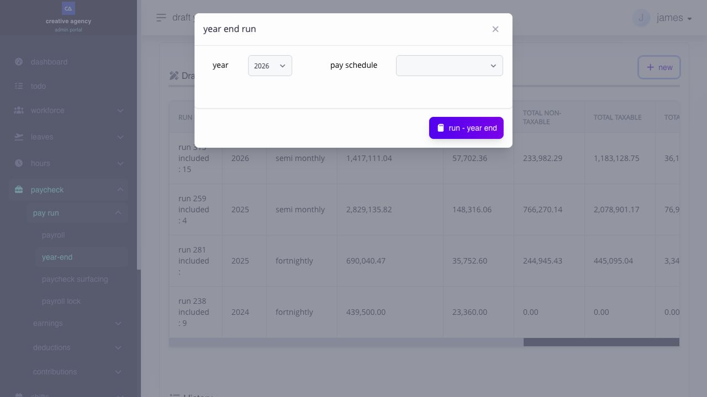<figcaption>
Choose the tax year and pay schedule before running Year End. This example shows selections in the test company; no run was created for the screenshot.
</figcaption></figure>

The **Draft(s)** table lists open Year End runs; **History** lists completed runs. Each row shows its **Run ID**, **Year**, **Pay Schedule**, **Total Gross Compensation Income**, **Total Contributions**, **Total Non-Taxable**, **Total Taxable**, **Total Tax Due**, **Total Tax Withheld**, and **Status**. **Run ID** distinguishes runs for the same year. **Pay Schedule** identifies the employee schedule covered by the run; do not assume that one run includes employees on every schedule. The totals provide a quick comparison, but review the employee rows before relying on them.

To create a run, select **New**, choose the tax **Year** and **Pay Schedule**, then select **run - year end**. The form offers **Semi Monthly**, **Fortnightly**, **Weekly**, and **Monthly** schedules. To continue a draft, select its row under **Draft(s)**. Ashima may show a data-preparation message while it gathers employees and computes the report. Wait for the detail page to load before reviewing its totals.


**Choose the correct year and schedule.** A report for the wrong combination can appear plausible while omitting the employees or payroll periods you meant to review.


### find an employee and read the table

<figure>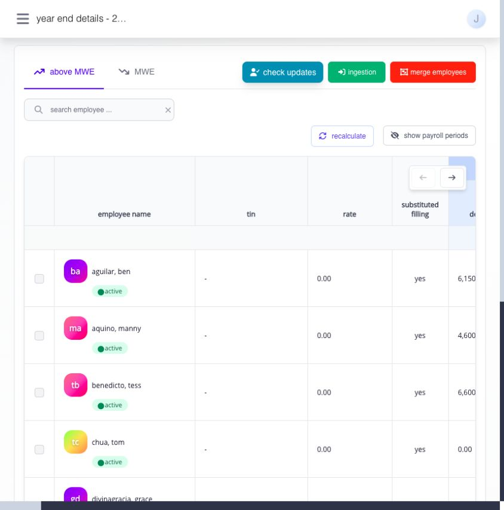<figcaption>
Start with the right employee group, then follow the same row across the report.
</figcaption></figure>

Choose **above MWE** or **MWE** first. These tabs separate employees by minimum-wage-earner classification and show different compensation breakdowns. Active and terminated employees may appear with their employment status. Use **search employee ...** to narrow the current tab, and **clear search** to remove the filter. If someone seems missing, check both tabs before changing the run.

Each employee row starts with a selection **checkbox**. Select the employee before using **include / exclude** or **substitute filing**; these actions are unavailable when no row is selected. **Employee Name** and status identify the record; **TIN** is the tax identifier to reconcile with source documents. The early **Rate** column shows the employee's basic pay rate, not the annual tax bracket **Rate** shown later under **TAX DUE**. **Substituted Filling** is the report's current column label for the employee's substitute-filing status.

Select **show payroll periods** to display each closed-payroll period's **Gross**, **Withholding**, and **Contributions** behind the Ashima totals; select it again to return to the shorter view. These period figures help locate the payslip behind an unexpected annual amount. Use **Scroll left** and **Scroll right**, or the table's horizontal scrollbar, to follow the same employee across the wide report. A group off-screen has not been omitted from the calculation. Where a figure has a hover breakdown, use it to identify the components before opening the source payroll.

#### what do the Ashima non-taxable columns show?

The **ASHIMA NON-TAXABLE** group separates **De Minimis**, **Contributions**, **13th Month & Other Benefits**, and **Salaries & Other Forms of Compensation**, then shows **Total Non-Taxable**. Review each classification against the source payroll. A value belongs here because of its payroll and tax treatment, not merely because its name sounds like an allowance.

#### what do the Ashima taxable columns show?

The **ASHIMA TAXABLE** group contains these amounts and totals:

| Column                                                                         | What to look for                                                                                                                                                                     |
| ------------------------------------------------------------------------------ | ------------------------------------------------------------------------------------------------------------------------------------------------------------------------------------ |
| **Basic Salary**, **Overtime**, **Night Differential**, **RD/Holiday Premium** | Taxable pay earned in those categories in closed Ashima payroll. Compare an unexpected amount with the relevant payslip and pay period.                                              |
| **Adjustments**                                                                | Taxable workday, overtime, holiday, NSD, paid-leave, allowance, and other-earning adjustments shown in the detail columns.                                                           |
| **Post Payroll Adjustments**                                                   | Workday, tardiness, undertime, leave, overtime, and NSD corrections recognized after payroll. Check the correction and the payroll it affected.                                      |
| **Retroactive Pay**                                                            | Recognized regular hours, paid or unpaid leave, overtime, rest-day/holiday premium, and NSD from retroactive pay. Check the covered dates and avoid counting the original pay twice. |
| **13th Month & Other Benefits**                                                | The taxable portion recognized for these benefits. The non-taxable portion appears separately.                                                                                       |
| **Total Taxable**                                                              | The combined Ashima taxable categories for the employee. The detail columns explain the total; do not add them to it again.                                                          |
| **Gross Compensation Income**                                                  | The Ashima compensation total represented by the taxable and non-taxable groups.                                                                                                     |
| **Total Contributions**, **Total Taxes Withheld**                              | Recognized contributions and withholding from the Ashima source. Compare them with closed payslips.                                                                                  |

#### how do the Beginning Balance columns work?

**BEGINNING BALANCE - CURRENT EMPLOYER** contains opening amounts for your own company. Read its two groups separately:

| Column                                                                                               | What it represents                                                                                                                                   |
| ---------------------------------------------------------------------------------------------------- | ---------------------------------------------------------------------------------------------------------------------------------------------------- |
| **Non-Taxable → Basic Salary**                                                                       | The exempt basic salary or statutory minimum wage portion carried in from your earlier payroll records.                                              |
| **Non-Taxable → 13th Month & Other Benefits**, **De Minimis**                                        | The imported non-taxable portions of those benefits. Check that the corresponding taxable portion, if any, was entered in the taxable group instead. |
| **Non-Taxable → Contributions**                                                                      | Imported SSS, GSIS, PHIC, PAG-IBIG, or union-dues amounts represented by the source record.                                                          |
| **Non-Taxable → Salaries & Other Forms of Compensation**, **Total Non-Taxable**                      | Other exempt compensation and the sum of the opening non-taxable group.                                                                              |
| **Taxable → Basic Pay**, **13th Month & Other Benefits**, **Salaries & Other Forms of Compensation** | The taxable portions of the same opening-period compensation, kept apart from exempt amounts.                                                        |
| **Total Taxable**, **Gross Compensation Income**, **Total Taxes Withheld**                           | Opening taxable total, compensation total, and withholding already taken by your company before the Ashima payroll periods represented in this run.  |

Use these columns only for the periods and amounts represented by the [Beginning Balance import](corrections-controls-and-ingestion/import-and-review-beginning-balances.md). If Ashima already has a closed payslip for a period, do not also include the same compensation as a beginning balance. Compare the imported category and year with the approved opening records before recalculating.

#### what does Previous Employer 2316 add?

**PREVIOUS EMPLOYER 2316 NON-TAXABLE** and **PREVIOUS EMPLOYER 2316 TAXABLE** show amounts imported from the other employer's certificate:

| Column                                                                                                                           | What it represents                                                                                                        |
| -------------------------------------------------------------------------------------------------------------------------------- | ------------------------------------------------------------------------------------------------------------------------- |
| **Non-Taxable → Basic Salary / Basic SMW**                                                                                       | The previous employer's exempt basic pay or statutory minimum wage amount.                                                |
| **Non-Taxable → Holiday Pay**, **Overtime Pay**, **Night Shift Differential**, **Hazard Pay** for MWE                            | Separately reported exempt MWE pay from that employer. These are source-certificate amounts, not new Ashima earnings.     |
| **Non-Taxable → 13th Month Pay & Other Benefits**, **De Minimis**, **Contributions**, **Salaries & Other Forms of Compensation** | The other exempt benefit, deduction, and compensation categories reported on the certificate.                             |
| **Total Non-Taxable / Exempt Compensation**                                                                                      | Sum of the previous employer's exempt categories shown in this group.                                                     |
| **Taxable → Basic Salary**, **13th Month Pay & Other Benefits**, **Salaries & Other Forms of Compensation**                      | Taxable compensation reported by the previous employer.                                                                   |
| **Total Taxable Compensation**, **Gross Taxable Income**, **Tax Due**                                                            | The certificate's taxable totals and tax information used in the annual review. Compare them with the uploaded Form 2316. |

Check employee identity and the certificate's tax year before using these values. A previous-employer 2316 is not a substitute for your company's beginning balance. If an amount appears in both imported groups, determine which source owns it before approving the run.

#### what is different in the MWE tab?

<figure>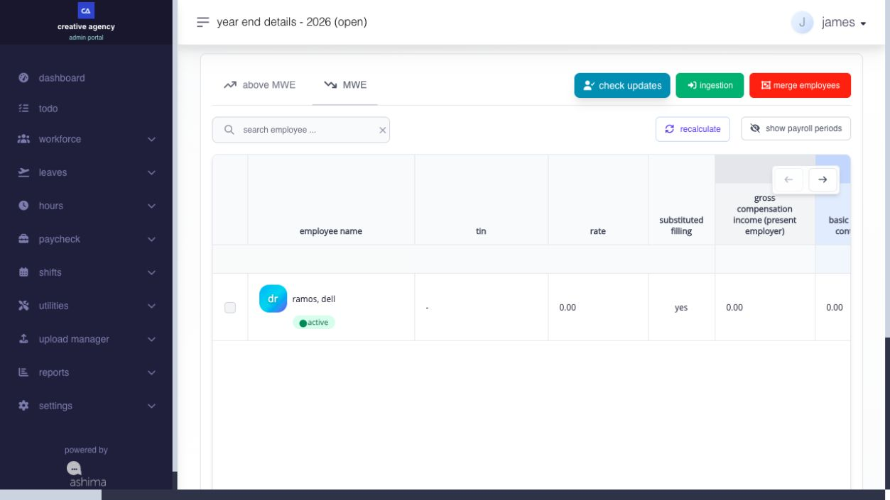<figcaption>
The MWE tab has its own employee list and exempt-compensation columns.
</figcaption></figure>

For minimum wage earners, the report calls out **Gross Compensation Income (Present Employer)** and the separate exempt categories: **Basic SMW (net of contributions)**, **RD/Holiday Pay**, **Overtime Pay**, **Night Shift Differential**, **Hazard Pay**, **13th Month Pay & Other Benefits**, **De Minimis Benefits**, **Contributions**, and **Salaries & Other Compensation**. Read these as components of the employee's **Total Non-Taxable/Exempt Compensation**, rather than adding that total again. The taxable side identifies **Basic Salary (net of contributions and union dues)**, any taxable **13th Month Pay & Other Benefits**, and taxable **Salaries & Other Forms of Compensation**. **Total Taxable Compensation** and **Gross Taxable Income** summarize that side. Beginning Balance and Previous Employer 2316 have corresponding non-taxable and taxable groups.

Use this separate view to check the employee's MWE classification and the treatment of each pay component. Do not copy an Above MWE employee's tax interpretation onto an MWE row. If the employee is on the wrong tab, correct the underlying classification, use **check updates**, and review the recalculated result.

### how is the annual tax result calculated?

<figure>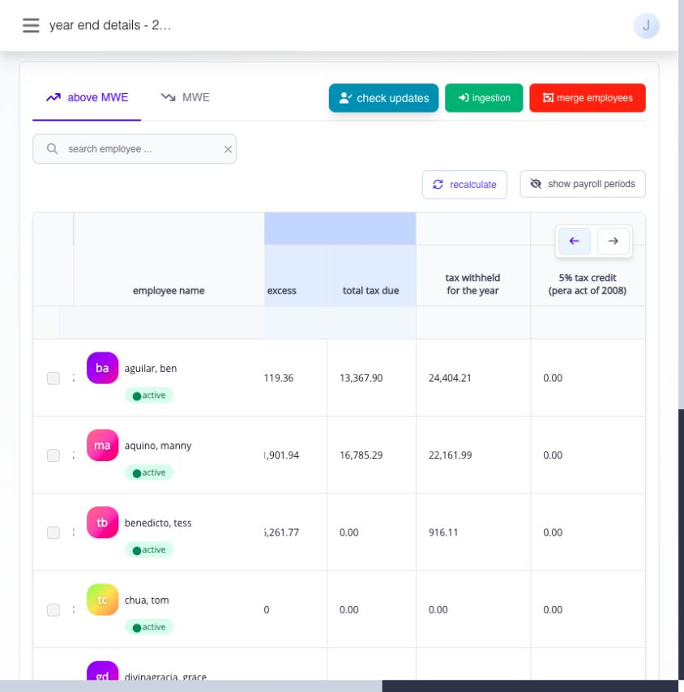<figcaption>
Compare Total Tax Due with TAX WITHHELD FOR THE YEAR for the same employee.
</figcaption></figure>

The report builds **NET TAXABLE** from taxable components of the Ashima, Beginning Balance, and Previous Employer 2316 groups. Ashima's taxable group includes applicable payroll adjustments, post-payroll adjustments, retroactive pay, and taxable 13th Month or other benefits. Non-taxable values remain visible for reconciliation but are not simply added to net taxable income.


**Read the calculation in this order:**

1. Annual net taxable income = taxable Ashima amounts + taxable present-employer beginning balance + taxable previous-employer 2316 amounts.
2. **Excess** = **NET TAXABLE** − **First Tax**, the starting taxable amount for the applicable annual tax band. **First Tax** is a threshold, not tax already paid. **Total Tax Due** = the annual table's starting tax for that band + **Excess** × the tax-band **Rate**.
3. Year End tax difference = **TAX WITHHELD FOR THE YEAR** + any applicable displayed tax credit − **Total Tax Due**. A positive difference is a potential **Refund**; a negative difference appears as **Payable**.


**TAX WITHHELD FOR THE YEAR** combines withholding recognized from Ashima payroll, the present-employer beginning balance, and previous-employer information. Termination-related refunds or additional tax already settled can also affect this figure. The report displays a **5% Tax Credit (PERA ACT of 2008)** column; use any amount shown there in the comparison, but do not assume a credit applies merely because the column exists. **Adjusted TAX WITHHELD FOR THE YEAR** is a separate review field for a supported manual adjustment to the displayed withholding figure.

For example, suppose verified taxable sources are ₱480,000 from Ashima, ₱70,000 from your company's beginning balance, and ₱50,000 from a previous employer. **NET TAXABLE** is ₱600,000. Under the annual tax band effective from 2023 onward, **First Tax** is ₱400,000, **Excess** is ₱200,000, and **Rate** is 20%. The starting tax is ₱22,500, so **Total Tax Due** is ₱22,500 + (₱200,000 × 20%) = ₱62,500. If recognized withholding is ₱55,000, the comparison shows **Payable** of ₱7,500 before any applicable credit or supported correction. This is an illustration; use the tax table and amounts displayed for the employee's actual year. The [BIR annual rate table](https://bir-cdn.bir.gov.ph/BIR/pdf/RMC%20No.%2034-2025%20Annex%20A.pdf) provides the statutory bands used in this example.


**The report does not itself pay or collect the difference.** Confirm where a refund or additional withholding is applied in payroll, then check the resulting payslip and Year End figures. Submitting Year End alone does not settle the balance.


<figure>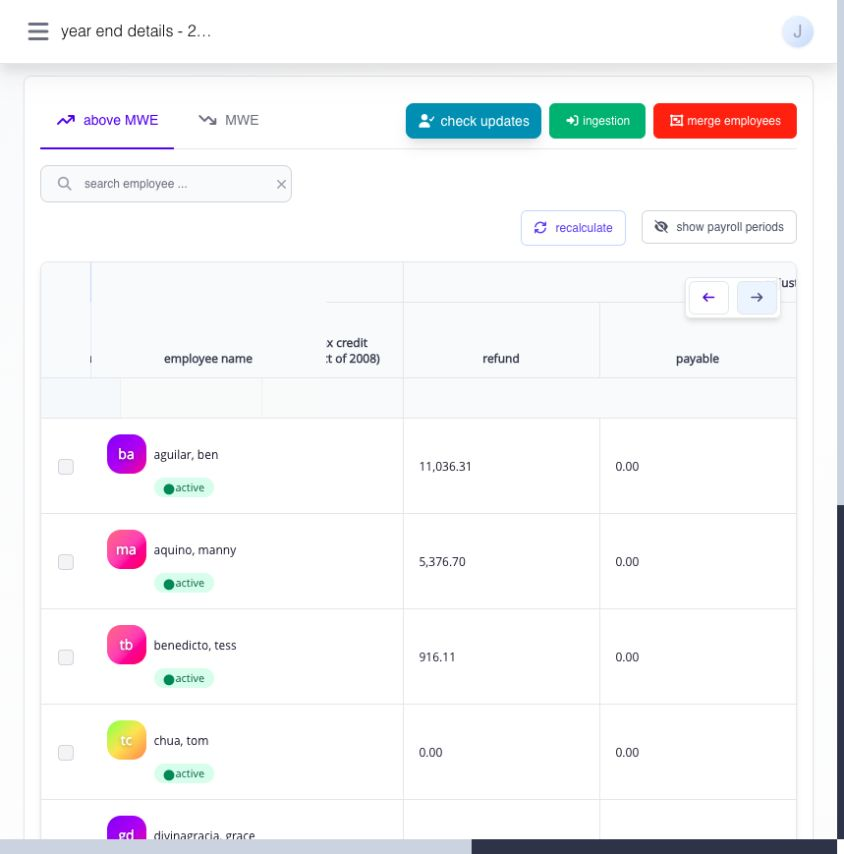<figcaption>
Refund and Payable are the annual comparison result. Verify how any amount is handled in payroll.
</figcaption></figure>

### check updates or recalculate: which should i use?

<figure>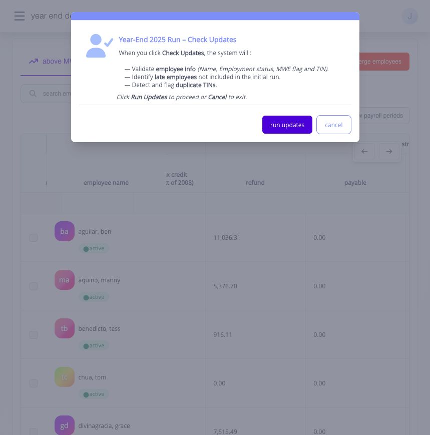<figcaption>
Check updates identifies employee changes before you choose Run Updates.
</figcaption></figure>

| Control           | What it checks or changes                                                                                                                                                                                                   | Use it when                                                                                                                                                                                                                                   |
| ----------------- | --------------------------------------------------------------------------------------------------------------------------------------------------------------------------------------------------------------------------- | --------------------------------------------------------------------------------------------------------------------------------------------------------------------------------------------------------------------------------------------- |
| **check updates** | Checks employee **Name**, **Employment status**, **MWE flag**, and **TIN**; looks for employees added after the run was first prepared; checks duplicate TINs. Its dialog asks you to select **Run Updates** or **Cancel**. | An employee is missing, an identity or classification changed, or the draft has been open while employee records changed. After the check completes, review the affected employee rows; the completion message is not an itemized comparison. |
| **recalculate**   | Recomputes Year End amounts from available source data. A row may also show that an employee needs recalculation after a system or source change.                                                                           | A closed payroll, import, Year End ingestion, or calculation basis changed after your last review. Recheck the affected employee's totals, tax result, and draft outputs afterward.                                                           |

**Check updates** answers “are the right employees and identifying details in this run?” **Recalculate** answers “what are the amounts now, using the available source records?” If you correct a TIN and a payroll amount, use both as needed. Neither action repairs a wrong source record by itself.

### what if an employee is missing, duplicated, or should not be included?

First check the tax year and pay schedule, both MWE tabs, and the search filter. Use **check updates** to look for employees added after the run was created. If the person still does not appear, inspect the employee record and source payroll rather than guessing from the Year End total.

#### include or exclude a selected employee

<figure>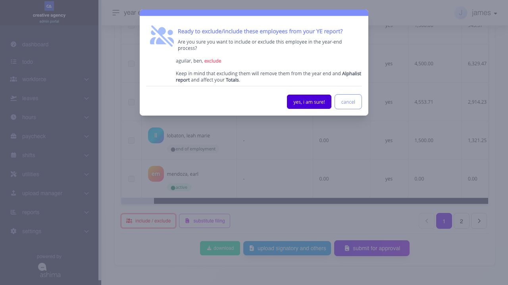<figcaption>
Read the confirmation and its effect on the Alphalist before changing an employee's inclusion.
</figcaption></figure>

Select the row's **checkbox**, then choose **include / exclude** and review the confirmation. Excluding removes the employee from this run's intended population and its related outputs; it does not delete the employee or their payroll history. If the employee belongs in the run after a correction, include them again and review the totals and Alphalist. A record merged into a primary employee cannot also be included as a separate Year End record.

#### merge records that belong to the same person

<figure>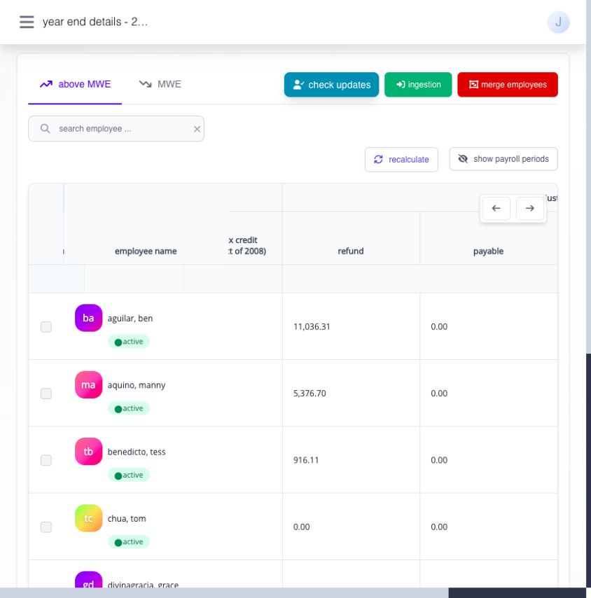<figcaption>
Search and verify the records before confirming an employee merge.
</figcaption></figure>

**merge employees** opens a search dialog for duplicate employee records. Search for the employee, inspect the records and source payroll, choose the correct primary record, and review the selection count before confirming. The merge combines selected Year End records into the primary employee; it is not a general way to join two employees who merely share a TIN. A merged record cannot be merged again as a separate primary record. Recheck taxable income, withholding, the employee-level 2316, and the Alphalist afterward so nothing is counted twice or omitted.


**A duplicate TIN is a prompt to investigate, not permission to merge.** Confirm that the records belong to the same person and that the proposed primary employee is correct before saving.


#### set substitute filing status

Select the employee's **checkbox** and choose **substitute filing** to set the run's **Yes** or **No** status. Use the employee's actual circumstances and your company's tax-review decision. The control records a classification in Year End; it does not submit a return or issue the employee's Form 2316. Review the saved status in the employee row and resulting output.

### when should i use ingestion or edit a withholding figure?

Use **ingestion** only when a supported Year End-specific input is needed for this run. Keep the source file and review accepted and rejected rows. If a closed payslip, Beginning Balance, or Previous 2316 is wrong, correct that owning source instead; then use **recalculate** and compare the employee's before-and-after result.

The **Adjusted TAX WITHHELD FOR THE YEAR** area can expose an edit control for an employee. Use it only when you have a verified basis for changing the displayed withholding amount, enter the supported amount, save it, and review **Refund** or **Payable** again. This does not replace correcting an incorrect payroll or imported source. Record why the adjustment was made so the final output can be reconciled.

#### enter ingestion for one employee

1. Open the run’s single-employee ingestion form and check the run, pay date, coverage and preselected employee. Employee search is disabled; **Add more** adds another item for the same employee.
2. Choose **work day**, **holiday**, **rest day**, **leaves**, **nsd**, **overtime**, **13th month**, **deminimis**, **extra compensation**, **contributions** or **withholding tax** as appropriate. Check the offered item choices.
3. De minimis, contributions and withholding tax use aggregate entries, so their item selector is hidden. Direct amounts apply to 13th month, de minimis, extra compensation, contributions and withholding tax. For other categories, review the amount offered by the form.
4. Choose a tax rule only where its control is shown and enabled. Contributions, withholding tax and 13th month have no editable tax-rule control in this form.
5. Add or remove item rows as needed, then select **Review and save**. Review the **New/Update** classifications, effects and destinations. **Back** returns without saving; **Save entries** commits the reviewed entries. Correct any failed check and review again.
6. Verify the entries through **view/manage ingestion**, then return to Year End and recalculate separately. Saving does not automatically recalculate this run. The **import file** action opens a separate import destination for this source and employee.

### inspect Form 2316 and the draft downloads

<figure>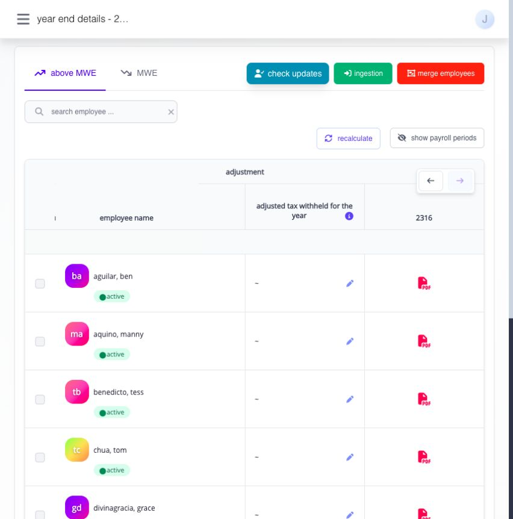<figcaption>
The rightmost columns provide a withholding adjustment control and available employee 2316 forms.
</figcaption></figure>

The employee row has a **2316** column. Open an available employee form from there to check identity and TIN, present- and previous-employer details when applicable, taxable and exempt compensation, contributions, tax withheld, and the annual result. If the row does not yet offer a form, complete the missing data or run state first rather than treating the empty indicator as a completed certificate. A form shown during draft review is not the final issued copy.

<figure>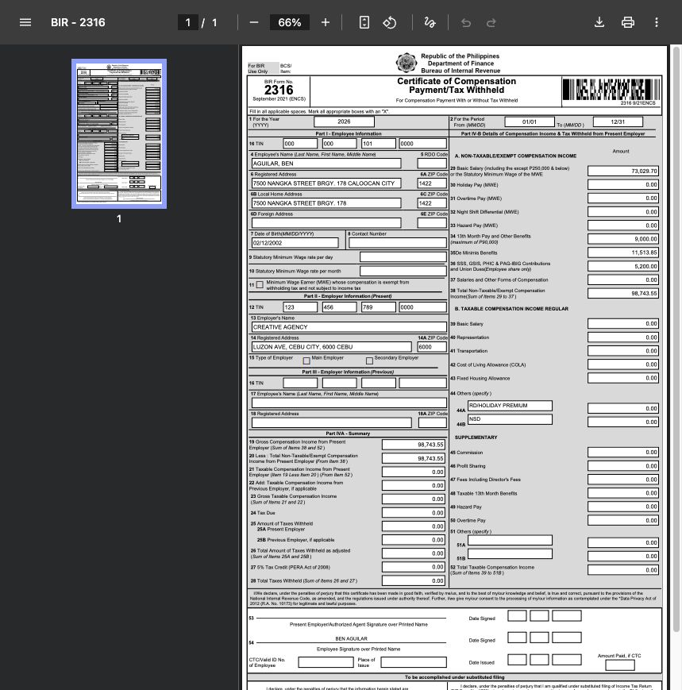<figcaption>
Open an employee's draft 2316 to compare the certificate with that employee's Year End row and source records.
</figcaption></figure>

Open **download** on the draft report. **above mwe** and **mwe** each open a submenu with **year-end** and **alphalist** downloads for that classification. The separate **1604C dat file** entry is also present. Review a draft Alphalist before approval: reconcile its employee population, classifications, TINs, compensation, and withholding with the Year End table. If you change inclusion, merge records, update identity, or recalculate, download and compare a fresh copy.

| Download                                                    | What it helps you review                                                  | What it does not do                                           |
| ----------------------------------------------------------- | ------------------------------------------------------------------------- | ------------------------------------------------------------- |
| **year-end** under **above mwe** or **mwe**                 | Detailed Year End amounts for that employee group.                        | It does not close the run.                                    |
| **alphalist** under **above mwe** or **mwe**                | Employees and annual tax information intended for the corresponding list. | A draft download is not proof of filing or acceptance.        |
| **1604C dat file**                                          | DAT output associated with the run for the company's BIR review workflow. | Generating or downloading it does not submit it to BIR.       |
| **bir form 2316 (zip file)** when available on a closed run | Generated employee Form 2316 PDFs as an archive.                          | It does not sign, issue, or deliver those forms to employees. |

<figure>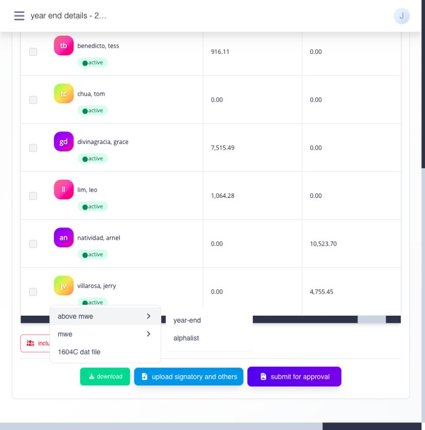<figcaption>
Open the appropriate year-end and alphalist downloads while the run is still a draft.
</figcaption></figure>

<figure>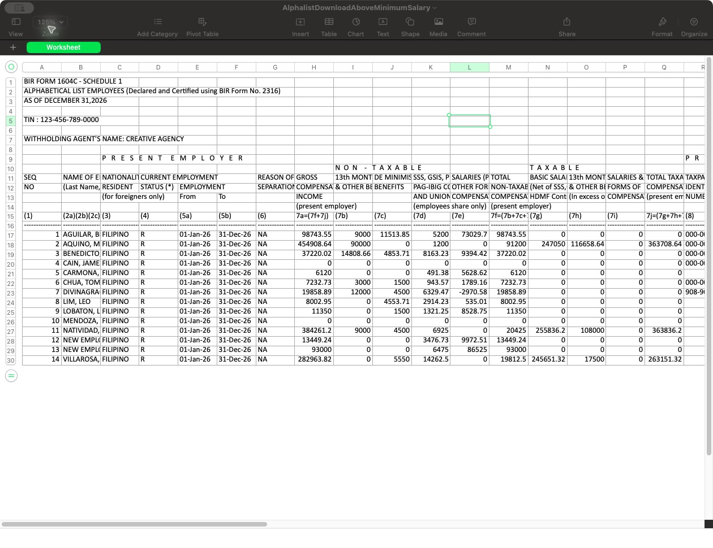<figcaption>
Sample Above-MWE draft Alphalist from the test company. Check the employee list and amounts against the current Year End run; download a new copy after any change.
</figcaption></figure>

### submit the run and prepare final documents

Before selecting **Submit for approval**, compare both MWE groups, source totals, missing or duplicate employees, substitute-filing decisions, tax due, withholding, and refund or payable amounts. Use **upload signatory and others** on the open draft for supporting signatory information required by the form, and review what was supplied. Then submit the run into the company's Year End approval workflow. Do not treat an open or waiting-for-approval report as closed.

After the run reaches the closed state, use **Generate 2316** when offered to prepare final employee forms. Generation may take time. When the archive is available, use **download → above mwe** or **mwe → bir form 2316 (zip file)**, then inspect the PDFs before signing or issuing them. Keep the Year End run ID, reviewed Alphalist and DAT output, approval result, final 2316 archive, and correction records together so an employee's annual result can be traced back to its source.

### definition of terms

| Term                  | Meaning in this guide                                                                                                                                   |
| --------------------- | ------------------------------------------------------------------------------------------------------------------------------------------------------- |
| **annualization**     | Calculating tax due on the employee's recognized taxable compensation for the tax year, then comparing it with tax already withheld.                    |
| **Above MWE / MWE**   | The two Year End views for employees above minimum wage and minimum wage earners. They display different compensation and exemption breakdowns.         |
| **Beginning Balance** | Approved current-employer payroll and tax opening amounts for part of the year not represented by Ashima closed payroll.                                |
| **Previous 2316**     | Previous-employer Form 2316 information for an employee who worked for another employer during the year.                                                |
| **Refund / Payable**  | The Year End difference when recognized withholding exceeds tax due, or tax due exceeds recognized withholding. Confirm its eventual payroll treatment. |
| **Alphalist**         | Employee-level annual compensation and withholding list prepared from the run for tax reporting review.                                                 |
| **DAT file**          | A file output prepared from Year End for the applicable BIR submission process. Downloading it is not the same as filing it.                            |
