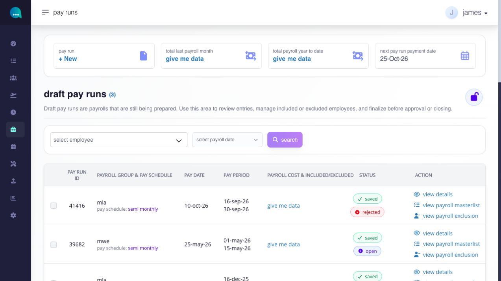
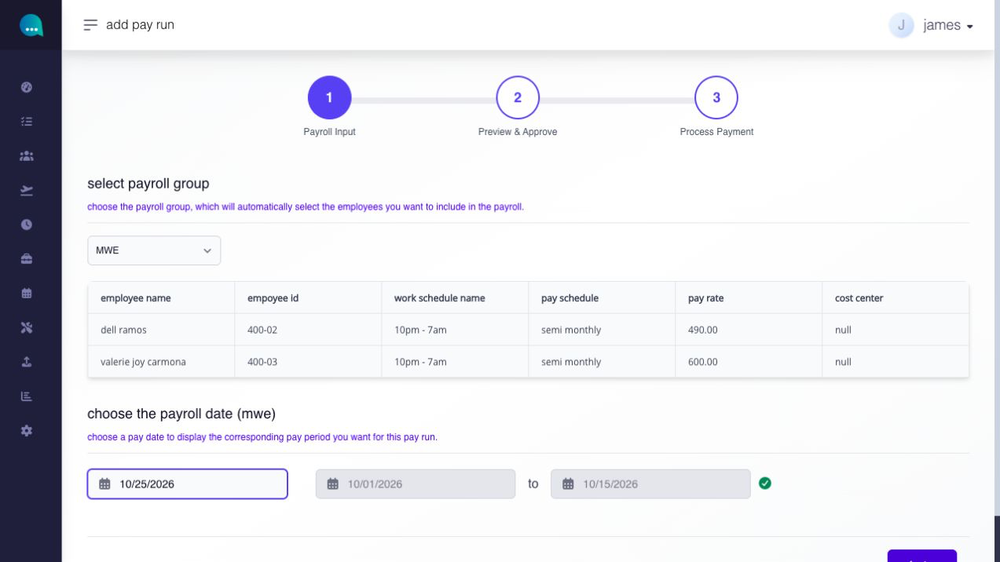
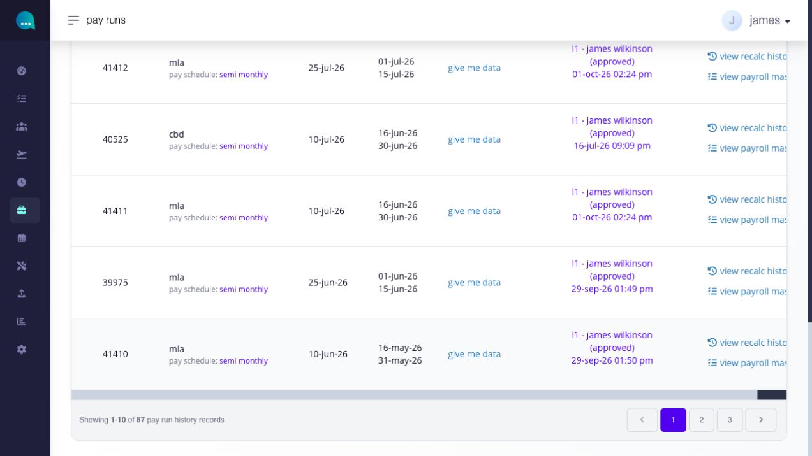
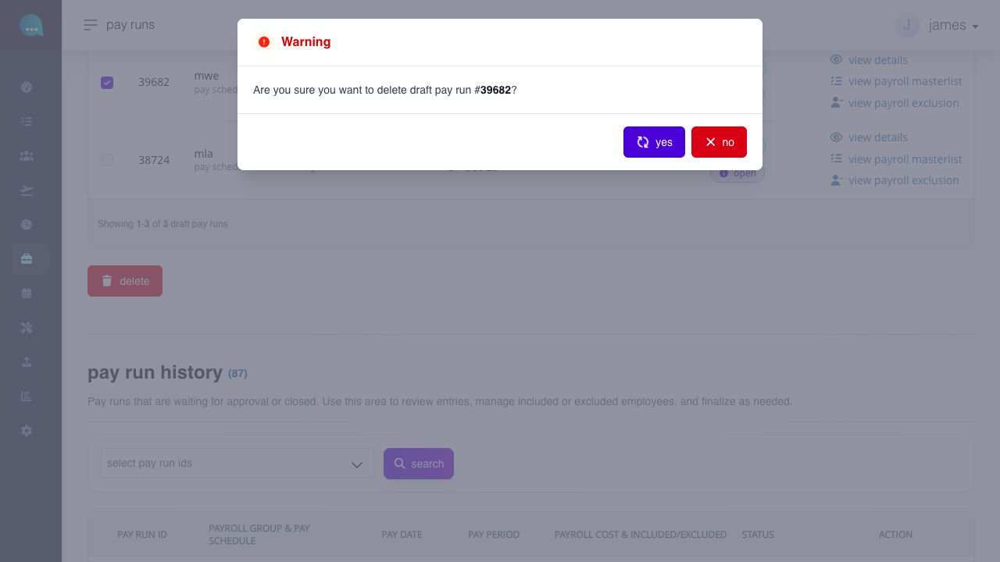

# create or delete a draft pay run

## create or delete a draft pay run

Create a draft pay run to begin payroll for one configured payroll group and pay date. Delete a draft only when it must be discarded rather than corrected.

**Navigation:**\
go to **Paycheck → Pay Run → Payroll**, then select **+ New**.

### before you begin

* configure the payroll group and pay schedule.
* assign eligible employees to the payroll group.
* confirm compensation, work schedules, pay rates, cost centers, payment settings, and applicable payroll rules.
* confirm that the intended pay date has not already been processed for the same group.

### which settings control this workflow?

| level            | setting or record                                              | effect                                                                   |
| ---------------- | -------------------------------------------------------------- | ------------------------------------------------------------------------ |
| company / global | payroll groups, schedules, rates, payment and payroll settings | supplies the selectable payroll setup                                    |
| module           | payroll lock and workflow rules                                | can restrict creation or later payroll-sensitive actions                 |
| employee         | payroll-group membership and payroll profile                   | determines which employees and payroll inputs are brought into the draft |
| pay run          | selected group and pay date                                    | determines the covered period and creates the dated draft                |

#### how do I run a new payroll?

use **+ New** to begin a new payroll run. the two decisions that define the pay run are the **payroll group** and the **pay date**.

the payroll group determines which employees are included. the pay date determines which pay period is used. when you select a pay date, the system displays the corresponding pay period automatically.

**navigation:** go to **Paycheck → Pay Run → + New**

**steps**

1. go to **Paycheck → pay run**.
2. click **+ New**.

<figure><figcaption>
Select + New at the top of Pay Runs to start a draft.
</figcaption></figure>

3. in **select payroll group**, choose the payroll group you want to run.
4. In **choose the payroll date**, select the pay date for the payroll you want to process.

<figure><figcaption>
After you select a payroll group and pay date, check the employee list and the period Ashima fills in before selecting done.
</figcaption></figure>

5. review the pay period the system displays for that pay date.
6. review the employee listing for the selected payroll group.
7. click **done** to continue to the pay run workflow.


**required fields must be completed before continuing**

* **Choose Payroll Group (\*)** - selects the payroll group for the new pay run. This determines which employees are pulled into the run.
* **Choose Payroll Date (\*)** - selects the pay date and displays the corresponding pay period.


***

#### can I run pay runs for multiple payroll groups within the same pay period?

yes. you can create pay runs for one payroll group at a time, and multiple payroll groups can exist within the same pay period.

each pay run is created for a single payroll group only. however, this does not limit you to just one payroll group per pay period. if several payroll groups share the same pay period, you can generate separate pay runs for each group under that same period.

**example:**\
the test account has separate CBD and MLA pay runs dated **July 10** for the **June 16–30** pay period. Each payroll group has its own pay run even though the date and period match.

<figure><figcaption>
CBD and MLA have separate pay runs for the same pay date and period. Each run still belongs to only one payroll group.
</figcaption></figure>

***

#### how do I delete an open draft pay run?

Use **delete** only when you are sure the draft pay run should no longer be used.

**Navigation:**\
Go to **Paycheck → pay run**


Delete only applies to open draft pay runs. You will not be able to delete closed/approved pay runs.


<figure><figcaption>
Check the pay run ID in the warning before confirming. Select no to keep the draft.
</figcaption></figure>

**steps**

1. select the checkbox beside the draft pay run.
2. click **delete**.
3. review the pay run ID shown in the warning.
4. confirm the deletion.

**what happens after I delete a draft pay run?**

the selected open draft pay run is removed from the current payroll review list.


**rules**

* delete only applies to open draft pay runs.
* deleting a pay run cannot be undone.
* review the pay run ID, pay date, and pay period before confirming. 


***
