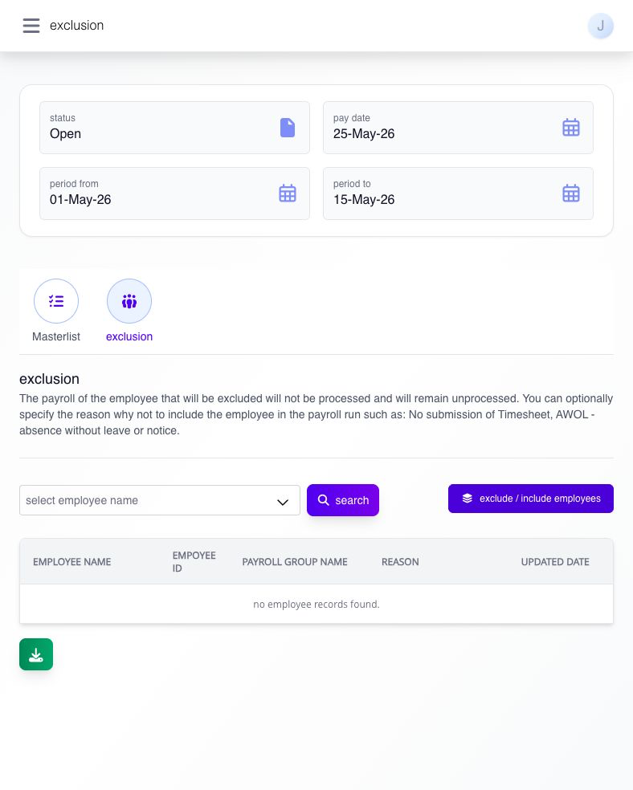
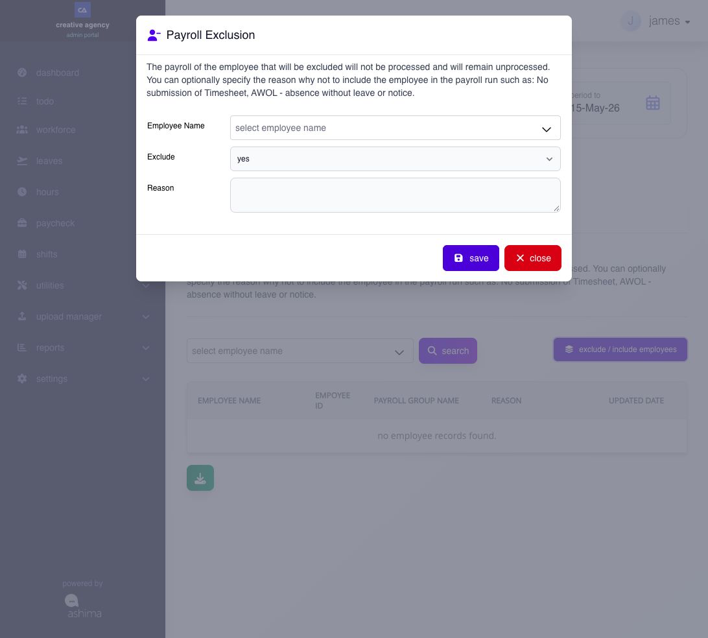

# exclude or include an employee

## exclude or include an employee

Use Payroll Exclusion to keep an employee in the selected payroll group's context while preventing that employee's payroll from being processed in the current run.

**Navigation:**\
open **View Payroll Exclusion** from a draft pay run, or select **exclusion** from Pay Run Details or Payroll Masterlist.

### before you begin

* confirm the draft is **Open** and verify its pay date and period.
* confirm why the employee must not be processed in this run.
* review timesheet, employment status, leave, and payroll-group information before excluding the employee.

### which settings control this workflow?

| level            | setting or record                               | effect                                                                |
| ---------------- | ----------------------------------------------- | --------------------------------------------------------------------- |
| company / global | payroll group and pay schedule                  | establishes the employees normally eligible for the run               |
| module           | payroll recalculation, approval, and lock state | controls whether exclusion changes can be applied and regenerated     |
| employee         | payroll-group assignment and source readiness   | determines normal inclusion and the reason an exception may be needed |
| pay run          | Exclude Yes/No and optional reason              | changes processing only for the selected draft                        |

Exclusion is a run-specific decision. It does not terminate the employee or remove the employee from the payroll group.

### payroll exclusion

#### how do I use payroll exclusion?

use **payroll exclusion** to review, remove, or reinstate employees for the current payroll output.\
\
employees left in the masterlist at submission will be included in the final payroll.

**navigation:**\
go to **Paycheck → pay run → view payroll exclusion**

#### what does the exclusion page display?

* a searchable listing of excluded employees for the selected payroll set
* the reason recorded for each exclusion or inclusion change
* a **Download** option for the exclusion listing

<figure><figcaption>
Check the pay date and period before reviewing exclusions. This test run has no excluded employee records.
</figcaption></figure>

#### how do I exclude or include an employee?

1. open the relevant **exclusion** page.
2. click **exclude / include employees**.
3. select the employee in **Employee Name**.
4. set **Exclude** to **Yes** to exclude or **No** to include back.
5. enter **Reason** if needed.
6. click **save**.

<figure><figcaption>
Select the employee, choose yes to exclude or no to include again, then save the change.
</figcaption></figure>

**fields**

* **employee name (\*)** — selects the employee to update.
* **exclude (\*)** — controls whether the employee is excluded or included.
* **reason** — records why the payroll membership changed.

`(*) Required fields must be completed before saving.`

#### what happens after I exclude an employee?

the employee is removed from the current payroll output. their payroll is not processed for this run, and the exclusion is recorded with the date and payroll period for audit purposes.\
\
you can include them again before submission if their status changes.


common exclusion reasons include no timesheet submission and AWOL.


exclusion applies to the current payroll set only. It does not permanently remove the employee from payroll.

#### how do I re-include an excluded employee?

Use the same **Payroll Exclusion** form. Check the pay date and period, select **exclude / include employees**, choose the employee, set **Exclude** to **No**, and select **save**. Add a **Reason** if needed.

#### what happens after I include the employee back?

the employee is no longer treated as excluded for that payroll period and can return to the payroll output for that payroll review.

after including the employee back:

* review the payroll listing again
* recalculate if the page prompts you to do so
* confirm the employee is back in the payroll counts and review pages before approval

***

#### what should I check before changing an exclusion?

check the employee, pay date and complete pay period. exclusion is recorded for the company, employee and matching payroll dates; do not assume a different Pay Run ID isolates the same employee and dates. excluding an employee can remove generated payroll results for that matching context. including the employee again is not a promise to restore the earlier calculated amounts automatically; review and recalculate the applicable payroll before proceeding.
