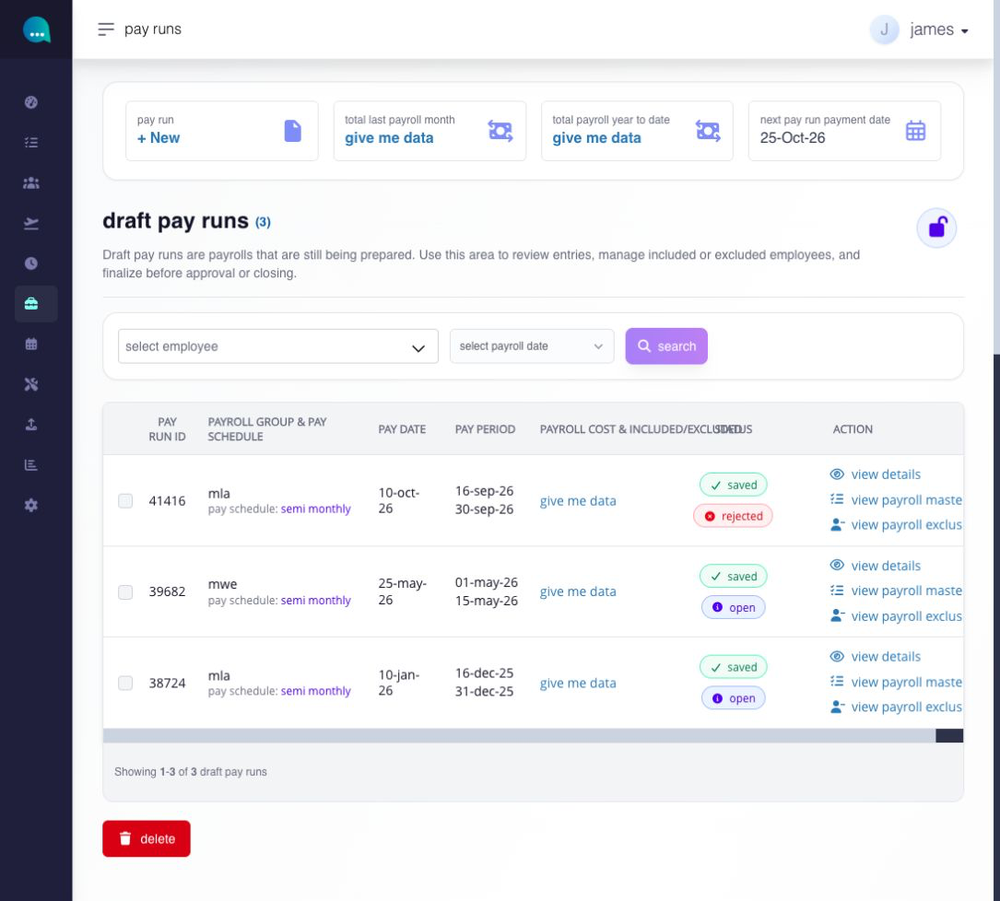
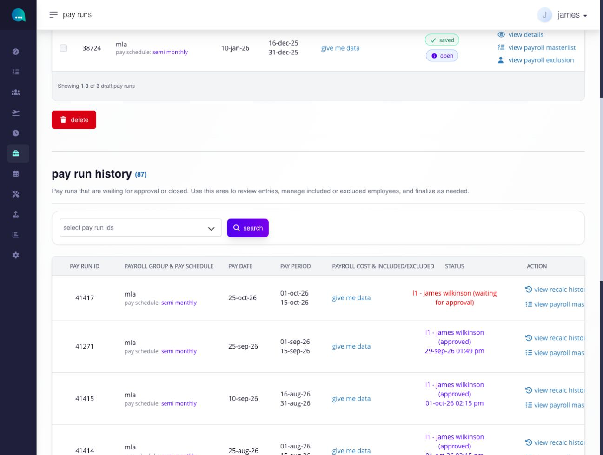

# find and understand pay runs

## find and understand pay runs

Use Pay Run to start payroll work, review payrolls still being prepared, and find payrolls that are waiting for approval or already closed.

**Navigation:**\
go to **Paycheck → Pay Run → Payroll**.

### before you begin

* confirm that payroll groups, pay schedules, pay dates, employee payroll assignments, and required payroll settings are complete.
* confirm that source changes to compensation, time, leave, earnings, deductions, contributions, or tax have been approved and recalculated where required.
* use an account with payroll access.

### which settings control this workflow?

| level            | setting or record                                                                                      | effect                                                                          |
| ---------------- | ------------------------------------------------------------------------------------------------------ | ------------------------------------------------------------------------------- |
| company / global | payroll groups, pay schedules, rates, contributions, tax, payment, and payslip settings                | supplies the reusable payroll configuration                                     |
| module           | payroll lock and approval workflow                                                                     | controls whether payroll-sensitive changes are allowed and who approves payroll |
| employee         | payroll group, compensation, pay type, tax, contribution, payment, entitlement, and assigned pay items | supplies employee-specific payroll inputs                                       |
| pay run          | payroll group, pay date, pay period, exclusions, adjustments, and current state                        | defines one payroll processing cycle                                            |

The pay run does not replace company or employee setup. It calculates a dated payroll from those settings and records, together with approved run-specific changes.

### pay runs

#### what are pay runs?

a **pay run** (often called a _payroll run_) is the scheduled process of calculating and processing employee pay for a specific period.

a pay run typically refers to the full workflow that includes:

* **collecting payroll inputs** such as hours worked, overtime, leave, earnings, and deductions
* **calculating gross pay** based on compensation rules and pay schedules
* **applying deductions and taxes** (e.g., statutory contributions, withholding taxes, etc.)
* **generating net pay** (take-home pay for employees)
* **producing payroll outputs** such as payslips, masterlist and reports
* **finalizing and approving payroll** before bank files are generated for payment

in simpler terms, a pay run is **one complete cycle of processing employee salaries for a defined pay period**, from computation to final payout.

#### where can I view my pay runs?

**navigation:**\
Go to **Paycheck → pay run**\
\
there are two ways to view your pay runs, depending on their status:

* **draft pay runs**\
  displays pay runs that are **open** or **rejected**.\
  \
  draft pay runs are payrolls that are still being prepared. use this area to review entries, manage included or excluded employees, and finalize before approval or closing.

<figure><figcaption>
Use draft pay runs for open payroll and rejected runs returned for correction.
</figcaption></figure>

* **pay run history**\
  displays pay runs that are **pending approval** or **approved/closed**.

<figure><figcaption>
Use pay run history to find payroll waiting for approval or already approved.
</figcaption></figure>

#### how do I find open, submitted or closed payroll?

use the two sections on the Pay Run page. **draft pay runs** contains payroll being prepared, including rejected runs returned for correction. **pay run history** contains payroll waiting for approval or already closed.

#### which section should I use?

| payroll state        | where to look   | next action                                                            |
| -------------------- | --------------- | ---------------------------------------------------------------------- |
| Open                 | draft pay runs  | review and prepare payroll                                             |
| Rejected             | draft pay runs  | investigate the rejection, correct the payroll and resubmit when ready |
| Waiting for approval | pay run history | review approval progress                                               |
| Closed               | pay run history | review finalized payroll and available output actions                  |

#### what do the status values mean?

an open run is being prepared. a waiting run has been submitted for approval. rejection returns the run for correction; final approval closes it. the displayed approval level and decision help distinguish an approval already recorded from completion of all required approval levels.

#### how do I find a particular payroll?

in draft pay runs, select an employee and then an available payroll date to narrow the review context. in pay run history, use the pay-run selection and **search** to locate historical runs. check the Pay Run ID, payroll group, pay date and pay period before opening an action. the tables also provide payroll cost/inclusion information, status and available actions; some summaries load on request.

filtering changes what you view. it does not approve, reject or close a pay run.

***
