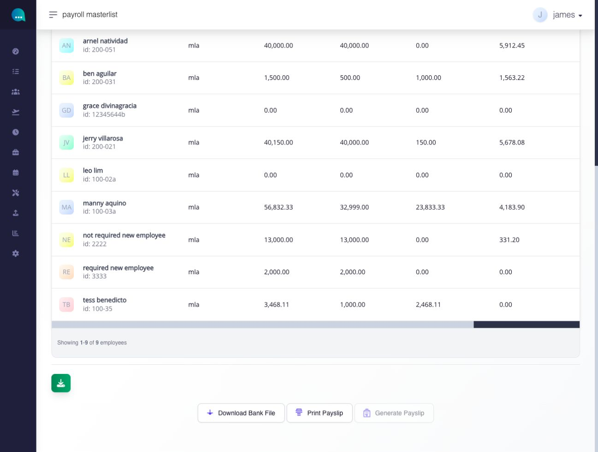
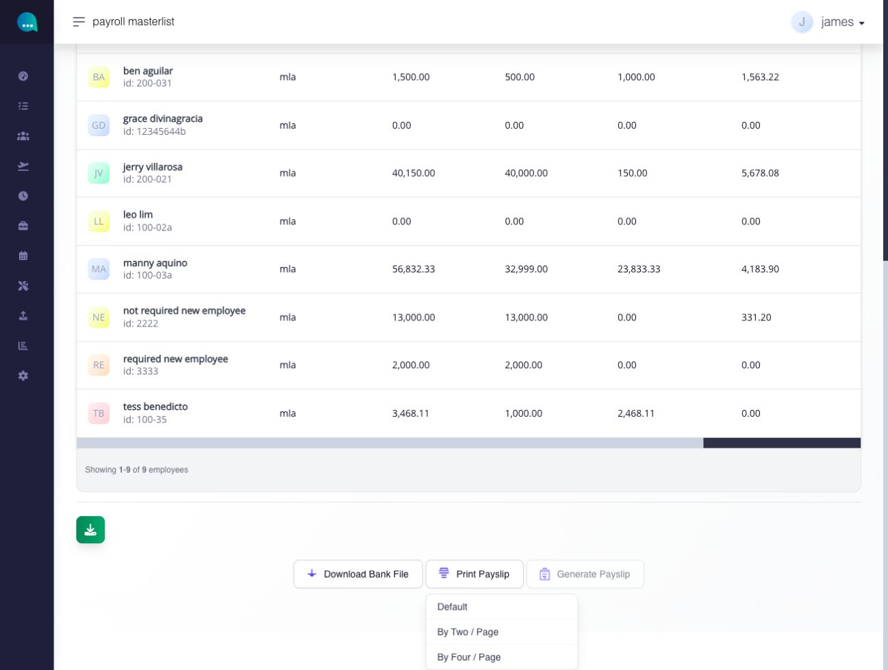
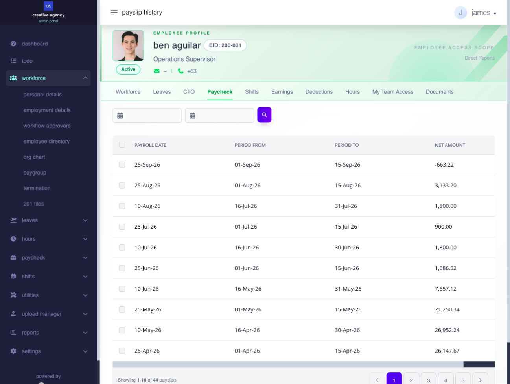
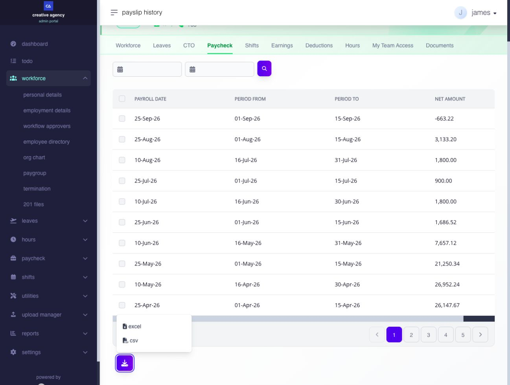
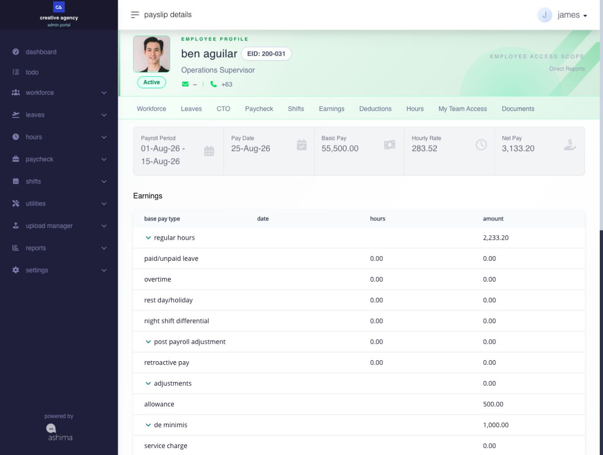
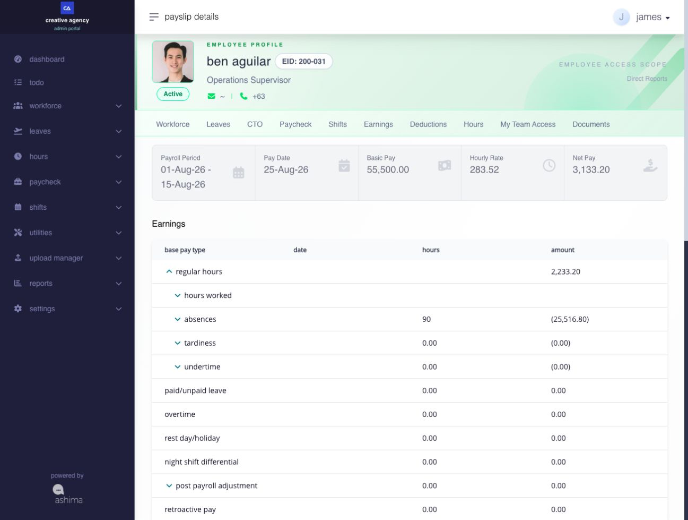
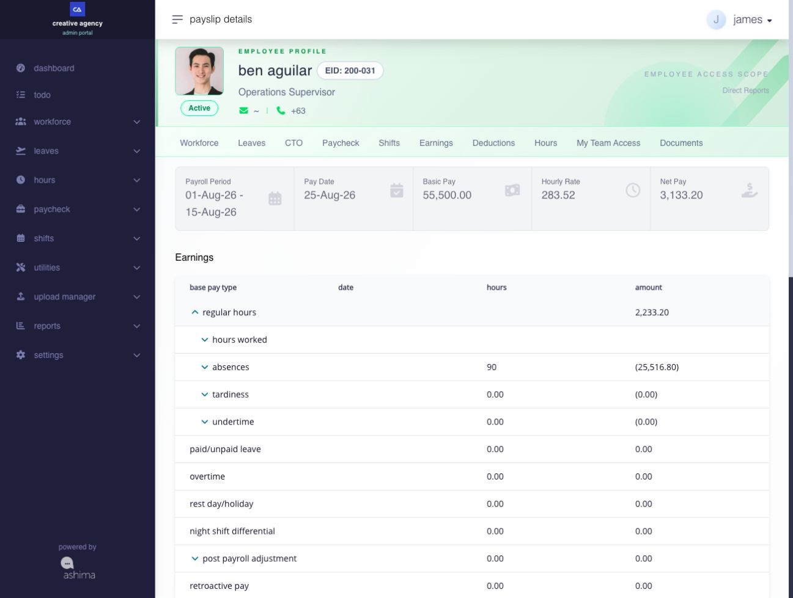
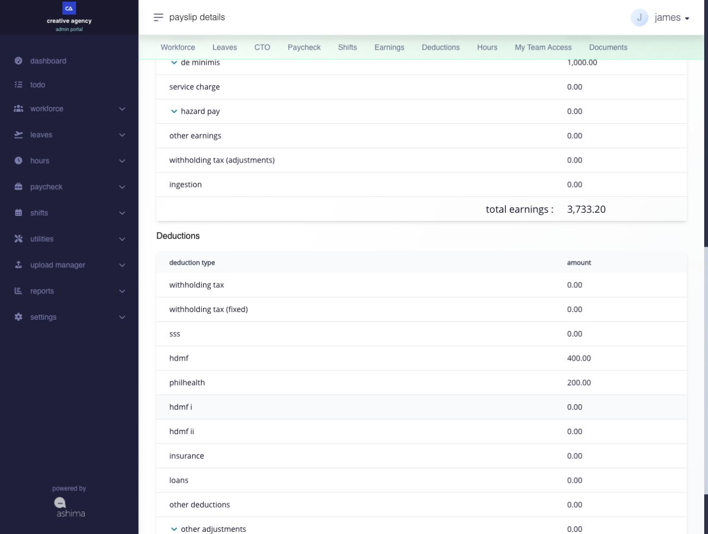

# generate and review payslip output

## generate and review payslip output

use a closed payroll masterlist to review, print, or download generated payslips.

**Navigation:**\
go to **Paycheck → Pay Run → Payroll**, find a closed pay run in **pay run history**, then open **View Payroll Masterlist**.

### what can I do on a closed payroll masterlist?

\
after payroll is approved and closed, the masterlist remains available for admin actions. the review-stage buttons (Check for Pay Updates, Send Pay Draft, Submit for Approval) are no longer shown.\
\
in their place, the bottom action area changes to:

* **download** - download the masterlist for the closed payroll
* **download Bank File** - opens the bank file output step
* **print payslip** - opens the payslip print action. The print dropdown offers multiple layouts: **Default**, **By Two / Page**, and **By Four / Page**.
* **generate payslip** - triggers the payslip generation step. A confirmation prompt appears before the system begins generation.

you can still search for a specific employee and review the payroll summary table on a closed masterlist.

<figure><figcaption>
On a closed pay run, the bottom actions include Print Payslip. This example was already generated, so Generate Payslip is disabled.
</figcaption></figure>

### what is the difference between generate payslip and print payslip?

use the payslip area to review how payroll is presented to employees after payroll is closed or released. 

**generate payslip** starts the payslip generation step after closed payroll.\
\
clicking **generate payslip** starts the payslip generation process after payroll is closed. this means:

* payslips become available in the employee portal for employees to view
* the system attempts email notification to let employees know their payslips are available; generation success is not proof of email delivery

after generation, the **generate payslip** button is disabled (grayed out) when the run is marked as generated. do not treat a disabled generation control as confirmation that an email reached every employee.


**Note:** in Ashima, payslips are not automatically generated or made visible to employees once payroll is approved or closed.

the payroll admin must manually generate the payslips to make them available on the employee portal. this is to ensure payroll admins have completed the necessary fund transfers first before releasing the payslips to employees.


**print payslip** opens the printing options for the available payslip layouts. go to [how to print payslip](generate-and-review-payslip-output.md#page-070-pages-admin-paycheck-md--how-to-print-payslips) click here to know more about options on printing.

<figure><figcaption>
Choose a print layout from the closed payroll masterlist.
</figcaption></figure>

### why is a closed payroll not yet visible in employee payslip history?

closing payroll and generating payslips are separate steps. eligible employee payslip history requires the payroll to be closed and its payslips generated. exclusion can also affect whether the employee has an available payslip for the period. review the employee, period, exclusion and generation state before assuming a missing payslip is a printing problem.

the generation action and email delivery are separate outcomes. successful generation does not prove that every notification reached its recipient. **Print Payslip** prepares a printable output; it is not a substitute for the generation/release step.

### payslips

use the payslip area to review how payslip is presented to employees after payroll is closed or released.

this guide covers three pages that work in sequence:

1. **Payslip History** — review the employee's released payroll periods and open a specific payslip.
2. **Payslip Details** — review the full earnings and deductions breakdown for one payslip.
3. **Print Payslip** — open the condensed printable format used for sharing or download.

#### what pages are available in the Payslip area?

| Page                | What it is for                                                                                     |
| ------------------- | -------------------------------------------------------------------------------------------------- |
| **Payslip History** | Shows the employee's available payslips by pay period. Use it to find and open a specific payslip. |
| **Payslip Details** | Shows the full earnings and deductions breakdown for one selected payslip.                         |
| **Print Payslip**   | Shows the condensed printable payslip with totals. Used for sharing or download.                   |

#### before you begin: key payslip terms

* **Regular Hours** — the main salary or worked-time earning for the payslip period. This is where basic pay, attendance deductions, and the core payroll result sit.
* **Adjustments** - payroll corrections added directly to the pay run through Paycheck Adjustment.
* **Ingestion** - payroll entries added through the paycheck-entry flow and grouped separately on the detailed payslip view.
* **Post Payroll Adjustment (PPA)** — a late correction applied after the original payroll was already closed.
* **Net Pay** — the final take-home amount after all earnings, deductions, contributions, and tax are applied.

#### what should administrators know about how payslip items are grouped?

Ashima groups payroll items by category - not by the order they were saved or entered. The payslip is not a flat list of every saved entry.

the detailed payslip organises items into four layers:

1. **Main payroll earnings** — the regular payroll result for the period, including basic pay and attendance-based changes
2. **Payroll corrections** — items added after the original payroll calculation, such as PPA, Adjustments, and Ingestion entries
3. **Deductions** — statutory deductions, contributions, loans, insurance, and other deductions
4. **Net Pay** — the final payroll result

this means a saved payroll item may appear:

* as its own top-level section
* as a child line inside a larger section
* inside the payroll bucket it affects

for example, a normal allowance assignment appears under **Allowance**. A paycheck-entry allowance correction can appear under **Adjustments** or **Ingestion** depending on how it was added. An absence correction can appear under **Other Adjustments** rather than under **Regular Hours**.

if a saved entry is not where you expect it, check the payroll category it belongs to - not just the name it was saved under.

***

#### payslip history

Use **Payslip History** to find one employee's available payslips before opening a period's details or printable view. This employee-scoped page is separate from the closed-payroll masterlist and its batch print layouts.

<figure><figcaption>
Check the pay date and period, then open the matching row.
</figcaption></figure>

**Navigation:** Go to **Paycheck → \[pay run] → \[employee] → Payslip History**.

**how do i find and print one employee's payslip?**

1. Confirm that you have opened the intended employee. Set the start and end dates, then select the magnifying-glass **Search** button. Select **Clear dates** when shown if you need to remove the date filter.
2. Check the payroll date and covered period in the matching rows. Open the intended row to review its **Payslip Details** and confirm the employee, period, and amounts.
3. Select **Print Payslip** to open that payslip's single preview. From there, choose **PDF** to download it or **Print** to open your browser's print action. Review the [single-preview instructions](generate-and-review-payslip-output.md#print-or-download-a-single-payslip) before producing a copy.

The history download menu exports a list in **Excel** or **CSV**. It does not download individual payslip PDFs. Use the selected payslip's **Print Payslip** view for an individual PDF or printout.

<figure><figcaption>
Excel and CSV export the history list; open a payslip for its individual printable output.
</figcaption></figure>

***

#### payslip details

use **payslip details** when you need the full breakdown of how the employee's pay was built for one payroll period.

<figure><figcaption>
Start with the period and net pay, then review the expandable earnings and deductions below.
</figcaption></figure>

**navigation:** Go to **Paycheck → \[pay run] → \[employee] → Payslip History → \[payslip]**

**what does this page display?**

at the top, the page shows a summary card area with:

* **Payroll Period**
* **Pay Date**
* **Basic Pay**
* **Hourly Rate** (when shown for the employee)
* **Net Pay**

below the summary cards, the page divides into **earnings** and **deductions**. each section can expand into more detailed rows.

***

#### what appears under payslip earnings?

depending on the employee's payroll result, the detailed payslip can show these earnings sections:

<figure><figcaption>
Open a category to inspect its underlying lines; categories with zero amounts may still appear.
</figcaption></figure>

| Section                           | What it contains                                                               |
| --------------------------------- | ------------------------------------------------------------------------------ |
| **Regular Hours**                 | The main payroll earning block — basic pay, absences, tardiness, and undertime |
| **Paid Leave**                    | Leave pay for the period                                                       |
| **Leave Conversion**              | Leave converted to cash where applicable                                       |
| **Overtime**                      | Overtime pay for the period                                                    |
| **Rest Day / Holiday**            | Rest day or holiday premium pay                                                |
| **Night Shift Differential**      | NSD pay for the period                                                         |
| **Post Payroll Adjustment**       | PPA corrections from prior closed payrolls                                     |
| **Retroactive Pay**               | Prior pay differences carried into this run                                    |
| **Adjustments**                   | Payroll corrections added through Paycheck Adjustment                          |
| **Allowance**                     | Allowance assignments                                                          |
| **De Minimis**                    | De minimis benefit amounts                                                     |
| **Service Charge**                | Service charge earnings                                                        |
| **Hazard Pay**                    | Hazard pay amounts                                                             |
| **Other Earnings**                | Other earning assignments                                                      |
| **Withholding Tax (Adjustments)** | Direct withholding tax corrections                                             |
| **Ingestion**                     | Paycheck-entry earnings grouped together                                       |

The page may also display categories with zero amounts. Focus on the categories that carry a value for the selected period.

***

**how is regular hours broken down?**

**Regular Hours** is the main payroll earning block. It can expand into:

<figure><figcaption>
Expand Regular Hours to see the attendance lines behind the amount.
</figcaption></figure>

* **Hours worked** — the base earning for the period
* **Absences** — attendance deductions for absent days or hours
* **Tardiness** — deductions for late arrivals
* **Undertime** — deductions for early departures

this section shows how the employee's core pay for the period was built before other earnings or corrections are applied. Review this section first when the net pay result looks different from what was expected.\
\
it is important to note that [monthly-paid employees ](generate-and-review-payslip-output.md#page-070-pages-admin-paycheck-md--monthly-paid-vs-hourly-paid-payslips)use a different calculation formula compared to hourly-paid employees.

***

**how are payroll corrections shown under earnings?**

Ashima separates three kinds of payroll corrections so you can trace where each amount came from.

**post payroll adjustment** covers corrections from prior closed payrolls. It can include:

* Workday, Tardiness, Undertime, Leave, Overtime, Holiday, Night Shift Differential

**adjustments** covers corrections added to the current pay run through Paycheck Adjustment. It can include:

* Workday, Overtime, Holiday Premium, Night Shift Differential, Paid Leave, Allowance, Advance Payment, De Minimis, Service Charge, Hazard Pay, Other Earnings

**ingestion** covers payroll entries added through the paycheck-entry flow. It appears as its own grouped section in the detailed payslip when entries were added that way.

the reason for the separation: a normal earned allowance and a paycheck-entry allowance correction are different things even though they both affect allowance pay. keeping them in separate sections makes it easier to trace the source of each amount.

***

#### what appears under payslip deductions?

Depending on the payroll result, the detailed payslip can show these deduction sections:

<figure><figcaption>
Review the deduction amounts separately from the earnings total.
</figcaption></figure>

| Section                     | What it contains                                |
| --------------------------- | ----------------------------------------------- |
| **Withholding Tax**         | Normal payroll-calculated withholding tax       |
| **Withholding Tax (Fixed)** | Fixed withholding tax where that method applies |
| **SSS**                     | SSS contribution deduction                      |
| **PhilHealth**              | PhilHealth contribution deduction               |
| **HDMF**                    | Regular HDMF contribution                       |
| **HDMF I**                  | HDMF voluntary contribution                     |
| **HDMF II**                 | HDMF modified contribution                      |
| **HDMF MP2**                | HDMF MP2 savings contribution                   |
| **Insurance**               | Insurance deduction assignments                 |
| **Loans**                   | Government and third-party loan deductions      |
| **Other Deductions**        | Company-defined other deductions                |
| **Other Adjustments**       | Deduction-side payroll corrections              |
| **Ingestion**               | Paycheck-entry deductions grouped together      |

***

**how are deduction corrections shown?**

The payslip separates normal deductions from deduction-side corrections.

**Other Adjustments** covers deduction corrections added to the pay run. It can include:

* Absences, Tardiness, Undertime, Third-Party Loans, Government Loans, Other Deductions

This makes it easier to distinguish what was a normal payroll deduction result from what was a correction added directly to the pay run.

***

**what can I do from this page?**

* Review the full earnings and deductions breakdown for the period
* Expand sections to see date-based or entry-based detail rows
* Trace whether an amount came from the main payroll result, a PPA, an Adjustment, or Ingestion
* Open the printable payslip

***

#### how do I print payslips?

Use **Print Payslip** when you need the cleaner condensed format for sharing or download.

**Navigation:** Go to **Paycheck → \[pay run] → \[employee] → Payslip History → \[payslip] → Print**

**print or download a single payslip**

In the single-payslip preview, confirm the employee, period and amounts. Select **PDF** to download the payslip, or **Print** to open browser printing. Follow the displayed **LETTER**, portrait, shrink-to-fit and blank browser headers/footers guidance.

The closed-payroll masterlist’s **Default**, **By Two / Page** and **By Four / Page** layouts are batch choices. They are separate from the single-payslip preview and from the history list’s **Excel** and **CSV** exports.

**what does this page display?**

The printable payslip shows:

* company details
* employee name and employee ID
* job position, department, and location
* payroll date and payroll period
* **Basic Pay**
* **Earnings** with total
* **Deductions** with total
* **Net Pay**

**how is the printable payslip different from Payslip Details?**

The printable payslip is more condensed. It shows the same payroll result but groups some items under larger parent labels such as **regular hours**, **Post Payroll Adjustments**, and **Adjustment** rather than showing every category with the same expanded structure as the detailed page.

Use **Payslip Details** when you need to trace a specific amount or review the full breakdown. Use **Print Payslip** when you need a clean shareable format.

***

#### Monthly-Paid vs Hourly-Paid Payslips

**what is the difference between a monthly-paid and an hourly-paid payslip?**

The biggest difference is how **Regular Hours** and **Basic Pay** are interpreted. The structure of the payslip is the same — the reading changes based on the employee's pay type.

***

**Monthly-paid employees**

For a monthly-paid employee, the payslip's main earning block starts from the employee's payroll-period basic pay based on their monthly salary setup.

The monthly-paid payslip reads as:

* payroll-period basic pay for the cutoff
* less Absences
* less Tardiness
* less Undertime
* with other earnings and corrections shown in their own sections

The focus is on how attendance deductions and payroll corrections changed the salary result. The base amount is salary-first — not hours-first.

**Simple example:** An employee on a monthly salary of 30,000 on a semi-monthly payroll starts with a basic pay of 15,000 for the cutoff. If they had 1 day of absence and 2 hours of tardiness, those amounts reduce the regular hours result. Overtime, allowances, or adjustments then appear in their own sections above or below.

***

**Hourly-paid employees**

For an hourly-paid employee, the payslip is more directly tied to payable worked hours and the employee's hourly rate. The **Hourly Rate** field in the summary cards becomes more important when reviewing hourly-paid payroll.

The hourly-paid payslip reads as:

* worked hours for the period
* multiplied by the employee's hourly rate
* reduced by any Tardiness or Undertime
* with other earnings and corrections shown in their own sections

The focus is on hours worked and worked-time adjustments.

**Simple example:** An employee at 150/hour with 80 payable hours starts with a basic pay of 12,000. Tardiness reduces that amount. Overtime adds to it. Other corrections appear in their own sections.

***

#### how does paid leave differ between pay types?

For hourly-paid employees, paid leave is treated as a separate earning amount tied to payable hours and is more clearly visible as its own earning line.

For monthly-paid employees, paid leave still appears separately when relevant, but the regular salary view is more salary-based — the payslip does not always show the leave as a distinct hours-based line in the same way.

***

**what changes in the Basic Pay summary card?**

| Pay type         | What Basic Pay shows                                                         |
| ---------------- | ---------------------------------------------------------------------------- |
| **Monthly-paid** | The payroll-period share of the monthly salary — salary-based for the cutoff |
| **Hourly-paid**  | The payable hours multiplied by the hourly rate — hours-first                |

***

#### payslip Review Reference

**what should administrators check first when reviewing a payslip?**

Review in this order:

1. **Payroll Period**, **Pay Date**, and **Net Pay** — confirm you are looking at the right period and the right employee
2. **Basic Pay** — confirm the starting pay value is correct for the employee's pay type
3. **Regular Hours** — review the core payroll earning and any attendance deductions (Absences, Tardiness, Undertime)
4. **Additional earnings** — review Overtime, Rest Day/Holiday, Night Shift Differential, and Allowance
5. **Payroll corrections** — review PPA, Adjustments, and Ingestion entries
6. **Deductions** — review Withholding Tax, SSS, PhilHealth, HDMF, Loans, and Other Deductions

Following this order makes it easier to identify whether a payroll result changed because of the core pay calculation, attendance, an additional earning, a payroll correction, or a deduction.

***

**where do payroll adjustments and ingestions appear on the payslip?**

The payslip shows each payroll entry under the earnings, deductions, contribution, or tax section it belongs to.

Typical display behavior is:

* **Work Day**, **Overtime**, **Holiday**, **NSD**, and **Paid Leave** corrections appear under the **Adjustment** earnings section
* **Allowance** and **Other Earnings** paycheck entries appear under the **Ingestion** earnings section
* **De Minimis** appears in the de minimis or non-taxable earnings area, with excess handled separately when applicable
* **Other Deductions**, **Loans**, **Contributions**, and **Withholding Tax** paycheck entries appear under the deductions or tax side
* **Withholding Tax (Adjustments)** appears as its own tax-adjustment line
* **Absent**, **Tardiness**, and **Undertime** stay on the deduction side

***

### how do holiday adjustments affect the total?

A **Holiday Adjustment** can be positive or negative. Include its sign when checking the subtotal: a positive adjustment adds to it, while a negative adjustment reduces it. For example, ₱500 of holiday pay and a −₱100 adjustment give a ₱400 subtotal. A negative adjustment is not a zero amount.

#### how does the company-details setting affect printed payslips?

The company address and contact visibility setting applies to printed and downloaded PDF payslips. If these details are hidden, the company name remains aligned in the output. Save the intended setting, then check the PDF layout you will use.
