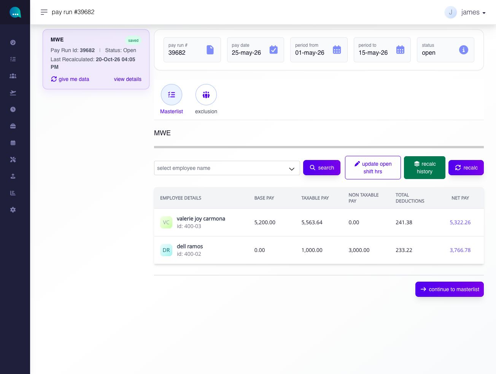
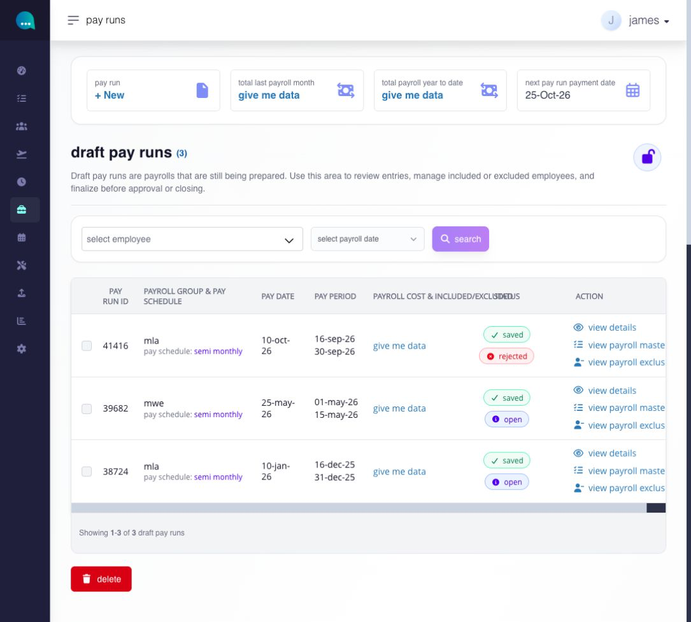
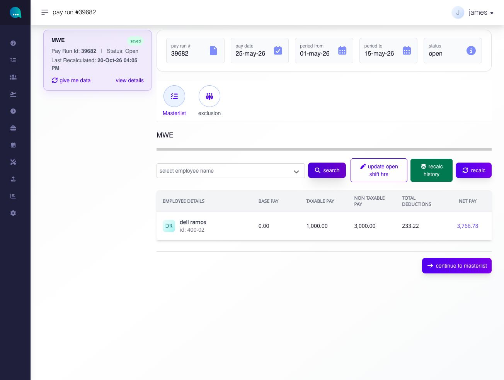
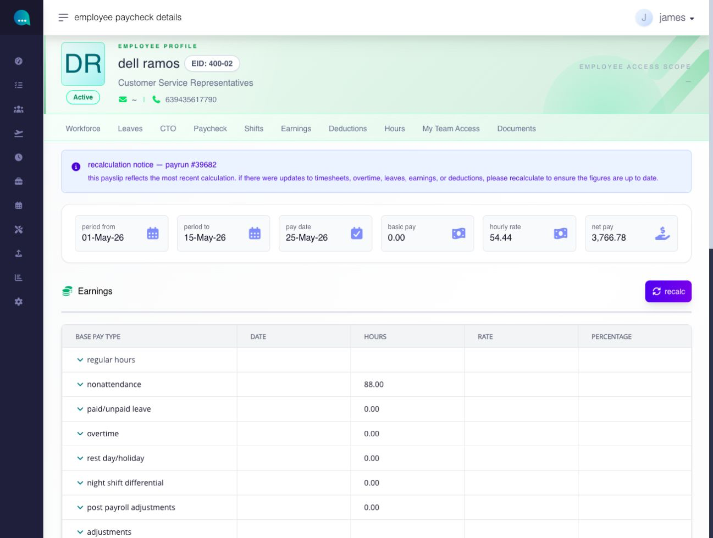
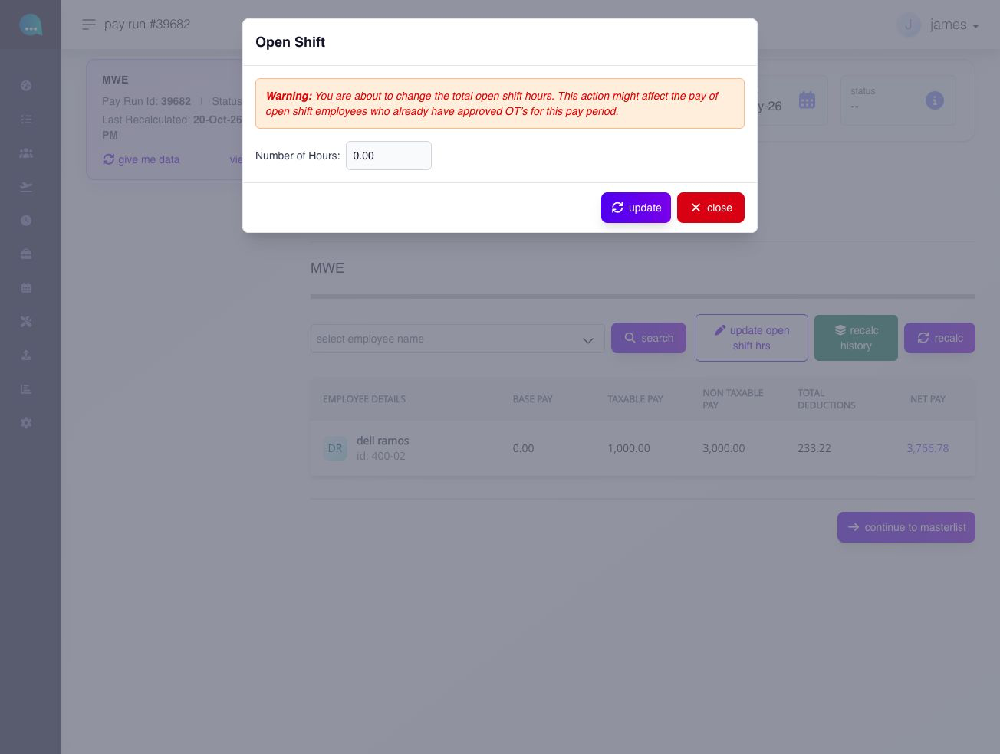
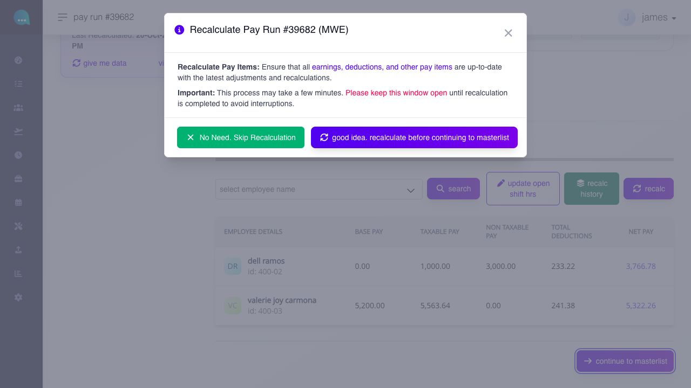
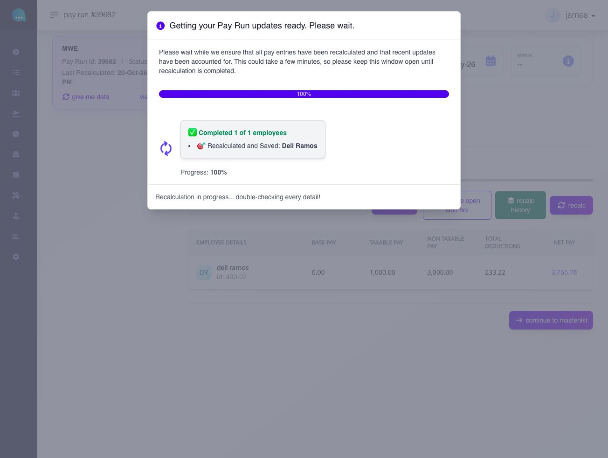
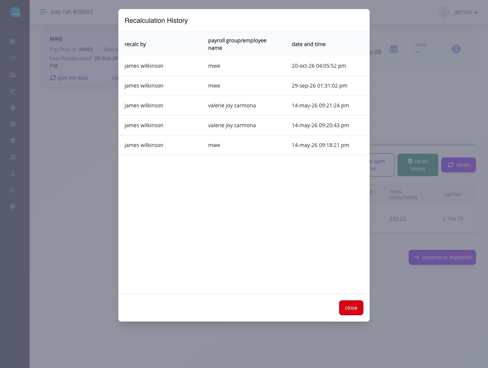

# review and recalculate a pay run

## review and recalculate a pay run

Use Pay Run Details to review employee payroll totals, open an employee calculation, and recalculate the draft after relevant source changes.

**Navigation:**\
go to **Paycheck → Pay Run → Payroll**, then select **View Details** for an open draft.

### before you begin

* verify the Pay Run ID, payroll group, pay date, period from/to, and **Open** status.
* complete or approve relevant time, leave, compensation, earning, deduction, contribution, tax, exclusion, and adjustment changes.
* confirm that payroll is not blocked by an applicable lock or approval state.

### which settings control this workflow?

| level            | setting or record                                                                  | effect                                                            |
| ---------------- | ---------------------------------------------------------------------------------- | ----------------------------------------------------------------- |
| company / global | pay rates, contribution/tax rules, earnings/deductions, and payroll settings       | provides calculation rules and reusable items                     |
| module           | hours, leave, shifts, workflow, payroll lock, and recalculation behavior           | determines eligible source inputs and whether changes can proceed |
| employee         | compensation, schedule, tax/contribution profile, assigned items, and entitlements | supplies employee-specific calculation inputs                     |
| pay run          | pay date, period, exclusions, adjustments, and recalculation state                 | determines the dated calculation being reviewed                   |

Recalculation regenerates payroll results from current eligible inputs. It should not be described as a simple screen refresh.

### pay run details

use the **pay run details** page to review employee-level payroll output for one selected pay run before moving to the masterlist.

**navigation:**\
go to **Paycheck → pay run → view details**

<figure><figcaption>
Check the pay run ID, dates, status, and employee totals before changing the run or continuing to the masterlist.
</figcaption></figure>

#### what does this page display?

the page shows:

* the selected pay run header
* pay run ID, pay date, payroll period, and status
* a side card identifying the selected pay run and its last recalculation
* quick links for **masterlist** and **exclusion**
* the employee payroll summary table

the employee payroll summary table displays:

* employee details
* base pay
* taxable pay
* non-taxable pay
* total deductions
* net pay

#### what can I do from this page?

* review [**details of your pay run**](review-and-recalculate-a-pay-run.md#page-070-pages-admin-paycheck-md--how-can-i-view-details-of-my-pay-run)
* update [**open shift hours**](review-and-recalculate-a-pay-run.md#page-070-pages-admin-paycheck-md--how-do-i-update-open-shift-hours-for-this-pay-run)
* run [**recalc**](review-and-recalculate-a-pay-run.md#page-070-pages-admin-paycheck-md--how-do-i-review-and-recalculate-payroll-on-the-pay-run-details-page)
* review [**recalculation history**](review-and-recalculate-a-pay-run.md#page-070-pages-admin-paycheck-md--how-do-i-review-recalculation-history)
* continue to [masterlist](review-employee-pay-details.md#page-070-pages-admin-paycheck-md--payroll-masterlist)

#### how can I view details of my pay run?

payroll review follows a top-down path. start from the pay run list, then work down into the employee level.\
\\

**step 1 — pay run list**

\
the Pay Run list shows all open pay runs for the company. each row represents one pay run for one payroll group and pay date. open a pay run by clicking **View Details** from the action link.\
\
If you have several pay groups on the same pay date, each group has its own pay run. Select the correct row in **Pay Runs** and check its ID, group, dates, and status after opening **View Details**. The side card identifies the pay run currently being reviewed; do not assume every group appears on this page.

<figure><figcaption>
Open the row for the intended pay group and pay date. Each row is a separate pay run.
</figcaption></figure>

**step 2 — review the employee summary table**

\
this page shows the employee payroll summary for the selected pay run - one row per employee with their base pay, taxable pay, non-taxable pay, total deductions, and net pay totals.\
\
use **select employee name** and click _search_ to narrow the table to one employee. 

<figure><figcaption>
After searching for an employee, review that employee's base pay, taxable and non-taxable pay, deductions, and net pay.
</figcaption></figure>

**step 3 — review individual employee pay**

\
Select the employee's **Net Pay** amount in the summary table to open **Employee Pay Details**. That page shows the period, pay date, net pay, itemized earnings, and deductions. Expand the relevant pay item when you need to investigate a specific amount. Return to Pay Run Details to review another employee.

<figure><figcaption>
Select a Net Pay amount to open the employee's detailed calculation. The notice reminds you to recalculate if payroll inputs changed.
</figcaption></figure>

***

### updating open shifts on pay run

#### how do I update open shift hours for this pay run?

configure the open shift settings if your company has employees assigned to open shifts.

if not, you may skip this step.\
\
use **update open shift hours** to correct the total hours for employees assigned to open shifts.

complete this step before proceeding with the payroll run.

**navigation:**\
go to **Paycheck → pay run → view details**

**steps**

1. click **update open shift hrs**.
2. review the warning shown in the modal.
3. enter the value in **Number of Hours** only if the current required hours need to change.

**number of hours (\*)** — records the total open shift hours for the selected pay run.

note that changing total open shift hours may affect the pay of employees who already have approved overtime for the selected pay period. review carefully before updating.

4. click **update** and review the resulting pay figures. If no change is needed, select **close**.

<figure><figcaption>
Review the approved-overtime warning and the period's required hours before saving an Open Shift change.
</figcaption></figure>


changing total open shift hours may affect the pay of employees who already have approved overtime for the selected pay period. review carefully before saving.


**what are open shifts?**

open shift is a work schedule type used for employees who are not paid against a fixed daily start and end time. when an employee’s effective shift for a date is open shift, Ashima processes that date using open-shift rules instead of regular fixed-time shift rules.

open shift is resolved by the employee’s effective shift assignment for the date.\
\
if a different shift is assigned for another date, Ashima can use that other shift for that date instead.\
\
more about open shifts on the shift module.

**what does the open shift hours field do when creating a pay run?**

when you open a new pay run, Ashima checks whether the selected payroll group includes employees whose effective shift is open shift during the covered pay period. If yes, the pay run shows an Open Shift total-hours field.

\
use this field to enter the required total open shift hours for that payroll period. this gives payroll the period-level total to use for employees on open shift.


If no employees in the selected pay run are on Open Shift, you can skip this.


**what happens after I update open shift hours?**

the pay run uses the updated open shift hour value in the current payroll review.

**what if I leave open shift hours blank?**

\
if you leave the Open Shift hours field blank, Ashima saves the required open shift hours for that pay run as 0.

this does not automatically mean the employee will receive zero pay. the system can still calculate payroll using the employee’s recorded open shift hours and applicable holiday or pay entitlements.

what changes is that the pay run will no longer use a positive required open Shift total for the payroll period.

in practice, this means:

* the system can still read and total the employee’s open shift logs
* the system does not apply the intended open shift required-hours target for that cutoff
* the system does not apply the same open shift hours cap or comparison logic that would apply if a valid total had been entered
* undertime tied to missing required Open Shift hours may not be computed as intended

\
the main risk is not that payroll stops completely. the main risk is that payroll may be calculated without the correct open shift period target, which can lead to inaccurate payroll results.


Best practice: If the pay run includes employees assigned to Open Shift, enter the correct total required hours for the pay period before continuing payroll review.


***

### payroll recalculation

#### how do I review and recalculate payroll on the pay run details page?

use this page when you need to check employee totals and make sure payroll is fully recalculated before continuing.

**navigation:**\
go to **Paycheck → pay run → view details**

**steps**

1. open the selected pay run through **view details**.
2. review the employee summary table.
3. use **select employee name** and **search** if you need to narrow the table.
4. click **recalc history** if you want to check previous recalculation activity.
5. click **recalc** if payroll values need to be refreshed.
6. continue only after the employee rows and values are fully loaded.

**what happens after I use recalc?**

the system refreshes payroll values for the current pay run using the latest payroll-affecting data.

on first access, the page may prompt recalculation while payroll details are being prepared.

<figure><figcaption>
Choose whether to recalculate before continuing. If inputs changed, recalculate and wait for completion.
</figcaption></figure>

the first recalculation can take longer because the system may still be preparing payroll details for the selected group and period.

larger payroll groups can take longer because payroll entries are processed in batches.

keep the page open while recalculation is running.

<figure><figcaption>
Keep the page open while Ashima processes the selected pay run or employee and shows its progress.
</figcaption></figure>


if the pay run opens but the employee table is empty even though employees belong to the payroll group, click **recalc**.


**why is recalculation important in an open pay run?**

recalculation refreshes the pay run so it uses the latest approved and saved payroll data.

an open pay run is not static. while it is still open, payroll-affecting changes can continue to happen.

because of this, the figures you first saw on screen may no longer be the latest figures.

in Ashima several page prompts users to recalculate so that all pay entries have been recalculated and recent updates have been accounted for, and warns that continuing without recalculation can result in discrepancies.

**when should I recalculate a pay run?**

recalculate when:

* you are opening the pay run for the first time and the details are still loading
* changes may have happened after you last reviewed the page
* you or another admin updated payroll-related data
* the page prompts you to recalculate before continuing

As a best practice, recalculate before you release a pay draft, continue your final review, or submit payroll for approval.

**what happens if I skip recalculation?**

if you continue without recalculating, the pay run may still display older figures.

this can lead to:

* outdated employee pay summaries
* draft payslips that do not reflect the latest updates
* payroll review or approval based on figures that are no longer current

in short, skipping recalculation increases the risk of payroll discrepancies.

**why does the system prompt recalculation?**

the prompt appears because the system is checking whether the pay run may have updates that need to be applied before you continue.

this is common in open payroll because payroll data can still move while the pay run is under review.

**why can recalculation take time?**

recalculation may take a few minutes, especially for larger payroll groups or pay runs with many updates.

keep the page open until the process finishes so the pay run can fully refresh.


best practice: if the pay run is still open and there is any chance that payroll-affecting changes were made after your last review, recalculate first. this helps make sure the pay run, pay draft, and approval review are based on the latest payroll data


#### how do I review recalculation history?

\
use **recalc history** to see who performed recalculations for the pay run and when.

1. click **Recalc History**.
2. review the history table in the modal.

use this when you need to confirm that a recalculation was completed and by whom before moving forward.

**what does recalculation history show?**

\
the history shows who recalculated the pay run and when.\
\
it includes:

* who triggered the recalculation
* the payroll group or employee tied to the recalculation record
* the date and time of the recalculation 

<figure><figcaption>
History identifies who recalculated, which group or employee was involved, and when it happened.
</figcaption></figure>

***

#### why does payroll recalculation show Out of Date?

the notice means timesheet updates still need attention before payroll recalculation can proceed. select **Open Timesheets**, resolve the pending timesheet work and complete its recalculation, then confirm **In Synch**. return to the pay run and start payroll recalculation again. opening Timesheets alone does not complete either calculation.

this readiness check is company-scoped; it should not be understood as checking only the employee currently displayed. after payroll recalculation completes, review the affected employee details and masterlist totals.
