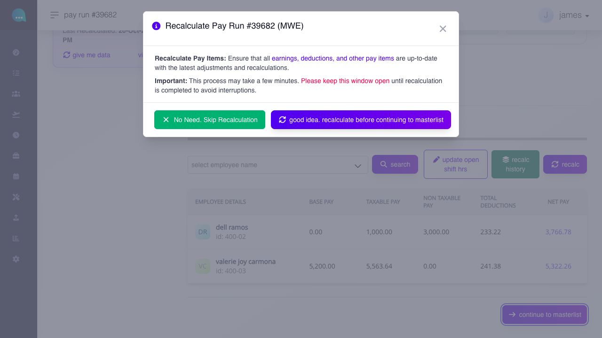
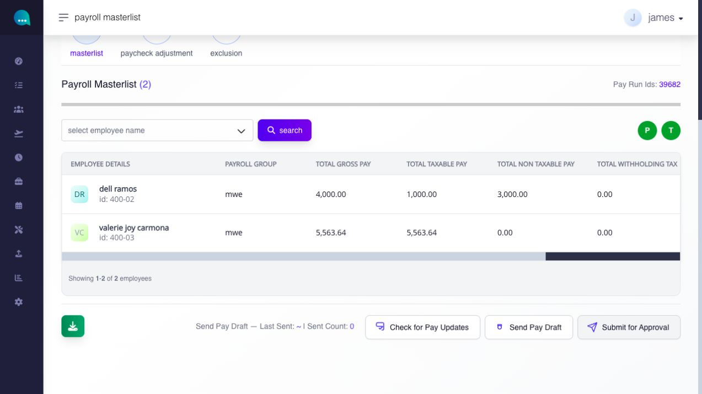
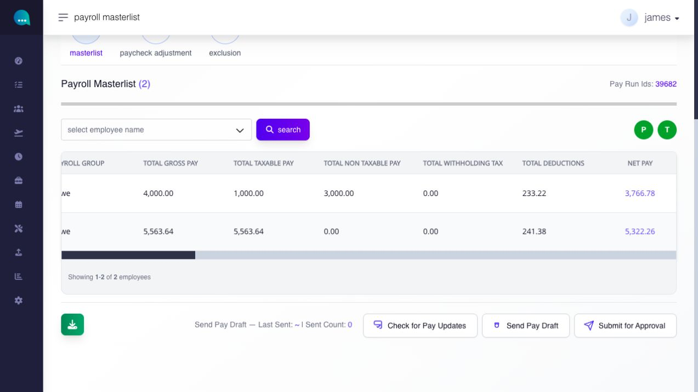
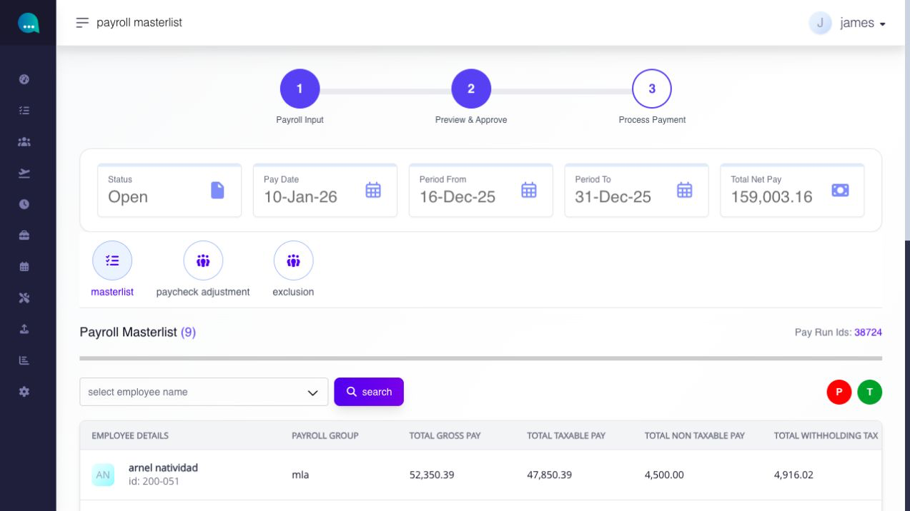
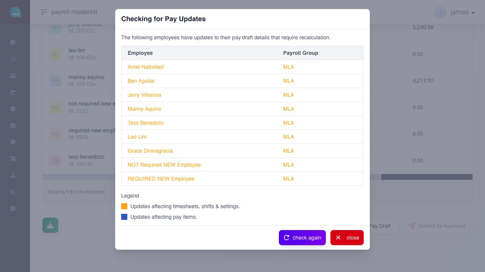
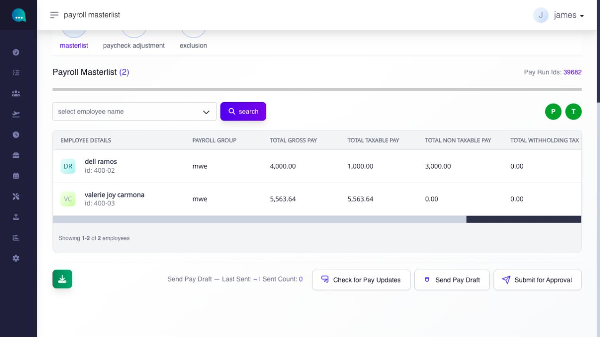
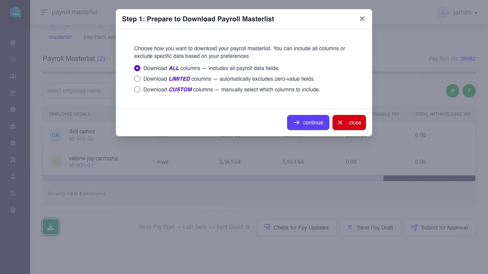
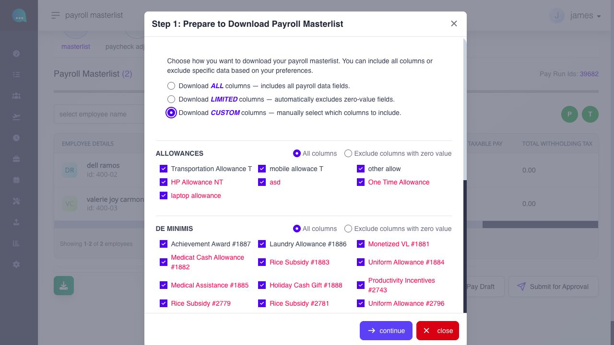
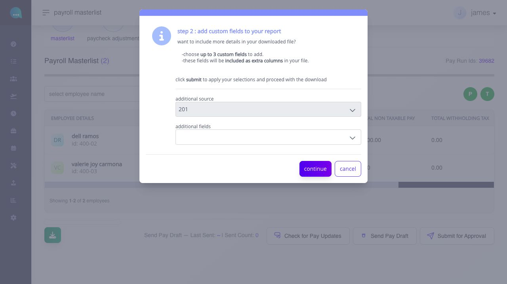
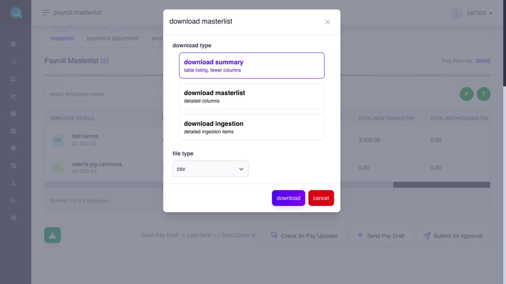

# review the Payroll Masterlist and readiness

## review the Payroll Masterlist and readiness

Use Payroll Masterlist to review consolidated employee payroll, check for source updates, prepare employee pay drafts, and submit a ready payroll for approval.

**Navigation:**\
open **View Payroll Masterlist** from Pay Run, or select **continue to masterlist** from Pay Run Details.

### before you begin

* verify the status, Pay Run IDs, pay date, period from/to, and total net pay.
* recalculate after eligible source changes.
* review exclusions, direct adjustments, and employee-level outliers.
* confirm the payroll approval workflow and payroll lock state.

### which settings control this workflow?

| level            | setting or record                                                                 | effect                                                              |
| ---------------- | --------------------------------------------------------------------------------- | ------------------------------------------------------------------- |
| company / global | payroll, payment, payslip, workflow, and output settings                          | controls reusable payroll review and release behavior               |
| module           | readiness checks, pay-update detection, approval, payroll lock, and output rules  | controls whether the run can proceed and what actions are available |
| employee         | calculated payroll result and employee delivery/payment details                   | supplies each row and related output data                           |
| pay run          | selected Pay Run IDs, dates, status, exclusions, adjustments, and pay-draft state | defines the consolidated review and submission                      |

### payroll masterlist

the **payroll masterlist** is the consolidated payroll review page for a selected pay date and payroll period. All pay runs that belong to the same pay date and period are reviewed together at this stage as one payroll output.

use the masterlist to confirm payroll values, manage adjustments and exclusions, check for pay updates, and submit payroll for approval.

**navigation:**\
go to **Paycheck → pay run → view payroll masterlist**

#### how do I move from pay run details to the payroll masterlist?

when you are done reviewing the pay run details, click **continue to masterlist**.

the system may ask whether you want to recalculate before continuing. this prompt appears because payroll-affecting changes can happen while the page is open.

* if you have had the page open for a while, or if you expect changes have been made, choose **recalculate before continuing to masterlist**.
* if you just recalculated and no new changes were made, choose **no need. skip recalculation**.

if you choose to recalculate, keep the page open until the process is complete. the system shows a progress window while it prepares the updated pay run.

**steps**

1. review the pay run details table.
2. click **continue to masterlist**.
3. if prompted, choose whether to recalculate before continuing.

<figure><figcaption>
After selecting continue to masterlist, choose whether to recalculate this pay run before moving on.
</figcaption></figure>

the system moves you to **payroll masterlist** for the selected pay date and pay period.


**notes**

* if the page has been open for a while, or you expect payroll-affecting changes have happened, choose the recalculation option before continuing.
* if you recently recalculated and no new changes were made, you can use **No Need. Skip Recalculation**.


#### what does the masterlist table show?

<figure><figcaption>
Each employee has one summary row. Scroll the table horizontally to see the remaining pay columns.
</figcaption></figure>

<figure><figcaption>
The right side of the same table shows total deductions and net pay.
</figcaption></figure>

the table shows a payroll summary for each employee:

* **employee details**
* **payroll group**
* **total gross pay**
* **total taxable pay**
* **total non-taxable pay**
* **total withholding tax**
* **total deductions**
* **net pay**

#### what do the top counters mean?

the summary cards show:

* **status** — the current state of the payroll review, such as **Open**
* **pay date** — the scheduled payroll payment date
* **period from** — the start date of the payroll period
* **period to** — the end date of the payroll period
* **total net pay** — the current total net pay for all employees included in the masterlist

confirm all five values before continuing to make sure you are reviewing the correct payroll set.

#### what can I do from this page?

* search the masterlist by employee. how do I search the masterlist?

1. In **Select Employee Name**, choose the employee you want to review.
2. Click **Search**.

* review the green and red light **P (payroll)** and **T (timesheet)** indicators
* run **check for pay updates**
* open **paycheck adjustment**
* open **exclusion**
* send a **Pay Draft**
* submit **payroll for approval**
* **download** the masterlist

#### how do I search the masterlist?

Use **Select Employee Name** and click **Search** to narrow the masterlist to one employee.

#### what should administrators know about the green and red light indicators on the masterlist?

the <mark style="color:$success;">green</mark> and <mark style="color:$danger;">red</mark> light **P (payroll)** and **T (timesheet)** indicators are payroll readiness checks on the masterlist page.

* **P** (Pay Update Check) - identifies payroll-affecting changes that may require recalculation before approval.
* **T** (Timesheet Check) - identifies timesheet-related payroll changes that still need attention before approval.

<figure><figcaption>
In this pay run, P is red and T is green. The red P means pay updates need attention before submission.
</figcaption></figure>

<figure><figcaption>
Select Check for Pay Updates to see which employees need recalculation and whether the updates affect timesheets, shifts, settings, or pay items.
</figcaption></figure>

the page runs these checks automatically when the masterlist opens. you can run them again using **check for pay updates**.

when both indicators are green, the current check found no items requiring recalculation.\
\
when **P** or **T** is red, the system found employees whose payroll details still need to be recalculated before submission.\
\
**submit for approval** is disabled until both indicators return to green.

#### what usually turns the indicators red?

the check turns red when it detects payroll-affecting updates that have not yet been fully refreshed into the current payroll state. This can include changes to:

* hours worked, tardiness, undertime, or absences
* paid leave, rest day or holiday premium, overtime, or night shift differential
* allowances, commissions, De Minimis, or other earnings
* government loans, other deductions, or retroactive pay
* third party loans
* retroactive pay

#### how do I clear a red indicator?

1. click **check for pay updates**.
2. review the employees flagged by the system.
3. recalculate the payroll.
4. run **check for pay updates** again.

if no recalculation issues remain, both indicators return to green and **submit for approval** becomes available.


**what happens if P or T is red?**

the page disables **Submit for Approval** until payroll is recalculated and checked again.


#### how do I use check for pay updates?

use **check for pay updates** to refresh the payroll review checks before submitting.

1. click **check for pay updates**.
2. wait for the system to complete the check.
3. review the indicator results and any prompts shown.

run this check again if the page has been open for a while before your final review. if P or T is red, review and recalculate the flagged employees before continuing.

***

#### how do export layout, extra fields, and download type differ?

these are three separate choices in the masterlist download workflow:

1. choose **ALL**, **LIMITED** or **CUSTOM** columns. CUSTOM exposes category-level choices and individual payroll items; LIMITED omits zero-value fields.
2. optionally add up to three employee custom fields as extra columns, then select **continue**. these fields add employee context; they are separate from the payroll item columns chosen in step 1.
3. choose summary, detailed masterlist or ingestion content. for **summary**, choose **CSV** or **XLS**. detailed masterlist downloads as CSV, while ingestion downloads as XLS. confirm the filename and file type after downloading.

review the selected payroll context before generating the file. choosing columns changes the exported presentation, not the payroll calculation. cancel the dialog when you do not want to generate an output.

#### how do I download the payroll masterlist?

<figure><figcaption>
Use the Download button below the masterlist to start an export.
</figcaption></figure>

use **download** to export the payroll masterlist from either an open or closed payroll. The exported file name reflects the payroll status so you can distinguish a working review export from a final closed-payroll export.

**navigation:** go to **Paycheck → pay run → view payroll masterlist**

**steps**

1. open the relevant payroll masterlist.
2. click **download**.
3. <mark style="color:violet;">**step 1: choose your export layout:**</mark>

<figure><figcaption>
Choose ALL, LIMITED, or CUSTOM columns in the first export step.
</figcaption></figure>

* **Download ALL Columns** - includes all payroll data fields in the export.
* **Download LIMITED Columns** - includes the main payroll columns but removes zero-value fields automatically. Use this for a cleaner export when you only need columns with active values.
* **Download CUSTOM Columns** - lets you manually choose which fields to include.

<figure><figcaption>
CUSTOM reveals category choices and individual payroll item columns.
</figcaption></figure>

4. <mark style="color:violet;">**step 2: add up to three extra custom employee fields if needed.**</mark>

* the custom field picker lets you add up to three extra employee fields as additional columns. Examples include Department, Payroll Group, Cost Center, Employment Type, Job Position, Location Assigned, Rank, and Report to Name.\
  \
  a search box is available to find fields quickly.

<figure><figcaption>
Add up to three employee fields if needed, or continue without adding any.
</figcaption></figure>

5. In the final download dialog, choose the output type and available file type, then select **download**. Select **cancel** if you do not want to generate a file.

the download modal gives three output types:

* **Download summary** — table listing, fewer columns
* **Download masterlist** — detailed payroll columns
* **Download ingestion** — detailed ingestion items only

<figure><figcaption>
Choose the output type and available file type before downloading.
</figcaption></figure>

#### what does download ingestion show?

**download ingestion** gives a dedicated ingestion file with one row per saved ingestion item.

the dedicated ingestion download lists these columns:

* **Employee Id**
* **First Name**
* **Last Name**
* **Ingestion Category**
* **Ingestion Item**
* **Tax Rule**
* **Amount**

#### where does ingestion appear on the masterlist page itself?

ingestion is not shown as one separate visible column on the current masterlist page.

on the page, its effect is already folded into payroll totals such as:

* taxable pay
* deductions
* withholding tax
* net pay

#### how is ingestion reported in the masterlist export?

when **Include Ingestion Breakdown** is set to **Yes**, the masterlist export adds a second row for the employee with **Source = ingestion**.

that extra row maps the ingestion amount into the payroll column it affects, instead of putting every item into one single "ingestion" column.

Examples:

* **Work Day** goes into **Taxable Basic Pay**
* **Tardiness** goes into **Tardiness**
* **Undertime** goes into **Undertime**
* **Absent** goes into **Absent**
* **Leaves** goes into **Leave**
* **Overtime** goes into **Overtime**
* **Holiday** goes into **Holiday** and **Total Holiday & Rest Day**
* **NSD** goes into **Night Shift Differential**
* **SSS**, **PHIC**, **HDMF**, **HDMF I**, **HDMF II**, and **Withholding Tax** go into their matching statutory or tax columns
* dynamic entries such as **Allowance**, **Other Earnings**, **Other Deductions**, and some loan headers are placed into the matching named dynamic columns

this means the ingestion breakdown row is column-mapped, not one single summed narrative line.
