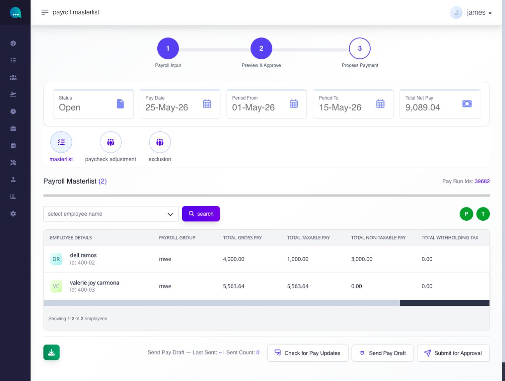
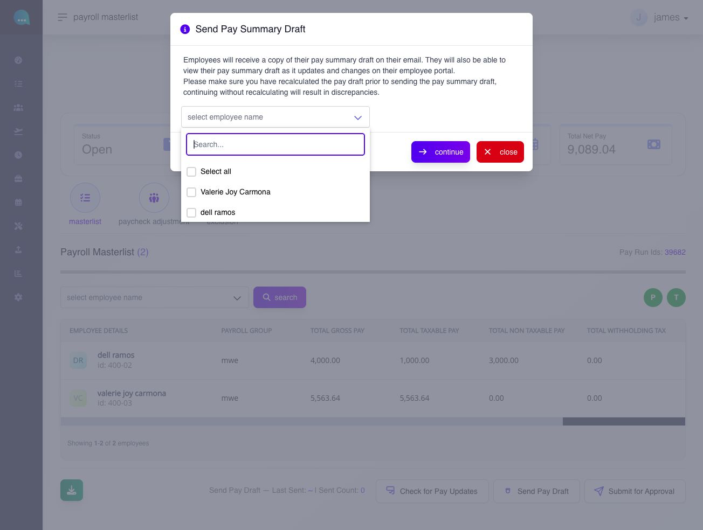
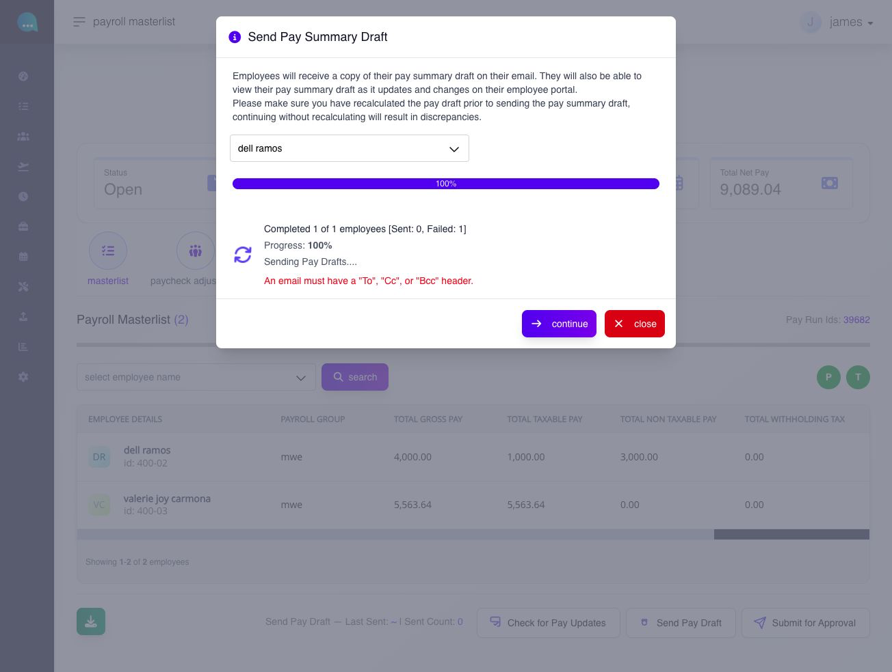

# send a Pay Draft

## send a Pay Draft

use **Send Pay Draft** to give selected employees an employee-facing preview of an open payroll before approval and closing.


a pay draft is not a closed payslip. Recalculate and review the payroll first. The page warns that continuing without recalculation can create discrepancies.


**Navigation:**\
go to **Paycheck → Pay Run → Payroll**, then open **View Payroll Masterlist** for an open pay run.

<figure><figcaption>
Check the pay run status, dates, employee rows, and pay-update indicators before selecting Send Pay Draft.
</figcaption></figure>

### Pay Draft

#### what is a pay draft?

a **pay draft** lets employees view a draft version of their payslip before payroll is closed.

normally, employees can only view their payslip after payroll is closed and payslips are generated/released. the Pay Draft function makes a draft payslip visible earlier - while the pay run is still open - so employees can review current earnings and deductions before payroll is finalized.\
\
the page guidance may also refer to this as a **pay summary draft**.

**how do I send a pay draft?**

use **send pay draft** when you want employees to view their draft payslip in the employee portal before payroll is closed.

1. open the relevant payroll masterlist.
2. recalculate the pay run if you have not done so recently.
3. click **send pay draft**.
4. In **Send Pay Summary Draft**, open **select employee name**. Choose **Select all** or select the individual employees who should receive the draft.
5. Review the recipients and the recalculation warning, then select **continue**. This starts the send batch; there is no separate confirmation after **continue**.
6. Wait for processing to finish. Read **Sent**, **Failed**, and any displayed error before closing the dialog.

<figure><figcaption>
Choose only the employees who should receive this draft. The dialog also warns that unrecalculated payroll can produce discrepancies.
</figcaption></figure>

make sure the pay run has been recalculated before sending. the page warns that sending without recalculation may result in discrepancies in what employees see. because this action sends a notification to employees, review the payroll state carefully before using it.

you can send a pay draft more than once before payroll closes. Each time, the masterlist updates the Last Sent time and Sent Count.

#### does a completed Pay Draft batch mean all drafts were sent?

check the **Sent** and **Failed** counts as well as processing progress. a completed count does not mean every send succeeded. for example, 10 processed, 8 sent and 2 failed means two sends still need attention.

read the displayed error and establish which employees need follow-up before sending again. do not assume that every recipient should be resent a draft, or that a failed-only retry has happened automatically. keep the error details when support needs to investigate. sending a draft remains a preview action and does not close payroll.

<figure><figcaption>
This test batch processed one employee but sent no email. A completed progress bar is not proof of delivery; check the Sent and Failed counts and the error.
</figcaption></figure>

#### what happens after you send a pay draft?

* sending prepares employee access to the pay summary draft and attempts notification. check the send result and any failures before treating the batch as successful.
* the masterlist page shows a history line such as **Last Sent** and **Sent Count** for successful sends. A failed attempt may leave these values unchanged.
* companies can send pay draft more than once before payroll closes.


**rules or warnings**

* recalculate first before sending a pay draft.
* the page warns that sending a pay draft without recalculation can cause discrepancies.
* treat pay draft as an employee-facing communication step and review it carefully before use.


***
