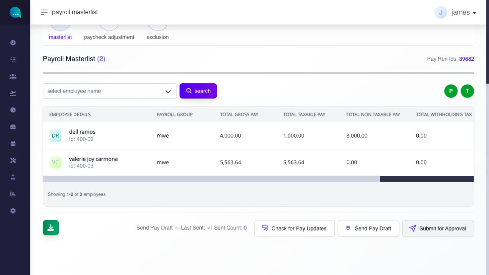
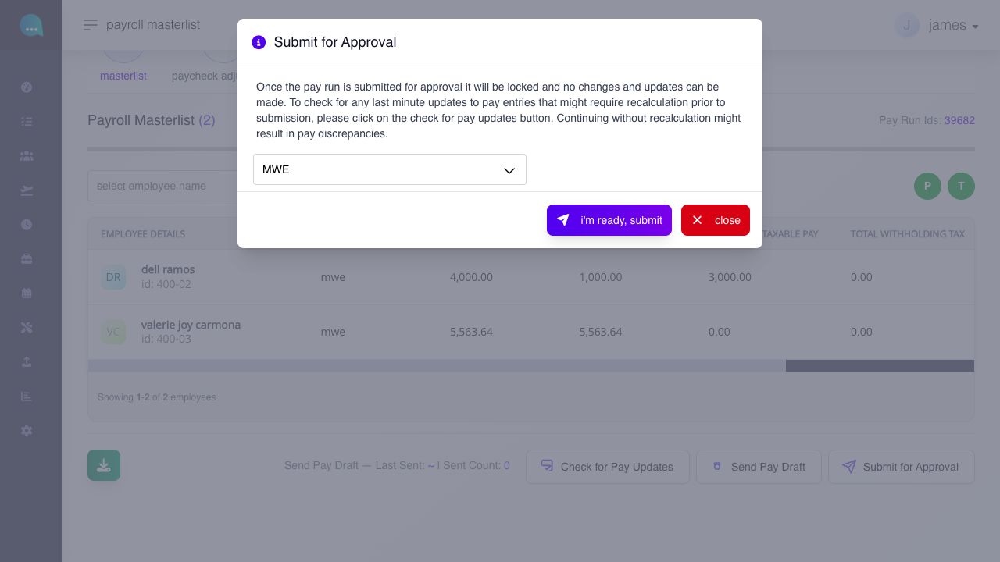
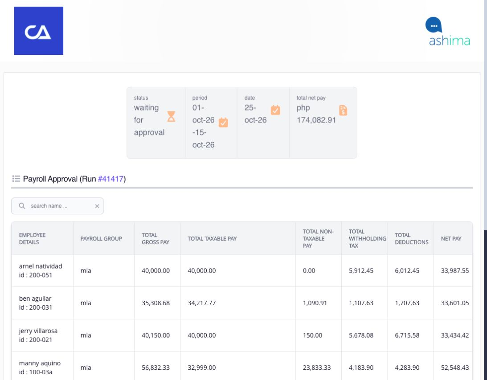
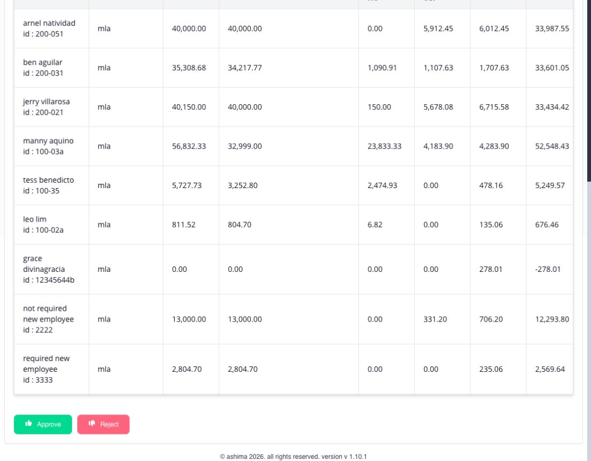
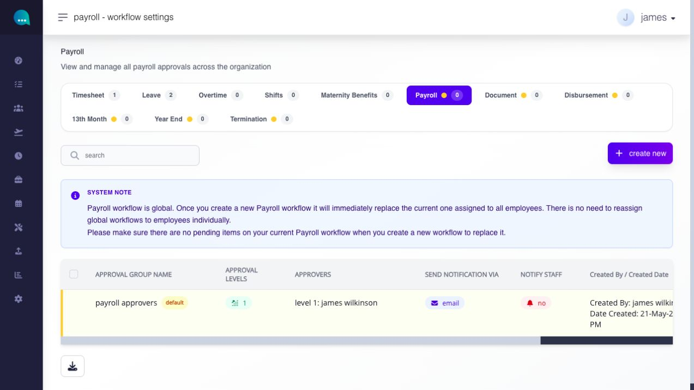
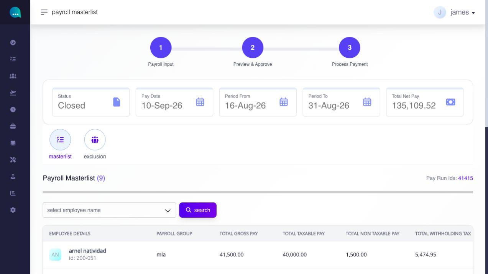

# submit, approve, reject, and close payroll

## submit, approve, reject, and close payroll

use **Submit for Approval** only after the open pay run is recalculated, reviewed, and ready for the configured Payroll approval workflow.

**Navigation:**\
go to **Paycheck → Pay Run → Payroll**, then open **View Payroll Masterlist** for the open pay run.

### pay run approval

#### how do I submit pay run for approval (payroll approval)?

use **submit for approval** when payroll review is complete and the payroll is ready to move to the approval stage.

**navigation:**\
go to **Paycheck → pay run → view payroll masterlist**

<figure><figcaption>
After reviewing the masterlist and pay updates, use Submit for Approval below the employee table.
</figcaption></figure>

**steps**

1. open the relevant payroll masterlist.
2. review the masterlist table, adjustments, and exclusions.
3. click **check for pay updates** and confirm both P and T indicators are green.
4. click **submit for approval**.
5. **choose which pay group** you want to submit for approval.
6. review the confirmation and proceed.

the confirmation explains that once the pay run is submitted for approval, it is locked and no further changes or updates can be made. it also reminds you to run Check for Pay Updates first, because submitting without recalculation may result in pay discrepancies.

<figure><figcaption>
Choose the pay group and read the lock warning before selecting I'm ready, submit.
</figcaption></figure>

submit only after payroll values, exclusions, and adjustments are final for the current review cycle.

#### what happens after I submit pay run for approval?

when submission is completed:

* the payroll is sent to the configured payroll approver workflow.
* an approval email with a payroll approval link is sent to the approver.
* a payroll approval To Do item is created for the approver.
* the pay run status changes to **Waiting for Approval**.

approvers can review and act on the payroll from the approval email link or from the payroll approval To Do item.

#### pay run approval and rejection

once submitted, approvers can review payroll from the approval email link or from the payroll To Do item. if no action is taken, payroll remains in **Waiting for Approval**.

* **after the final required approval** — the pay run becomes **Closed** and moves to closed-payroll actions.
* **if rejected** — the pay run becomes **Rejected** and returns to payroll review for correction and resubmission.

#### can approvers approve or reject payroll from email or Todo?

yes. the approval workflow supports review from:

* the approval email link
* the payroll approval To Do page

from either view, the approver can review the payroll summary, approve the payroll, or reject it.

<figure><figcaption>
The approver sees the pay run status and employee payroll rows together before making a decision.
</figcaption></figure>

<figure><figcaption>
After reviewing the employee totals, the approver can select Approve or Reject at the bottom of the page.
</figcaption></figure>

#### how can I check who the pay run approver(s) are?

Go to **Settings > Workflow > Payroll**.

This page will show the assigned pay run approver(s).

For a confidential payroll group, also confirm that each approver has permission to view that payroll. Being assigned in the Workflow does not by itself grant access to confidential payroll details. See [configure approval workflows](../../settings/platform-controls/configure-approval-workflows.md) for the separate access check.

<figure><figcaption>
On Settings → Workflow → Payroll, check the approval group, levels, and approvers. The notice explains that Payroll uses a global workflow.
</figcaption></figure>

#### what happens if the payroll is left pending?

If the approver does not act, the payroll remains in **Waiting for Approval**. It does not return to the open draft state on its own.

#### what happens when payroll is approved?

<figure><figcaption>
After final approval, the pay run shows Closed and moves to Process Payment.
</figcaption></figure>

when final approval is completed:

* the payroll approval status is marked as complete.
* the pay run status changes to **Closed**.
* [the payroll moves into closed-payroll actions:](generate-and-review-payslip-output.md#page-070-pages-admin-paycheck-md--what-can-i-do-on-a-closed-payroll-masterlist)\
  \* download masterlist\
  \* download bank file,\
  \* print payslip\
  \* generate payslip (payslip release)

closed payroll should be treated as final for normal payroll review purposes.

#### what happens when payroll is rejected?

when payroll is rejected:

* the pay run status changes to **Rejected**.
* the payroll leaves the approval queue.
* the payroll can return to payroll review so it can be corrected and resubmitted.

review rejected payroll carefully before resubmitting for approval.
