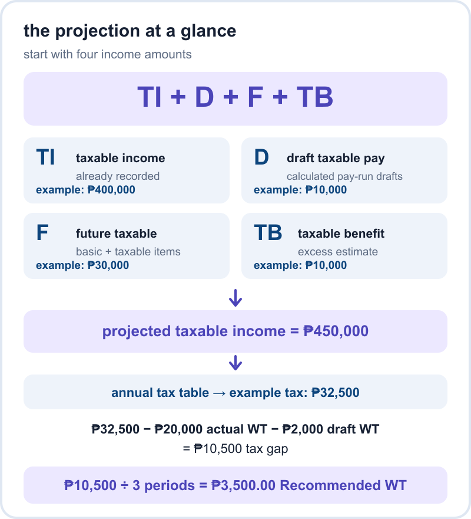
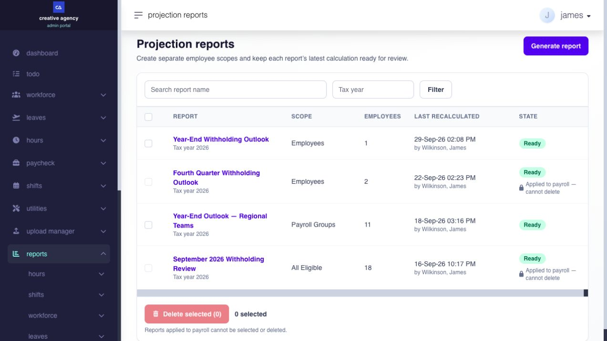
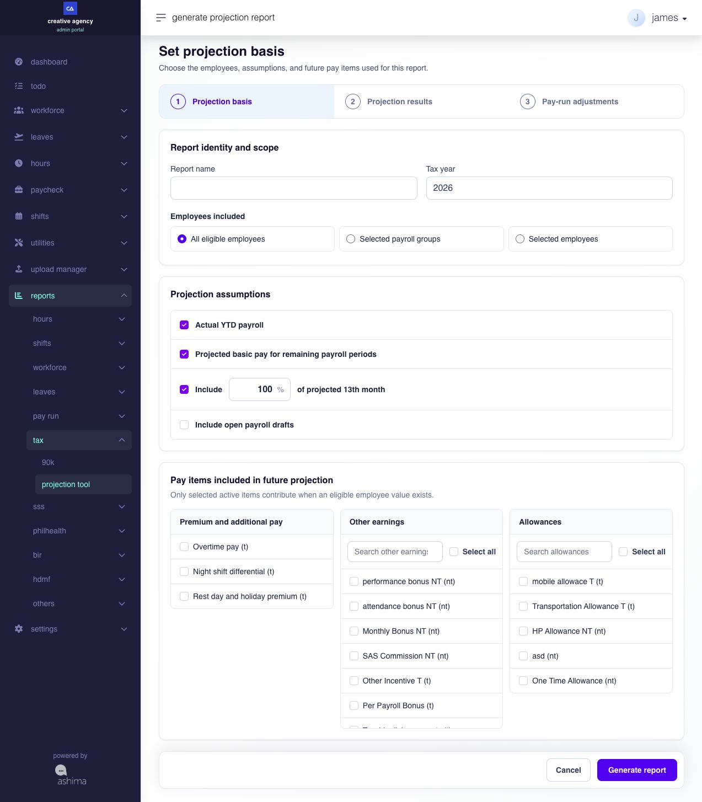
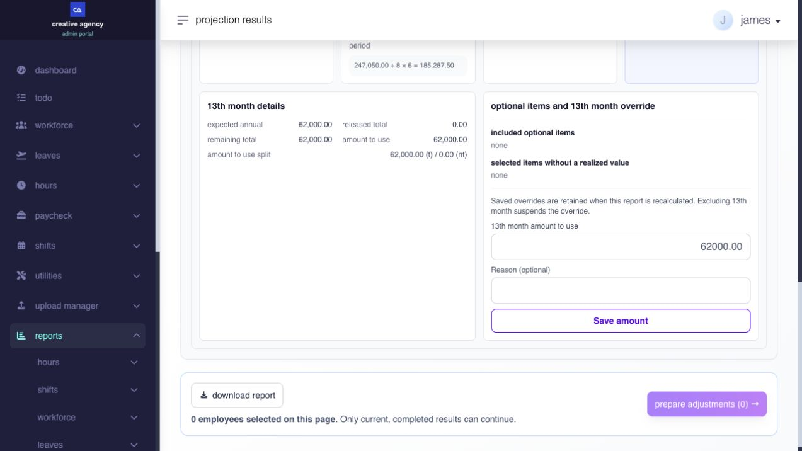
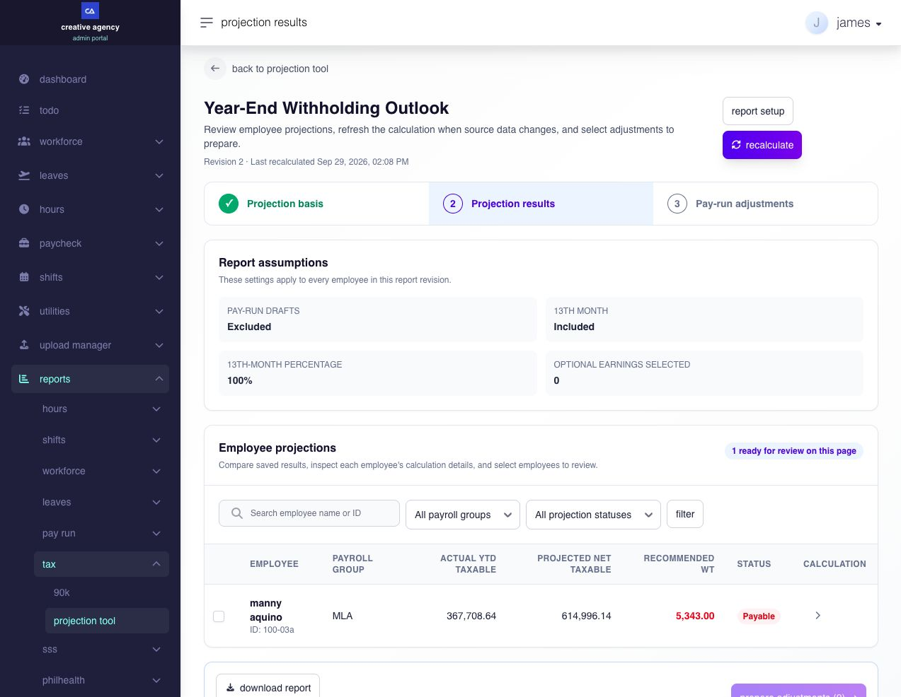
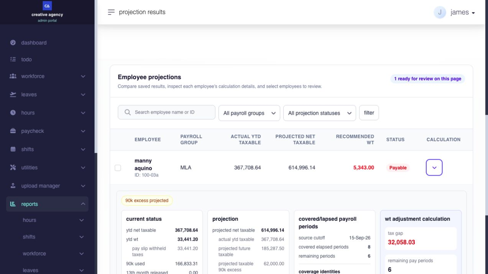
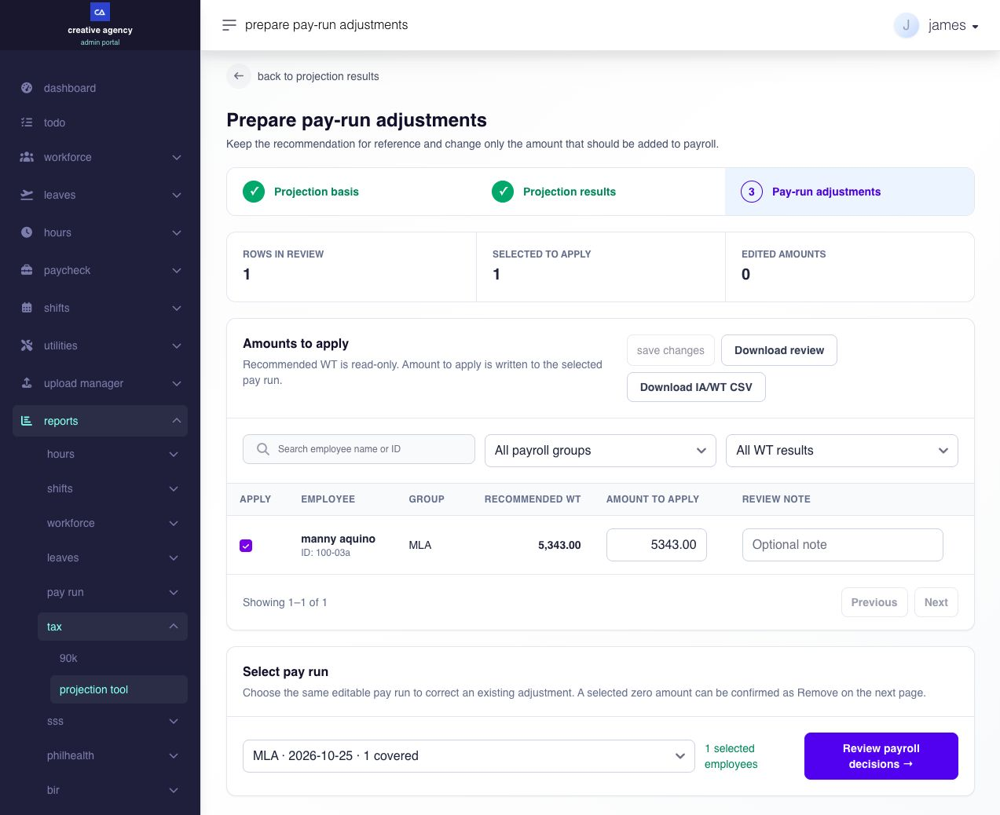
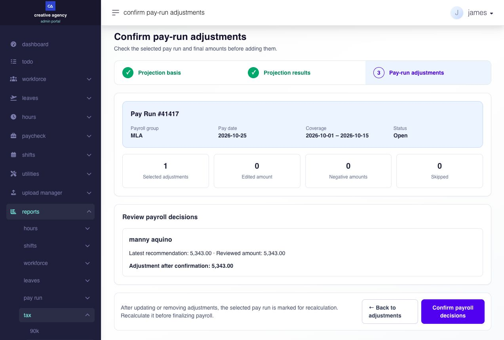

# use Projection Tool

## start here: estimate year-end withholding before adjusting payroll

use Projection Tool when you want to estimate employees' year-end taxable income and withholding, understand a possible tax gap, and review whether an adjustment belongs in an upcoming payroll.

**this is an optional planning tool.** you can create, compare, and download reports without applying anything to payroll. the result is a projection based on available records and selected assumptions. it is not an exact forecast, a finalized payslip, or a completed year-end tax calculation.

read [how the projection is calculated](use-projection-tool-v2.md#how-the-projection-is-calculated), then [create a report](use-projection-tool-v2.md#create-a-projection-report) and review its results. if you decide to change withholding in an open pay run, [review and apply a separate adjustment](use-projection-tool-v2.md#apply-a-reviewed-adjustment-to-payroll).

## how the projection is calculated

the formulas below explain the tool's calculation. the numerical examples show the software's arithmetic; they are not a statutory tax-rate guide or a prediction for a particular employee.

### start with the overall formula

the tool estimates the employee's taxable income for the year, calculates the estimated annual tax, then spreads the tax still to be withheld across the remaining pay periods.

<figure><figcaption>
selected optional taxable items, such as overtime, contribute to the future estimate F; they are not a separate amount added after F. the values shown are an example, not an employee forecast.
</figcaption></figure>

| component                               | what it contributes                                                                                              | where its detail follows                                                                       |
| --------------------------------------- | ---------------------------------------------------------------------------------------------------------------- | ---------------------------------------------------------------------------------------------- |
| **TI — recorded taxable income**        | recognized income for the tax year, including relevant Year End and previous-employer records                    | [recorded income](use-projection-tool-v2.md#ti-what-income-is-already-recorded)                |
| **D — included draft taxable income**   | eligible calculated pay-run drafts, only when you select **Include open payroll drafts**                         | [draft income](use-projection-tool-v2.md#d-when-do-open-payroll-drafts-count)                  |
| **F — estimated future taxable income** | recurring taxable basic pay and selected taxable items with usable values, spread over remaining payroll periods | [future income](use-projection-tool-v2.md#f-how-is-future-taxable-income-estimated)            |
| **TB — taxable benefit excess**         | the projected portion of 13th Month and selected future non-taxable items above the remaining benefit allowance  | [benefit excess](use-projection-tool-v2.md#tb-how-do-projected-benefits-affect-taxable-income) |

> **formula — from annual income to a per-period recommendation**
>
> projected taxable income = **TI + D + F + TB**
>
> tax gap = estimated annual tax from the configured tax table − tax already withheld − included draft withholding
>
> **Recommended WT** per remaining pay period = tax gap ÷ remaining pay periods

a positive tax gap means estimated tax remains to be covered; a negative gap means estimated over-withholding under these assumptions. neither result automatically pays or refunds an employee.

**example:** suppose an employee has ₱400,000 taxable income already recorded and ₱10,000 in an included draft. the tool estimates ₱30,000 taxable income for the remaining periods and ₱10,000 taxable benefit excess. the sections below show how it gets those two estimates. projected taxable income is **₱400,000 + ₱10,000 + ₱30,000 + ₱10,000 = ₱450,000**.

in the report, **YTD net taxable = ₱410,000** combines the ₱400,000 already recorded and the ₱10,000 included draft. **YTD WT = ₱22,000** combines ₱20,000 already withheld and ₱2,000 draft withholding. do not add the draft amounts again.

using the annual graduated bracket effective from 2023 for this example, tax on ₱450,000 is **₱22,500 + 20% × (₱450,000 − ₱400,000) = ₱32,500**. see the [BIR annual tax table, table 2](https://bir-cdn.bir.gov.ph/local/pdf/1701%20Jan%202018%20final%20with%20rates.pdf). this example assumes that bracket applies and that Ashima's configured annual table matches it; always check the report's applicable table and employee treatment.

subtract the withholding already included: **₱32,500 − ₱20,000 − ₱2,000 = ₱10,500** still to withhold. with three remaining pay periods, **Recommended WT = ₱10,500 ÷ 3 = ₱3,500 per period**.

**Recommended WT** is a planning figure, not the amount automatically deducted from the next pay run. **Amount to apply** is a separate signed payroll adjustment. review the payroll's own withholding before choosing it. the component explanations below show where the estimate comes from.

### TI: what income is already recorded?

actual taxable income comes from the year-end calculation's recognized YTD amounts. recognized historical adjustments, previous-employer values, and beginning balances can remain in **TI** without becoming recurring future pay. this matters when an employee had a one-time adjustment or brought previous-employer income into the year.

#### does Year End ingestion affect the projection?

yes. focus on Year End ingestion that changes an input used in the projection:

| Year End ingestion                                                                                                                                                                                                        | What to check in Projection Tool                                                                                                                                                                                                                                                                                                               |
| ------------------------------------------------------------------------------------------------------------------------------------------------------------------------------------------------------------------------- | ---------------------------------------------------------------------------------------------------------------------------------------------------------------------------------------------------------------------------------------------------------------------------------------------------------------------------------------------- |
| **Taxable pay or adjustments**, such as workday, holiday, rest-day, leave, night-differential, or overtime adjustments; supported retroactive items; taxable extra compensation; and taxable 13th Month or other benefits | once recognized by Year End for the selected tax year, these can change **taxable income already recorded**. an ingested adjustment does not automatically become recurring **estimated future taxable income**. recalculate and check both figures.                                                                                           |
| **Non-taxable 13th Month and other benefits**, including the Year End benefit categories for hazard pay and fringe benefits                                                                                               | these can change Year End's annual benefit total and its taxable excess above the **90k** allowance. compare that result with Projection Tool's **90k used** and **projected taxable 90k excess**; an ingested benefit may not appear in those projection fields in the same way. resolve any difference before relying on **Recommended WT**. |

an ingested **13th Month** amount also needs a separate check. Year End may include it in actual figures, but Projection Tool reduces its _remaining 13th Month assumption_ only for qualifying released 13th Month pay. an ingestion entry alone does not count as that release. if the entry represents an amount already paid, review **13th month amount to use** so the projection does not also assume that payment is still ahead.

[review the Year End ingestion entry](run-and-review-year-end.md#when-should-i-use-ingestion-or-edit-a-withholding-figure), then recalculate the projection. if the Year End and projection figures do not reconcile, ask your payroll administrator to review them before applying an adjustment.

#### does a previous-employer BIR 2316 affect the projection?

yes, when an approved previous-employer 2316 record is available for the selected tax year. its recorded taxable income and withholding feed the year-to-date amounts used by the projection. its imported coverage can also help the tool recognize past payroll periods. previous-employer income is not treated as recurring basic pay to be projected into future periods.

the Projection Tool uses the amounts already recorded in Ashima; it does not verify the 2316 document or correct an incomplete entry for you. if an employee's prior-employer figures look wrong, review the previous 2316 record, correct the source where appropriate, and recalculate the projection.

### D: when do open payroll drafts count?

**D** is taxable income from eligible, calculated pay-run drafts. it is included only when you select **Include open payroll drafts**. draft amounts are provisional; their withholding is also included when the annual tax gap is calculated. their covered periods move out of the remaining-period count. [review draft figures before including them](use-projection-tool-v2.md#what-does-including-open-payroll-drafts-do).

### F: how is future taxable income estimated?

**F** uses recognized recurring taxable basic pay and selected taxable items with usable employee values, such as **Overtime pay (t)**, **Night shift differential (t)**, or a taxable allowance. the tool does not add those items a second time after **F**. actual taxable amounts already recorded remain in **TI** even when an item is excluded from the future estimate.

#### how does the tool count payroll periods?

the calendar comes from the employee's payroll group's pay schedule. the latest qualifying closed-payroll coverage end sets the group cutoff. on or before that cutoff, the tool recognizes supported employee payslip participation and imported coverage against the scheduled periods, counting a matching period once.

periods after the cutoff are future periods. a past period in which an employee did not participate is not simply relabelled as future. included draft periods move into recognized elapsed coverage and out of remaining coverage.

use the displayed employee counts rather than counting months manually. weekly, semi-monthly, and monthly employees have different schedules. these period counts influence both the historical average and how the tax gap is spread.

#### how is the future average calculated?

> **formula — future taxable income**
>
> taxable average per covered period = recurring taxable YTD ÷ covered elapsed periods
>
> projected future taxable = taxable average per covered period × remaining pay periods

the same averaging pattern is used for selected usable non-taxable future items. no covered elapsed periods means no reliable average; the row is blocked from payroll application.

**continuing the example above:** the employee has ₱60,000 recurring taxable YTD across six covered periods and three remaining periods:

> **formula — example substitution**
>
> ₱60,000 ÷ 6 = ₱10,000 average per covered period
>
> ₱10,000 × 3 = ₱30,000 projected future taxable

the ₱60,000 is a basis drawn from recorded income; do not add it again to projected taxable income. if a selected taxable earning adds ₱12,000 to the usable recurring YTD basis, the future estimate becomes ₱72,000 ÷ 6 × 3 = ₱36,000. the extra ₱6,000 is a projection effect; it does not assign or pay the earning.

### TB: how do projected benefits affect taxable income?

the tool compares their combined future amount with the remaining benefit allowance used by the calculation. the interface calls this the **90k** balance. the example below assumes a configured ceiling of ₱90,000; it is not a claim that every item labelled **(nt)** has identical statutory treatment.

> **formula — projected benefit excess**
>
> remaining allowance = maximum of zero and (configured ceiling − recognized YTD usage)
>
> projected taxable excess = maximum of zero and (13th Month amount to use + projected future non-taxable items − remaining allowance)

**continuing the example above:** with a ₱90,000 configured ceiling and ₱70,000 already used, ₱20,000 remains. if the 13th Month amount to use is ₱25,000 and selected future non-taxable items total ₱5,000, the combined projected taxable excess is **₱25,000 + ₱5,000 − ₱20,000 = ₱10,000**.

the 13th Month-only taxable split would show ₱5,000 in that example. the combined excess is larger because it also includes the ₱5,000 of selected future non-taxable items. do not add both taxable excess figures to the annual total; that would double-count the 13th Month excess.

### what can change the recommendation?

one remaining period receives the full calculated tax gap. zero remaining periods produces a zero recommendation and a blocker, not an instruction to apply the entire gap to a closed year. monetary results are displayed to two decimal places; use saved result values when reconciling rounding.

future attendance, earnings, salary changes, payroll timing, source corrections, and actual benefit releases can differ from the report's assumptions. recalculate after material changes and verify the final payroll result. when you intend to affect payroll, [review the signed adjustment separately](use-projection-tool-v2.md#apply-a-reviewed-adjustment-to-payroll).

### which related settings and records matter?

| source or setting                                          | why it matters                                                              | where to review it                                                                                                        |
| ---------------------------------------------------------- | --------------------------------------------------------------------------- | ------------------------------------------------------------------------------------------------------------------------- |
| employee payroll group and schedule                        | selects the calendar and helps determine covered and remaining periods      | Workforce employment details; Settings pay schedules and pay groups                                                       |
| employee basic-pay history                                 | supplies the effective basic pay used for the initial 13th Month assumption | Workforce compensation and salary history                                                                                 |
| closed payroll and calculated drafts                       | supply recognized coverage, actual/provisional amounts, and withholding     | Paycheck pay runs                                                                                                         |
| beginning balance and previous 2316                        | supply recognized imported income, withholding, and coverage                | Paycheck beginning balance and previous 2316 records                                                                      |
| allowance and other-earning definitions and payroll values | supply the selectable items and usable employee trend amounts               | Settings earnings; the relevant employee earnings and payroll records                                                     |
| approved 13th Month and disbursement records               | supply qualifying released benefits and usable disbursement history         | 13th Month and disbursement details                                                                                       |
| annual tax table and withholding rules                     | determine tax calculation and how the target payroll calculates withholding | [withholding-tax schedules and rules](../settings/contributions-and-tax/configure-withholding-tax-schedules-and-rules.md) |

report selections do not edit these source records. correct the owning record, then recalculate the report and review any intended payroll change.

## create a projection report

create a named report for a specific tax year and employee population. a clear name helps distinguish a company-wide review from a focused payroll-group or employee review.

### where do i open the Projection Tool?

go to **Reports → Tax → projection tool**. the opening page is **Projection reports** and includes **Generate report** and a list of named reports. if the menu is unavailable to you, ask your account administrator to review your access.

on **Projection reports**, use **Search report name** to find a saved report, **Tax year** to narrow the list, and **Filter** to apply those entries. **Report** opens the saved result; **Scope** and **Employees** tell you who it covers; **Last recalculated** tells you when its figures were last produced; and **State** tells you whether it is **Ready** or needs recalculation. the checkbox selects an unused report for **Delete selected**. **Select all deletable reports on this page** selects only eligible reports on the displayed page, not every report in every page of the list. use the page controls to browse older reports.

<figure><figcaption>
Find a saved report or select Generate report. These example reports belong to a test company.
</figcaption></figure>

### what should be ready?

check that the employees have the correct payroll groups and pay schedules, that the tax-year payroll calendar exists, and that the relevant payroll records have been calculated and closed. review beginning balances and previous-employer records when they apply. missing history changes what the tool can recognize as completed coverage.

you also need access to the tax-report function and the employees being reviewed. confidential-employee access affects which employees and reports you can open. an active payroll group may appear in the selection list even when it contributes no eligible employees.

### how do i generate a report?

1. open **Projection reports** and select **Generate report**.
2. enter a **Report name** and **Tax year**.
3. choose **All eligible employees**, **Selected payroll groups**, or **Selected employees**.
4. review the **Projection assumptions**.
5. choose the optional items under **Pay items included in future projection**.
6. select **Generate report** and keep the page open while calculation runs.
7. when the results load, confirm the report name, assumptions, employee count, and any failed or blocked employees.

the report name must be unique within your company, ignoring letter case. changing only uppercase to lowercase does not create a distinct name. use a name such as “september withholding review” or “quarter-four outlook — operations.” names can contain up to 150 characters. the tax year must be a whole year from 2000 to 2100.

<figure><figcaption>
Set the employee scope and assumptions before generating the report. Optional pay items affect the future estimate only when an employee has a usable recorded value.
</figcaption></figure>

### which employee scope should i choose?

| option                      | when to use it                                           | what to check                                                                                                                      |
| --------------------------- | -------------------------------------------------------- | ---------------------------------------------------------------------------------------------------------------------------------- |
| **All eligible employees**  | a broad company review                                   | eligibility and your access still determine the included employees                                                                 |
| **Selected payroll groups** | a review organized by payroll responsibility or schedule | select one or more active groups; up to 100 groups can be submitted                                                                |
| **Selected employees**      | a focused review or investigation                        | search by name or employee ID, select the correct people, and load more results when needed; up to 5,000 employees can be selected |

employee selections remain selected when you search for another employee or load another page. review the selected names before generating. an empty group adds no results. if the entire scope contains no eligible employees, Ashima cannot publish a new calculation for that scope; revise the selection or correct the employee setup.

**Search payroll groups** and **Search employee name or ID** only narrow the choices displayed while you build the scope. tick a checkbox to add a group or employee; the panel on the right shows the complete selected set, its count, and an **×** control for removing one selection. **Load more employees** brings in another page of search results without discarding earlier selections; **Retry** repeats a failed employee search. **No longer eligible** identifies a previously selected employee who cannot contribute to the current calculation. **Cancel** returns to the report list without saving the setup. on an existing report, **Save and recalculate** saves the edited setup and starts a new calculation; **Delete unused report** opens a deletion confirmation only when deletion is allowed.

## choose what the projection includes

report assumptions let you decide what is reasonable to carry forward. they apply to the report, not to the company's earning definitions or employees' actual pay assignments.

### which inputs are always included?

**Actual YTD payroll** and **Projected basic pay for remaining payroll periods** are fixed selections. YTD means year to date.

actual figures preserve the recognized year-to-date taxable income and withholding. the future basic-pay component uses the recognized recurring taxable basic-pay basis and covered payroll periods. it is not simply the current salary multiplied by the months left in the year.


**Actual amounts remain:** deselecting an optional earning does not erase its actual year-to-date amount. it changes whether that earning contributes to the future estimate.


### what does including open payroll drafts do?

select **Include open payroll drafts** when you want eligible calculated draft payroll amounts included provisionally. it is off when you create a new report.

the tool reads usable employee payslip values from eligible active, calculated pay-run drafts in the selected tax year. it adds their taxable amounts and withholding to the calculation and recognizes their covered periods so those periods are not also counted as remaining future periods.

if a draft was returned for correction, correct its source records and recalculate the pay run before using its figures in the projection. you can leave **Include open payroll drafts** off if you want to estimate without draft figures.

if you replaced a draft with another run, compare the report's **Pay run draft taxable** and **Pay run draft withheld taxes** with the pay runs you expect to contribute. if both the old and new runs still appear as active drafts for the same employee and period, leave draft inclusion off until the duplicate is resolved; otherwise, the projection may count both amounts.

an empty or uncalculated draft does not supply a reliable amount merely because the pay run exists. draft amounts remain provisional and can change before payroll closes.

### which future pay items can i choose?

| category                       | available choices                                                                                                                      | when to include them                                                                            |
| ------------------------------ | -------------------------------------------------------------------------------------------------------------------------------------- | ----------------------------------------------------------------------------------------------- |
| **Premium and additional pay** | **Overtime pay (t)**, **Night shift differential (t)**, **Rest day and holiday premium (t)**                                           | when you expect the recorded pattern to continue and want it represented in the future estimate |
| **Other earnings**             | active company other-earning items, labelled **(t)** or **(nt)**; **Taxable disbursements (t)** and **Non-taxable disbursements (nt)** | when the selected earnings or approved disbursement pattern is a reasonable future assumption   |
| **Allowances**                 | active company allowance items, labelled **(t)** or **(nt)**                                                                           | when those allowances have usable employee payroll values and are expected to continue          |

**(t)** identifies the taxable variant and **(nt)** the non-taxable variant used by the projection. the individual allowance and other-earning names come from company settings; they are not a fixed list shared by every company.

search the earning and allowance lists to find the intended items. each list has its own **Select all** or clear-selection action. searching does not clear selections already made, so review all selected items before saving.

each checkbox means “consider this item when estimating future periods.” an unavailable item has a disabled checkbox and cannot be selected. **Select all** applies to the enabled items in that category, even if search currently shows only some of them; review the whole category before using it. the search box changes which names you see, not what was already selected. deselect an item when its past value should remain in actual YTD but should not be carried into the future.

### does selecting an item guarantee a projected amount?

no. the tool needs a usable current-year employee value. a configured or assigned allowance with no recognized payroll value does not become a projected payment simply because you select it.

when an item has no usable value, the employee breakdown shows a projection check explaining that it does not contribute a future trend. distinguish a recorded zero from missing usable history: a displayed zero is an amount, while a missing-value notice means Ashima could not derive the trend for that selection.

for disbursements, the tool uses recognized approved disbursement payslips with usable dates, original amounts, and tax classifications, subject to the projection cutoff. draft or unclassified disbursements are not automatically treated as recurring future payments.

### should i include a one-time bonus?

include an item only when projecting its recorded pattern makes sense for your review. carrying a one-time earning forward can overstate expected future income. you can keep it in actual YTD income while excluding it from the future assumption.

this tool does not provide a separate schedule of arbitrary future salary increases, new allowance amounts, or one-off future bonuses. correct source records or review a separate assumption set when historical values no longer represent the expected future.

## review the projected 13th Month

the 13th Month assumption estimates a remaining benefit amount for tax projection. it does not generate, approve, or pay the employee's actual 13th Month benefit.

you can include a 13th Month amount that **has not yet been released**. the tool estimates what remains after qualifying releases already recorded in Ashima; it does not require an open 13th Month pay run. it compares that estimate and selected future non-taxable items with the remaining configured benefit allowance. only the combined excess contributes to **TB**, the taxable benefit amount in the overall formula.

### how do i set the report-wide assumption?

in report setup, use **Include … % of projected 13th month**. enable it to include the calculated remaining estimate and enter a percentage from 0 to 100. a new report starts with inclusion enabled and 100%.

the tool calculates the expected amount from the employee's effective basic pay multiplied by the report percentage, then subtracts qualifying 13th Month amounts already released. it does not allow a negative remaining amount.

> **formula — initial 13th Month estimate**
>
> expected annual amount = effective basic pay × report percentage
>
> initial amount to use = maximum of zero and (expected annual amount − qualifying released amount)

for example, effective basic pay of ₱40,000 at 75% gives an expected amount of ₱30,000. if ₱10,000 has already been recognized as released, the initial amount to use is ₱20,000.

the release must be supported by the qualifying approved and generated 13th Month payroll records. an unfinished 13th Month draft does not count as released simply because it exists.

### how do i interpret the employee breakdown?

expand the employee's result and review **13th month details**:

* **expected annual** is the basic-pay assumption multiplied by the report percentage;
* **released total** is the qualifying amount already released;
* **remaining total** shows the expected amount less the released total, with a minimum of zero;
* **amount to use** is the amount currently used in this employee's projection, including a saved override;
* **amount to use split** separates the displayed taxable and non-taxable portions of that 13th Month estimate.

the overall projected taxable excess also considers selected future non-taxable items against the remaining benefit allowance used by the calculation. therefore, the 13th Month split alone does not explain every amount in **projected taxable 90k excess**. see [how TB is calculated](use-projection-tool-v2.md#tb-how-do-projected-benefits-affect-taxable-income).

### what does “optional items and 13th month override” tell me?

this panel brings together two different decisions: which optional earnings can support the employee's future-pay estimate, and whether the report uses a custom 13th Month amount for this employee. the optional-item lists are results of the choices made in **Pay items included in future projection** during report setup. they are not controls for assigning or paying those items.

<figure><figcaption>
Compare the calculated 13th Month details on the left with the optional-item checks and employee-specific override on the right. This example has no optional items selected.
</figcaption></figure>

| what you see                                      | what it means                                                                                                                                                                                            | what to do                                                                                                                                                                        |
| ------------------------------------------------- | -------------------------------------------------------------------------------------------------------------------------------------------------------------------------------------------------------- | --------------------------------------------------------------------------------------------------------------------------------------------------------------------------------- |
| **included optional items**                       | selected items for which Ashima found a usable current-year employee value. each line shows the item and the recognized value used as a basis for its future trend, not an extra payment being added now | check that the item is expected to continue. change the report's item selection and recalculate if it should not be projected                                                     |
| **included optional items: none**                 | no selected optional item supplied a usable value for this employee. this can be normal when no optional items were selected                                                                             | if you expected an item, check the report selections and the employee's payroll records                                                                                           |
| **selected items without a realized value**       | the number of selected items for which this employee has no usable current-year value. those items add no future trend for this employee                                                                 | review the report's selected items and the employee's source records. correct the source and recalculate if a value is missing; do not assume selecting an item creates a payment |
| **selected items without a realized value: none** | every selected optional item has a usable value, or no optional items were selected                                                                                                                      | no missing-value action is indicated by this count alone                                                                                                                          |

for example, selecting **Overtime pay (t)** does not predict overtime for every employee. if this employee has a usable current-year overtime value, the panel shows it under **included optional items** and the calculation may carry its pattern forward. if there is no usable value, the item is counted under **selected items without a realized value** and does not contribute a future overtime amount. use these choices when you have a reasonable basis to expect premiums, allowances, other earnings, or disbursements to continue; leave a one-time item out of the future estimate.

### when should i change the 13th Month amount for one employee?

the report-wide percentage gives every employee a starting estimate. use an individual override only when you have a supported reason to expect this employee's **remaining** 13th Month amount to differ from that estimate. for example, you may have a confirmed planned amount for this employee that the report-wide percentage does not represent. do not enter the full annual benefit again if part has already been released: **13th month amount to use** represents the amount still being projected after recognized releases.

if the displayed **released total**, basic pay, or other source record is wrong or missing, correct that source and recalculate the report first. an override is a planning assumption for this report; it does not change the employee's 13th Month entitlement, create a 13th Month payroll, or approve or pay the benefit.

| field or action                | purpose                                                                                                                                                            |
| ------------------------------ | ------------------------------------------------------------------------------------------------------------------------------------------------------------------ |
| **13th month amount to use**   | the non-negative remaining amount to include in this employee's tax projection instead of the calculated report-wide amount. use up to two decimal places          |
| **Reason (optional)**          | records why you chose a different amount for another reviewer; up to 500 characters. it does not change the calculation                                            |
| **Save amount**                | saves the employee-specific assumption and recalculates that employee's projected taxable income, tax due, tax gap, and recommendation. it does not change payroll |
| **Reset to calculated amount** | appears after an override is saved. it removes the custom amount and returns to the amount calculated from the report's percentage and recognized releases         |

**example:** the report calculates **expected annual** at ₱40,000 and recognizes ₱10,000 in **released total**, so the starting **amount to use** is ₱30,000. if you have a supported reason to project only ₱20,000 more for this employee, enter ₱20,000 and explain the assumption in **Reason (optional)**. after saving, review the revised tax result. **Reset to calculated amount** returns the estimate to ₱30,000, subject to the report's current source records and assumptions.

### how do i change one employee's estimate?

1. expand a current, completed employee result.
2. find **13th month amount to use**.
3. enter the non-negative amount you want used for the projection, with up to two decimal places.
4. add a **Reason (optional)** so the next reviewer understands the change.
5. select **Save amount**.
6. review the updated projected taxable income, tax due, tax gap, and recommendation.
7. select and review that employee again before preparing payroll adjustments.

when an override is saved, the panel shows the original amount, custom amount, editor, time, and reason. the saved change refreshes the employee's recommendation and clears that employee's previous review selection, review note, and edited amount to apply. this prevents an old reviewed amount from silently continuing after the assumption changes. resetting to the calculated amount also requires a fresh review before applying a payroll adjustment.

in the **13th month override audit**, **original** is the calculated amount before the custom entry, **override** is the saved custom amount, **edited by** and **edited at** identify the change, and **reason** shows the optional explanation or **not recorded**. these fields let another reviewer understand why **amount to use** differs from **remaining total**. **Saved override is suspended** means the amount remains stored but is not included while 13th Month is excluded from the report.

an already applied employee result cannot be overridden. a report that needs recalculation must be recalculated first. saved 13th Month overrides are retained when the report is recalculated, but their effect can change as source payroll and report assumptions change. review each override and its new result afterward. if 13th Month is excluded from the report, the saved override is suspended and does not affect the estimate while exclusion applies. enable 13th Month in report setup and recalculate before setting a new override.

## read an employee's projection and status

open a named report, search by employee name or ID, and filter by payroll group or projection status. expand the employee row to understand the calculation before deciding what to apply.

<figure><figcaption>
Review the saved assumptions and each employee's result before opening the calculation details. Amounts shown here are test-company examples.
</figcaption></figure>

### what do the statuses mean?

| status         | meaning                                                    | next action                                                                                     |
| -------------- | ---------------------------------------------------------- | ----------------------------------------------------------------------------------------------- |
| **Payable**    | the estimate has a positive recommended withholding amount | review the tax gap, remaining periods, and target payroll's existing withholding                |
| **Balanced**   | the rounded recommendation is zero                         | check that there is no blocking notice; zero alone does not prove the sources are complete      |
| **Refundable** | estimated withholding exceeds the projected tax due        | review the assumptions and amount; a negative payroll adjustment requires explicit confirmation |
| **Failed**     | a complete employee calculation could not be produced      | correct the reported source problem and recalculate                                             |

**Ready** and **Recalculation needed** describe the report's calculation readiness, not an employee's tax position. a saved **Ready** report does not promise that no payroll or employee record has changed since it was calculated.

### which figures should i compare?

| part of the expanded result                | question it answers                                                                                |
| ------------------------------------------ | -------------------------------------------------------------------------------------------------- |
| **current status**                         | what taxable income, withholding, benefit allowance usage, and released 13th Month are recognized? |
| **projection**                             | what future taxable amount and benefit excess are being added to actual income?                    |
| **projected future taxable calculation**   | what recurring amount, average, and period count produce the future estimate?                      |
| **covered/lapsed payroll periods**         | which completed periods and remaining periods support the estimate, and what is its cutoff?        |
| **wt adjustment calculation**              | how is the tax gap divided across the remaining periods?                                           |
| **13th month details**                     | what benefit amount is expected, released, and used?                                               |
| **optional items and 13th month override** | which selected items supplied employee values, and is an override being used?                      |

the source cutoff follows the latest recognized closed-payroll boundary for the employee's payroll group. it may be much earlier than today's date when payroll is not up to date. look at this date before relying on the result.

### how do i read every figure in the detailed breakdown?

open the arrow in **Calculation** for an employee. the values are a chain: recognized amounts and payroll coverage establish a trend; future taxable pay and benefit excess are added to actual taxable income; annual tax is calculated; withholding already recognized is subtracted; and the remaining gap is spread over future periods. the displayed amounts are rounded to two decimals, so a multiplication using rounded screen values can differ slightly from the saved calculation.

<figure><figcaption>
Open Calculation to trace the current amounts, future estimate, covered periods, and tax gap. Read the field explanations below alongside this test-company example.
</figcaption></figure>

| **current status** field         | what it means and when to check it                                                                                                                                                                                  |
| -------------------------------- | ------------------------------------------------------------------------------------------------------------------------------------------------------------------------------------------------------------------- |
| **ytd net taxable**              | actual recognized taxable income plus provisional draft taxable income **only if** drafts are included. start here when the estimate seems too high or low; it is an income amount, not net take-home pay           |
| **pay run draft taxable**        | the provisional taxable amount contributed by eligible calculated pay-run drafts. shown only when draft inclusion is on; compare it with the draft payroll if a period appears twice or an amount looks unexpected  |
| **ytd wt**                       | recognized withholding plus eligible draft withholding when included. this is the amount subtracted from projected annual tax to find the gap                                                                       |
| **pay slip withheld taxes**      | recognized withholding from payslip/year-end sources before any included draft withholding; use it to reconcile the non-draft part of **ytd wt**                                                                    |
| **pay run draft withheld taxes** | provisional withholding from included drafts. shown only when draft inclusion is on; it can change when those pay runs are recalculated                                                                             |
| **90k used**                     | recognized use of the configured 13th Month/benefit allowance so far. subtract it from the configured ceiling to understand how much allowance remains for projected benefits; it is not a new payment or deduction |
| **13th month released**          | qualifying 13th Month amount already released in recognized records. it reduces the initial _remaining_ 13th Month estimate; check the actual 13th Month records if it looks wrong                                  |

| **projection** field             | what it means and when to check it                                                                                                                                                                                    |
| -------------------------------- | --------------------------------------------------------------------------------------------------------------------------------------------------------------------------------------------------------------------- |
| **actual ytd taxable**           | recognized taxable income before the separately displayed draft amount. it remains in the report even if you exclude an optional item from the _future_ trend                                                         |
| **pay run draft taxable**        | provisional draft income added only when that assumption is enabled. it is not another copy of **actual ytd taxable**                                                                                                 |
| **projected future taxable**     | estimated taxable income for remaining scheduled periods, based on recurring taxable history divided by covered elapsed periods, then multiplied by remaining periods                                                 |
| **projected taxable 90k excess** | the portion of projected 13th Month plus selected future non-taxable items that exceeds the remaining configured benefit allowance. it is added once to taxable income; do not add the 13th Month taxable split again |
| **projected net taxable**        | the sum of actual taxable, included draft taxable, future taxable, and projected taxable benefit excess. this is the annual amount passed to the tax calculation, not an employee's projected take-home pay           |
| **tax due**                      | estimated annual tax calculated from **projected net taxable** using the applicable annual withholding-tax table. compare the table and source records before treating it as a final year-end figure                  |

| **projected future taxable calculation** field | what it means and when to check it                                                                                                                                                                                                                                                             |
| ---------------------------------------------- | ---------------------------------------------------------------------------------------------------------------------------------------------------------------------------------------------------------------------------------------------------------------------------------------------- |
| **recurring taxable ytd**                      | the recognized recurring basic-pay trend plus _selected taxable optional items_ that have usable current-year values. it is deliberately narrower than **actual ytd taxable**, which can contain one-time amounts, imported income, and adjustments                                            |
| **taxable average per period**                 | **recurring taxable ytd ÷ covered elapsed periods**. it is a trend for this report, not a change to the employee's rate of pay                                                                                                                                                                 |
| displayed multiplication                       | **recurring taxable ytd ÷ covered elapsed periods × remaining periods = projected future taxable**. use the counts in **covered/lapsed payroll periods** to check the denominator and multiplier. with no covered elapsed periods, Ashima cannot derive the normal average and shows a warning |

| **covered/lapsed payroll periods** field      | what it means and when to check it                                                                                                                                                                             |
| --------------------------------------------- | -------------------------------------------------------------------------------------------------------------------------------------------------------------------------------------------------------------- |
| **source cutoff**                             | the latest qualifying closed-payroll boundary for this payroll group. check this date first if recent pay appears absent; “lapsed” here means elapsed calendar coverage, not a late employee or failed payroll |
| **covered elapsed periods**                   | distinct past scheduled periods supported by payslip participation, imported coverage, or included drafts. this is the denominator of the future-pay average                                                   |
| **remaining periods**                         | scheduled periods after the cutoff, excluding included draft periods moved into elapsed coverage. this is the future-pay multiplier and the number used to divide the tax gap                                  |
| **coverage identities — elapsed / remaining** | each line identifies a pay date and its covered start/end dates. use these lists to find a missing, duplicate-looking, or unexpectedly future payroll period; **none** means no periods in that list           |

| **wt adjustment calculation** field | what it means and when to check it                                                                                                                                                                      |
| ----------------------------------- | ------------------------------------------------------------------------------------------------------------------------------------------------------------------------------------------------------- |
| **tax gap**                         | **tax due − ytd wt**. positive means estimated tax still to cover; negative means estimated over-withholding under these assumptions                                                                    |
| **remaining pay periods**           | the count used to distribute that gap. if zero, there is no future period for a recommendation and the result cannot be handed to payroll                                                               |
| **recommended wt**                  | **tax gap ÷ remaining pay periods**, shown as a signed per-period recommendation. it is a planning result; it is not automatically the final withholding on the next payslip or the **Amount to apply** |

in **13th month details**, **expected annual** is effective basic pay times the chosen report percentage; **released total** is qualifying recognized releases; **remaining total** is expected annual less released total, floored at zero; **amount to use** is that remaining estimate or the saved employee override; and **amount to use split** shows the taxable **(t)** and non-taxable **(nt)** parts of that amount. the split is specific to the 13th Month estimate, while **projected taxable 90k excess** also considers selected future non-taxable items. see [when to change the 13th Month amount](use-projection-tool-v2.md#when-should-i-change-the-13th-month-amount-for-one-employee) for the edit controls.

**Projection checks** are notices about source quality or assumptions. the colored markers mean **13th month released** (a recognized release), **90k excess projected** (some future benefit exceeds the remaining allowance), or **custom 13th month override** (an employee-specific estimate is saved); they are cues to inspect the numbers, not buttons. **Cannot prepare a pay-run handoff** identifies a missing cutoff or period basis that must be corrected before applying an adjustment. the amber payroll-adjustment panel, when present, shows an existing adjustment in a pay run and the latest recommendation so you can decide whether to keep, update, or remove that existing entry during confirmation.

### what do the result-page controls do?

**report setup** opens the report's scope and assumptions; saving there recalculates the report. **recalculate** refreshes the saved report from current sources without changing its selected assumptions. the progress dialog shows employees processed; **View progress** reopens recoverable progress, and **Retry** continues after an interruption when offered. **Pay-run drafts**, **13th month**, **13th-month percentage**, and **Optional earnings selected** summarize report-wide assumptions, so inspect these before comparing employees.

**Search employee name or ID**, the payroll-group menu, the status menu, and **filter** narrow the displayed rows. the result columns show employee, group, actual taxable income, projected taxable income, signed recommendation, status, and an arrow under **Calculation** to expand or collapse the breakdown. the checkbox selects a current completed employee for **prepare adjustments**; the count is for the _current page_. page controls move through additional employees. **download report** exports the saved detailed calculation without applying it. if you change a 13th Month amount, review and select that employee again because the earlier selection is cleared.

### what is the difference between a check and a blocker?

a **Projection checks** notice explains an assumption or source limitation—for example, an earning with no current-year value. read it even when the employee remains selectable.

a payroll-application blocker prevents that result from continuing. no closed-payroll cutoff, no recognized elapsed coverage, or no remaining periods means the required basis for applying a future recommendation is missing. correct the source or use the appropriate year-end process; entering a manual review amount does not establish the missing basis.

## recalculate or change a report

use **report setup** to change the report name, tax year, scope, or assumptions. saving setup starts a new calculation. use **recalculate** when the setup is correct but payroll or employee source values have changed.

1. finish the relevant payroll or employee-source corrections.
2. open the report and select **recalculate**.
3. keep the page open while the progress dialog runs.
4. wait for the new results to load and the dialog to close.
5. review the latest recalculation time, employee results, notices, and any previously overridden employees.
6. make and save a fresh adjustment review before continuing to payroll.

the report keeps its latest working calculation. recalculating replaces older unapplied working results and review edits, while retaining saved 13th Month overrides for renewed review. it is not a full archive of every earlier scenario. results already applied to payroll are retained as application evidence. download a review copy before recalculating if you need to keep the earlier figures.

### what if calculation stops?

the progress dialog shows the processed employee count and offers **Retry** after a request failure. keep the page open until completion. leaving the page interrupts continued processing; it is not an unattended scheduled job.

after an accidental refresh, the user who started the calculation can recover saved progress. another user can view progress but cannot resume that user's calculation. use **View progress** when offered.

if the setup or employee access changes during calculation, restart from the current setup. a partial calculation does not become a payroll-ready revision. review employee failures after completion; a completed report can still contain individual failed employees.

## apply a reviewed adjustment to payroll

the projection does not change payroll on its own. for an eligible positive recommendation, the review starts with **Recommended WT** as **Amount to apply**; you may keep or edit that signed amount after checking the target payroll's existing withholding. zero and negative recommendations start at zero and require an intentional edit if you want a non-zero adjustment. save the review, then either send selected amounts directly to an eligible open pay run or download an **IA/WT CSV** for the separate upload process. use one route for the same adjustment.

### prepare the amounts to apply

select the employees whose results you have reviewed, then choose **prepare adjustments**. only current, completed, unapplied results that meet the application requirements can continue.

the results page shows the selected count for the current page. for large reports, verify the actual employee list on **Prepare pay-run adjustments** before proceeding; do not assume a page selection includes every employee in the report.

### is Recommended WT the final payroll deduction?

no. **Recommended WT** is the projection's calculated recommendation. **Amount to apply** is the signed adjustment that the tool will write to the selected pay run. the two amounts are deliberately separate so you can review the payroll effect.


**Review the payroll tax before applying:** the tool adds the saved adjustment to payroll's calculated withholding. it does not replace that calculated withholding with the recommendation. review the existing payroll tax before accepting the default amount.


for example, if payroll's otherwise calculated withholding is ₱1,500 and you apply a positive ₱500 adjustment, the combined amount is ₱2,000 in a simplified case with no other tax overrides. if you enter ₱2,000 as the adjustment, that simplified combined amount becomes ₱3,500—not ₱2,000.

### how do i review and save the adjustments?

1. confirm each employee and payroll group.
2. compare the read-only **Recommended WT** with the **Amount to apply**.
3. keep or edit the amount after reviewing the payroll context.
4. add a **Review note** when the reason needs to be retained; notes can contain up to 500 characters.
5. select the employees you intend to apply.
6. select **save changes**.
7. check the saved feedback and refreshed eligible pay-run list.

use a signed number with up to two decimal places. a positive amount increases withholding; a negative amount reduces it. a zero amount does not create a new adjustment. if the same editable pay run already contains a matching adjustment, zero alone does not remove it: choose **Remove adjustment** on the confirmation page and give a reason.

positive eligible recommendations initially populate the review amount. zero, negative, or ineligible recommendations initially use zero. a **Refundable** result does not automatically populate and apply a negative refund.

unsaved changes disable the downloads and pay-run action. **save changes** saves the review; it does not apply anything to payroll. search and filtering help you find rows, but they are not a replacement for checking the saved selection count.

on **Prepare pay-run adjustments**, **Apply** selects the employee for the next step; **Employee** and **Group** identify whose payroll will be affected; **Recommended WT** is read-only; **Amount to apply** is the signed payroll adjustment you can edit; and **Review note** records the reason for the saved choice. **Search employee name or ID**, **All payroll groups**, and **All WT results** narrow the visible rows without changing saved amounts or selections. **Previous** and **Next** show more rows; check the total selected count, not just the page you can see. **Download review** retains the selected review decisions; **Download IA/WT CSV** exports selected non-zero rows for the separate upload route. save edits before either download or pay-run selection.

<figure><figcaption>
Recommended WT is the projection; Amount to apply is the adjustment to payroll. Review the selected employees and pay run before continuing.
</figcaption></figure>

### send the reviewed amounts to an eligible pay run

you can send the saved, selected non-zero amounts directly to one eligible pay run. this avoids retyping the same reviewed amounts into an upload file.

#### why is my pay run missing?

the offered pay run must be an active, editable draft that you can access and that contains every employee selected for a non-zero adjustment. **Submitted**, approved, or **Closed** runs are not offered as editable targets.

the employee must have the matching payroll record for that run's group, pay date, and covered period. a report may span several payroll groups, but a single target run must cover the entire selected set. if no run covers all selected employees, prepare a smaller selection for one target run and save it again.

#### how do i apply the saved amounts?

1. on **Prepare pay-run adjustments**, save any edited amounts or selections.
2. choose the intended run under **Select pay run**.
3. select **Review payroll decisions**.
4. on **Confirm pay-run adjustments**, verify the payroll group, pay date, covered dates, status, employee list, and amounts.
5. if an employee already has a matching adjustment in that pay run, choose **Keep existing adjustment**, **Update adjustment to reviewed amount**, or **Remove adjustment** for that employee. explain an update or removal in **Reason (required)**.
6. review the **Adjustment after confirmation** for each employee. acknowledge the existing-adjustment and negative-amount notices when shown and when they match your intended decisions.
7. select **Confirm payroll decisions**.
8. review the receipt, including created, updated, unchanged, removed, and skipped outcomes.
9. open the affected pay run, recalculate it, and verify employee withholding and net pay before finalization.

<figure><figcaption>
Check the target pay run and final decision before selecting Confirm payroll decisions. confirming this decision applies the selected payroll adjustment; opening the preview does not.
</figcaption></figure>


**Existing adjustment:** a matching withholding-tax adjustment may already be in the selected pay run. the confirmation initially offers **Keep existing adjustment**. choose **Update adjustment to reviewed amount** only when the saved review should replace that entry, or **Remove adjustment** when the entry should be removed. these decisions affect the matching adjustment, not the employee's entire calculated payroll tax. an entry without a matching Projection origin may have been entered or changed outside this tool; inspect it carefully before updating or removing it.



**Negative amount:** a negative adjustment reduces withholding. review the employee's actual tax position and existing pay-run amount before confirming; the **Refundable** projection status alone does not authorize a refund.


the confirmation lets you choose how to handle an **existing** adjustment but does not edit **Amount to apply**. use **Back to adjustments** when that amount is wrong, save the correction, and prepare a new confirmation. a prepared confirmation expires after 30 minutes and must be prepared again. changed report, employee, payroll, or adjustment records can also require a fresh review.

the summary counts distinguish **Selected adjustments** (employees being considered), **Edited amount** (reviewed amount differs from the recommendation), **Negative amounts** (signed values that reduce withholding), and **Skipped** (rows that will not be applied). **Latest recommendation**, **Reviewed amount**, and any existing payroll amount appear together for each employee so you can compare the three before deciding. **Reason (required)** documents an update or removal; the acknowledgement checkboxes confirm you reviewed existing-entry decisions and negative adjustments. **Back to adjustments** returns to the editable review. **Confirm payroll decisions** writes the accepted decisions to the selected pay run and marks it for recalculation.

#### what happens after application?

the report records the application and needs recalculation before another application. the pay run is marked for recalculation; it is not immediately guaranteed to show the final recalculated deduction.

an applied result cannot be applied again as the same result. a later recalculation can produce a new review. if you revisit a run that already has a matching adjustment, review the keep/update/remove decision. do not assume a second application is an additional installment or that another report creates an independent additive amount for the same employee and run.

if an applied amount is wrong, review the saved adjustment in the affected pay run. when the same editable run and matching entry are available, select that employee, save the intended review amount, then choose **Update adjustment to reviewed amount** or **Remove adjustment** at confirmation as appropriate. deleting the projection report or entering zero in a new review does not by itself undo an adjustment already written to payroll.

### use the IA/WT upload route or download review files

choose the download that matches your purpose. downloading does not apply payroll changes.

| download               | what it contains                                                                                                                                      | how to use it                                                                              |
| ---------------------- | ----------------------------------------------------------------------------------------------------------------------------------------------------- | ------------------------------------------------------------------------------------------ |
| **download report**    | a detailed CSV from saved employee results: current amounts, future projection, calculation basis, benefit details, recommendation, and review values | reconcile the saved calculation; check tax year, employees, and figures against the report |
| **Download review**    | selected saved review rows with employee, group, recommendation, amount to apply, note, report/revision, calculation time, and cutoff                 | retain the decision record or obtain an internal review                                    |
| **Download IA/WT CSV** | selected non-zero saved adjustment rows in the supported ingestion format                                                                             | prepare the upload alternative when you are not applying those same rows directly          |

the detailed report uses the saved calculation. it does not silently refresh payroll figures during download. recalculate first when you need current sources or detailed breakdown fields are unavailable. for an IA/WT upload, follow [import ingestion entries from CSV](corrections-controls-and-ingestion/import-ingestion-entries-from-csv.md) for an eligible open pay run; check the required date and scope before submitting it.

#### what do the IA/WT CSV columns mean?

| column             | exported value                       | what it means                                                                                                                                    |
| ------------------ | ------------------------------------ | ------------------------------------------------------------------------------------------------------------------------------------------------ |
| **Employee ID**\*  | the employee's payroll identifier    | identifies the employee whose adjustment is being supplied                                                                                       |
| **Pay Category**\* | `withholding tax`                    | routes the row to withholding-tax adjustment processing                                                                                          |
| **Pay Item**\*     | `withholding tax`                    | identifies the adjustment item                                                                                                                   |
| **Date**           | blank                                | the export is not tied to the date currently selected in the direct pay-run picker; complete the date required by the destination upload process |
| **Tax Status**     | blank                                | the exported adjustment does not populate an earning tax-classification field                                                                    |
| **Amount**\*       | the signed saved **Amount to apply** | supplies the adjustment value, not a final-tax replacement target                                                                                |

do not import the report CSV or review CSV as if it were the IA/WT file. verify the target upload's date and scope requirements before submitting. retain the accepted/rejected-row result and recalculate the affected payroll after a successful upload.


**Choose one application route for the same reviewed set:** review existing adjustments before uploading an IA/WT file after direct application. a repeat can duplicate or replace a value unintentionally.


## manage saved reports

use **Projection reports** to find the named report and tax year, compare employee scope, and check **LAST RECALCULATED** and **STATE**.

### can i keep several reports for the same employees?

yes. use different report names and assumptions for separate outlooks. each report retains its latest working calculation. compare like-for-like employee scopes and recalculation dates when assessing the effect of a changed assumption.

creating a second report does not create a second payroll adjustment. applying a second report can encounter an existing adjustment for the same employee and pay run, which must be reviewed as a replacement.

### can i delete a report?

select eligible reports and use **Delete selected**, or the deletion action in report setup. review the confirmation before deleting because the action cannot be undone through that confirmation.

reports with payroll applications are protected. their checkbox is disabled and the list explains **Applied to payroll — cannot delete**. this preserves the relationship to payroll. if a selected batch contains a report that is no longer eligible for deletion, resolve that report's status and review the batch again.

## resolve common projection problems

| what you see                                  | what it means                                                                                 | what to do                                                                                                                                                         |
| --------------------------------------------- | --------------------------------------------------------------------------------------------- | ------------------------------------------------------------------------------------------------------------------------------------------------------------------ |
| report name unavailable                       | another company report already uses that name, ignoring case                                  | choose a distinct name                                                                                                                                             |
| no eligible employees                         | no employee in the selected scope meets the current requirements                              | check scope, employee status, payroll information, and access                                                                                                      |
| **Recalculation needed**                      | saved results are not ready for a new review/application                                      | recalculate and review the new results                                                                                                                             |
| **Closed-payroll cutoff unavailable**         | no usable closed-payroll boundary exists for the group                                        | review payroll history and close/reconcile the appropriate payroll through the normal process                                                                      |
| **Recognized payroll coverage unavailable**   | no covered elapsed periods were found                                                         | check hire date, closed payslips, imported coverage, and calendar                                                                                                  |
| **No remaining payroll periods**              | there are no future periods over which to spread the estimate                                 | review the selected year and calendar; use the year-end process when appropriate                                                                                   |
| **Payroll-period coverage needs review**      | recognized plus remaining periods exceed the expected calendar count                          | check draft periods, imported dates, and payroll history                                                                                                           |
| selected earnings have no current-year value  | the item cannot supply a future trend for that employee                                       | check the item and payroll values; do not assume its configured amount was projected                                                                               |
| allowance or other-earning setup needs review | a recorded item cannot be matched with a usable tax classification                            | correct the item/source record and recalculate                                                                                                                     |
| disbursement check                            | a usable date, amount, record, or tax classification is missing                               | review the disbursement record and recalculate after correction                                                                                                    |
| draft payroll taxable source is unavailable   | an included draft does not have the saved calculation details needed to determine taxable pay | recalculate the affected draft, then recalculate the projection; if you need a projection without drafts, turn off **Include open payroll drafts** and recalculate |
| **Failed**                                    | an employee calculation did not finish successfully                                           | review payroll group, schedule, recognized history, and the error; provide these details to support if it persists                                                 |
| **save changes** is required                  | the displayed review differs from the saved review                                            | save before downloading or choosing a pay run                                                                                                                      |
| no eligible pay run                           | no editable run covers all selected non-zero rows                                             | narrow the selection and verify employee payroll participation                                                                                                     |
| confirmation changed or expired               | the prepared values no longer match the current review or payroll context                     | return to review and prepare a fresh confirmation                                                                                                                  |
| multiple matching adjustments                 | more than one active matching payroll adjustment needs reconciliation                         | have the payroll administrator resolve the duplicates before retrying                                                                                              |

when asking for help, provide the report name, tax year, last recalculation time, employee ID, relevant notice, and intended pay run. those details identify the affected calculation without requiring an unrelated full payroll export.

## definition of terms

| term                     | meaning                                                                                                                      |
| ------------------------ | ---------------------------------------------------------------------------------------------------------------------------- |
| projection               | an estimate produced from saved payroll information and chosen assumptions                                                   |
| YTD                      | year to date; the recognized figures for the selected tax year                                                               |
| actual YTD taxable       | recognized taxable income already included in the year-end source calculation                                                |
| recurring taxable YTD    | the narrower historical amount selected as the basis for estimating future taxable pay                                       |
| source cutoff            | the recognized closed-payroll boundary used to distinguish past coverage from future periods                                 |
| covered elapsed periods  | scheduled past periods recognized through payroll participation, imported coverage, and included drafts                      |
| remaining pay periods    | scheduled future periods remaining in the projection's coverage calculation                                                  |
| 13th Month amount to use | the remaining benefit estimate or saved override used in the employee's projection                                           |
| realized value           | a usable current-year payroll or disbursement value found for an optional item selected in the report                        |
| 13th Month override      | an employee-specific remaining 13th Month amount used for this report's projection instead of its calculated starting amount |
| 90k balance              | the interface's label for the remaining benefit allowance used when calculating projected taxable excess                     |
| tax gap                  | projected tax due less withholding already included in the calculation                                                       |
| WT / WTT                 | withholding tax; the tool uses **WT** in **Recommended WT** and **IA/WT CSV**                                                |
| Recommended WT           | the calculated tax-gap amount per remaining pay period                                                                       |
| Amount to apply          | the signed withholding-tax adjustment you review and save for a target pay run                                               |
| IA                       | ingestion and adjustment; the payroll input route used for the exported and directly applied withholding adjustment          |
| (t) / (nt)               | taxable/non-taxable variants used in the projection's item choices                                                           |
| revision                 | a report's saved calculation version; recalculation replaces unapplied working results                                       |
| applied                  | the reviewed adjustment has been written to payroll input; payroll recalculation and final review still follow               |
