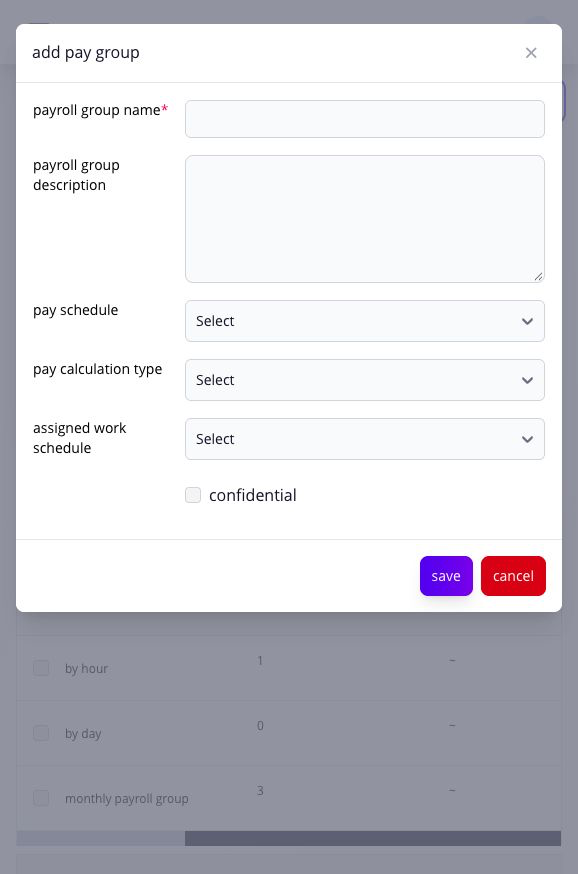

# configure pay schedules and payroll groups

use payroll groups and pay schedules to group employees who share a payroll calendar, pay frequency, and payroll-processing setup.


**warning:** changing an employee's payroll group or an active payroll calendar affects payroll coverage and may require exclusion or recalculation in an open pay run.


\*\*navigation:\*\* go to \*\*Settings → Paycheck → Pay Groups\*\* or \*\*Settings → Paycheck → Pay Schedule\*\*.

## what does a payroll group control?

a payroll group connects employees to a pay schedule and related payroll setup. It may also provide a default shift and calculation choices used when the employee record is created or updated.

## how do i create a payroll group?

1. open **Pay Groups**.
2. click **Add Pay Group**.
3. enter the group name and description.
4. select the **Pay Schedule** and **Pay Calculation Type** (**By Month**, **By Day**, or **By Hour**) that fit the employees in this group.
5. choose the **Assigned Work Schedule** that should be their starting shift, then review whether the group should be marked **Confidential**. An employee's shift can be reassigned later; this group choice supplies the default.
6. click **Save**.

<figure><figcaption>
Review the pay cadence, calculation basis, starting shift, and confidentiality choice together before saving the group.
</figcaption></figure>

Creating a group does not automatically add employees to it. Assign the intended employees and verify their saved payroll group and shift before the next pay run.

## how do i maintain a pay schedule?

Opening the Pay Schedule list maintains future rows for the four supported cadence families through a rolling five-year horizon. It does not rewrite existing calendar rows.

open the required semi-monthly, weekly, or fortnightly schedule currently configured for the company, then review its pay days, upcoming pay days, and pay calendar. Use the schedule view before saving a changed calendar.

## how do i delete a payroll group?

you cannot delete a payroll group while employees are assigned to it. Unassign the employees first, then delete the eligible group. Eligible deletion deactivates the group and is audited; it does not state that historical payroll is erased.

## what happens after saving?

the payroll group or schedule becomes available to employee compensation setup and pay-run creation. New pay runs use the current applicable calendar.

## verify the payroll structure

confirm the generated payroll calendar, pay dates, group defaults, assigned employees, confidentiality, and the next eligible pay run. if a default is wrong, correct the schedule or group before creating the affected run. review existing open and historical runs separately because a settings change does not prove they were regenerated.

## continue in the affected module

* [create and review pay runs](../../paycheck/)
