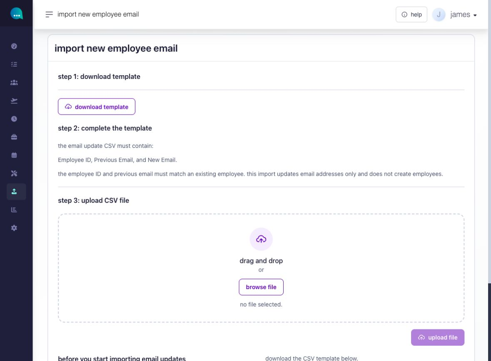
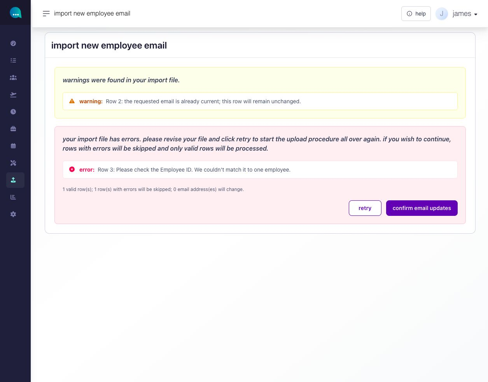
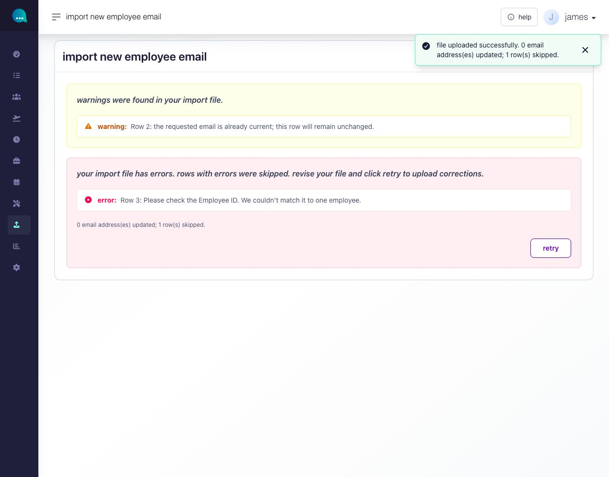

# update employee login emails by CSV

Use **New Email** to update login email addresses for existing employee accounts. This is useful when several employees need a corrected address or a new company email. It does not create employees or accounts.

**Navigation:** **Settings → Upload Manager → New Email**.

You need employee-record access to view the page and employee-edit permission to upload and confirm changes. The import is limited to active employees in the current company and your permitted employee scope who already have an account.

## prepare the file

1. Select **Download template** and retain **Employee ID**, **Previous Email** and **New Email**.
2. Enter each employee ID once, keeping leading zeros. Enter the account’s current email in **Previous Email**.
3. Enter a valid **New Email**. It must be unique both in the file and across existing accounts.
4. Save a CSV with no more than **1,000 data rows** and a maximum size of **10 MB**.

<figure><figcaption>
download the template, complete the three columns, then select your CSV file.
</figcaption></figure>

## upload and review before saving

1. Select the CSV and choose **Upload file**. This opens a preview without changing account emails.
2. Compare the valid-row, skipped-error-row and prospective-change counts with your file. Read every error and warning. The preview shows totals and messages, not a row-by-row list of employee emails.
3. If corrections are needed, choose **Retry**, which clears the selected file and preview, then upload the corrected CSV.

An unchanged email is a valid warning row but makes no change. Rows with errors will be skipped.

<figure><figcaption>
check the warnings and errors as well as the totals. this example has one valid row, but its email is already current, so no address will change.
</figcaption></figure>

## confirm and check the result

When at least one valid row remains and the intended changes are correct, select **Confirm email updates**. Check the actual updated and skipped counts afterward. Ashima checks current account data again during confirmation, so the result can differ from the preview if an account changed in between.

<figure><figcaption>
read the final counts. this example completed with zero email addresses changed and one unmatched row skipped.
</figcaption></figure>

The confirmed source file is retained privately for audit. If a storage error prevents this, resolve that error before retrying.


**Unsure whether the import saved?** Check the saved account email addresses before resubmitting. A processing error without a clear result is not proof that no accounts changed.


For employees who need access but do not have an email address, see [provide portal access without email or mobile](../../workforce/portal-time-and-security-access/provide-portal-access-without-email-or-mobile.md).
