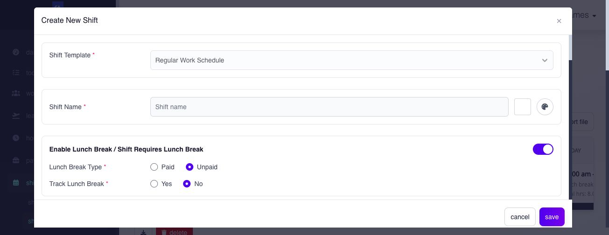

# configure shift definitions and premium transitions

## configure shift definitions and premium transitions

use shift settings to define reusable work schedules before assigning them to payroll groups or employees. choose the shift family that matches how work time is expected, recorded, and reviewed.

**Navigation:**\
go to **Shifts → Shifts Planning**.


**warning:** a shift is timekeeping and payroll source data. changing a shift that is already assigned can change expected hours, tardiness, undertime, breaks, rest-day treatment, holiday treatment, and open-payroll results. use **Save As New** when a new rule should coexist with the old one.


### choose the shift family before configuring it

use [shift types and schedule rules](shift-types-and-schedule-rules.md#page-039-pages-admin-shifts-shift-types-and-schedule-rules-md) as the authoritative comparison. after choosing the family, return here to configure, save, assign, and verify the schedule.

### how do shift records connect?

1. **Shift settings** create a reusable schedule.
2. a **payroll-group default** can provide the normal schedule for employees in that group.
3. a dated **employee shift assignment** can apply another schedule for specific dates.
4. **Hours** uses the dated result to interpret logs, attendance, tardiness, undertime, breaks, rest days, and holidays.
5. **Paycheck** uses the resulting approved or calculated hours and premiums.

do not assume that saving a shift automatically assigns it. setup and assignment are separate actions.

### what should i decide before creating a shift?

* the shift family;
* covered workdays and rest days;
* daily start, end, and break rules where applicable;
* required daily hours for flexible work;
* threshold and grace-period behavior where available;
* whether normal timekeeping is allowed on rest days or holidays;
* premium behavior when one shift crosses a workday, rest day, or holiday boundary; and
* whether a payroll-group default or dated employee assignment will use the shift.

### use a consistent shift naming convention

a shift name appears in schedule selectors, the employee calendar, Hours and timesheet views, and applicable downloads. a descriptive name lets administrators recognize the intended schedule without opening its detailed setup.

use one short, consistent order such as:

> **schedule type or work time, break pattern, rest days**


**important:** a shift name can contain letters A-Z, numbers, spaces, the hyphen `-`, and underscore `_`. do not use `/`, commas, colons, the en dash `–`, the em dash `—`, or other special characters. **Rest Day** is reserved and cannot be used as a custom shift name.


| valid example name | how to read it                                                                                                              |
| ------------------ | --------------------------------------------------------------------------------------------------------------------------- |
| `9a-5p SS`         | fixed shift from 9:00 am to 5:00 pm; Saturday and Sunday are rest days                                                      |
| `8a-11a-12p-4p SS` | time in at 8:00 am, lunch out at 11:00 am, lunch in at 12:00 pm, and time out at 4:00 pm; Saturday and Sunday are rest days |
| `Full Flex SS`     | fully flexible schedule with no latest-time-in reference in the name; Saturday and Sunday are rest days                     |
| `Flex 8a SS`       | flexi schedule whose configured latest time in is 8:00 am; Saturday and Sunday are rest days                                |

use a short company legend and apply it consistently. in these examples, `SS` means Saturday and Sunday are rest days. another pattern can use `SM` for Sunday and Monday, provided the company documents and uses the same day-code order everywhere.

for a fixed schedule with a meal break, place the required clock events in order: **time in - lunch out - lunch in - time out**. for Flexi Time, omit the time when the schedule has no latest-time-in reference. when a time follows **Flex**, treat it as the configured latest time in.

avoid vague names such as `Shift 1`, `New Shift`, or `Day Schedule` when several schedules could match them. use only the permitted spaces, hyphens, or underscores to separate parts of the name.


**important:** the name is a quick identifier only. Ashima uses the saved workdays, times, breaks, thresholds, and other shift settings for timekeeping and payroll. confirm the detailed setup before assigning a shift, especially when two names look similar.


### how do i create a shift definition?

1. open **Shifts → Shifts Planning** and choose the correct shift-family tab.
2. select **Create New**.
3. enter a concise name that follows the company shift naming convention.
4. complete the displayed schedule and rule fields.
5. review the calculated daily and total hours.
6. confirm the displayed rest days.
7. review threshold, grace, break, rest-day, holiday, and premium options that appear for that family.
8. select **Save** to create the definition.
9. assign the saved shift through the payroll-group or employee assignment workflow.
10. review affected employee calendars and recalculate affected open payroll.

<figure><figcaption>
Choose the correct shift template and enter a recognizable name. Review the break and schedule rules farther down the form before selecting Save.
</figcaption></figure>

To change a definition that already exists, open its row and select **Edit**. Review the affected employees before choosing **Update**, because updating the original can change their timekeeping and open-payroll results. Select **Cancel** to leave edit mode. **Save as New** is available only for supported non-default definitions while editing; use it when the new rule must coexist with the original. The available fields and controls depend on the shift family.

### find and maintain definitions by shift family

The tabs are separate lists. Use the list that matches the schedule you intend to create, inspect, or export:

| list                                   | actions available from the list                                                                                                                |
| -------------------------------------- | ---------------------------------------------------------------------------------------------------------------------------------------------- |
| **Regular**, **Compressed**, **Night** | search by shift name, select **Create New** or open a row, use **Import File** for that fixed-schedule family, or download the list as XLS/CSV |
| **Flexi Time**                         | search, create or open a definition, use its separate **Import File** path, or download the list as XLS/CSV                                    |
| **Rest Day**                           | search, create or open a definition, or download the list as XLS/CSV                                                                           |
| **Open Shift**                         | search, create or open a definition, or download the list as XLS/CSV                                                                           |

The import here creates **reusable shift definitions**. To upload dated assignments for employees, use [import shift assignments](../plan-and-assign-shifts/import-shift-assignments.md).

#### import fixed or Flexi Time definitions

1. Open the intended **Regular**, **Compressed**, **Night**, or **Flexi Time** list and select **Import File**.
2. Download the template from that import page. The Flexi Time template and import path are separate from those for fixed schedules.
3. Complete the required columns without changing the template headers, choose the CSV file, and upload it.
4. Review the result. If it reports errors, download the error details, correct the file, and upload it again. Continue only when the result has no errors.
5. Check the new definitions in the correct family list before assigning them.

#### delete a definition

On a shift-family list, select the definitions and choose **Delete** if it is available. Review the warning and affected records before confirming. A protected default or a definition still needed by employees may be unavailable for deletion. Deleting a reusable definition is different from clearing a dated employee override or archiving an unused shift; see [change or restore employee shifts](../plan-and-assign-shifts/change-or-restore-employee-shifts.md) and [manage and archive shifts](../plan-and-assign-shifts/manage-and-archive-shifts.md).

#### set the lead time for schedule requests

**Settings → Shifts → Schedule Request Settings** controls whether employee schedule-change requests must be made a specified number of days in advance. Open **Days Lead Time Prior to Schedule Change**, select **Edit**, enable the rule if needed, and enter **Number of days**. Select **Update** to save or **Cancel** to leave the setting unchanged. Check a representative request after changing this rule; it does not create or assign a shift definition.

### understand the common schedule fields

| field or rule                                | purpose and effect                                                                                                      |
| -------------------------------------------- | ----------------------------------------------------------------------------------------------------------------------- |
| **Shift Name**                               | identifies the reusable schedule during payroll-group and employee assignment                                           |
| **Workdays / Rest Days**                     | establishes scheduled and non-working days                                                                              |
| **Start / End Time**                         | establishes the planned time range for fixed schedules                                                                  |
| **Required Hours / Total Hours**             | establishes expected work duration and the displayed calculated total                                                   |
| **Break Settings**                           | controls lunch and additional-break interpretation in hours                                                             |
| **Shift Threshold / Grace / Tardiness Rule** | controls when a late arrival is evaluated under the selected rule                                                       |
| **Holiday and Rest-Day Behavior**            | controls whether the schedule supplies normal timekeeping context on those dates                                        |
| **Advanced Rules on Premium Pay**            | controls premium, NSD, and overtime interpretation when a shift crosses between workday, holiday, and rest-day contexts |

### configure advanced rules on premium pay

use **Advanced Rules on Premium Pay** when a shift starts under one day type and ends under another. this commonly happens when an overnight shift crosses midnight and the next date is a holiday or rest day, or when a shift begins on a holiday or rest day and ends on an ordinary workday.

these settings tell Ashima which rate context applies to each part of the cross-date shift. the controls are part of the shift definition, so two otherwise similar overnight shifts can produce different premium results when their advanced rules differ.

#### understand the four transitions

| transition             | example                                                              | what the rule controls                                                                                                                                      |
| ---------------------- | -------------------------------------------------------------------- | ----------------------------------------------------------------------------------------------------------------------------------------------------------- |
| **Workday to Holiday** | shift starts on an ordinary workday and continues into a holiday     | whether holiday, holiday NSD, and holiday OT treatment applies to the hours that fall on the holiday                                                        |
| **Holiday to Workday** | shift starts on a holiday and continues into an ordinary workday     | whether holiday treatment covers only applicable holiday hours or, where offered, the full shift; it also controls NSD and the move to standard OT rates    |
| **Workday to Restday** | shift starts on a workday and continues into the employee's rest day | how rest-day NSD and rest-day OT treatment applies after the boundary; the current ordinary rest-day-premium control is fixed at **No** for this transition |
| **Restday to Workday** | shift starts on a rest day and continues into a workday              | whether rest-day treatment covers applicable rest-day hours or the full shift, how NSD is treated, and how OT moves to standard rates                       |

#### understand the available outcomes

| displayed outcome             | interpretation                                                                                                                                 |
| ----------------------------- | ---------------------------------------------------------------------------------------------------------------------------------------------- |
| **For applicable hours only** | apply the selected premium-rate context only to the hours that fall within the applicable holiday, rest-day, NSD, or OT portion                |
| **For the full shift**        | apply the selected premium treatment to the entire cross-date shift; this option appears only for supported transitions and premium components |
| **No / Standard rates only**  | do not extend that premium treatment; use the standard rate context stated by the option                                                       |

ordinary premium, NSD premium, and overtime treatment are separate decisions. for example, selecting holiday premium for applicable hours does not automatically make every NSD or overtime hour use holiday rates. review all controls shown for the transition.

#### example: workday to holiday

an employee works from 10:00 pm on an ordinary workday until 6:00 am on a holiday that begins at midnight.

* **Pay Holiday Premium → Yes. For applicable hours only.** applies holiday premium treatment to the applicable hours after the holiday boundary.
* the hours before midnight remain under the ordinary workday context.
* **Pay NSD Holiday Premium** independently determines whether the applicable nighttime hours use holiday NSD treatment or standard NSD rates.
* **Pay OT Holiday Rates** independently determines whether applicable overtime uses holiday OT rates or standard OT rates.

#### example: holiday to workday

an employee works from 10:00 pm on a holiday until 6:00 am on the following ordinary workday.

* **Pay Holiday Premium → Yes. For applicable hours only.** limits holiday premium treatment to the applicable holiday hours.
* **Pay Holiday Premium → Yes. For the full shift.** extends holiday premium treatment across the supported full-shift calculation.
* the NSD control can use standard NSD, applicable holiday NSD, or full-shift holiday NSD where those options are displayed.
* **Pay OT Standard Rates** controls the transition from holiday OT treatment to applicable workday OT rates.


**warning:** these controls affect premium interpretation; they do not define the premium percentages. holiday records, rest-day rules, NSD settings, pay-rate settings, employee entitlement, actual logs, and approval state still determine the final result.


#### configure and verify the rule

1. open the reusable shift in **Shifts → Shifts Planning**.
2. confirm that its time range crosses into another calendar date.
3. open **Advanced Rules on Premium Pay**.
4. identify the applicable transition: **Workday to Holiday**, **Holiday to Workday**, **Workday to Restday**, or **Restday to Workday**.
5. review ordinary premium, NSD premium, and overtime treatment separately.
6. save the shift, or use **Save As New** when the changed policy must not alter an existing schedule used for other employees or periods.
7. assign the shift to a representative employee and test a date that actually crosses the applicable holiday or rest-day boundary.
8. review the employee timesheet, premium-hour classification, and calculated open payroll.


**important:** changing an advanced premium rule on an assigned shift can change payroll results. recalculate affected open payroll and compare the premium-hour breakdown before broad use. do not assume that the shift's start-date type alone determines the entire shift.


after saving or importing, confirm the schedule appears under the correct family with the intended workdays, hours, breaks, threshold, grace, rest-day, and holiday behavior. if the wrong definition was saved, correct it before broad assignment and review employees already using it.

### related articles

* [shift types and schedule rules](shift-types-and-schedule-rules.md#page-039-pages-admin-shifts-shift-types-and-schedule-rules-md)
* [thresholds, grace periods, and breaks](thresholds-grace-periods-and-breaks.md#page-040-pages-admin-shifts-thresholds-grace-periods-and-breaks-md)
* [open shift](open-shift.md#page-041-pages-admin-shifts-open-shift-md)
* [rest days and shift enforcement](rest-days-and-shift-enforcement.md#page-042-pages-admin-shifts-rest-days-and-shift-enforcement-md)
* [company holiday calendar](company-holiday-calendar.md#page-043-pages-admin-shifts-company-holiday-calendar-md)
* [assign shifts](../plan-and-assign-shifts/assign-shifts.md#page-034-pages-admin-shifts-assign-shifts-md)
* [manage and archive shifts](../plan-and-assign-shifts/manage-and-archive-shifts.md#page-037-pages-admin-shifts-manage-and-archive-shifts-md)
