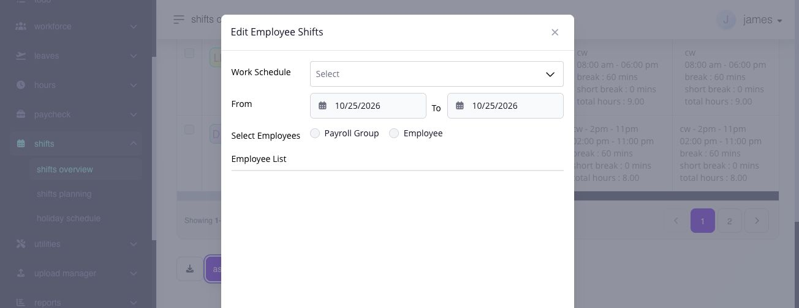

# assign shifts

## assign shifts

use shift assignment to give selected employees the correct dated work schedule before work begins. Hours matches captured logs with this schedule, and Paycheck uses the resulting eligible time and premiums.


**warning:** assigning or replacing a shift changes how time entries are interpreted. review any affected open payroll and recalculate after the assignment changes.


\*\*Navigation:\*\*\ go to \*\*Shifts → Shifts Overview\*\*, select one or more employees, then select \*\*Assign Shifts\*\*.

### how do i prepare an assignment?

1. use the weekly date control to display the relevant period.
2. select one or more employee rows.
3. select **Assign Shifts**.
4. select the **Work Schedule**.
5. enter the **From** and **To** dates.
6. choose **Payroll Group** or **Employee** as the assignment scope and review the employee list.
7. select **Notify Employee** when notification is required.
8. select **Save**. use **Mark as Rest Day** instead when the selected dates should be rest days.

<figure><figcaption>
Review the schedule, date range, and employee scope together before saving. The Employee List shows who will be affected once a scope is selected.
</figcaption></figure>

### understand the assignment fields and limits

* **Work Schedule** selects an existing reusable schedule.
* **From** and **To** define the covered dates. standard bulk assignment supports up to 90 days from the start date; calendar-based assignment supports up to nine months.
* **Payroll Group** or **Employee** defines the assignment scope.
* **Employee List** shows the affected employees.
* **Notify Employee** sends the supported change notification when enabled.
* **Mark as Rest Day** assigns the covered dates as non-working days instead of deleting the dated schedule.

Ashima checks ongoing shifts, pending timesheets, pending shift requests, overlapping pending or approved leave, adjacent-day overlap, and closed-payroll dates. a multi-employee action can allow valid employees to continue while blocked employees are excluded. an administrator assignment saves directly through this workflow; an employee schedule-change request follows the configured todo approval workflow.

### what should i review in the preview?

check the selected employees, covered dates, existing weekly schedules, proposed work schedule, and any validation message before saving.

### what happens after assignment?

the selected employees receive the shift for the covered dates. Ashima recalculates affected timesheets after a successful assignment. Review their attendance and premium results, then recalculate an open pay run that includes the affected dates.

### why does a flexible shift overlap another shift?

For a flexible schedule with a latest allowed time-in, Ashima checks the interval from that latest arrival through the configured required hours against the previous and next dated shifts. For example, a latest arrival of 10 a.m. and eight required hours gives an assignment interval ending at 6 p.m. A following shift starting before then can conflict even if the employee intends to arrive earlier.

Changing an attendance log does not change that assigned interval. Review the latest allowed arrival, required hours and adjacent schedules, then correct the authorized schedule or assignment and try again.

Read the employees and dates in any warning before choosing **Continue**, when offered. Continuing rechecks the restriction; it does not bypass it. **Cancel** closes the warning and clears the pending fields, so reopen the assignment form if you want to prepare a different change.

### verify or correct the assignment

open the employee calendar and confirm the employees, dates, schedule, rest days, holiday or leave context, and weekly hours. then review affected timesheets and recalculate any open payroll covering the dates.

if the wrong schedule or dates were saved, assign the intended schedule over the affected dates. when the employee should use the payroll-group default again, use **Delete** only on the dated override; the default schedule immediately remains applicable. stop and resolve a blocking timesheet, leave, request, overlap, or closed-payroll condition rather than bypassing it.

### related articles

* [shift calendar and overview](shift-calendar-and-overview.md#page-033-pages-admin-shifts-shift-calendar-and-overview-md)
* [change or restore employee shifts](change-or-restore-employee-shifts.md#page-036-pages-admin-shifts-remove-shift-assignments-md)
* [import shift assignments](import-shift-assignments.md#page-035-pages-admin-shifts-import-shift-assignments-md)
* [shift settings](../../settings/time-entry-hours-shifts-and-holidays/configure-shift-rules.md)
