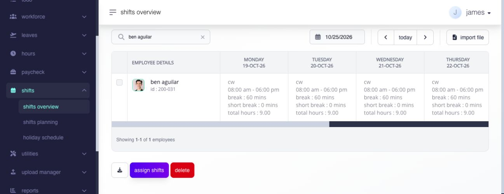
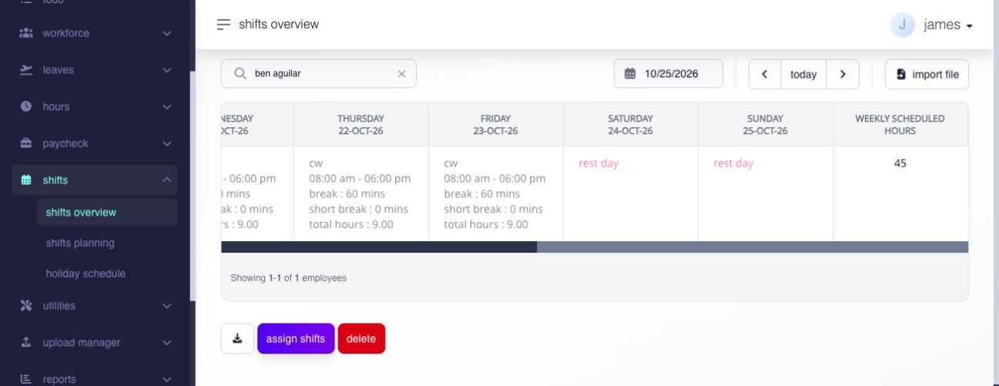

# review the shift calendar and overview

## review the shift calendar and overview

use the shift overview to review employee schedules by date and open an employee calendar before changing attendance or payroll source data.

**Navigation:**\
go to **Shifts → Shifts Overview**.

### what does this page display?

the overview lists employees and their assigned schedules for the selected period. open an employee to review the calendar and dated shift details.

the employee's assigned shift gives context to captured time. it determines expected work times, rest days, break structure, and the basis for attendance indicators. as logs are captured, the matched timesheet can expose late clock in, missing or accidental clock out, missing breaks, tardiness, or undertime for prompt review.

### read the weekly overview

the page shows one employee per row and one day per column for the selected week. each dated cell can show the assigned shift code, scheduled time range, break values, total hours, or **Rest Day**. **Weekly Scheduled Hours** summarizes the displayed week.

use **Search** to find an employee, the date control or arrows to change weeks, and **Today** to return to the current week. select an employee to open the broader four-week calendar with holiday and leave context.

<figure><figcaption>
For one employee, read the dated shift cells across the selected week. Scroll the table horizontally to see the rest days and weekly total.
</figcaption></figure>

<figure><figcaption>
The same week, scrolled right, shows the two rest days and the Weekly Scheduled Hours total.
</figcaption></figure>

### verify the schedule you reviewed

confirm the employee, week, daily schedule cells, rest days, and weekly scheduled hours. if the calendar differs from the intended arrangement, identify whether the date uses a payroll-group default or a dated assignment before changing it. review hours and an affected open payroll when a schedule correction changes previously interpreted time.

### how do i review an employee schedule?

1. select the date range.
2. search for the employee.
3. open the employee row.
4. review each dated shift, rest day, and date using the payroll-group default.
5. compare the calendar with the employee's payroll group and expected work arrangement.

### download shift assignments

1. apply the employee and week filters.
2. select the download control.
3. choose **XLS** or **CSV** for the displayed week, or **Custom** for another date range or employee scope.
4. for a custom download, choose **All Employees**, **Payroll Group**, or **Employee**, enter the dates, choose the file type, and select **Check**.
5. select **Download** after validation passes.

**Download** remains unavailable until the custom request passes the check. if the request is too large, reduce the date range or narrow the employee scope. verify the downloaded employee count, dates, and scheduled hours against the filtered overview.

### access and confidentiality

the overview, employee calendar, employee search, and payroll-group choices follow the signed-in administrator's confidentiality access. a direct employee-calendar link does not bypass that scope. separate **view**, **edit**, and **delete** privileges control workspace access, assignment, and removal.

### related articles

* [assign shifts](assign-shifts.md#page-034-pages-admin-shifts-assign-shifts-md)
* [change or restore employee shifts](change-or-restore-employee-shifts.md#page-036-pages-admin-shifts-remove-shift-assignments-md)
* [import shift assignments](import-shift-assignments.md#page-035-pages-admin-shifts-import-shift-assignments-md)
* [timesheet logs](../../hours/timesheets-and-attendance/timesheet-logs.md)
