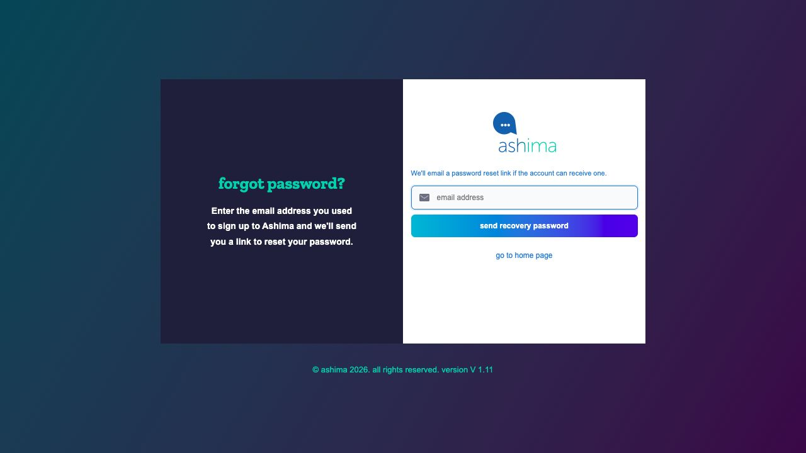

# reset a forgotten password

use this email recovery flow if your employee account has a registered email address and you cannot sign in. your administrator must first create your account during onboarding; the reset form cannot create one. if you sign in with a mobile number and have no email address, see [the mobile-number path below](reset-a-forgotten-password.md#if-you-have-no-email-address). if you have never activated an emailed invitation, start with [sign in for the first time](sign-in-for-the-first-time.md).

## request a reset link

1. on the Ashima sign-in page, select **Forgot Password**.
2. enter the email address registered to your employee account and select **send recovery password**. Ashima shows a request confirmation; it may not say whether that address has an account.
3. check that inbox for the Ashima account-recovery message. open the link in the most recent message. the recovery email says to use the link within 24 hours.
4. on the reset page, check the email address displayed, then enter and confirm your new password. follow any password rules shown on the page and select **reset password**.
5. return to sign-in and use the new password. if your account requires two-factor authentication, complete that step too. changing your password does not turn off 2FA.

<figure><figcaption>
Enter the email address registered to your employee account, then select send recovery password.
</figcaption></figure>

your password changes only after you finish the reset page. if you did not request a reset message, do not use its link; tell HR or your administrator if you are concerned about your account.

## if no email arrives

check spam, junk, and any company quarantine or email-security folder. confirm that you entered the address held in your employee record, not a different personal or work address. give delivery a few minutes before requesting a new link. if you still receive nothing, ask HR or your administrator to check your account, correct the registered address if needed, and ask your IT team to check whether its email firewall blocked Ashima mail. a confirmation on the reset form alone does not mean an email was delivered.

## if you have no email address

you can use a registered mobile number to sign in, but this recovery page asks for an email and sends a link by email. it does not establish an SMS reset path. ask HR or your administrator to verify your account and mobile number and set a new password from your employee record. use that password with your registered mobile number on the Employee portal sign-in page. if 2FA is also blocking access, tell your administrator that separately; changing the password does not remove the second factor.

## if the link or new password does not work

use the newest reset message and open its complete link. if the link has expired, return to **Forgot Password** and request another one. if the reset page rejects your new password, follow the rule or error shown there and make sure the two password entries match. if you can sign in with the new password but cannot complete 2FA, use an unused recovery code or contact your administrator for help with your second factor; see [set up and use two-factor authentication](set-up-and-use-two-factor-authentication.md).
