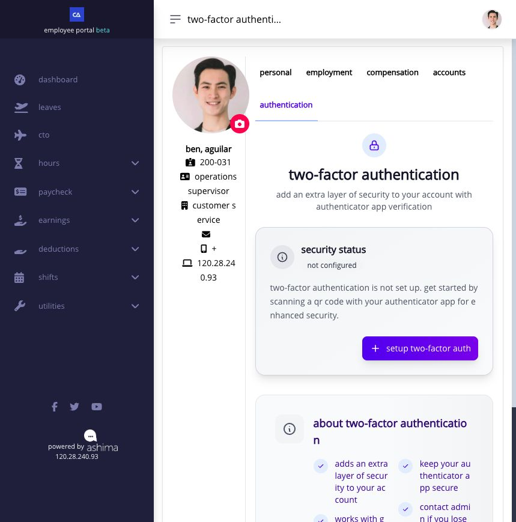

# set up and use two-factor authentication

two-factor authentication (**2FA**) asks for a changing code from an authenticator app after your password. it protects your account even if someone learns your password. your company may require it. the same 2FA steps apply whether you sign in with a registered email address or mobile number; the authenticator app does not send the code by email or SMS.

## find your 2FA status

from Employee portal, open your profile and select **authentication**. **Not Configured** means you have not set up an authenticator yet; select **Setup Two-Factor Auth** to begin. Ashima may also direct you to a setup page immediately after sign-in when your company requires 2FA.

<figure><figcaption><p>Ben's test account shows the Not Configured state and the setup button. No setup key or recovery code appears in this image.</p></figcaption></figure>

## set up your authenticator

have your phone and an authenticator app ready. the setup page names Google Authenticator, Authy, and Microsoft Authenticator as examples.

1. select **Setup Two-Factor Auth**, or follow the setup prompt Ashima shows after sign-in. if setup is required, finish it before continuing to the portal.
2. in your authenticator app, add an account by scanning the QR code on Ashima's **Scan QR Code** step. if you cannot scan it, enter the displayed setup key manually in the app. the key and QR code grant access to your one-time codes: keep them private and do not put them in a screenshot or support message.
3. select **Continue Verification**. the app will show a six-digit code that changes every 30 seconds. enter the current code in Ashima's **Verify Setup** field and select **Verify and Enable 2FA**.
4. once Ashima accepts the code, the **Two-Factor Authentication Enabled!** window displays your recovery codes. use **Copy Codes** or **Download** to save the complete list somewhere private and separate from the phone. select **I've saved them securely** only after checking that your copy is readable. the codes are shown once, and each code can be used only once.
5. return to **authentication** and confirm that 2FA is enabled. a required account may show **Active & Enforced**; another enabled account may show **Active & Protected**.

if the verification code fails, wait for the next code and try again. turn on automatic date and time on your phone if new codes keep failing. use **Back to QR Code** only if you need to check the setup entry; do not scan a different account's QR code.

### what do the recovery codes look like?

Ashima normally gives you **10 different codes**, each in a three-part format like `XXXX-XXXX-XX`. The `X` characters below are placeholders, not working codes:

```
XXXX-XXXX-XX
XXXX-XXXX-XX
XXXX-XXXX-XX
… seven more codes …
```

save **all 10 actual codes shown on your own screen**, not this example. keep them in a secure location you can reach if your phone is lost. anyone with an unused code and your sign-in credentials could use it to access your account. Ashima cannot show the same plaintext list again after you close the window; generating a replacement list invalidates the previous codes.

## sign in once 2FA is enabled

enter your usual email address or registered mobile number and password. when Ashima asks for the second factor, open the authenticator entry you set up for Ashima and enter its current six-digit code. the code expires quickly, so use a newly displayed one if the first is rejected. your password alone will not finish sign-in while 2FA is required or enabled.

if your phone or authenticator is unavailable, choose the recovery-code option on the verification page and enter one unused code you saved during setup. a recovery code is a substitute for one sign-in, not a replacement for your authenticator. after using one, check how many unused codes remain in **authentication**.

## manage your status and recovery codes

| status or control                                           | what it means and when to use it                                                                                                                                                       |
| ----------------------------------------------------------- | -------------------------------------------------------------------------------------------------------------------------------------------------------------------------------------- |
| **Not Configured** / **Setup Two-Factor Auth**              | no authenticator has been enrolled. start setup, then verify a code and save recovery codes.                                                                                           |
| **Configured but Disabled** / **Enable Two-Factor Auth**    | an authenticator was set up earlier but 2FA is not currently protecting sign-in. enable it from this page if your company allows this state.                                           |
| **Active & Protected** or **Active & Enforced**             | 2FA is enabled. **Active & Enforced** means company policy requires it.                                                                                                                |
| **Disable Two-Factor Auth**                                 | removes the extra sign-in check after you confirm with an authenticator or recovery code. it is unavailable when your company requires 2FA.                                            |
| **generate recovery codes** / **regenerate recovery codes** | create backup codes if you have none or replace the current set. regenerating invalidates all previously saved codes, including unused ones; save the new set before leaving the page. |

do not disable 2FA merely because a code is rejected. first check that you opened the correct Ashima entry in your authenticator and that your phone's time is accurate.

## if you lose your phone and recovery codes

contact HR or your administrator and explain that the second factor is unavailable. an administrator can reset employee 2FA so you can enroll again on a later sign-in. a password reset alone does not clear 2FA. never send your password, QR/setup key, or recovery codes to another person.
