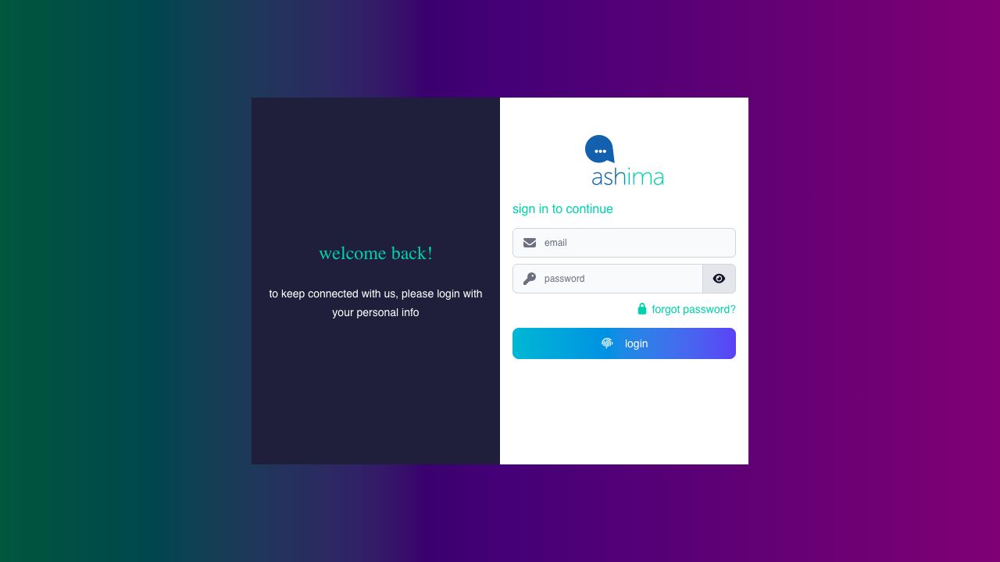

# sign in for the first time

your company’s administrator creates your employee record and Ashima account during onboarding. you cannot create an employee account yourself. you can sign in with the email address or mobile number registered to your account. employees without a company-required email can use their registered mobile number. the way you receive your first password depends on whether your account has an email address.

<figure><figcaption>
The first field is labelled email on this sign-in screen. Enter the email address or registered mobile number your administrator assigned to your account.
</figcaption></figure>

## if you have a registered email address

when your administrator sends the invitation, Ashima emails an activation link to that address. use the link to set your password before your first sign-in.

## before you open the invitation

1. check the inbox for the email address you gave your company. look for an Ashima account invitation or account-password message. the exact sender can vary with the email service your company uses; if you are unsure whether a message is genuine, confirm it with HR or your administrator before opening its link.
2. if you do not see it, check spam, junk, and any company quarantine or email-security folder. ask your IT team whether an email filter blocked Ashima mail.
3. if the message is still missing, ask HR or your administrator to confirm the email address on your employee record and resend the invitation. requesting a password reset does not create an employee account.

### activate your account

1. open the invitation email and select its activation link. use the complete link from the latest invitation; an older or already-used link may not work.
2. check that the page identifies the account you expect. if it shows a different email address or company, stop and contact your administrator.
3. enter and confirm a new password that meets the rules shown on the page, then submit it. do not share the password or the invitation link.
4. go to the [Employee portal sign-in page](https://ep.ashima.ph/login). enter your registered email address and new password, then select **login**. if your company requires two-factor authentication, follow [set up and use two-factor authentication](set-up-and-use-two-factor-authentication.md) before continuing.
5. check that Employee portal opens under your own name and the correct company. you can then review your shift, timesheet, leave balance, and pay records.

## if you use a mobile number and have no email address

you do not need an email invitation to use your registered mobile number as your sign-in name. ask HR or your administrator for your initial password and confirm the mobile number recorded on your account. the administrator can set a password from your employee record when there is no email address.

1. open the [Employee portal sign-in page](https://ep.ashima.ph/login).
2. enter your registered mobile number in the first field, even if the field is labelled **email**. enter the password given to you by your administrator and select **login**.
3. check that the portal shows your own name and the correct company. if Ashima requires 2FA, complete its setup or verification prompt before continuing. an authenticator app can be used with a mobile-number sign-in; 2FA does not require an email address.

if the mobile number or password is rejected, ask your administrator to verify the mobile number saved on your account and reset the password if needed. the **Forgot Password** page sends an email link; it does not provide a confirmed SMS reset path for an account with no email address.

## if the invitation link does not open your account

the link may be incomplete, expired, or already used. reopen the complete link from the latest invitation. if it still fails, ask HR or your administrator to verify your account and registered email address and send a fresh invitation. if you already activated your account but cannot remember the password, use [reset a forgotten password](reset-a-forgotten-password.md) instead.

keep your registered email address or mobile number current. ask HR or your administrator to correct the account record if your contact information changes or you cannot receive account messages.
