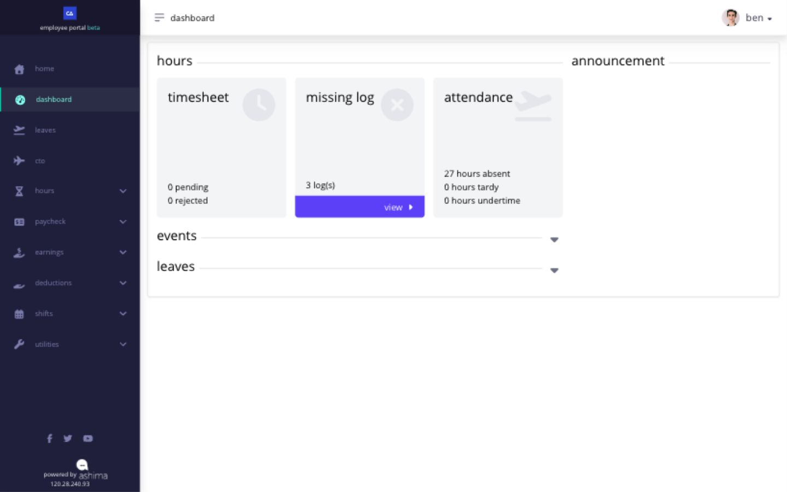

# start here: find what you need in Employee portal

the Employee portal is where you review your shifts and timesheets, submit employee requests, and open your pay and personal records. the pages you see depend on the functions your company has enabled and the records assigned to you.

<figure><figcaption>
Use the left navigation to open the detailed record behind a dashboard summary. This is the CupcakeAvenue test account.
</figcaption></figure>

| what you need to do                                                                                                                       | where to go                                                                         | when to do it                                                                     | what confirms it is complete                                              |
| ----------------------------------------------------------------------------------------------------------------------------------------- | ----------------------------------------------------------------------------------- | --------------------------------------------------------------------------------- | ------------------------------------------------------------------------- |
| [confirm when you are expected to work](../clock-in-and-shifts/check-your-shift-before-every-workday.md)                                  | **Shifts**                                                                          | before the workday and after a schedule change                                    | the correct shift, date, start and end times, breaks, and rest day appear |
| [add punches to your timesheet](../clock-in-and-shifts/understand-the-ways-you-can-clock-in.md)                                           | desktop clock, company kiosk, or mobile clock                                       | at each time in, lunch, break, and time out required by your shift                | Ashima shows a successful action and the captured time                    |
| [check the day’s timesheet](../timesheets-attendance-and-overtime/review-your-timesheet-every-day.md)                                     | **Hours → Timesheet Logs**                                                          | after the assigned shift ends                                                     | the saved punches match the shift and the hours you worked                |
| [correct an assigned shift](../clock-in-and-shifts/request-a-shift-change.md)                                                             | **Shifts → shift application**                                                      | as soon as the wrong assignment is visible                                        | the request appears in shift application history with its current status  |
| [correct a timesheet punch](../timesheets-attendance-and-overtime/correct-a-missing-or-incorrect-timesheet-punch.md)                      | **Hours → Timesheet Logs → add or change action**                                   | after the shift ends and a missing or incorrect punch is visible                  | the request appears in **Timesheet Application** with its current status  |
| [apply for work on a rest day](../timesheets-attendance-and-overtime/apply-for-rest-day-work.md)                                          | **Hours → Timesheet Logs → Apply RD**, when shown                                   | after the rest-day work appears in your timesheet                                 | the rest-day request appears with its current status                      |
| [apply for work on a holiday](../timesheets-attendance-and-overtime/apply-for-holiday-work.md)                                            | **Hours → Timesheet Logs → Apply Hol.**, when shown                                 | after the holiday work appears in your timesheet                                  | the holiday request appears with its current status                       |
| [request overtime](../timesheets-attendance-and-overtime/file-and-review-overtime.md)                                                     | **Hours → Overtime**                                                                | before the company deadline and before payroll locks the period                   | the request appears in the overtime list with its current status          |
| [request leave](../leave-cto-and-maternity/apply-for-leave.md) or [CTO](../leave-cto-and-maternity/apply-for-cto-when-it-is-available.md) | **Leaves**                                                                          | before the requested date and company deadline                                    | the request appears in leave history with its current status              |
| [request maternity benefits](../leave-cto-and-maternity/file-and-review-maternity-benefits.md)                                            | **Leaves → Maternity Benefits**                                                     | when **Apply** is enabled and the required dates and records are available        | the application appears in maternity history with its current status      |
| [choose the right pay record](../pay/)                                                                                                    | **Paycheck → Payslip**, **13 Month**, or **Disbursement (P)**; ask HR for final pay | after the record is available                                                     | the detail or final payslip shows your name, intended period, and amount  |
| [review personal information](../view-and-update-your-profile.md)                                                                         | **Profile**                                                                         | whenever a visible field must be checked or a field with **Edit** must be changed | the profile displays the saved value after an update                      |
| [request a document](../use-documents-and-statutory-reference-tables.md)                                                                  | **Utilities → Documents**                                                           | when you need an offered document                                                 | the request appears in the list with its current status                   |

## how do shifts, timesheets, and leave work together?

* your **timesheet** captures your punches: time in, time out, and any lunch or break punches required by your shift. by itself, a punch records when an action happened.
* your **shift** tells Ashima how to interpret those punches. it supplies the scheduled start and end, workday or rest-day treatment, and the required lunch and break pattern. Ashima uses that context to identify attendance results such as tardiness, undertime, absence, and overtime.
* your **leave** request explains an approved absence from an assigned shift. Ashima checks the leave dates against your shift, leave balance, leave rules, existing requests, and payroll state.

this is why the assigned shift must be correct. fixing a punch changes the timesheet entry; it does not correct the assigned shift. if the schedule is wrong, submit a shift application. if the shift is correct but a punch is missing or wrong, submit a timesheet application.

## do i need to clock lunch out and lunch in?

only when your assigned shift requires lunch punches. a shift can require **lunch out** and **lunch in**, **1st break out** and **1st break in**, **2nd break out** and **2nd break in**, or no separate lunch or break punches. check **Shifts** before the workday, then follow the punch sequence shown by the clock. missing a required lunch or break punch can make the timesheet incomplete or affect its attendance interpretation.

a wrong shift or missing punch can produce attendance or payroll results that do not match the workday. review the timesheet and submit the relevant request while the period is still open.

> **where to verify:** Dashboard cards summarize selected information. use **Shifts**, **Timesheet Logs**, the applicable request history, and the payslip detail as the record to verify.
