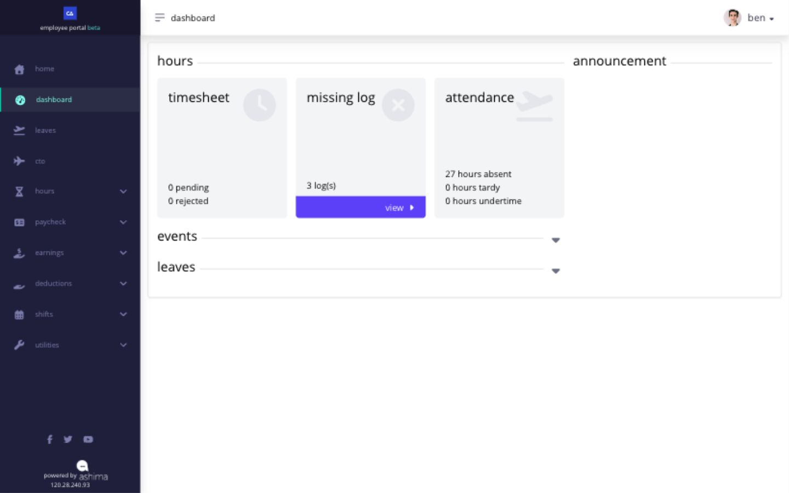

# use the dashboard without missing the details

use **Dashboard** to identify records that may need attention. it summarizes selected information; open the owning page before submitting a correction or reporting a discrepancy.

<figure><figcaption>
The cards are starting points. Open the corresponding Hours page for the dated records behind a count.
</figcaption></figure>

| area         | what it can show                                | where to verify                                                                       |
| ------------ | ----------------------------------------------- | ------------------------------------------------------------------------------------- |
| hours        | missing logs, absence, tardiness, and undertime | **Hours** and **Timesheet Logs**                                                      |
| events       | recent payslips and upcoming holidays           | **Paycheck → Payslip** for pay and **Shifts** or the applicable calendar for the date |
| leaves       | available leave cards and balances              | **Leaves**, history, and transactions                                                 |
| announcement | the active company announcement                 | the complete announcement shown                                                       |

if a card reports an exception, open the detailed page and check the affected date and record. a card that is absent can mean the dashboard component is not enabled or there is no applicable record or entitlement. use the owning page to distinguish those cases.

## what should i do when a card looks wrong?

open the owning page before reporting the problem. compare the dashboard date and summary with the detailed shift, timesheet, leave request, payslip, or announcement. include both the dashboard value and the detailed value when asking HR for help.

## why might a card be missing?

a card can be absent because the company has not enabled that dashboard item, your account has no applicable record, or the information belongs on its detailed page. a missing card does not prove that the underlying shift, timesheet, leave, or payslip is missing.
