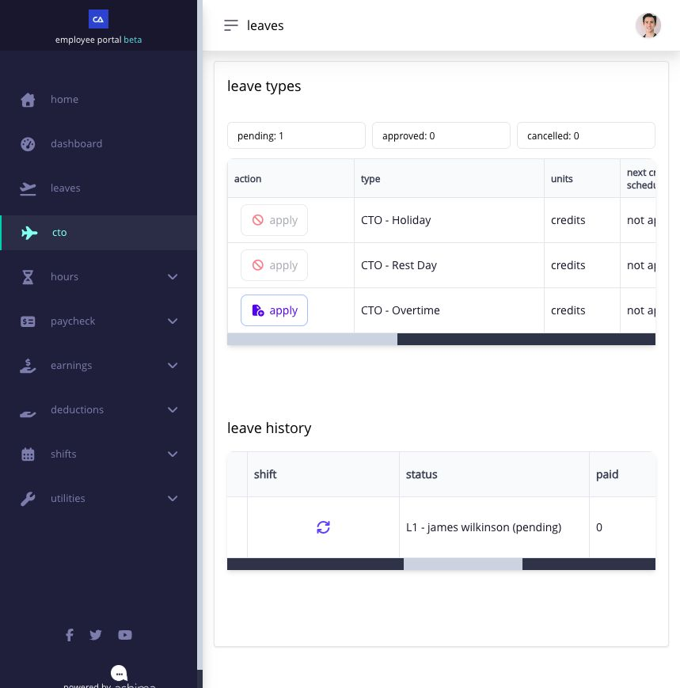

# see who is approving your request

if your submitted request is waiting for approval, check its status to see who is handling it now. start with the page where you applied.

## how do i find my approver?

1. open the page for your request, such as **Leaves**, **CTO**, or **Hours → Overtime**. for a timesheet correction, open **Hours → Timesheet → Application History**.
2. find the request by its date and type. on pages with a wide table, scroll the table sideways until you can see **Status**.
3. if **Status** includes a name and approval level, read them together. for example, **L1 – James Wilkinson (pending)** means James Wilkinson is shown at level one and has not yet acted on that request.
4. if you need to follow up, contact the approver currently shown. give them the request type and date so they can find it.
5. check the same history again for the latest status. if the request moves to another approval level, follow up with the approver then shown.

<figure><figcaption>
In this CTO example, the Status column names the approver at the current level. Scroll across the history table when the column is off screen.
</figcaption></figure>


some requests pass through more than one approval level. check the current status before following up; an earlier approver may have already completed their part.


## what if no approver name appears?

if your request is pending but its history does not show a name, ask HR or your administrator who is handling it. include the request type, date, and status shown.

## related articles

* [apply for leave and track the request](../leave-cto-and-maternity/apply-for-leave.md)
* [understand and apply for CTO](../leave-cto-and-maternity/apply-for-cto-when-it-is-available.md)
* [file and track an overtime request](../timesheets-attendance-and-overtime/file-and-review-overtime.md)
* [when to ask HR or your administrator for help](when-to-ask-hr-or-your-administrator-for-help.md)
