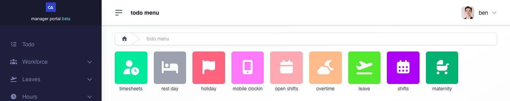
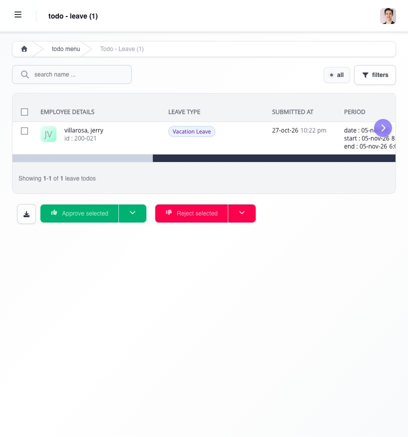
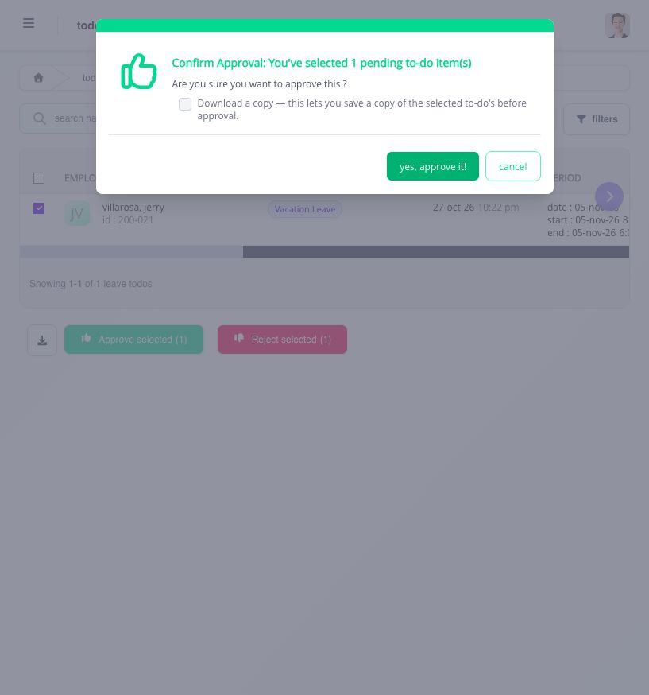

# use To Do when you are an approver

If you approve requests for your team, **To Do** shows the work waiting for your decision. Your own applications remain in the Employee Portal.

## how do i find a request waiting for me?

1. Open **To Do** from the Employee Portal sidebar. If your layout does not show it there, open the menu beside your name, select **Manager Portal**, then open **To Do**.
2. Choose the request type, such as **timesheets**, **leave**, or **overtime**.
3. Find the employee's row. For a Leave request, review the leave type, submission date, leave period, requested days, previous balance, reason, and approval status. Use the table's arrows to see columns that do not fit on screen.

<figure><figcaption>
Choose the category that matches the request you need to review. A category with no requests will show an empty list.
</figcaption></figure>

The categories you can use depend on your approval responsibilities. An empty category means no request is currently listed there for your account. If you expected one, check the correct category and any search or filters, then ask HR or the workflow administrator to check who has the pending approval.

<figure><figcaption>
The Leave list shows the employee, leave type, submission date, and period. Use the purple table arrows to review the remaining columns before deciding.
</figcaption></figure>

## how do i decide a request?

1. Review the row and any supporting information shown for that request type. For Leave, the details are in the table's columns; scroll horizontally to see the reason, status, and any attachment.
2. Select the checkbox for the request you intend to decide. Check the selected-item count before choosing **Approve selected** or **Reject selected**. Select several rows only if you intend to decide them together.
3. Read the confirmation, then confirm your choice once. Choose **Cancel** if the selection or decision is wrong. A confirmation may also offer **Download a copy** before approval.
4. Return to **To Do** and check the request's new status or that it has left your pending list.

<figure><figcaption>
Check the selected-request count before confirming. Choose cancel if you need to leave the request undecided.
</figcaption></figure>

An approval can pass the request to the next approver. If the request still appears unchanged, reopen it and check for an error or updated status before trying again. If you cannot find or act on a request, give HR or the workflow administrator the employee, request type, and submission date so they can check its assignment.

## related articles

* [see who is approving your request](see-who-is-approving-your-request.md)
* [when to ask HR or your administrator for help](when-to-ask-hr-or-your-administrator-for-help.md)
