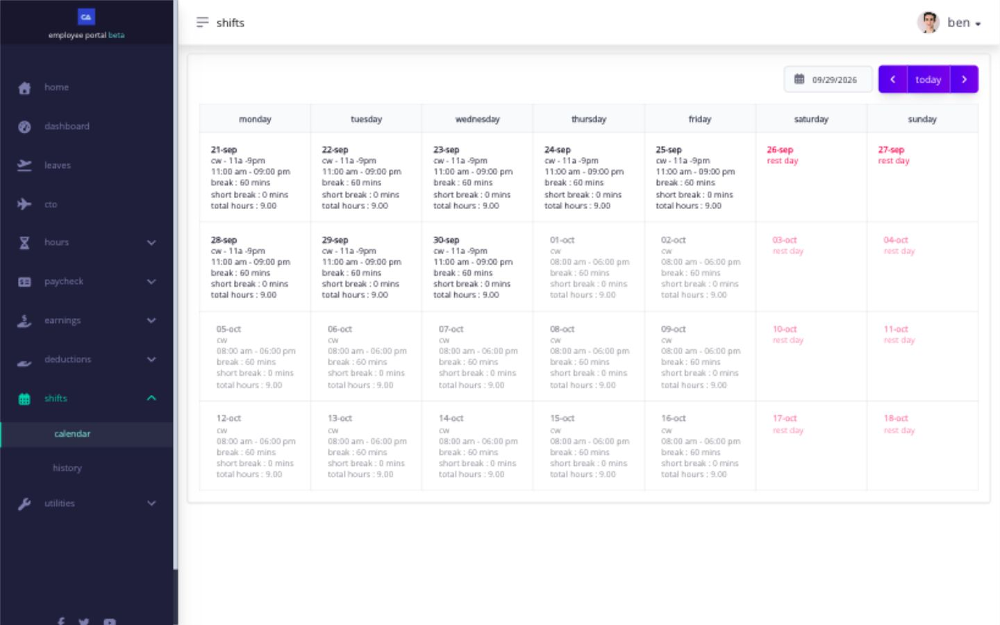

# check your shift before every workday

your shift tells Ashima when work is expected, which days are rest days, which breaks apply, and how your timesheet punches should be interpreted. it provides the schedule context used to identify attendance results such as absence, tardiness, undertime, and overtime.

## what should i check?

open **Shifts** before the workday and after any roster change. confirm all of the following:

<figure><figcaption>
The calendar places each shift and rest day on its work date. Select a date to inspect or request a change.
</figcaption></figure>

| item        | what to verify                                          |
| ----------- | ------------------------------------------------------- |
| date        | you are viewing the intended workday                    |
| shift name  | the assigned shift is the one you expect                |
| work period | the start and end times match the scheduled work period |
| breaks      | every required lunch or break period is shown           |
| day type    | the date is correctly treated as a workday or rest day  |

if the assignment is wrong, use the available shift application or contact your administrator immediately. a submitted change is not effective until it is approved and reflected in the schedule.

## why should i check before the shift starts?

> **act early:** plan and confirm shift changes before the shift starts. fixing an incorrect assignment after timesheet punches exist can require separate shift and timesheet approvals.
