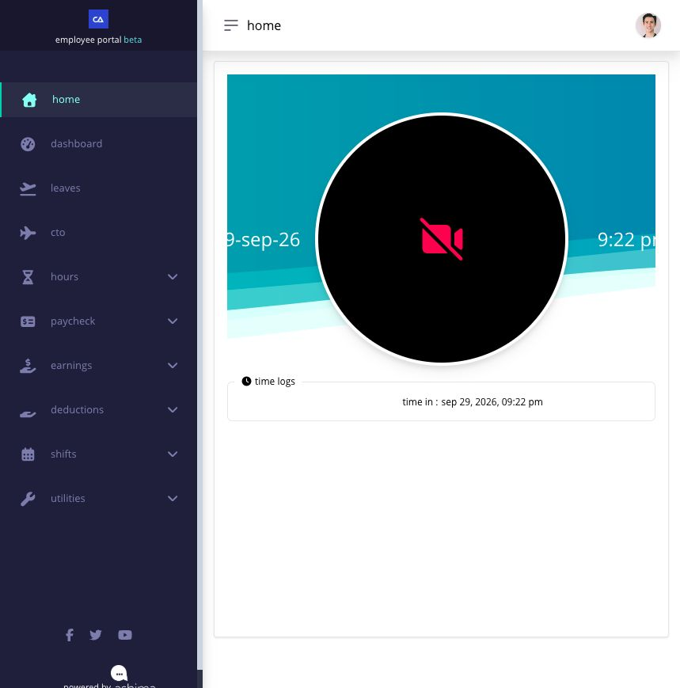

# clock in from your own desktop

when desktop clocking is enabled for you, the clock and the available punch button appear on Employee Home after you sign in.

## before you clock

use your own account and confirm that the displayed action matches what you intend to record. your company can limit desktop clocking by account, employee, or network address, and it can make a photo mandatory.

## use the clock on Employee Home

1. review the displayed date, time, and available action.
2. select the punch button.
3. read the confirmation, such as **Are you sure you're ready to clock in?**, and confirm only when the action is correct.
4. if photo capture is required, wait for the camera to become ready and allow Ashima to take the photo.
5. wait for the success message.
6. confirm the captured time displayed for time in, lunch, break, or time out.
7. check **Hours → Timesheet Logs** after the shift.

<figure><figcaption>
After a successful punch, Employee Home displays the captured time in the time logs panel. This test punch was made outside Ben's scheduled shift; check your own assigned shift before clocking.
</figcaption></figure>

Ashima prevents a required photo punch when the camera is blocked, unavailable, or unable to capture a valid image. allow camera permission in the browser, connect or enable the camera, reload the page, and try again.

## why don't i see the desktop clock?

one common reason is that your company allows desktop clocking only from approved IP addresses. if your current IP address is not on that list, the clock-in button may not appear on Employee Home.

1. look at the bottom of the left navigation bar, below **Powered by Ashima**. copy the IP address shown there.
2. send that IP address to HR or your administrator. tell them that the desktop clock-in button is missing and ask whether your current IP address is whitelisted for desktop clocking.
3. if you change networks or locations, check the displayed IP address again before following up. the address may be different.

an IP restriction is not the only possible cause. HR can also check whether desktop clocking is enabled for your account, whether your timesheet is required, and whether a clock action is available for your current shift state.

do not keep clicking or use another person's account. ask for help while the missing clock and network details can still be verified.
