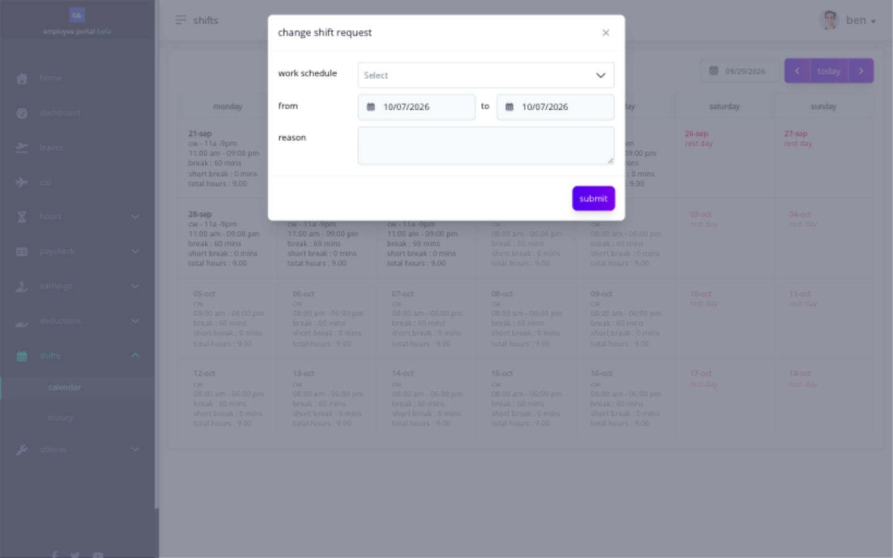

# request a shift change

use the shift application when you need a different shift for a date and the application action is available. the request changes the proposed assignment only after it is approved and the saved schedule reflects it.

1. open **Shifts** and select the applicable date.
2. choose the change or application action.
3. enter the requested shift and reason shown by the form.
4. review the request before submitting.
5. confirm the success message.
6. open shift application history and monitor its status.

<figure><figcaption>
Select the requested work schedule and check the date range before submitting. The form shown is an unsubmitted example.
</figcaption></figure>

the request is successfully submitted when it appears in shift application history. continue to follow the shift currently shown in **Shifts** until the approved assignment appears there.

if the action is unavailable, send HR or your administrator the affected date, the shift currently displayed, and the shift you expected. a shift cannot be corrected by filing a timesheet application because the shift assignment and the timesheet punches are separate records.

## why does the shift matter?

the shift determines the expected work date, start and end, required lunch or additional breaks, rest-day context, and the schedule Ashima uses for tardiness, overbreak, undertime, absence, overtime, and payroll-related hours.

request the change before the shift starts whenever possible. changing a historical shift can require the timesheet and an affected open payroll to be recalculated.

## why is the change action unavailable?

Ashima can block a shift change while the shift is ongoing, for a future or historical date outside the allowed rule, when another request is pending, or when payroll is frozen or closed. send HR the current shift, expected shift, work date, request status, and exact message instead of changing punches to imitate the intended schedule.
