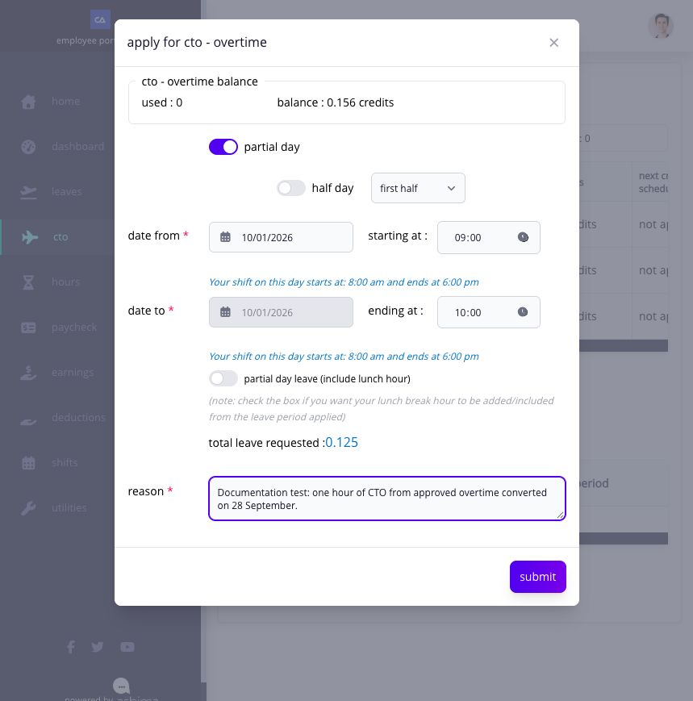
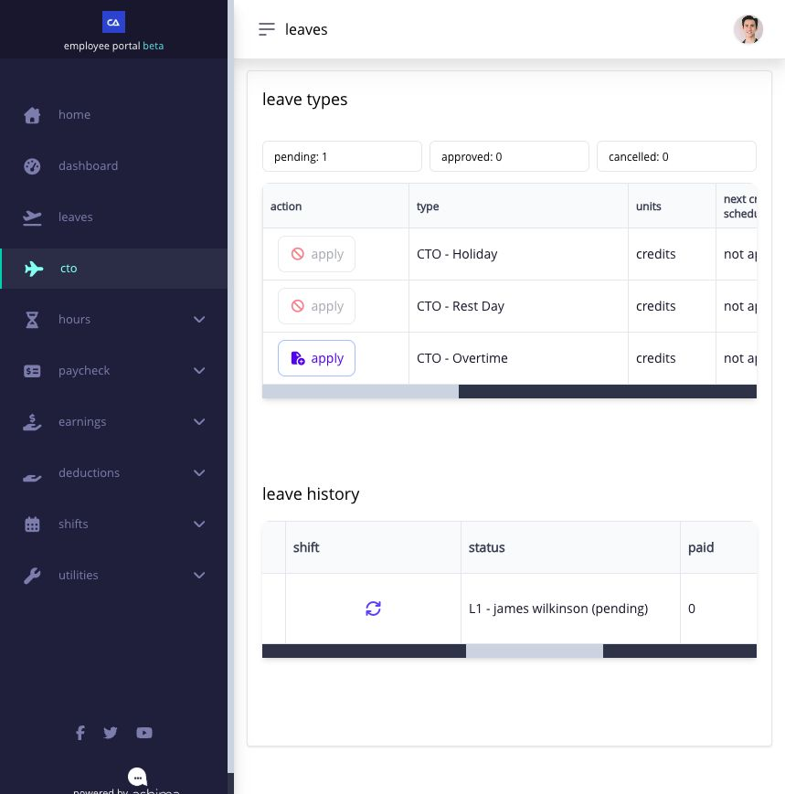
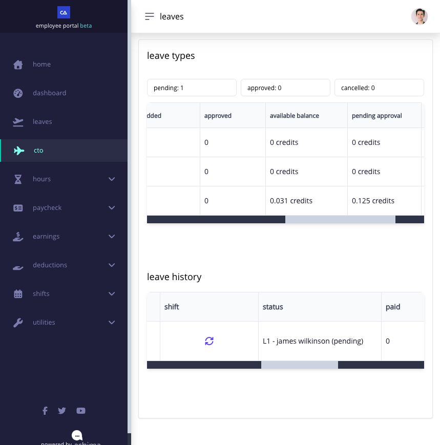
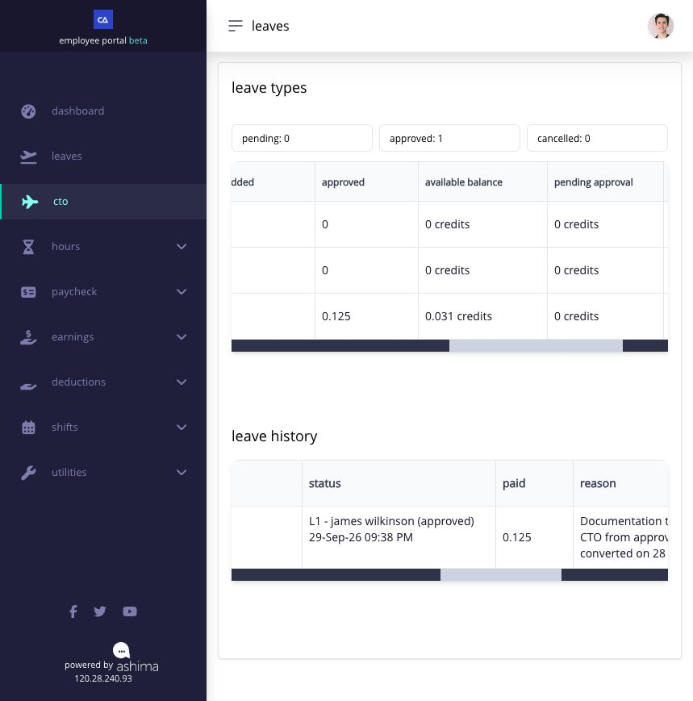

# understand and apply for CTO

**CTO** means compensatory time off: time off earned from approved work when your company allows it. for example, approved overtime, rest-day work, or holiday work may be converted into CTO credit.

CTO differs from ordinary leave. ordinary leave comes from a leave policy. CTO starts with approved work and appears as a balance only after the work is converted.

`approved work → CTO conversion → CTO credit → CTO leave request`


when approved work is successfully converted into CTO, the same source work is excluded from payroll and is not also paid again as the same overtime, rest-day, or holiday work.


## when will CTO appear in my Employee portal?

you can apply only when:

* your company has enabled CTO;
* the applicable generated CTO leave type is assigned to you;
* eligible approved work was converted into that CTO type, or an authorized adjustment supplied credit;
* you have enough available CTO for the request; and
* the type is active and the request is within its applicable rules.

depending on company setup, you may see separate types such as **CTO - Overtime**, **CTO - Rest Day**, or **CTO - Holiday**. use the type that contains the balance created from the relevant source work.

## how is my CTO balance produced?

your company selects which approved work can become CTO, the conversion rate, whether the credit expires, and who performs the conversion. Ashima converts the eligible source minutes into whole CTO minutes and records the result in the transaction ledger.

| balance term  | what it means                                                                            |
| ------------- | ---------------------------------------------------------------------------------------- |
| **Available** | CTO credits you can still request                                                        |
| **Pending**   | credits reserved by a CTO request waiting for approval; some pages may call this applied |
| **Approved**  | credits attached to an approved CTO request                                              |
| **Used**      | credits already consumed as approved time off                                            |
| **Expired**   | unused available credits that reached their expiry date                                  |

`available CTO = credited CTO − pending CTO − used CTO − expired CTO ± adjustments`

select **View Transaction** to see the source, credited amount, request movements, expiry, returns, and resulting balance. a converted source can be grouped with other credits that share the same CTO type and expiry date, so use the ledger when the summary alone is not enough.

## how do i apply for CTO?

1. open **CTO** in the Employee portal menu.
2. find the correct CTO leave type.
3. review **Available Balance**, **Pending Approval**, and **View Transaction**.
4. select **Apply**.
5. enter the requested date and duration.
6. review the assigned shift and calculated CTO amount.
7. enter the reason and attach a document when the form requires one.
8. submit once.
9. confirm that the request appears in leave history with its current status.

<figure><figcaption>
A test employee requests one hour of CTO for a future shift. The form shows the assigned shift, requested time, calculated 0.125 credit, and 0.156 credits available before submission.
</figcaption></figure>

generated CTO types do not allow borrowed or negative CTO. Ashima blocks a request that exceeds the available balance.

## what happens after i submit?

while the request is pending, Ashima reserves the requested credits: available CTO decreases and pending CTO increases. reserved pending CTO is not treated as unused available credit for expiry.

<figure><figcaption>
After submission, the CTO page shows one pending request. Scroll across the leave-history row to see who is next to approve it.
</figcaption></figure>

<figure><figcaption>
The CTO - Overtime row shows the requested 0.125 credits under Pending Approval and 0.031 credits still available.
</figcaption></figure>

when the request is approved, the pending reservation moves to **Approved**. check the approved count, the CTO type's balance row, and the approval status in leave history. in this example, 0.125 credits moved from **Pending Approval** to **Approved**; 0.031 credits remain available for another request.

<figure><figcaption>
After approval, the pending count is zero and the approved count is one. The CTO - Overtime row shows 0.125 credits approved and 0.031 still available; leave history shows James Wilkinson's approval.
</figcaption></figure>

when a request is rejected, eligible reserved credits return to the same CTO leave type. for forward usage, Ashima uses the credits that expire sooner before credits that expire later.

## why is Apply unavailable?

**Apply** can be unavailable when the CTO type is not assigned, the source conversion has not created a balance, the available balance is insufficient, the type is inactive, another request overlaps the dates, or the applicable payroll or leave process is locked.

seeing approved overtime, rest-day work, or holiday work does not by itself mean CTO exists. that source must still be eligible and successfully converted. ask HR or your administrator to review the conversion status and CTO assignment when expected credits are missing.

## can CTO expire?

yes, when your company's CTO settings assign an expiry rule. the expiry date is based on the conversion date, not the original work date. unused available credit is removed when it expires, while its historical transaction remains visible.

review the ledger before applying so you can use credits that expire soon. if a pending request is later rejected or cancelled, returned credits follow the applicable refund and expiry rules.

## can i cancel CTO?

the leave-history record follows the applicable cancellation rules. when cancellation is allowed, Ashima returns eligible credit to the same CTO type. cancellation can be blocked when the record is non-cancellable, belongs to a closed payroll, has already passed in an ineligible status, or has no eligible CTO balance to receive the returned credit.

## related articles

* [apply for leave and track the request](apply-for-leave.md)
* [file and track an overtime request](../timesheets-attendance-and-overtime/file-and-review-overtime.md)
* [correct a missing or incorrect timesheet punch](../timesheets-attendance-and-overtime/correct-a-missing-or-incorrect-timesheet-punch.md)
* [apply for work on a rest day](../timesheets-attendance-and-overtime/apply-for-rest-day-work.md)
* [apply for work on a holiday](../timesheets-attendance-and-overtime/apply-for-holiday-work.md)
