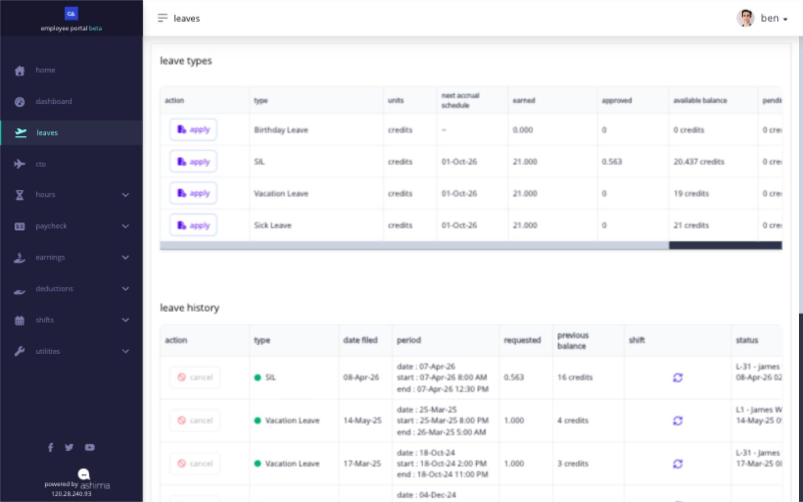
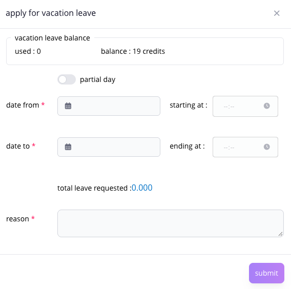
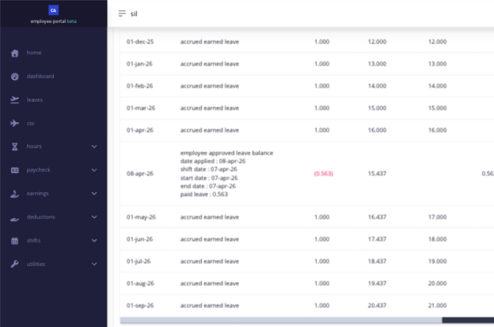

# apply for leave and track the request

use **Leaves** to review the leave types assigned to you, understand the available balance, submit a request, follow its approval, and open the transactions that produced the balance.

## what do the leave cards or rows mean?

your company creates leave types and assigns the applicable types to employees. this is why two employees can see different leave types or balances.

| field                     | what it tells you                                                                      |
| ------------------------- | -------------------------------------------------------------------------------------- |
| **Type**                  | the leave policy assigned to you, such as vacation leave or sick leave                 |
| **Units**                 | whether the type is measured in days, hours, or another configured unit                |
| **Next Accrual Schedule** | when the next configured earning event is expected, when shown                         |
| **Earned**                | credits already added under the leave rule                                             |
| **Approved**              | leave already approved for use                                                         |
| **Available Balance**     | credits currently available for a new request; some leave types do not require credits |
| **Pending Approval**      | credits reserved by requests waiting for a decision                                    |
| **View Transaction**      | the ledger showing how the balance changed over time                                   |

<figure><figcaption>
Review the assigned type and available balance before applying. Leave history below the balance table shows prior requests and their status.
</figcaption></figure>


seeing a leave type does not always mean you can apply for it today. the assignment makes the type visible; its effective date, entitlement, balance, application rule, and payroll state determine whether **Apply** is available.


## why can i see a leave type but not use Apply?

Ashima can show **Apply** as unavailable when:

* the leave type has a future effective date;
* you do not have the required leave entitlement;
* the type requires credits, your available balance is zero or below, and the policy does not allow an application beyond the balance;
* another application or record prevents a new request for the same period;
* leave applications are temporarily suspended while payroll is locked; or
* the requested date belongs to a closed payroll and is not eligible for the available post-payroll process.

if the row shows **No Entitlement**, ask HR to review your employment and leave assignment. if the leave type is assigned but **Apply** is disabled, send HR the leave type, intended dates, available balance, and any message shown. do not choose a different leave type simply to bypass the disabled control.

## how do i apply for leave?

before applying, check the leave type, intended dates, assigned shift, available balance, pending requests, and required documents.

1. open **Leaves**.
2. find the correct leave type and select **Apply**.
3. enter the requested date or date range and, when supported, the duration or partial-day details.
4. review the shift and the leave amount Ashima calculated for each covered date.
5. check the balance before and after the request.
6. attach the required supporting documents. the employee leave page accepts the file types and size displayed by the form.
7. enter a clear reason.
8. submit once.
9. return to leave history and confirm that the request appears with its current status.

<figure><figcaption>
The leave application shows your current balance and the amount requested before you submit. This example uses a fictitious test employee.
</figcaption></figure>

Ashima checks the assigned shift, holidays, rest days, leave effective dates, balance rules, overlapping records, and payroll state. correct the field named by a validation message before submitting again.

## how do i know whether my leave was approved?

open **Leaves** and review leave history. find the request by leave type, covered date, or filing date, then review:

* the request status;
* the requested and credited amount;
* the approver or approval levels shown;
* the action date and remarks, when available; and
* any attachment or application detail.

| status        | what it means                                                        | what to do                                                                             |
| ------------- | -------------------------------------------------------------------- | -------------------------------------------------------------------------------------- |
| **Pending**   | the request is waiting for an applicable approver                    | monitor the request and follow up with the approver when the leave date is approaching |
| **Approved**  | the required approval completed                                      | confirm the approved dates and credited amount in history and your timesheet           |
| **Rejected**  | the request did not pass approval                                    | read the available remark and submit a corrected request only when needed              |
| **Cancelled** | the request was withdrawn through the supported cancellation process | confirm the resulting balance in **View Transaction**                                  |

an approved request can change the balance and the interpretation of your timesheet. it does not rewrite a payroll that has already closed.

for help reading the approver name and approval level in a request's status, see [who is approving your request](../approvals-and-help/see-who-is-approving-your-request.md).

## how do i understand my leave balance?

select **View Transaction** for the leave type. the transaction ledger is the detailed history behind the summary balance. use it to trace:

* credits earned or assigned;
* credits reserved by an application;
* approved or used leave;
* rejected or cancelled requests that returned credits;
* manual adjustments or transfers;
* expired credits; and
* the balance after each movement.

start with the newest transaction, then trace backward to the application, earning event, adjustment, or expiry that changed the balance. a summary balance tells you the current amount; the ledger explains how Ashima reached it.

<figure><figcaption>
The 0.563-credit approved leave reduced this example balance; later accruals increased it again. Use the ledger for the sequence behind a summary figure.
</figcaption></figure>

## when can i cancel a leave request?

open leave history and find the request. when **Cancel** is available, open it, enter the cancellation reason, confirm once, and return to history.

Ashima can hide or disable **Cancel** when:

* the leave type or approver marked the request as non-cancellable;
* the request was already cancelled or rejected;
* the approved leave date has already passed;
* the request is part of a closed payroll;
* payroll is locked and leave applications are suspended; or
* the current record no longer has an eligible balance to receive returned credits.

a pending request can remain cancellable after its date has passed, but an approved past request is normally no longer cancellable through the employee action. follow the control shown for the record.

after cancellation, check both leave history and **View Transaction**. eligible reserved or approved credits return according to the leave rule. credits that have already expired do not become reusable merely because the request was cancelled.

## what if the leave belongs to a closed payroll?

ordinary leave correction is no longer available after the related payroll closes. when your company has enabled employee-initiated **Post Payroll Adjustment (PPA)** and the date is within the allowed payroll limit, Ashima can present the supported PPA path. otherwise, ask HR or payroll to review the record.

PPA does not reopen the old payroll. an approved eligible correction is carried into the applicable open payroll. see [correct an eligible record through PPA](../timesheets-attendance-and-overtime/correct-open-shift-hours-and-request-a-ppa.md) for the shared PPA rules.

## related articles

* [understand and apply for CTO](apply-for-cto-when-it-is-available.md)
* [check your shift before every workday](../clock-in-and-shifts/check-your-shift-before-every-workday.md)
* [review your timesheet every day](../timesheets-attendance-and-overtime/review-your-timesheet-every-day.md)
* [when to ask HR or your administrator for help](../approvals-and-help/when-to-ask-hr-or-your-administrator-for-help.md)
