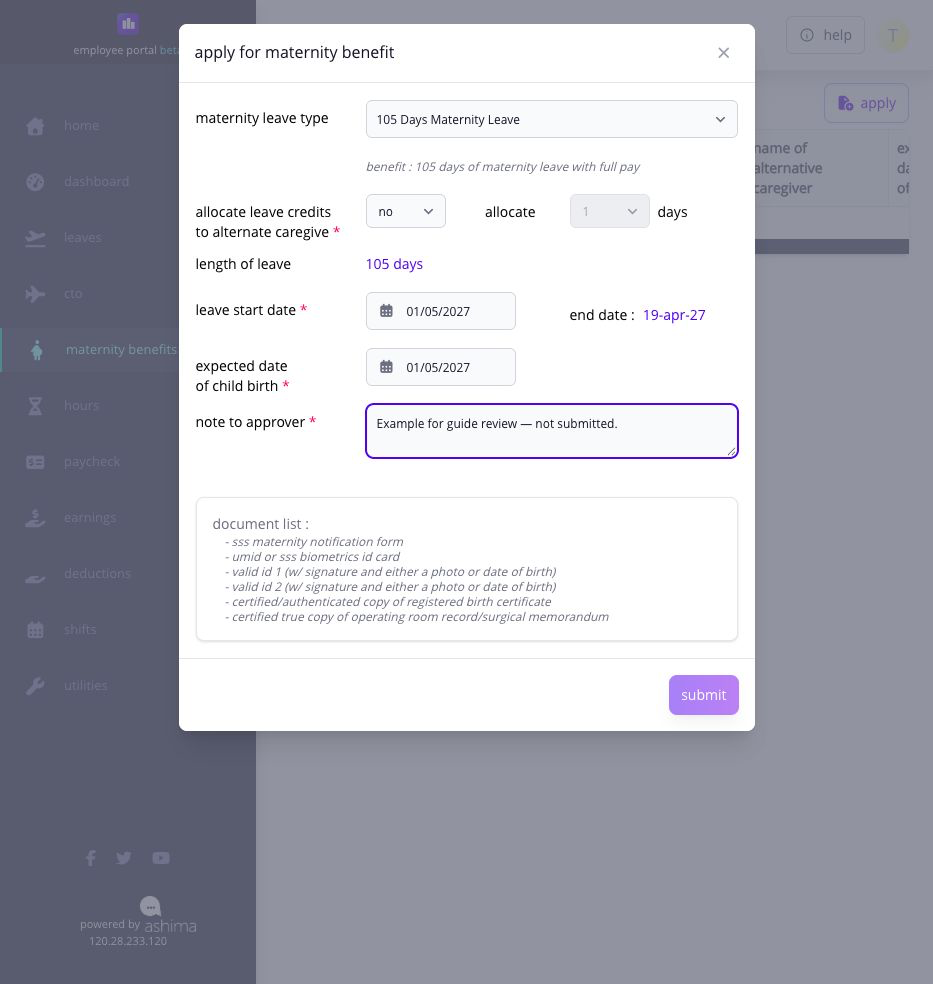

# file and track maternity benefits

go to **Leaves → Maternity Benefits** to prepare an application, review the source records used by Ashima, follow approval, and open the resulting benefit details. maternity benefits is a separate process from ordinary leave and CTO.

## before you apply

confirm:

* the maternity type and relevant dates;
* the expected date of delivery or applicable contingency date;
* the credits allocated to an alternate caregiver when applicable;
* the required supporting information;
* whether Ashima already has the relevant SSS contribution and payroll records; and
* that another maternity or leave record does not overlap the period.

Ashima normally uses the contribution and payroll history already recorded in the system. if you joined the company recently, earlier contribution or pay records may be missing. ask HR to maintain **Previous SSS Contribution** before the calculation is treated as complete.

## how do i file the application?

1. open **Leaves → Maternity Benefits**.
2. select **Apply** when the action is enabled.
3. choose the maternity type.
4. enter the required maternity, delivery, and leave dates.
5. complete the allocation fields, including alternate-caregiver information when applicable.
6. review the calculated duration.
7. select **Submit** when the required fields are complete. the Employee form reviewed here does not offer **Save draft**; leave it without submitting if you are not ready to apply.
8. return to maternity history and confirm its current status.

<figure><figcaption>
Review the type, dates, calculated leave length, caregiver choice, and note before submitting. This fictitious test example was not submitted.
</figcaption></figure>

## how is the displayed SSS maternity benefit calculated?

Ashima identifies the contingency quarter and semester, reviews the applicable twelve-month contribution period, selects the six highest applicable monthly salary credits, and displays the calculation stages.

`average daily salary credit = total of the six highest applicable monthly salary credits ÷ 180`

`SSS maternity benefit = average daily salary credit × compensable days`

review the months and values displayed for your own record. your result also depends on the maternity type, approved days, recorded contributions, company settings, allocated credits, and any approved early return to work.


the reimbursement fields document the SSS notification, transaction, approved days, and reimbursed amount. they do not replace the contribution-based benefit calculation.


## how do i track approval and the result?

open maternity history and review the record status, application status, approver levels, action dates, and available detail. a submitted application can remain pending through more than one approval level.

once approved, review the maternity dates, contribution table, daily allowance, SSS maternity benefit, salary differential or full-pay components shown, and total disbursement. contact HR when a contribution month, compensation value, or maternity date is missing or incorrect.

## why is Apply unavailable?

**Apply** can be disabled because of eligibility, an existing or overlapping application, payroll lock, an active recalculation, missing required setup, or the current record state. read the tooltip or message shown by Ashima and send HR the page, intended maternity type, dates, current application status, and exact message.

## what if i return to work early?

an approved early return or work-during-leave record can change the affected maternity period and payroll result. notify HR promptly. the maternity record and any affected open payroll must be reviewed and recalculated; do not assume the original calculation remains final.

## related articles

* [apply for leave and track the request](apply-for-leave.md)
* [understand your payslip](../pay/understand-your-payslip.md)
* [when to ask HR or your administrator for help](../approvals-and-help/when-to-ask-hr-or-your-administrator-for-help.md)
