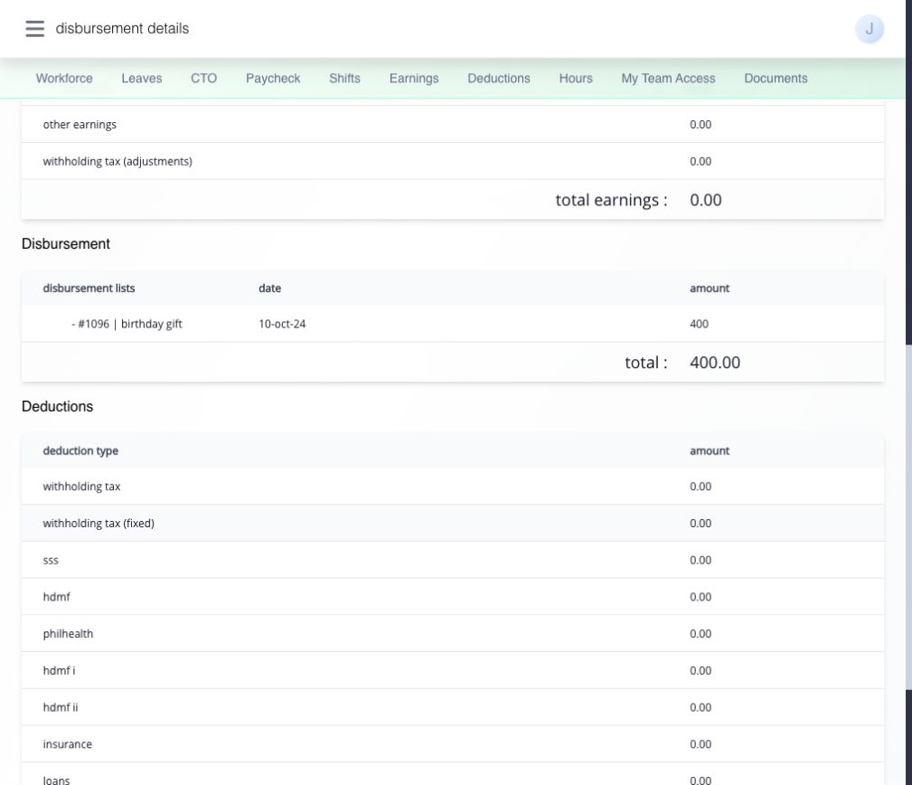

# understand your payroll disbursement payslip

**Paycheck → Disbursement (P)** shows disbursement records connected to payroll items. this is a separate record from the regular salary payslip. **Disbursement (NP)** is a different area for non-payroll items; this article covers **Disbursement (P)** only.

## find and read the right record

1. open **Paycheck → Disbursement (P)**.
2. find the row by payroll date, covered dates, and net amount, then open it.
3. check the item name, date, amount, total, and any deductions in the detail. compare the amount with the record or notice you expected.

select an expandable earnings or deduction line to inspect its breakdown. only lines with available details expand; select the expanded line again to hide it.

the detail uses a payslip-style view, but it represents the payroll-related disbursement, not another complete salary calculation.

## what does the disbursement slip show?

the slip or detail tells you which approved payroll-related amount was prepared or recorded for release. for example, a fictional record may list a birthday gift of ₱400 and a total of ₱400. check the item name, date, amount, total, and available status on your own record. use the [regular payroll payslip](understand-your-payslip.md) to understand an ordinary payroll earning or deduction.

<figure><figcaption>
In this test disbursement, the birthday-gift item, date, and ₱400 total appear under Disbursement. Ordinary earnings are listed separately above it; the disbursement is not a second regular salary payslip.
</figcaption></figure>

## how do i print or download it?

open the disbursement detail and select **print payslip**. the single-statement output opens in a new tab. check your name, pay period, item and amount, then choose **PDF** to download it or **Print** to open the browser print dialog. for printing, use **LETTER** paper, **Portrait**, **Shrink to Fit**, and turn off browser headers and footers.

if no print action is available for your record, ask HR or payroll for the release document.

## does a visible record mean the money reached my bank?

no. the record shows the amount and release state recorded in Ashima. it does not by itself confirm that an external bank transfer arrived. if the amount or status is unclear, give HR or payroll the item, date, displayed status, and amount so they can check the release and payment method.
