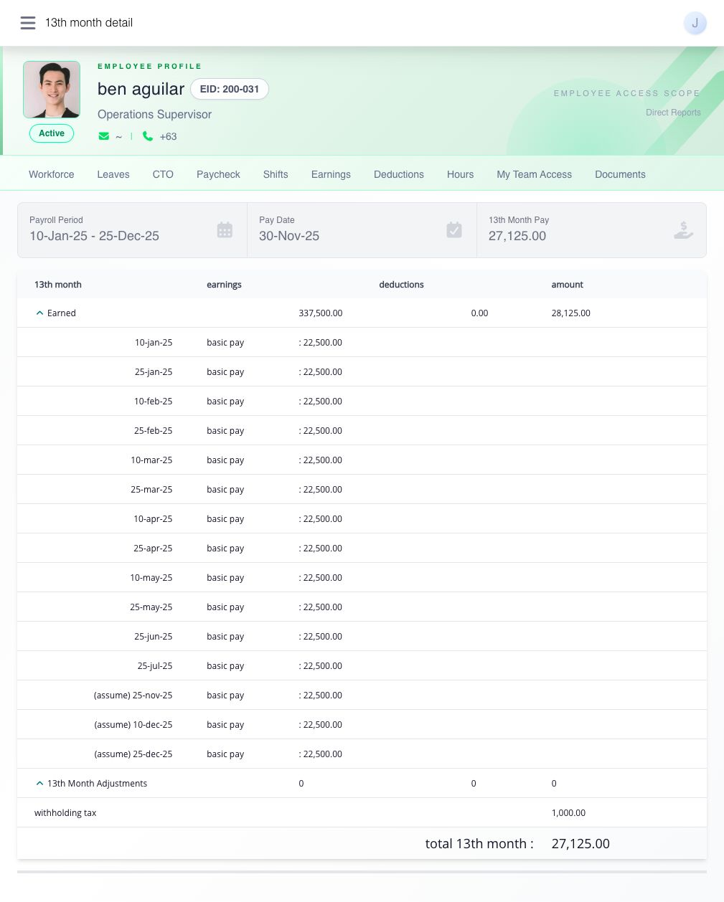

# understand your 13th Month payslip

**Paycheck → 13 Month** shows an available result from your employer's separate 13th Month payroll process. it is not an allowance added to every regular payslip. choose the row for the intended payout, then check its redeemable date, covered dates, amount, and detail before comparing figures.

## how do i keep a copy?

1. open the 13th Month record and select **print preview**. its output opens in a new tab.
2. check your name, covered dates, pay date and amount.
3. choose **PDF** to download the statement or **Print** to open the browser print dialog.
4. for printing, use **LETTER** paper, **Portrait**, **Shrink to Fit**, and turn off browser headers and footers.

## how is the amount calculated?

the useful starting formula is:

```
base 13th Month = (qualifying earnings - qualifying deductions) ÷ 12
```

for example, if your qualifying pay for the covered year is ₱240,000 after qualifying deductions, the base amount is `₱240,000 ÷ 12 = ₱20,000`. this is **before** supported direct 13th Month adjustments and tax treatment. qualifying pay can begin with basic pay and any other earnings your employer's rule includes, less any included absence, tardiness, undertime, or other qualifying deductions. your employer's 13th Month settings decide which items qualify, whether a prorated method applies, and which dates are covered. it is therefore possible for the figure to differ from one month's salary.

## where can I check the amount behind the formula?

open your 13th Month detail and expand **earned**. review the dated pay entries, earnings, deductions, and resulting amount. check **13th Month Adjustments** and **Withholding Tax** if they appear. the detail can include a future pay entry marked **(assume)** when the run used a projection for a date without completed payroll. that entry is an assumption, not a payslip for work already completed.

<figure><figcaption><p>This test example shows how the dated earned entries, assumed entries, withholding tax, and final 13th Month amount fit together. Check your own covered period and amounts.</p></figcaption></figure>

an adjustment to qualifying earnings or deductions changes the basis **before** division by twelve. a direct **13th Month Adjustment** changes the result **after** that division. for example, an approved ₱12,000 qualifying-earnings adjustment would add ₱1,000 to the base calculation, while a direct ₱1,000 13th Month adjustment adds ₱1,000 to the result. ask payroll which kind was used if you see an adjustment you do not recognize.

## why might part of it be taxable?

13th Month and qualifying other benefits share the annual ₱90,000 non-taxable ceiling. if other benefits have used some of that space, part of your 13th Month may be taxable even when the 13th Month amount alone is below ₱90,000. review the taxable and non-taxable split and withholding tax shown in your record; HR or payroll can explain the year-to-date basis.

## the amount or year looks wrong

check the year and covered pay dates first. if you joined during the year, had unpaid time, received a partial release, or see **(assume)** entries, those details can affect the comparison. send HR or payroll the year, displayed amount, and specific dated entry or adjustment you question. your regular payslips help explain the qualifying pay used; they are not a replacement for the dedicated 13th Month detail.
