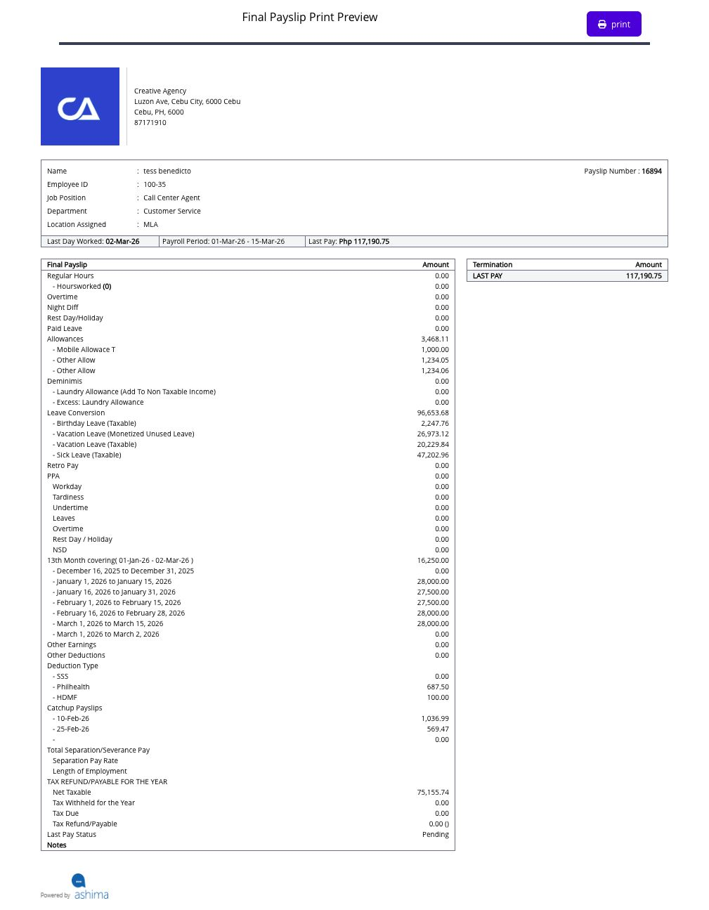

# understand a final payslip

a final payslip shows the employer's final-pay result when employment ends. it is separate from a regular payroll payslip. ask HR or payroll how your approved final payslip will be given to you. if you cannot find it among your available pay records, ask where to obtain it; do not assume it will appear under the regular **Paycheck → Payslip** list.

## what should i check first?

on the final payslip you receive, confirm your name or employee ID, **Last Day Worked**, **Payroll Period**, and **Last Pay**. this makes sure you are reading the result for the correct employee and separation period.

## how do i understand the amount?

read the itemized result, not only the final total. depending on your record, the final payslip can include the following:

<figure><figcaption>
This test print preview shows where the employee, period, pay components, and Last Pay appear. Its status is Pending, so it is an example of the layout, not an approved or released final payslip.
</figcaption></figure>

| part of the final payslip                       | what it helps you check                                                                           |
| ----------------------------------------------- | ------------------------------------------------------------------------------------------------- |
| **Regular Hours** and paid leave                | pay for eligible work and leave through the covered last period                                   |
| allowances and other earnings                   | approved items included in this final calculation                                                 |
| unused-leave conversion and 13th Month          | eligible balances or amounts included in final pay, if applicable                                 |
| **Other Deductions**, SSS, PhilHealth, and HDMF | amounts taken from this final result, when applicable                                             |
| **Catchup Payslips**                            | eligible payroll periods calculated as part of the termination process                            |
| **TAX REFUND/PAYABLE FOR THE YEAR**             | the annual tax result when that section is shown                                                  |
| **Last Pay Status**                             | the recorded approval state, which is different from confirmation that money reached your account |

an item that does not apply to you may be absent or zero. if the result includes separation or severance pay, review that line separately from regular hours and leave conversion.

compare any catch-up payslip with your earlier regular payslips so you do not treat a previously paid period as a new full payment. check whether a 13th Month amount or leave conversion was included in final pay before expecting it as a separate release. the total depends on the approved components and the final calculation, not on adding every possible item listed here.

## how do i get a copy or question an amount?

ask HR or payroll for the approved final payslip or its PDF and the release method. the employer's termination workflow can generate a final-payslip PDF. keep the copy provided to you and check its employee, period, and amount.

if a line is unclear, send HR or payroll the exact line name and amount, your last day worked, and the related timesheet, leave, or prior payslip. ask which period and approved calculation produced it. an earlier regular payslip remains the record of its original pay run; final pay does not silently rewrite that historical slip.
