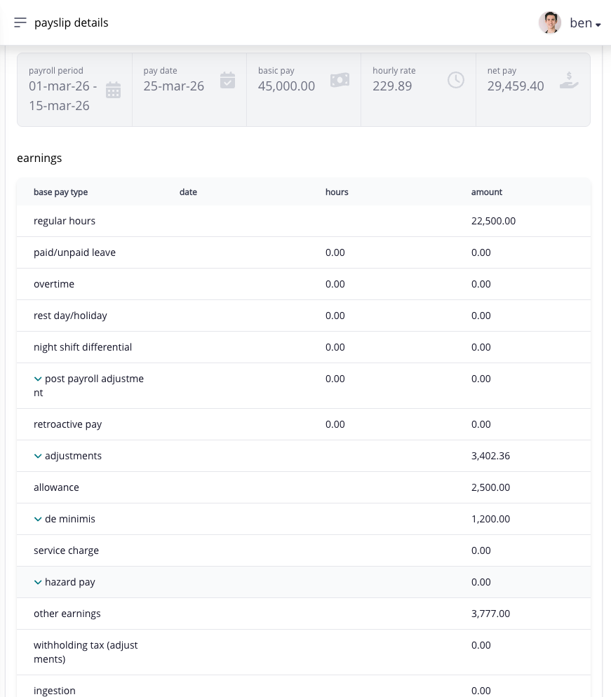
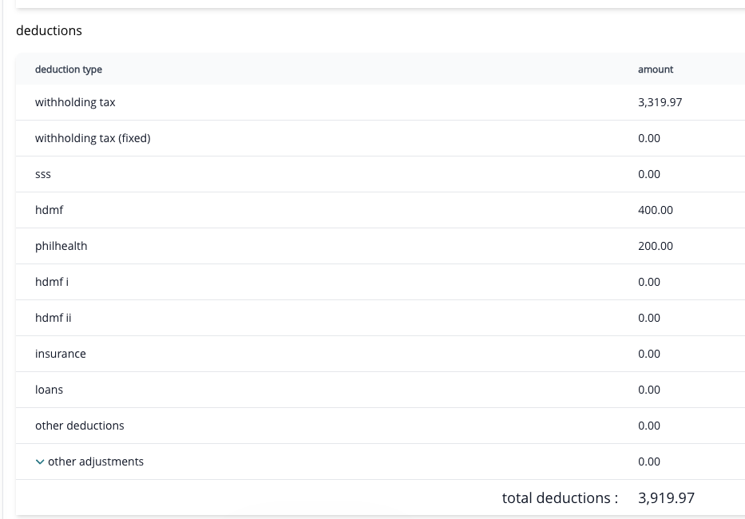

# understand your regular payroll payslip

your regular payroll payslip shows what Ashima included in one completed pay run. go to **Paycheck → Payslip**, find the pay period, and open the detail. a regular payslip becomes available after payroll is closed **and** its payslips are generated for employees. those are separate steps, so a closed payroll may not yet appear here.

for the other kinds of pay record, start with [understand your pay](./).

## find the right pay period

1. open **Paycheck → Payslip** and set the date range that includes the pay date you need.
2. select **Search**, then open the matching payslip row.
3. check your name, payroll period, and pay date before reading the amounts. if you have more than one payslip near the same date, use the period and pay date to identify the right one.

a retroactive-pay difference may appear as a line in a later regular payslip; it is not necessarily a new payslip for the earlier period.

<figure><figcaption>
Start with the period and pay date, then compare the pay summary with the itemized earnings and deductions below. this example uses a fictitious test employee.
</figcaption></figure>

## read the payroll result

| payslip area                | what to verify                                                                                                                |
| --------------------------- | ----------------------------------------------------------------------------------------------------------------------------- |
| period and pay date         | you opened the intended payroll                                                                                               |
| taxable and non-taxable pay | the applicable earning totals shown for the period                                                                            |
| gross pay                   | taxable pay plus non-taxable pay before total deductions                                                                      |
| earnings detail             | salary, paid hours, premiums, allowances, De Minimis, other earnings, retroactive pay, or adjustments included for the period |
| deductions detail           | attendance deductions, contributions, tax, loans, other deductions, adjustments, or ingestion lines included for the period   |
| contributions               | employee and employer contribution lines displayed by the payslip                                                             |
| tax                         | the withholding-tax amount shown for the period                                                                               |
| total deductions            | the combined deduction total used by the payslip                                                                              |
| net pay                     | gross pay less total deductions                                                                                               |

select an expandable earnings or deduction line to see its breakdown, then select it again to hide the details. only lines with available details expand.

Ashima groups payroll items by category. the payslip may show a parent total and its detailed items instead of listing entries in the order they were added. do not subtract a separately displayed contribution or tax line again when it is already included in **Total Deductions**.


an assignment under **Earnings** or **Deductions** tells you what is set up for you. this payslip tells you what the completed payroll actually included. [Earnings](understand-your-earnings.md), [deductions](understand-your-deductions.md), [contributions and tax](understand-your-contributions-and-tax.md), and [loans](understand-your-loans.md) explain the common reasons their lines change.


<figure><figcaption>
Review each deduction line and the total deductions for the selected period. this example uses a fictitious test employee.
</figcaption></figure>

## how is my first or changed salary calculated?

your pay-rate type and pay schedule matter. for a full semi-monthly period, a monthly salary of ₱30,000 starts at ₱15,000 basic pay before other earnings and deductions. if you joined during the cutoff, Ashima may prorate the amount from your hire date. for one supported actual-method example, six employed workdays out of twelve cutoff workdays give `(₱30,000 ÷ 2) × 6 ÷ 12 = ₱7,500`. another company proration setting or a daily/hourly pay rate can use a different method.

if your basic salary increased during a period, Ashima uses the effective date to divide the covered pay between the old and new rates. for one supported semi-monthly monthly-paid method, it starts with the old half-month salary, then adds the prorated increase for eligible workdays from the effective date. absence, tardiness, and undertime can reduce the final regular pay. the new salary is **not** added as a second full earning on top of the old salary.

open the detailed **Basic Pay** or **Regular Hours** section on your payslip and any information control shown beside it. if the breakdown or tooltip is not available in Employee portal, ask HR or payroll for the **Employee Pay Details → Basic Pay** calculation and the effective date used. that is the administrator's detailed calculation view; do not guess from the headline salary alone.

## what if I received retroactive pay?

retroactive pay is a correction for an earlier effective date or covered period. look for **Retroactive Pay** in the earnings breakdown of the later pay run that includes it. the earlier payslip is still the historical result for its original run. ask payroll which earlier periods, rates, and adjustments produced the difference if the retroactive line is unclear.

## print or download a copy

1. select **print payslip** from the detail. the output opens in a new tab, leaving your detail available.
2. confirm your name, payroll period, pay date and amounts.
3. use **PDF** to download the statement or **Print** to open the browser print dialog.
4. for printing, use **LETTER** paper, **Portrait**, **Shrink to Fit**, and turn off browser headers and footers.
5. close the output tab to return to your payslip detail.

## the payslip is missing or an amount is unexpected

if the period is missing or your search has no results, first confirm the company and date range. HR or payroll can then check whether payroll is closed, its payslips were generated, and you were eligible for the payroll. a successful payroll approval alone does not make the payslip visible.

if an amount is unexpected, compare the affected line with your assigned shift, timesheet, approved requests, and applicable pay-item record for that same period. send HR or payroll the pay period, exact line name, displayed amount, and the supporting record you expected it to use. an assignment page shows the current or effective-dated setup; the payslip shows what the completed payroll processed for that period.

## how do holiday adjustments affect the total?

A **Holiday Adjustment** can be positive or negative. Include its sign when checking the subtotal: a positive adjustment adds to it, while a negative adjustment reduces it. For example, ₱500 of holiday pay and a −₱100 adjustment give a ₱400 subtotal. A negative adjustment is not a zero amount.
