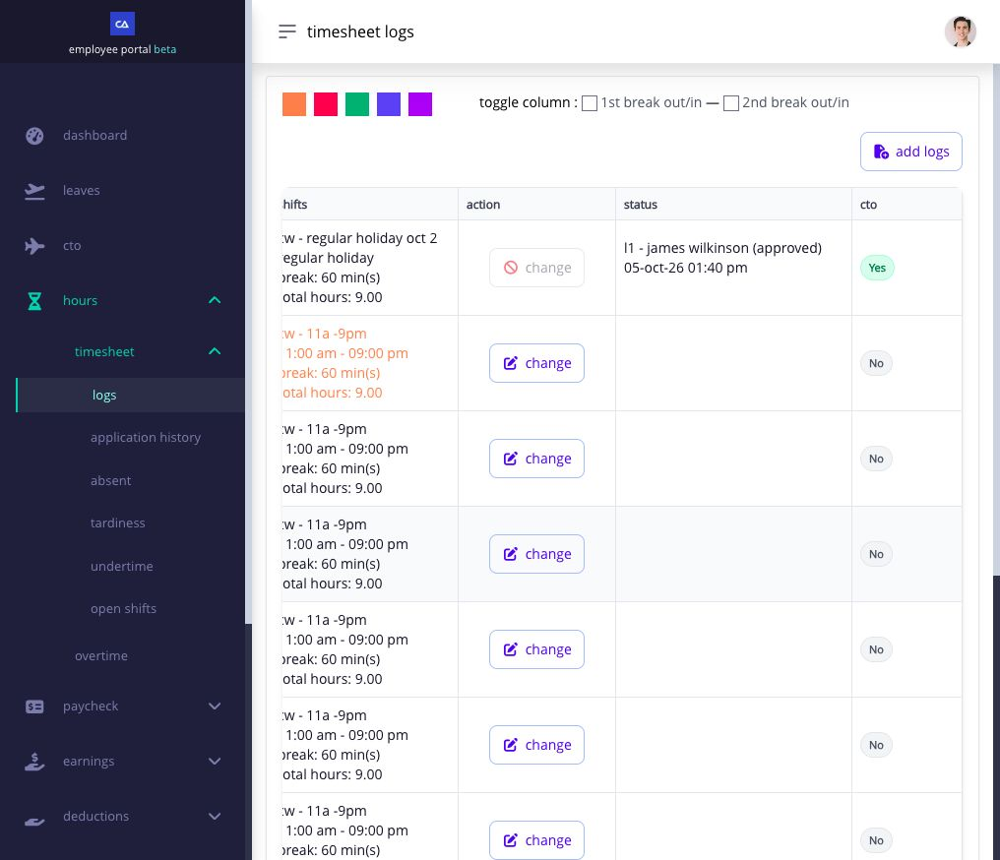

# apply for work on a holiday


**Holiday work may need approval for premium pay.** Your timesheet records the hours you worked. Depending on your company's settings, an application and approval after the work may also be required before holiday premium pay can be included. After your shift, check the timesheet row and the status of any holiday request. A captured punch or submitted request alone does not confirm that the premium is approved.


if you work on a holiday, check your shift, capture your punches, and look for **Apply Hol.** in your timesheet. a holiday does not automatically mean you can work at any time: your shift can still set the hours and breaks.

## how do i apply?

1. check **Shifts** for the work date and make the punches required by that schedule.
2. after working, open **Hours → Timesheet Logs** and check the punches for the date.
3. if the row shows **Apply Hol.**, select it. the form may be headed **Apply Holiday**.
4. check the date, shift, and punches. enter a missing punch or correct a wrong time in this form, then give the reason for the holiday work.
5. select **Submit** once. check the request status in your timesheet or **Timesheet Application**.

if the holiday does not apply to your work location, you may see a different action. ask HR to check the holiday and location; do not change your punches to make the date appear eligible.

## what if a punch or Apply Hol. is missing?

open **Hours → Timesheet Logs** and find the holiday date:

* **a row is there and it shows Apply Hol.:** open that form. enter a missing punch or correct a wrong time, explain the holiday work, and submit one request. the form requires a valid time in and time out.
* **there is no row for that date:** select **Add Logs** to request the missing time entry. check **Timesheet Application** for its status before looking for another action on that date.
* **the row shows Change:** use it if a punch needs correcting. the holiday work may already be included or an earlier request may have been approved. check the earlier request's status before filing again.
* **the action is visible but disabled:** read the message beside it. the shift may not have ended, another request may be pending, or the payroll period may prevent an application.

<figure><figcaption>
This holiday row is already approved, so it shows a disabled Change action rather than Apply Hol. The other rows show available Change actions. Check each row's status before expecting a new holiday application.
</figcaption></figure>

your company may not require a separate holiday request. if you still expect **Apply Hol.**, send HR the date, location, shift, punches, application status, and message shown.

if payroll has closed, Ashima may block a holiday correction. ask HR or payroll how to correct it; submitting the same request again will not change a completed payslip.

## does approval mean it will appear on my payslip?

approval confirms the request, but the payable amount still depends on your holiday rules, shift, accepted timesheet, and payroll calculation. check both the request status and the payslip for that period. if approved work is missing from pay, send HR the date, request status, and payslip period.

if the date is also your rest day, use the action Ashima shows for that row. do not file two requests for the same work. see [apply for rest-day work](apply-for-rest-day-work.md).

## related help

* [review your timesheet every day](review-your-timesheet-every-day.md)
* [correct a missing or incorrect punch](correct-a-missing-or-incorrect-timesheet-punch.md)
* [file and track overtime](file-and-review-overtime.md)
